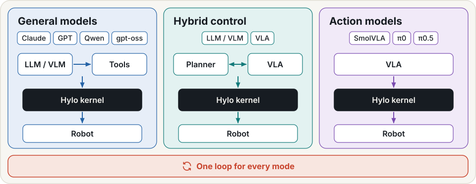
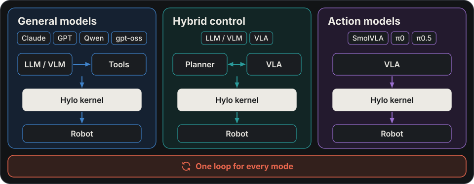

# Agents

An agent decides what a robot does from its observations and task instruction. Hylo supports agents that run
policies, execute programs or ask a language model to call robot tools. They share execution, safety checks and
recorded traces, so each approach can be evaluated under explicit task and observation conditions.

## Choose an agent

| You want to | Start with | Guide |
|---|---|---|
| Run an existing model or controller | a policy agent | [Policies](policies.md) |
| Give a policy subgoals, memory or steering | a composed or steered agent | [Policy agents](policies.md#agents-that-run-a-policy) |
| Run a compatible frozen VLA with episode video history | `simplememvla` | [Video memory](memory/video.md) |
| Execute a hand-written or frozen task program | `code.program` | [Developing programs](developing-strategies.md) |
| Let a model write task code during an episode | `code.llm` | [Developing programs](developing-strategies.md) |
| Let a model call typed robot tools one step at a time | `tools.llm` | [Tool-calling agents](tool-agents.md) |

{ .hylo-diagram .only-light }
{ .hylo-diagram .only-dark }

A policy is a model or controller used by an agent. The agent decides how to use its output, including chunk
execution, steering and planning. A research session is a development process that produces a program; the
resulting program can then run through `code.program` without model calls.

## Worlds, memory and skills

Agents act in an environment: a benchmark, a [world](worlds.md) or a robot adapter. The environment supplies
observations and actions; task checks and evaluation establish the outcome.

[Memory](memory/index.md) supplies observations and experience to the components that can use them.
[Skills](skills.md) provide reusable procedures or changes with stated applicability. Support depends on the
agent and skill kind: a code agent can call program skills, while role campaigns offer recipes after matching
goal failures. The [skill library](memory/skills.md) documents each consuming path.

## Evaluate and improve

Record an [experiment](experiments.md), inspect its traces and compare agents under a fixed
[evaluation protocol](../benchmarking/protocols.md). Declare observation privileges and task conditions in the
comparison. A [campaign](campaigns.md) can propose and test changes to an existing agent as part of Physical RSI.

Program agents execute generated code with in-process restrictions; read the
[execution boundaries](security.md#model-written-programs). Measured successes and current failures are recorded
in the [Showcase](../showcase/tool-agents.md).

## Next

- [Policies](policies.md): configure a policy and its agent.
- [Developing programs](developing-strategies.md): run and edit a task program.
- [Tool-calling agents](tool-agents.md): run, watch and steer a model through typed tools.
