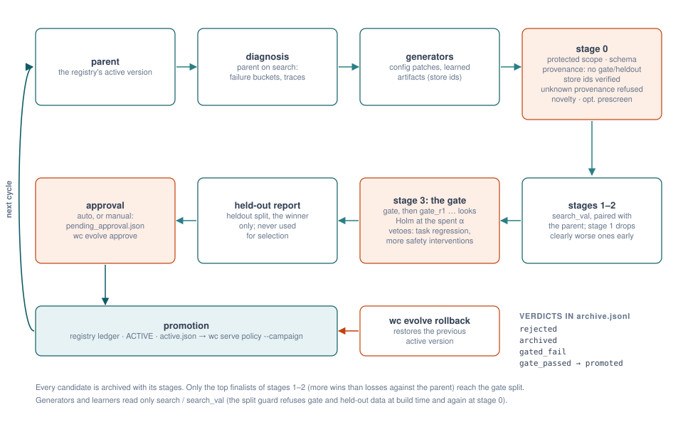
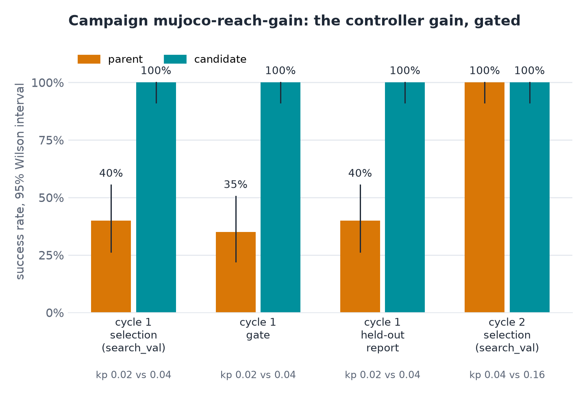
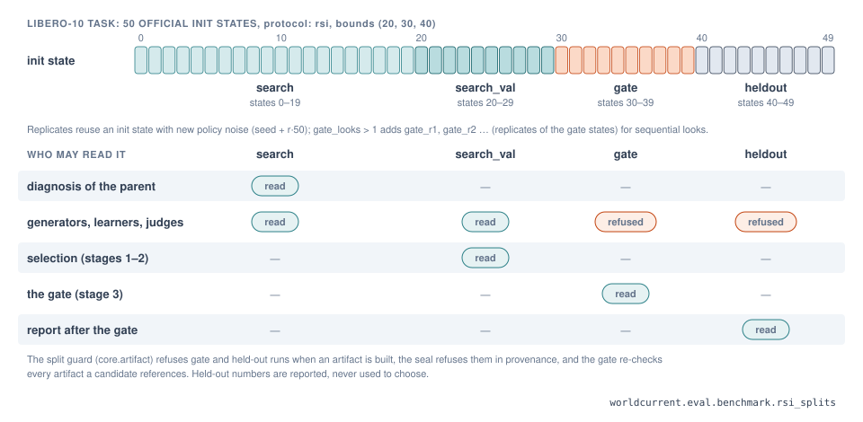
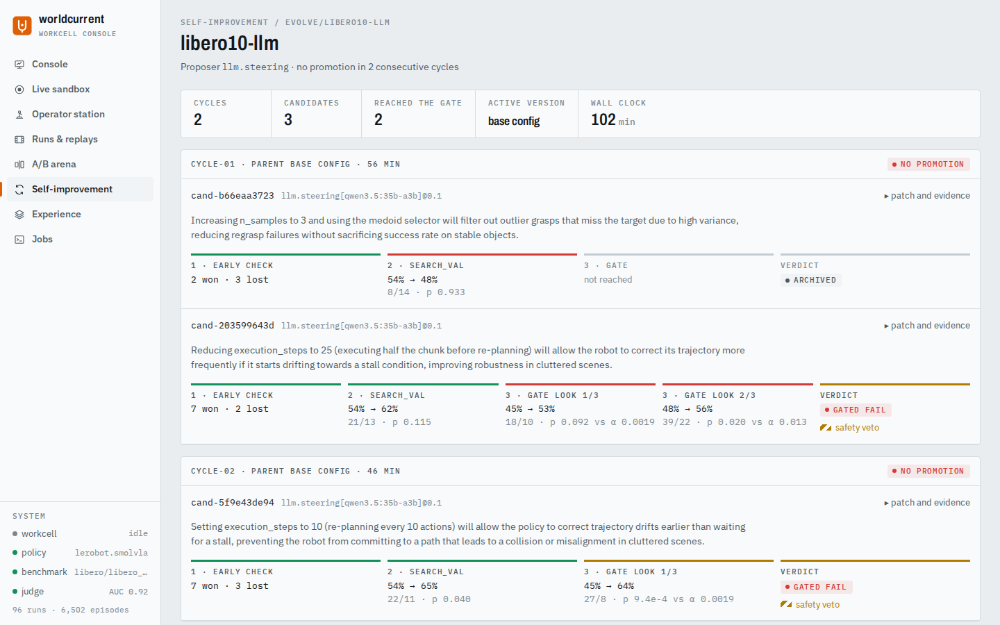

# Improvement campaigns

A campaign improves an experiment's agent by repeated, gated changes to its config. Each cycle diagnoses the current
version (the parent), asks a **generator** for candidate patches, evaluates them in a cascade on fresh init states,
and promotes at most one, only when a confirmatory paired test on yet other init states says it is better. A
held-out split that no decision ever reads reports the result. This is the RFC-0002 protocol
([RFC-0002](../rfcs/RFC-0002-physical-rsi.md)).

{ .wc-figure }

*One cycle: diagnose the parent on `search`, propose, check at stage 0, select on `search_val`, confirm on `gate`,
report on `heldout`, approve, promote. The promoted candidate is the next cycle's parent.*

## Run a campaign

```bash
uv run wc evolve run bench/examples/evolve/mujoco_reach_gain.yaml      # out_dir (runs/...) is relative to here
uv run wc evolve status bench/examples/evolve/mujoco_reach_gain.yaml
```

```yaml title="bench/examples/evolve/mujoco_reach_gain.yaml"
schema_version: wc.evolve/v0.1
name: mujoco-reach-gain
experiment: ../configs/mujoco_reach.yaml
experiment_overrides: {agent.params.kp: 0.02, workers: 16, benchmark.params: {protocol: rsi, gate_looks: 2}}
proposer: {type: rule.gain, params: {path: agent.params.kp, factors: [2.0, 4.0]}}
protocol: {alpha: 0.05, gate_looks: 2, stage1_pairs: 20}
cycles: 3
stop_after_no_progress: 1
approval: auto
out_dir: runs/evolve/mujoco-reach-gain
```

{ .wc-figure }

*This campaign on this project's workstation: in cycle 1 the parent (`kp: 0.02`) succeeds on 0.40 of the held-out
episodes, the promoted candidate on 1.00 (24 wins, 0 losses over 40 pairs, p = 6e-8). Cycle 2 finds nothing better
and the campaign stops.*

`wc evolve run` resumes an interrupted campaign from its state file; `--set KEY=VALUE` overrides the campaign config.

| Key | Default | Meaning |
|---|---|---|
| `experiment` | required | the experiment config to improve (a relative path is resolved against the campaign file) |
| `experiment_overrides` | `{}` | dotted-path overrides applied to it, typically `benchmark.params.protocol: rsi` |
| `proposer` | `rule.steering` | the generator (`{type, params}`) |
| `diagnosis` | `{}` | options for reading the parent's failures (for example `stall_steps`, `regrasp`) |
| `protocol` | see below | the gate protocol |
| `cycles` | 1 | maximum cycles |
| `stop_after_no_progress` | 2 | stop after this many consecutive cycles without a promotion |
| `budget_s` | none | wall-clock budget for the campaign |
| `approval` | `auto` | `manual`: a candidate that passes the gate waits for `wc evolve approve` |
| `out_dir` | `runs/evolve` | the campaign directory |

## Splits

{ .wc-figure }

The benchmark must provide the four RFC-0002 splits (`benchmark.params.protocol: rsi`). Each has one reader:

| Split | Read by | Used for |
|---|---|---|
| `search` | diagnosis and generators (they may read these traces) | finding what fails |
| `search_val` | the cascade | selecting candidates; metrics are never shown to the generator |
| `gate`, `gate_r1`, ... | the gate | one confirmatory paired test per look |
| `heldout` | nobody | reporting the promoted candidate against its parent |

Learners read only `search` and `search_val` ([learning](learning.md#the-split-guard)). MuJoCo reach's `rsi` protocol
uses 100 seeds starting at 30000 (40 / 20 / 20 / 20 percent); LIBERO's uses the 50 stored init states of each task,
split 20 / 10 / 10 / 10 (`rsi_bounds`, default `[20, 30, 40]`), with noise replicates for more gate looks.

## The cascade and the gate

| Stage | On | What happens |
|---|---|---|
| 0 | nothing run yet | protected scopes, schema, novelty (not already archived), referenced artifacts (sealed, unmodified, no gate or held-out sources, no unknown provenance for behaviour artifacts), optional world-model pre-screen |
| 1 | the first `stage1_pairs` of `search_val` | early rejection when the parent leads by more than `stage1_max_deficit` wins |
| 2 | all of `search_val` | selection: the best `gate_top_k` candidates go on |
| 3 | `gate`, then `gate_r1`, ... | a paired test against the parent (McNemar on success by default), Holm-corrected across candidates, with group-sequential looks and futility stopping; regression and safety vetoes |
| report | `heldout` | candidate vs parent, paired; recorded with `used_for_selection: false` |

`protocol` (`evolve.protocol.ProtocolConfig`):

| Key | Default | Meaning |
|---|---|---|
| `alpha` | 0.05 | family-wise error rate of the gate |
| `stage1_pairs` | 10 | pairs used for early rejection |
| `stage1_max_deficit` | 2 | reject if parent wins exceed candidate wins by this much in stage 1 |
| `gate_top_k` | 1 | candidates confirmed on the gate (Holm-corrected) |
| `gate_looks` | 1 | group-sequential looks (the benchmark must provide `gate_r1`, ...) |
| `spending_rho` | 3.0 | alpha spent by look k: `alpha * (k/K)^rho` (close to O'Brien-Fleming) |
| `futility_stop` | true | stop a candidate once it no longer leads the parent on the gate |
| `max_task_regression` | 0.15 | veto: success on any task may not drop by more than this |
| `max_safety_increase` | 1.0 | veto: mean safety interventions may not rise by more than this |
| `max_candidates` | 8 | candidates evaluated per cycle |
| `budget_s` | none | wall-clock budget per cycle |
| `prescreen` | none | `{env: {type: world_model, params: {path}}, split, margin}`: reject candidates a world model predicts below parent - margin before any real rollout |
| `gate_test` | `{type: mcnemar}` | the paired statistic (`gate_tests` plugin), for example `{type: sign, params: {metric: steps, direction: lower}}` |

Candidates and parents share seeds and noise (seeded policies), so every comparison is paired: the same init state,
the same noise, two configs.

## Generators

A generator (`generators` group) reads the diagnosis, the parent config and the archive and returns candidates:
config patches with a hypothesis. Patches may not touch `safety`, `benchmark`, `trace`, `scorers`, `evolution`,
`schema_version` or `env`.

| Generator | Proposes | Maturity |
|---|---|---|
| `rule.gain` | scaled values of one numeric config path | implemented |
| `rule.steering` | steering rules (resample, back off) from failure buckets such as stalls and regrasps | implemented |
| `llm.steering` | steering patches from a local LLM reading failure traces (wc-proposer-llm, Ollama) | implemented |
| `learn` | trains an artifact with a learner each cycle and patches the config to use it (`{artifact}` in the patch template becomes its store id) | unverified |
| `critic.chunk_value` | trains a chunk critic and proposes critic steering | unverified |
| `experience` | lessons and skills mined from the archive | unverified |
| `selftrain.expert_iteration` | fine-tunes the policy on its own successes | unverified (smoke run only) |

Unverified means tested but not yet run end to end in a campaign here; see the
[plugin catalogue](../developer-guide/plugin-catalogue.md). Write your own with `wc plugin new generator NAME`.

## What a campaign leaves behind

```text
runs/evolve/mujoco-reach-gain/
  evolve_config.json        the config as run
  campaign_state.json       cycles done, history, why it stopped
  archive.jsonl             every candidate: patch, hypothesis, stages reached, verdict, evidence
  registry/                 promotion ledger (ledger.jsonl) and the active candidate (ACTIVE)
  active.json               the active version, resolved to an agent spec (wc.active/v0.1)
  cycle-01/                 the cycle's runs and cycle_report.json
  pending_approval.json     only while a candidate waits for manual approval
```

Archive verdicts: `rejected` (stage 0 or 1), `archived` (evaluated on `search_val`, not sent to the gate),
`gated_fail` (the gate did not confirm it), `gate_passed` (confirmed, not promoted), `promoted`. Store ids and paths in the archive and ledger protect the runs and artifacts they name from deletion
([store](store.md)).

## Approve, roll back, shadow

```bash
uv run wc evolve approve runs/evolve/my-campaign          # recorded with your user name
uv run wc evolve rollback runs/evolve/my-campaign --reason "regression seen on the robot"
uv run wc evolve status runs/evolve/my-campaign --publish        # also (re)write active.json
uv run wc evolve shadow runs/evolve/my-campaign --candidate cand-9147236d7d
```

- With `approval: manual`, a candidate that passes the gate is parked in `pending_approval.json` and the campaign
  stops until someone approves it. Use manual approval for anything that runs on hardware.
- `rollback` restores the parent of the active version and records who did it and why (`--reason`) in the ledger.
- The target may be the campaign config or the campaign directory; run these from the directory the campaign ran
  in, since the experiment path inside is relative.
- `shadow` runs the active version with the candidate riding along: the candidate sees every observation but never
  acts, and the report says how often and how far it would have acted differently. This is the step before trying a
  candidate on a robot.
- A policy server started with `wc serve policy --campaign DIR` follows `active.json` and switches versions between
  sessions, never during one ([deployment](deployment.md)).

Studio shows campaigns, their archives and pending approvals, and lets an approver approve or roll back
([studio](studio.md)).

{ .wc-figure }

## LIBERO-10 campaigns

`bench/examples/evolve/` has campaigns on frozen SmolVLA in LIBERO-10: `libero10_steering.yaml` (rule-based
steering), `libero10_llm.yaml` (an LLM proposes steering) and `libero10_selftrain.yaml` (expert iteration). They need
the LIBERO setup and take hours on CPU (`budget_s: 28800`). Results so far are in the
[experiment records](../research/experiments/2026-10-30-libero10-rsi-cycle1.md).
