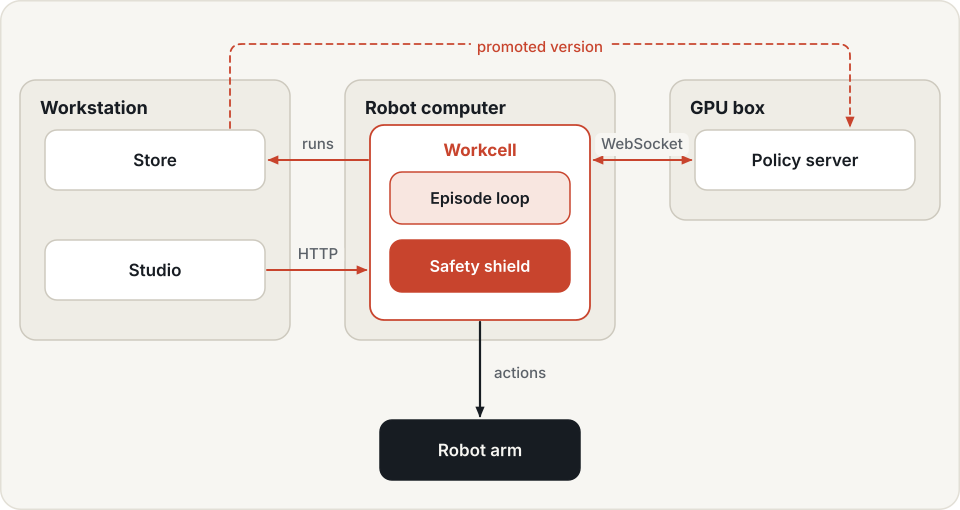
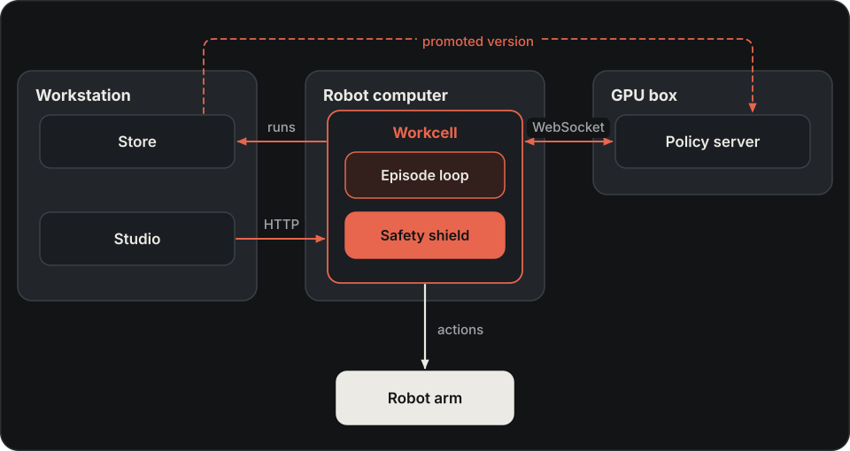

# Deployment

Deployment configures an agent or campaign version on a policy server and workcell. Validate the target robot,
assets and runtime dependencies separately from simulation results or skill-library verification.

This page takes you from a simulated arm to a real one, and back to the recorded episodes on your workstation. A
reference section follows the steps. Commands run from the workspace directory unless a step says otherwise.

Two services and a control plane split the work:

- A **policy server** (`hylo serve policy`) runs an agent, usually on a GPU machine, and answers observations with
  action chunks.
- A **workcell** (`hylo serve workcell`) runs next to the robot or simulator. It owns the environment, the episode
  loop with its safety shield, and the trace. It reaches the policy server over a WebSocket.
- **Studio** (`hylo playground`) is the control plane. It starts episodes and relays operator input over HTTP. It
  never sends actions.

{ .hylo-diagram .only-light }
{ .hylo-diagram .only-dark }

*The workcell's runs are copied to the store on the workstation.*

With `clock: wall` ([step 2](#2-the-robot-computer)), the workcell handles a slow network on its own: if
the policy server is slow, the arm holds its position, and if it stops answering, the watchdog ends the episode. An
e-stop stays latched in the workcell until an operator clears it. Where these layers stop is on the
[safety](safety.md#safety-on-robots) page.

## 1. Bring-up without hardware

Clone the deployments template next to the other repositories, once. Studio's web UI also needs a one-time build
([installation](../getting-started/installation.md)).

```bash
git clone https://github.com/HyloAI/hylo-deployments-template.git deployments-template
```

Then run three processes, each in its own terminal:

```bash
uv run hylo serve policy --agent '{"type": "bringup.wave", "params": {"amplitude": 8}}' --port 8002
uv run hylo serve workcell --config deployments-template/workcells/sim_arm.yaml --port 8102
uv run hylo playground --repo bench --workcell sim-arm=http://127.0.0.1:8102 --policy wave=ws://127.0.0.1:8002/hylo
```

- `bringup.wave` is not a task policy. It moves one joint in a small sine wave around the pose where the episode
  starts, `amplitude` degrees each way.
- `sim_arm` is a simulated arm with five joints and a gripper, in degrees. It goes through the same LeRobot robot
  adapter as a real arm, with `real_robot` safety.
- Studio opens at `http://127.0.0.1:8765`.

In Studio's **Operator station**, pick `sim-arm` and `wave`, and start an episode with the instruction `wave`. The
`sim_arm` config asks for reset confirmation and a verdict, so the episode goes through every operator step:

1. The workcell waits in `awaiting_reset`. Confirm the reset.
2. The arm moves to its home pose, then waves until `max_steps`.
3. The environment cannot judge success, so the workcell waits in `awaiting_verdict`. Give a verdict.

Without Studio, the same flow with `curl`:

```bash
curl -s -X POST localhost:8102/episodes -H 'content-type: application/json' -d '{"instruction": "wave", "max_steps": 120}'
curl -s -X POST localhost:8102/operator -H 'content-type: application/json' -d '{"type": "reset_done", "by": "me"}'
curl -s -X POST localhost:8102/operator -H 'content-type: application/json' -d '{"type": "verdict", "verdict": "success", "by": "me"}'
curl -s localhost:8102/status
```

After the verdict, `/status` is back to `idle` and reports the episode:

```text
"state": "idle", "last": {"status": "success", "steps": 120, "holds": 1, "chunks": 12, "safety_interventions": 0, ...}
```

The episode is in `runs/workcell/workcell-sim-arm/`.

## 2. The robot computer

The robot computer needs:

- **Hylo with the serve packages.** Install `hylo-core`, `hylo-serve` and `hylo-env-lerobot-robot` (plus
  `hylo-policy-openpi` to reach an openpi policy server), for example as a
  [subset of the repositories](../getting-started/installation.md).
- **A venv for the robot SDK.** It holds LeRobot with your robot's extras (`lerobot[feetech]` for SO-100/101),
  `hylo-core` and `hylo-env-lerobot-robot`. Register it as the `robot` runtime of this machine's
  [execution profile](../configuration/profiles.md):

    ```bash
    uv run hylo profile set-runtime robot --python ~/robot/.venv/bin/python
    ```

- **A calibrated arm.** Calibrate it with LeRobot's own tools. The calibration is keyed by the robot `id` in the
  workcell config.
- **Your lab's deployments repository**, created from `deployments-template`. Start from
  `workcells/so101.yaml` and set the serial port, the robot `id`, the cameras, the action limits and the home pose
  for your arm ([deployments repository](../configuration/deployments-repo.md)).

!!! danger "Set `clock: wall` on hardware"
    The default clock is `virtual`. With it, the episode loop does not pace itself to `control_hz`: it sends actions
    as fast as the robot's I/O returns. It blocks in each policy call and sends no commands while it waits, so the
    watchdog cannot fire. A stalled policy server ends the episode only when the call times out, after 600 s on the `hylo` protocol. On a
    real robot, always set `runtime: {clock: wall}` in the workcell config. The `so101` and `sim_arm` templates
    already do.

Keep the robot's own limits (LeRobot's `max_relative_target`, torque limits) and a hardware e-stop within reach. The
safety shield is not a certified safety function ([safety](safety.md)).

The LeRobot robot adapter has run only with the simulated arm ([plugin catalogue](../developer-guide/plugin-catalogue.md)).

## 3. Serving a policy

On the GPU machine, serve the agent of an experiment config, or the promoted version of a campaign:

```bash
uv run hylo serve policy --config bench/examples/configs/libero10_steered.yaml --host 0.0.0.0 --port 8000 --token $POLICY_TOKEN
uv run hylo serve policy --campaign bench/runs/evolve/libero10-steering --host 0.0.0.0 --port 8000 --token $POLICY_TOKEN
```

- `--config` serves only the config's agent. The workcell brings its own environment and safety settings.
- `--campaign` serves the campaign's active version and follows promotions and rollbacks. It rebuilds the agent
  between sessions, never during one ([campaigns](campaigns.md)).
- The server checks compatibility when the workcell resets the episode, before any motion. It refuses the session if
  the agent does not fit the environment's spec: action space, control mode, cameras, state keys.
- It serves one session at a time. A second client is refused.

The workcell config points at the server with `policy: {url: "ws://gpu-box:8000/hylo", protocol: hylo}`. Give the
token per episode rather than in that config ([security](security.md)).

## 4. Operating a workcell

Start the workcell on the robot computer, and point Studio at it and at the policy server:

```bash
uv run hylo serve workcell --config workcells/so101.yaml --host 0.0.0.0 --port 8100 --token $HYLO_TOKEN
uv run hylo playground --repo bench \
    --workcell so101=http://robot-host:8100#$HYLO_TOKEN --policy smolvla=ws://gpu-box:8000/hylo#$POLICY_TOKEN
```

An episode starts with a `StartEpisode` request to `POST /episodes`. It names either a `task_id` from the
workcell's benchmark (with a `seed`), or a free-form `instruction`. With a `task_id`, an `instruction` changes only
what the agent hears, not the task or its success check. `policy` overrides the configured endpoint.

A workcell moves through these states:

| State | When | Leaves when |
|---|---|---|
| `idle` | no episode | an episode is requested |
| `starting` | the environment and the policy connection are being set up | setup ends; a setup failure returns to `idle` |
| `awaiting_reset` | `require_reset_confirm` is on, before the move to home | the operator sends `reset_done`; `stop` ends the episode instead |
| `running` | the arm moves to home, then the episode runs | the episode ends |
| `awaiting_verdict` | the environment cannot judge success and `verdict_timeout_s` is above 0 | a verdict arrives, or `verdict_timeout_s` passes |
| `fault` | an e-stop is latched | the operator sends `clear_fault` |

Confirm the reset only when the path to the home pose is clear: the move to home does not pass through the safety
shield. While an episode runs or a fault is latched, `POST /episodes` answers 409.

Operator events go to `POST /operator`:

| Event | Effect |
|---|---|
| `stop` | end the episode as `safety_abort`; the arm holds its measured position |
| `estop` | the same, and latch a fault: no episode starts until `clear_fault` |
| `clear_fault` | clear the latched fault |
| `reset_done` | the scene is reset; the episode may start |
| `verdict` | `success`, `failure` or `partial`, for an episode the environment could not judge |

Studio's Operator station sends these events. Every Studio role can press the e-stop; the other events need the
operator role ([security](security.md#studio-roles)).

## 5. Recorded episodes

All episodes of a workcell go into one run, `<output_dir>/workcell-<name>/`. Unlike `hylo run`, which writes a new
run each time, the workcell appends a trace per episode and updates `evallog.json` after each one. Replay, judges and Studio work on it like any run. Episodes get the split `deployment`, which no learner reads
unless asked.

The operator's verdict becomes the episode's label (`labels.success.by: operator:<by>`); `partial` counts as
`failure`. A workcell run scores `unlabeled`, `safety_abort` and `error` episodes differently from `hylo run`
([episode statuses](experiments.md#runs-and-traces)).

To bring the runs to the workstation, make the workcell's output directory the robot computer's
[store](store.md) and pull from it:

```bash
uv run hylo store init runs                                  # on the robot computer, where output_dir lands
uv run hylo store pull robot-host:/path/to/runs              # on the workstation: new runs, and new episodes of runs it has
```

## Reference

### Policy server

| Option | Default | Meaning |
|---|---|---|
| `--agent JSON` / `--config FILE` / `--campaign DIR` | one required | what to serve: an agent spec, an experiment config's agent, or a campaign's active version |
| `--port` | `8000` | |
| `--openpi-inputs` | `libero` | preset name, or a JSON mapping from openpi observation keys to observation fields |

`--host` and `--token` are described on the [security](security.md#what-is-exposed-where) page. One server
answers on several paths:

| Path | Wire format | Clients |
|---|---|---|
| `/hylo` | JSON: the Hylo agent protocol (spec, reset, act, on_step, on_episode_end) | workcells, `remote.ws` agents |
| `/openpi` | msgpack-numpy: openpi's protocol (metadata, then an observation dict in and `{"actions": (H, A)}` out) | openpi clients (DROID, RoboArena, openpi's examples) |
| `/healthz` | HTTP | liveness, no token needed |
| `/meta` | HTTP, JSON | the served agent's spec |

On `/openpi` the server only computes chunks. There is no safety shield and no compatibility check: the openpi
client runs its own control loop and applies its own limits. openpi has no reset message, so the agent is reset on
connect, when the prompt changes, or when the client sends `{"reset": true}`.

### Workcells

`hylo serve workcell` takes `--config` (required), `--host` (default `127.0.0.1`), `--port` (default `8100`) and
`--token`. Its config:

| Field | Default | Meaning |
|---|---|---|
| `name` | required | the workcell's name; its run is `<output_dir>/workcell-<name>` |
| `env` | required | any environment plugin, local or in another venv (`remote: {runtime: ...}`) |
| `benchmark` | none | a benchmark whose `validation` tasks can be started by `task_id`; without it, free-form instructions only |
| `policy` | none | default policy endpoint: `url`, `protocol` (`hylo` or `openpi`), `token`, `params` |
| `runtime` | see below | the episode loop's timing |
| `safety` | `{}` | safety shield config: `max_delta`, `guards` ([safety](safety.md#configure-guards)) |
| `image_every` | `10` | keep every n-th camera frame in the trace; every frame is streamed live |
| `split` | `deployment` | the split recorded episodes get |
| `max_steps` | `600` | step limit for free-form instructions; benchmark tasks have their own |
| `output_dir` | `runs/workcell` | where the run is written, relative to the working directory |

The workcell's `runtime:` block holds the episode loop's timing. It takes the keys of an experiment's
[`timing:`](experiments.md#timing-sync-and-realtime), with these differences:

| Key | Workcell default | Meaning |
|---|---|---|
| `mode` | `realtime` | experiments default to `sync` |
| `clock` | `virtual` | set `wall` on hardware ([step 2](#2-the-robot-computer)) |
| `require_reset_confirm` | `false` | wait for the operator's `reset_done` before the move to home |
| `verdict_timeout_s` | `0` | how long to wait for a verdict when the environment cannot judge success |
| `record_privileged` | `true` | store privileged state, when the environment has any |

`runtime.image_every` has no effect: the top-level `image_every` decides which frames the trace keeps.

### Workcell API

| Endpoint | Body / reply | Notes |
|---|---|---|
| `GET /healthz` | `{"ok": "yes"}` | no token needed |
| `GET /status` | name, state, episode, last result, latched fault, run id, policy, split, runtime, tasks | |
| `POST /episodes` | `StartEpisode` → `{"task_id", "policy"}` | 409 while an episode runs or a fault is latched |
| `POST /operator` | `OperatorEvent` (`type`, `by`, `verdict`, `note`) → `{"fault", "state"}` | 400 for an unknown or malformed event |
| `WS /events` | one JSON event per message | observations (JPEG), actions, chunks, safety, operator events, done |

## Design

[Read the design rationale](../developer-guide/execution-model.md#deployment).

## Next

- [Safety](safety.md): what the shield checks on a robot, and where it stops.
- [Security](security.md): tokens and bind addresses before the workcell leaves loopback.
- [Studio](studio.md): the other pages of the control plane.
