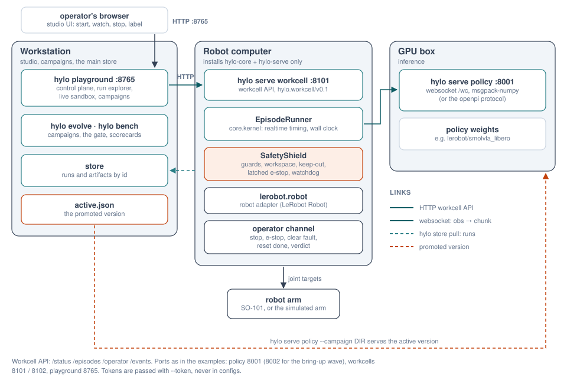
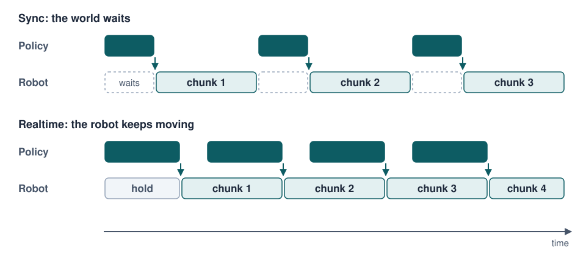

# Deployment

worldcurrent-serve runs policies next to robots. Two services split the work:

- a **policy server** (`wc serve policy`) runs an agent, usually on a GPU machine, and answers observations with
  action chunks;
- a **workcell** (`wc serve workcell`) runs next to the robot or simulator. It owns the environment, the
  SafetyShield, the episode loop and the trace, and reaches the policy over the network.

Safety never depends on the network: if the policy server is slow the arm holds, if it stops answering the
watchdog aborts the episode, and an e-stop is latched in the workcell until an operator clears it. The playground in
[studio](studio.md) is the control plane: it starts episodes and relays operator input, but never sends actions.

{ .wc-figure }

*Who talks to whom: the control plane calls the workcell API; the workcell calls the policy server; episodes are
recorded where the robot is and copied to the workstation through the store.*

serve's packages depend on `wc-core` only, so a robot computer installs nothing else.

## Policy server

```bash
uv run wc serve policy --agent '{"type": "bringup.wave", "params": {"amplitude": 12, "horizon": 15}}' --port 8002
uv run wc serve policy --config bench/examples/configs/libero10_steered.yaml --port 8001   # the config's agent
uv run wc serve policy --campaign runs/evolve/libero10-steering --port 8001               # a campaign's active version
```

| Option | Default | Meaning |
|---|---|---|
| `--agent JSON` / `--config FILE` / `--campaign DIR` | (one required) | what to serve: an agent spec, an experiment config's agent, or a campaign's active version |
| `--host` | `127.0.0.1` | bind address; `0.0.0.0` exposes it on the network |
| `--port` | `8000` | |
| `--token` | none | require `Authorization: Bearer <token>` (or openpi's `Api-Key <token>`) |
| `--openpi-inputs` | `libero` | preset name, or a JSON mapping from openpi observation keys to observation fields |

One WebSocket server speaks two protocols, chosen by path:

| Path | Protocol | Clients |
|---|---|---|
| `/wc` | the worldcurrent agent protocol (JSON): spec, reset, act, on_step, on_episode_end | workcells, `remote.ws` agents |
| `/openpi` | openpi's protocol (msgpack-numpy): metadata, then observation dict in, `{"actions": (H, A)}` out | openpi clients (DROID, RoboArena, openpi's examples) |
| `/healthz`, `/meta` | HTTP | liveness; the served agent's spec as JSON |

- `reset` carries the client's EnvSpec. The server refuses the session there, before any motion, if the agent is
  not compatible with it (`core.compat`: action space, control mode, cameras, state keys).
- One session at a time: a robot talks to one policy, and a second client is refused (close code 1013). The agent
  is built once and reused across sessions.
- With `--campaign`, the server follows the campaign's `active.json` (`wc.active/v0.1`,
  [campaigns](campaigns.md)): when a promotion or a rollback changes the active version, it rebuilds the agent
  between sessions, never during one.
- openpi has no reset message: the agent is reset on connect, when the prompt changes, or when the client sends
  `{"reset": true}`.

## Workcells

```bash
uv run wc serve workcell --config deployments-template/workcells/sim_arm.yaml --port 8102
uv run wc serve workcell --config workcells/so101.yaml --host 0.0.0.0 --port 8100 --token $WC_TOKEN
```

`--config` (required), `--host` (default `127.0.0.1`), `--port` (default `8100`), `--token`. A workcell config
(`worldcurrent.serve.workcell.WorkcellConfig`) lives in your lab's [deployments repository](../configuration/deployments-repo.md):

```yaml
name: sim-libero10
env:
  type: libero
  remote: {runtime: libero-sim}          # the simulator in its own venv (execution profile)
benchmark:                               # optional: named tasks and init states
  type: libero
  params: {suite: libero_10, n_validation: 10, n_heldout: 0}
policy: {url: ws://127.0.0.1:8001/wc, protocol: wc}
runtime: {clock: virtual, refill_steps: 10, max_hold_steps: 200}
image_every: 10
split: deployment
output_dir: runs/workcell
```

| Field | Default | Meaning |
|---|---|---|
| `name` | (required) | the workcell's name; its run is `<output_dir>/workcell-<name>` |
| `env` | (required) | any environment plugin, local or in another venv (`remote`) |
| `benchmark` | none | a benchmark whose tasks can be started by `task_id`; without it, free-form instructions only |
| `policy` | none | default policy endpoint: `url`, `protocol` (`wc` or `openpi`), `token`, `params` |
| `runtime` | realtime, wall clock | the episode loop's timing (below), plus `image_every` and `record_privileged` |
| `safety` | `{}` | SafetyShield config: `max_delta`, `guards` ([safety](safety.md)) |
| `image_every` | `10` | keep every n-th frame in the trace (every frame is streamed live) |
| `split` | `deployment` | the split recorded episodes get; no learner reads it unless asked |
| `max_steps` | `600` | step limit for free-form instructions (benchmark tasks have their own) |
| `output_dir` | `runs/workcell` | where the run is written, relative to the working directory |

### The realtime runner

The workcell runs the same episode loop as evaluation: `core.kernel.EpisodeRunner`, in realtime mode
([RFC-0005 part 3](../rfcs/RFC-0005-architecture-measurement-and-placement.md)). A benchmark can therefore measure
exactly what a workcell runs (`timing: {mode: realtime}` in an experiment or protocol).

{ .wc-figure }

*Sync: the world waits for every policy call. Realtime: the next chunk is requested while the current one still
executes; actions that went stale during inference are dropped, and gaps are held.*

In realtime mode:

1. when only `refill_steps` actions are left in the queue (or earlier, with `adaptive_refill`, when the queue covers
   only the recent latency plus one step) the runner requests the next chunk;
2. when the chunk arrives it is merged aligned with time: the actions for steps that already passed during inference
   are dropped;
3. when the queue is empty the arm executes a hold action: the environment's own `hold_action` (a real robot holds
   its measured position), the last target for absolute control, or zero motion with the gripper kept for delta
   control;
4. after `max_hold_steps` consecutive holds the watchdog aborts the episode.

| `runtime` field | Default | Meaning |
|---|---|---|
| `mode` | `realtime` (in a workcell) | `sync` waits for every call |
| `clock` | `virtual` | `virtual`: simulated latency, deterministic; `wall`: a real control loop at `control_hz`, the policy in a worker thread. Use `wall` on hardware |
| `control_hz` | the environment's | control rate |
| `refill_steps` | `2` | request the next chunk when this many queued actions remain |
| `adaptive_refill` | `true` | request earlier when the recent latency needs it |
| `latency_s` | measured | virtual clock only: a fixed inference latency instead of the measured one |
| `max_hold_steps` | `100` | watchdog |
| `require_reset_confirm` | `false` | wait for the operator's `reset_done` before an episode starts |
| `verdict_timeout_s` | `0` | how long to wait for the operator's verdict when the environment cannot judge success |
| `image_every`, `record_privileged` | `1`, `true` | what the trace keeps |

## Operating a workcell

The workcell API (`wc.workcell/v0.1`, models in `worldcurrent.core.remote.workcell`, so the control plane never
imports serve):

| Endpoint | Body / reply | Notes |
|---|---|---|
| `GET /healthz` | `{"ok": "yes"}` | no auth |
| `GET /status` | name, state, episode, last result, latched fault, run id, policy, split, runtime, tasks | |
| `POST /episodes` | `StartEpisode` → `EpisodeStarted` | 409 while an episode runs or a fault is latched |
| `POST /operator` | `OperatorEvent` → `OperatorAck` | 400 for an unknown or malformed event |
| `WS /events` | one JSON event per message | observations (JPEG), actions, chunks, safety, operator events, done |

With `--token`, HTTP calls need `Authorization: Bearer <token>` and the WebSocket `?token=<token>`.

A `StartEpisode` names a `task_id` of the workcell's benchmark (with `seed`), or a free-form `instruction`; with a
`task_id`, an `instruction` overrides only what the agent hears, not the task or its success check. `policy`
overrides the configured endpoint. States: `idle`, `starting`, `running`, `awaiting_reset`, `awaiting_verdict`,
`fault`.

```bash
curl -s -X POST localhost:8102/episodes -H 'content-type: application/json' -d '{"instruction": "wave", "max_steps": 120}'
curl -s -X POST localhost:8102/operator -H 'content-type: application/json' -d '{"type": "reset_done", "by": "me"}'
curl -s -X POST localhost:8102/operator -H 'content-type: application/json' -d '{"type": "verdict", "verdict": "success"}'
```

Operator events:

| Event | Effect |
|---|---|
| `stop` | end the episode (the robot holds) |
| `estop` | stop and latch a fault: no episode starts until `clear_fault` |
| `clear_fault` | clear the latched fault |
| `reset_done` | the scene is reset; the episode may start (`require_reset_confirm`) |
| `verdict` | `success`, `failure` or `partial` for an episode the environment could not judge |

The playground's operator station sends these with roles ([studio](studio.md#operator-station)); the e-stop is open
to every role.

!!! warning "Not a certified safety function"
    The SafetyShield is a software layer. On a real robot keep the robot's own limits (LeRobot's
    `max_relative_target`, torque limits) and a hardware e-stop within reach. For `real_robot` environments the
    shield aborts on any modification instead of correcting the action ([safety](safety.md)).

## Robots and bring-up

`wc-env-lerobot-robot` (`lerobot.robot`) turns any robot with LeRobot's `Robot` interface into an environment:
SO-100/101 and Koch followers and others. It adds an EnvSpec (named state groups, cameras, an action box in the
robot's units, the control rate), resets by moving to the `home` pose in small steps within the shield's limits,
never claims success (the operator's verdict or a calibrated judge decides), and holds the measured position when
the policy is late.

Bring a workcell up without hardware first:

```bash
uv run wc serve policy --agent '{"type": "bringup.wave", "params": {"amplitude": 8}}' --port 8002
uv run wc serve workcell --config deployments-template/workcells/sim_arm.yaml --port 8102
```

`sim_arm` is a simulated five-joint arm with a gripper, in degrees like LeRobot's SO follower, with first-order
motor dynamics and a per-step limit on the commanded change. `bringup.wave` makes small sinusoidal moves around the
measured pose, joint by joint: it checks the chain (policy server, workcell, adapter, motors) without coming near
any limit. Then the same with the real arm (`workcells/so101.yaml`, with `lerobot[feetech]` in the robot venv).

!!! info "Maturity"
    `lerobot.robot` has run with the simulated arm only; no real arm has been connected yet
    ([plugin catalogue](../developer-guide/plugin-catalogue.md)).

## Recorded episodes

Every workcell episode is recorded as an ordinary run in `<output_dir>/workcell-<name>/`: a trace per episode,
`evallog.json` and `manifest.json` updated after each one. Replay, judges and the catalog work on it. The operator's
verdict is the episode's label (`labels.success.by: operator:<who>`).

To bring the runs to the workstation, make the workcell's output directory the robot computer's
[store](store.md) and pull from it:

```bash
wc store init runs                                         # on the robot computer, where output_dir lands
uv run wc store pull robot-host:/path/to/runs              # on the workstation: runs it does not have yet
uv run wc store push robot-host:/path/to/runs artifact:l10-trace-v2@54a1efadf00d34d8   # an artifact the other way
```

## Serving one component

`wc serve env` and `wc serve agent` put a single plugin behind a WebSocket (`core.remote.ws`), for example a
simulator in its own venv on another machine:

```bash
uv run wc serve env libero --params '{"image_size": 256}' --port 8765
uv run wc serve agent lerobot --params '{...}' --port 8766 --token-env WC_TOKEN
```

Configs then use `{type: remote.ws, params: {url: "ws://host:8765"}}` as the environment or agent.
`--token-env` names an environment variable holding the token, so it never appears in a command line.
