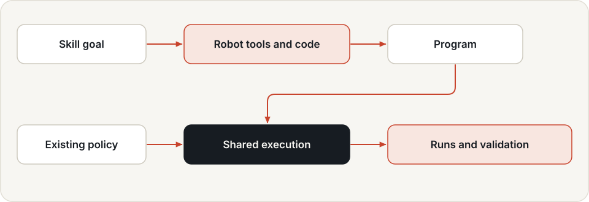
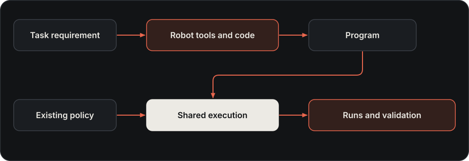

# Developing robot skills

Developing a robot skill means constructing a reusable task capability and establishing where it works. Start
with the task, robot, observations, success conditions and constraints. Then connect perception, planning and
control into an executable strategy, and test it across initial states. Hylo provides robot tools and code agents
for this work, with the same kernel, safety checks and traces used by existing policies.

Use this path for a new task, a changed scene, or an existing strategy you want to improve. An observed failure
is one possible starting point; a task requirement is another.

This guide covers the implementation and execution part of the [skill lifecycle](skills.md). Validation, versioning
and reuse are covered in [Skill research, validation and reuse](research-and-skills.md). Programs, policies and
controllers are ways to implement task capabilities; the broad skill concept is defined in [Robot skills](skills.md).

## Choose a skill implementation

{ .hylo-diagram .only-light }
{ .hylo-diagram .only-dark }

| Approach | What runs | Use it for |
|---|---|---|
| Existing policy | a model or controller through a policy agent | evaluating or deploying a policy you already have |
| `code.program` | a Python `solve(robot)` program, without a model call | a hand-written or frozen task strategy |
| `code.llm` | a chat model writes and executes code one turn at a time | interactive construction and debugging during an episode |
| `hylo research` | a model develops and submits programs on development cases | producing a frozen program for separate evaluation |
| `tools.llm` | a chat model calls typed robot tools, one checked action at a time | trying a model on a task, watching and steering it, collecting conversations that worked |

The policy/program is the executable implementation. Task scope, robot and observation assumptions, measured
evidence and version/dependencies complete the skill description. Store that information in the task/config,
run/artifact records and, for reusable program skills, the skill library.

See [Policies](policies.md) for existing policies and [Skill research, validation and reuse](research-and-skills.md) for
development sessions and versioned reuse. A first program can be checked against the task requirements without
claiming it improves a baseline. A campaign makes that comparison before promoting a change.

## Prepare the environment

Use the [development workspace](../getting-started/installation.md), with harness and bench installed. It includes
`hylo-manip`, `hylo-code-agents` and `hylo-tools`. Camera-based tasks need an
[off-screen renderer](../getting-started/installation.md#camera-rendering). Robot models are downloaded into the
asset cache on first use; a reference program needs no language model. `code.llm` and research additionally need
a configured chat backend, such as a local Ollama endpoint or a supported API.

Start with a supported MuJoCo manipulation task. Panda, ALOHA and the fixed-base G1 have recorded program runs.
LIBERO uses a separate runtime. robosuite and RoboCasa have adapters and interface checks, while their formal
program success-rate evaluations remain unrun. See the [measured showcase](../showcase/tool-agents.md).

## Robot tools

The environment publishes a `RobotSpec`: arms, hands, cameras, frames and action layout. The `robot` facade
provides tools over that contract:

| Work | Tools |
|---|---|
| Observe and locate | `status`, `look`, `find`, `table`, `objects`, `box` |
| Choose a manipulation goal | `grasps`, `hand_grasps`, `grasp_at`, `place_at`, `Goal` |
| Plan and execute | `plan`, `run`, `together` |
| Check and inspect | `holding`, `carried`, `show` |

`robot.run` sends an action chunk back to the kernel. Every executed action passes the SafetyShield and is
recorded. Tools use the robot contract; the environment retains the task's success predicate. See the
[toolkit API](../api/packages/hylo-manip.md) for parameters and return types.

Simulator segmentation is privileged perception. Keep it explicit in the environment config and compare runs
with the same observation conditions. A result using segmentation is not a like-for-like comparison with an RGB-only policy.

## Run a reference program

From the workspace root, after configuring rendering:

```bash
uv run python harness/adapters/hylo-code-agents/examples/programs/run_programs.py \
    --suite manip --tasks pick_place --workers 1 --parallel 1 --out runs/strategy-pick-place
```

This evaluates the hand-written reference `solve(robot)` on the validation split, records traces, and writes
`results.json`, `results.md` and generated experiment configs under the output directory. It demonstrates the
toolkit; it is not evidence that a model independently discovered the strategy. Suites `bimanual` and `humanoid`
use the same runner.

To develop your own program, use the generated config as a starting point. `code.program` takes source text in
`agent.params.source` for experiments, or a sealed program in `agent.params.artifact`. Source text is the program
itself, not a Python filename. Keep the benchmark and environment fixed while changing the strategy.

For a model that writes code during the episode, use `agent.type: code.llm` and a `model` specification in its
params. For repeated development cases and frozen submissions, follow [Skill research, validation and reuse](research-and-skills.md).

## Model tools and further workflows

`hylo tool` exposes segmentation, depth, meshes, motion extraction and rendering. Each heavy model runs in a
separate worker environment; the first call can install dependencies and download weights. Current mesh, hand
and human tools have fallback backends because their primary models have access or registration requirements.
The [tools README](https://github.com/HyloAI/hylo-harness/tree/main/adapters/hylo-tools) records backends, licences and timings.

Scene generation, replay-to-simulation and motion authoring are additional experimental workflows. Free-scene
and motion-free showcase requests remain unrun; external replay and physical motion stability have known failures.
Their presence in the CLI is not evidence of task reliability. See [Showcase](../showcase/tool-agents.md).

## Tool calls instead of code

`code.llm` and `tools.llm` use the same robot tools. `code.llm` writes Python blocks, which suits tasks a program
can express in a few lines and keeps the code for reuse. `tools.llm` calls one tool at a time with JSON arguments;
every action is refused or confirmed with a measured receipt before the model decides again, which suits models
trained for tool calls and makes each step visible. See [Tool-calling agents](tool-agents.md).

To try a task with another robot or in another scene first, build it as a [world](worlds.md): 24 robot packs,
cameras, people, goals checked with reason codes.

## Validate the capability and record its scope

Inspect task success, steps, safety interventions and traces across more than one initial state. Record the
robot, task, observation conditions and program version. Development successes do not establish generalisation;
freeze the program and evaluate separately before making that claim.

For a first skill, compare the frozen implementation with the task's success and safety requirements. For an
improved skill version, also compare it with the previous implementation. A promoted program can become a
verified program skill for later code agents; deployment on a target workcell remains a separate check.

Programs execute in a restricted Python namespace in the host process. This is not operating-system isolation
and does not limit memory. Read [Security](security.md#model-written-programs) before running generated code.
