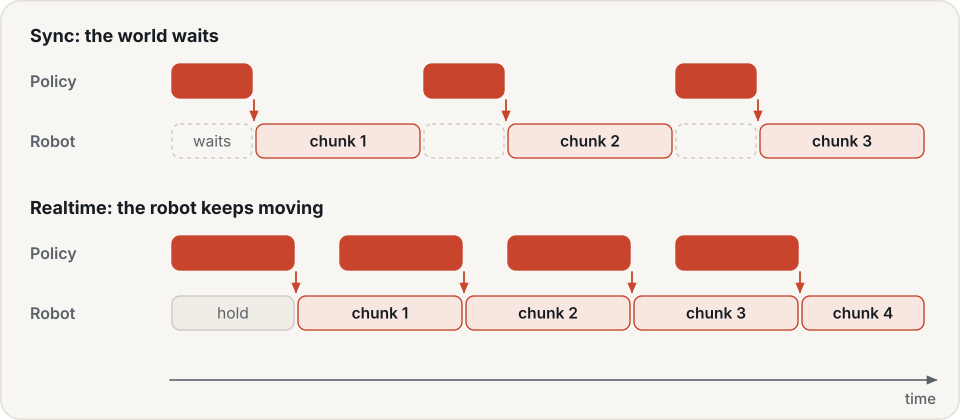
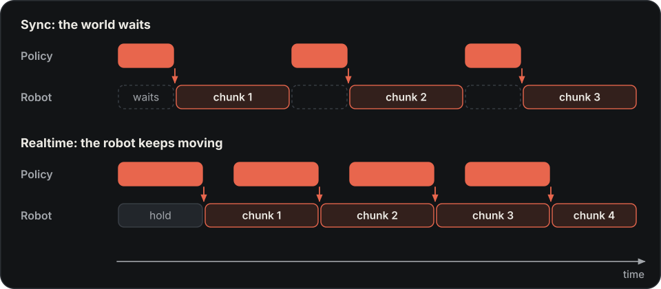
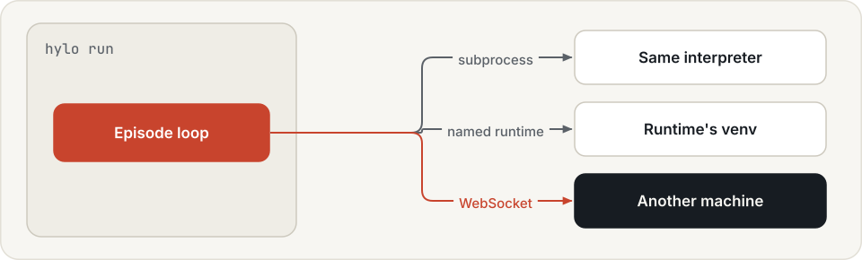
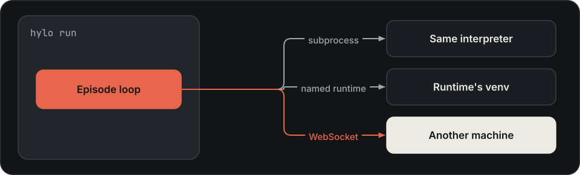

# Experiments

Experiments record execution in the [robot-skill lifecycle](skills.md). They run an implementation (a model policy,
controller or task program) against specified tasks and initial states. Use development runs to iterate and
separate validation runs to support claims about the capability's scope and reliability.

An experiment is one config file: a benchmark split, an environment, an agent, and optional safety, trace, timing
and seed settings. `hylo run` evaluates it and writes a run.

## Design

**One episode loop for everything.** Evaluation, campaigns, the Studio's sandbox and a workcell next to a robot run
the same loop. When deployment had a loop of its own, what the gate approved in simulation was not what the robot
ran; with one loop it is.

**Everything an episode does is recorded, and everything else reads the record.** Each episode writes an append-only
event stream: observations, the agent's chunks and decisions, memory retrievals, every safety review, every executed
action, results. Scoring, diagnosis, replay, learners and the Studio read only these traces. Formats made for
training data, for service calls or for chat messages each miss some of this (reasoning, memory, safety) or cannot be
replayed, so the trace is Hylo's own and those formats are export targets.

**An experiment's identity is what it measures.** The digest covers the benchmark, environment, agent, safety, trace
and timing settings, and leaves out where the experiment runs: output directories, worker counts, interpreters and
paths. Configs name runtimes and store ids, and each machine resolves them, so the same experiment has the same
identity on a workstation, a GPU machine and a robot computer.

**Timing is part of the experiment.** In `sync` timing the world waits for every policy call; in `realtime` it does
not, and actions that went stale while the policy computed are dropped. A slow policy behaves differently on a robot
than in a waiting simulation, so the difference is something to measure, not to hide. Realtime runs on a
deterministic virtual clock in simulation, so it can be repeated.

**Problems surface before the first step.** The agent and the environment are checked for compatibility (control
mode, rotation format, action dimensions) when they are bound, and privileged simulator state goes to the trace for
scoring, never to the agent.

## Run a config

Commands on this page run from `bench/`, so runs land in the store registered during
[installation](../getting-started/installation.md):

```bash
cd bench
uv run hylo run examples/configs/mujoco_reach.yaml
```

`hylo run` prints one line per finished episode on stderr, then a JSON summary on stdout:

```text
[20] mujoco/planar_reach_random seed=10009 success (32 steps)
{
  "run_dir": "runs/mujoco-reach-validation-2342f91d706e83e9-5c6b71",
  "config_digest": "2342f91d706e83e9",
  "success_mean": 1.0,
  "safety_interventions_mean": 0.0,
  "steps_mean": 35.25,
  "n_episodes": 20,
  "n_scored": 20
}
```

`n_scored` counts the episodes that have a success value; `success_mean` is taken over those only.

| Option | Meaning |
|---|---|
| `--split SPLIT` | run another split of the benchmark (default: `benchmark.split` in the config) |
| `--set KEY=VALUE` | dotted-path override, value parsed as YAML; repeatable (`--set agent.params.kp=0.1 --set workers=8`) |
| `--output DIR` | where the run directory goes (default: the config's `output_dir`, `runs`) |

## Runs and traces

A run directory is named `<name>-<split>-<digest>-<6 hex>` and contains:

| File | Content |
|---|---|
| `evallog.json` | run and benchmark ids, the agent's spec, aggregate results, and one sample per episode (task, seed, status, steps, scores, trace path) |
| `manifest.json` | the measured config and its digest, the git commit, Python, platform and package versions, and the resolved store ids |
| `episodes/<episode_id>.jsonl` | the episode's events. Large arrays (camera images, point clouds) are stored once in `blobs/<sha256>.npy`. |

Each episode ends with a status:

| Status | When | Success score |
|---|---|---|
| `success` / `failure` | the environment says so, or the episode reached the task's `max_steps` | 1 / 0 |
| `safety_abort` | the safety shield or the operator ended the episode ([safety](safety.md#interventions-and-aborts)) | 0 |
| `error` | the agent failed, or the realtime watchdog fired | none |
| `infra_invalid` | the environment faulted or the simulator diverged; not the policy's fault | none |
| `unlabeled` | realtime mode only: the environment cannot judge success, and no operator verdict came | 0 |

An `unlabeled` episode keeps that status in its trace and is recorded as `failure` in `evallog.json`. An operator's
`partial` verdict also counts as `failure`.

A workcell run scores differently. There, `unlabeled`, `safety_abort` and `error` episodes have no success value,
so the run's `success_mean` covers only `success` and `failure` episodes ([deployment](deployment.md)).

Read runs with `hylo trace RUN_DIR [EPISODE_ID]` or in [Studio](studio.md).

## The config

```yaml
schema_version: hylo.experiment/v0.1
name: mujoco-guarded
benchmark: {type: mujoco/reach-v0, split: validation}      # a benchmark plugin, its params, the split
env: {type: mujoco.planar_reach}                           # an environment plugin
agent: {type: baseline.planar_ik, params: {kp: 0.3}}       # an agent plugin
safety: {max_delta: 0.5, guards: [{type: norm_limit, params: {max_norm: 1.2}}]}
trace: {record_privileged: true, image_every: 1}
timing: {mode: sync}
seed: 0
workers: 8
output_dir: runs
```

| Key | Default | Measured | Meaning |
|---|---|---|---|
| `name` | required | yes | the experiment's name; starts every run directory name |
| `benchmark` | required | yes | `{type, params, split}`; `split` defaults to `validation`. `params.protocol: rsi` (a benchmark setting, not an evaluation protocol) selects the four [campaign splits](campaigns.md#splits). |
| `env` | required | yes, except `env.remote` | `{type, params, remote}` |
| `agent` | required | yes, except placement | `{type, params}`; `type` is a plugin name or `module:attr` |
| `safety` | `{}` | yes | extra guards and limits ([safety](safety.md)) |
| `trace` | `record_privileged: true`, `image_every: 1` | yes | store privileged simulator state; keep camera images every N steps (0 = never) |
| `timing` | sync | yes | [sync or realtime](#timing-sync-and-realtime) |
| `seed` | 0 | yes | |
| `tags` | `()` | yes | free labels |
| `workers` | 1 | no | parallel episode workers, each with its own environment and agent |
| `output_dir` | `runs` | no | where run directories go |

The full schema is the [experiment config schema](../harness/experiment-schema.md). `hylo schema experiment` prints
it as JSON Schema.

## Check a config before a long run

```bash
uv run hylo conformance examples/configs/mujoco_reach.yaml            # the environment against its contract
uv run hylo conformance examples/configs/mujoco_reach.yaml --agent    # and the agent (two full episodes)
```

`--nondeterministic` skips the same-seed comparison of the agent check. `--spec-budget` (default 2 s) limits how
long `spec()` may take, which matters for remote environments. `--split` and `--set` work as in `hylo run`. What
each check covers is in [extending](../harness/extending.md).

## Timing: sync and realtime

{ .hylo-diagram .only-light }
{ .hylo-diagram .only-dark }

One episode loop runs every episode, in benchmarks and on robots. In `sync` mode (the default) the world waits for
each policy call. In `realtime` mode the robot keeps executing while the next chunk is computed. Actions for steps
that already passed are dropped. An empty queue executes a hold action: the environment's `hold_action`, the last
target for absolute control, or zero motion (gripper kept) for delta control.

| Key | Default | Meaning |
|---|---|---|
| `mode` | `sync` | `sync` or `realtime` |
| `clock` | `virtual` | realtime only. `virtual`: simulated latency, deterministic; the loop blocks in each policy call. `wall`: a real control loop at `control_hz`, with the policy in a worker thread. Use `wall` on hardware. |
| `control_hz` | the environment's | control rate of the realtime loop |
| `refill_steps` | 2 | request the next chunk when this many queued actions remain |
| `adaptive_refill` | true | or earlier, when the queue covers only the recent latency plus one step |
| `latency_s` | measured | virtual clock only: a fixed inference latency per chunk instead of the measured one |
| `max_hold_steps` | 100 | watchdog: the episode ends as `error` after more than this many hold steps in a row |

Two more keys, `require_reset_confirm` and `verdict_timeout_s`, matter only on workcells
([deployment](deployment.md#reference)).

```bash
uv run hylo run examples/configs/mujoco_reach.yaml \
    --set 'agent={type: policy, params: {policy: {type: examples.ik_reacher, params: {horizon: 16}}}}' \
    --set timing.mode=realtime --set timing.latency_s=0.1
```

A realtime episode records at its end how many hold steps it needed (`holds`) and how many chunks it requested
(`chunks`). Protocols that score in realtime fix `latency_s`, because a measured latency depends on the machine and
its load ([protocols](../benchmarking/protocols.md)).

An agent that returns one action per call, such as `baseline.planar_ik` or `temporal_ensemble`, does not work in
realtime mode with any latency: each action arrives after its step has passed, so the arm only holds until the
watchdog ends the episode.

## Where components run

An environment or an agent can run in another process, with another interpreter. Name a **runtime** from this
machine's [execution profile](../configuration/profiles.md), so the config stays the same on every machine:

{ .hylo-diagram .only-light }
{ .hylo-diagram .only-dark }

=== "Environment"

    ```yaml
    env:
      type: libero
      remote: {runtime: libero-sim}          # the simulator runs in the libero-sim venv
    ```

    `remote: {}` runs the environment in a subprocess of the current interpreter
    (`examples/configs/mujoco_reach_remote.yaml`).

=== "Agent"

    ```yaml
    agent:
      type: remote
      params:
        ref: lerobot.steered                 # the agent plugin to build in the other process
        runtime: lerobot
        params: {repo_id: lerobot/smolvla_libero, steering: {n_samples: 1, seed_noise: true}}
    ```

`python:` and `env:` entries set the interpreter and extra environment variables directly, and override the
runtime's. They tie the config to one machine, so prefer a runtime.

A component on another machine runs behind a WebSocket server, started in the component's own venv:

```bash
uv run hylo serve env libero --params '{"image_size": 256}' --port 8770
uv run hylo serve agent lerobot --params '{...}' --port 8771 --token-env HYLO_TOKEN
```

The config then uses `{type: remote.ws, params: {url: "ws://host:8770"}}` as the environment or the agent. Each
connection gets its own component instance. `--token-env` names an environment variable that holds the token
([security](security.md)).

## What is measured: the digest

The **config digest** is a short hash of everything the experiment measures. Left out are where results go
(`output_dir`), parallelism (`workers`), and where components run: `env.remote`, and a `remote` agent's `runtime`,
`python` and `env`. A `remote.ws` component is the exception: its URL replaces the component in the config, so it is
hashed and changes the digest. Changing any measured value changes the digest. `timing` is measured; a config that
leaves it at the default (`sync`) has the same digest as one that omits it.

Two runs with the same digest used the same config. Compare them episode by episode only if both hold:

- **Every artifact id is pinned** (`artifact:<name>@<digest>`). An unpinned id such as `artifact:policy.flow`
  enters the digest as written. If the artifact with that name is replaced in the store, the digest stays the same
  but the behaviour changes. The manifest records the full id each run actually used ([store](store.md)).
- **The code versions match.** Code is not part of the digest. Compare the git commit and package versions in the
  two manifests.

## Next

- [Policies](policies.md): run your own model under one of Hylo's agents.
- [Benchmarking](../benchmarking/index.md): score an agent under a fixed evaluation protocol.
