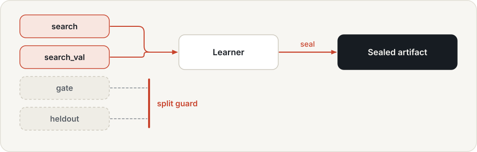
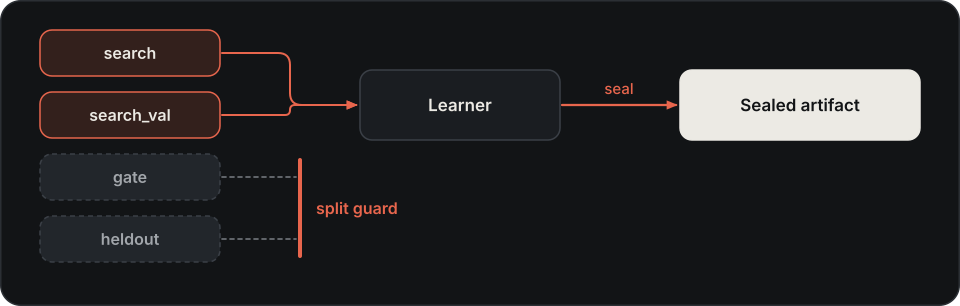

# Learning

A learner turns recorded runs into an **artifact**: a sealed directory whose manifest (`artifact.json`) records what
it is, a digest of its content, and where it came from: the learner, its parameters, and the runs it read. External
data enters as runs too, so every artifact traces back to runs.

Task programs use a separate [research session](research-and-skills.md) to produce a frozen artifact.
[Campaigns](campaigns.md) compare proposed changes before promotion.

{ .hylo-diagram .only-light }
{ .hylo-diagram .only-dark }

## Design

**One pipeline for everything learned.** Learning from the agent's own runs, from demonstrations, from video, and
learning judges or world models all take the same path: data, an optional labeller, a learner, a sealed artifact, a
candidate, the gate. Before this pipeline, each learner had its own export, its own split guard and its own output
format; now a new learner only has to read runs and write an artifact.

**The trace store is the only source of truth.** Everything learned is derived from recorded runs, and a sealed
artifact records which runs and splits it read, which builder made it, with which parameters, and its content
digest. Memory and learning are the same thing in this design: they differ only in the builder (a retrieval index, a
curated list, gradient descent).

**Three roles, three ways to earn trust.** What an artifact is allowed to influence decides how it must be trusted.

{ .hylo-diagram .only-light }
{ .hylo-diagram .only-dark }

An instrument never decides a gate verdict: in simulation the gate scores with ground truth, and a world model may
only decide which candidates are worth real episodes. An instrument is never calibrated on, and never labels, the
data it was built from. A model used in two roles is approved separately for each.

**Split integrity is enforced twice.** When an artifact is sealed, a guard refuses any provenance that includes gate
or held-out runs. When a candidate reaches the gate, stage 0 checks again that every artifact it names still has its
digest and never saw those splits. One bias is accepted and recorded: an artifact built from `search_val` can favour
itself in the screen that uses `search_val`; the gate split stays clean.

**Outside data comes in as runs.** External datasets and videos enter as runs under their own split, with origin,
licence and how their labels were made, and are checked against the gate and held-out initial states, so they follow
the same rules as everything else.

## Run a learner job

A learner job is a JSON file. Commands on this page run from `bench/`, so runs and artifacts land in the store you
registered during [installation](../getting-started/installation.md).

```json title="examples/policies/jobs/flow.json"
{"learner": "policy.flow", "inputs": ["runs/policies/demos"], "out": "runs/policies/artifacts/flow",
 "params": {"chunk": 8, "epochs": 300, "integration_steps": 10}}
```

Record demonstrations on a development split, then run the job:

```bash
cd bench
uv run hylo run examples/configs/mujoco_reach.yaml --split search \
    --output runs/policies/demos --set benchmark.params.protocol=rsi
uv run hylo learn examples/policies/jobs/flow.json
```

```json title="Output"
{
  "out": "runs/policies/artifacts/flow",
  "kind": "policy_params",
  "role": "behaviour",
  "digest": "218d7147b2d05110",
  "splits": ["search"],
  "metrics": {"episodes": 80, "samples": 2858, "obs_dim": 8, "chunk": 8, "action_dim": 2,
              "train_flow_mse": 0.128}
}
```

| Field | Meaning |
|---|---|
| `learner` | a `learners` plugin name, or `module:attr` |
| `inputs` | run directories, directories to search for runs, or store ids (`run:<id>`) |
| `out` | the artifact directory this job seals |
| `splits` | the splits it may read (default `search`, `search_val`) |
| `params` | the learner's parameters |

A finished job is not run again: if `out` already holds an artifact sealed by the same job, `hylo learn` skips it.
A job that stopped halfway starts over.

Use `--python` when the learner's dependencies live in another venv, such as LIBERO's:

```bash
uv run hylo learn my-job.json --python envs/libero/.venv/bin/python
```

## Inspect and reference an artifact

```bash
uv run hylo artifact runs/policies/artifacts/flow     # check the digest and sources, print the manifest
uv run hylo store ref runs/policies/artifacts/flow    # its store id: artifact:policy.flow@218d7147b2d05110
```

`hylo artifact` fails if the content no longer matches the digest or a source is a gate or held-out run.
`hylo store ref` needs the directory to be inside this machine's [store](store.md).

Configs name the artifact by its store id:

```yaml
sampler: {type: policy.flow, params: {path: "artifact:policy.flow@218d7147b2d05110"}}
```

Keep the `@digest` ([why](store.md#reference-artifacts-in-configs)).

## The split guard

By default a learner reads only `search` and `search_val` runs. It reads `synthetic` runs (produced inside a learned
model) and `external` runs ([ingested data](#external-data)) only when the job lists them in `splits`.

Gate and held-out runs are refused three times: when the job starts (asking for them fails, and a directory scan
skips them), when the artifact is sealed, and in a campaign's stage-0 checks, for every artifact a candidate
references. Who else reads which split: [campaign splits](campaigns.md#splits).

## Artifact roles

| Role | Kinds | Changes | Trusted when |
|---|---|---|---|
| `behaviour` | `action_memory`, `value_model`, `noise_policy`, `policy_weights`, `policy_params` | what the robot does | the gate promotes a candidate that uses it |
| `instrument` | `success_judge`, `progress_model`, `world_model` | what is measured or labelled | it is calibrated against known outcomes |
| `proposal` | `lesson_book`, `skill_library` | only what generators propose | campaign outcomes, including gate results, curate it: lessons cited by promoted candidates gain credit, those cited by refuted ones lose it |
| `data` | `dataset` | what learners can read | its labels come from the source or a calibrated judge |

The two trust paths are separate. A gate verdict never makes an instrument trusted, and calibration never activates
a behaviour artifact.

A **mutable** artifact keeps changing after it is sealed, such as a lesson book a campaign is curating. Its digest is
not enforced: `hylo artifact` and the stage-0 checks do not compare its content with the manifest.

## Success judges and calibration

A success judge (an `instrument`) labels episodes from their traces when no simulator can, on a robot or in external
data. Train one with `judge.trace`, then calibrate it on simulator runs:

```json title="judge-job.json"
{"learner": "judge.trace", "inputs": ["runs/libero10"], "out": "runs/judges/l10-trace",
 "params": {"cameras": ["agentview", "wrist"]}}
```

```bash
uv run hylo learn judge-job.json
uv run hylo calibrate --judge '{"type": "judge.trace", "params": {"path": "artifact:l10-trace@<digest>"}}' \
    --runs RUN_DIR [RUN_DIR ...] --artifact artifact:l10-trace@<digest>
```

Calibration reads `search` and `search_val` runs by default (`--splits`) and compares the judge's scores with the
simulator's outcomes. It reports AUC, Brier score, expected calibration error, and the lowest threshold that reaches
the target precision (`--target-precision`, default 0.95), with the recall there.

The judge is `ready` to label when all three hold:

- at least 50 episodes were scored;
- the target precision is reachable;
- the recall at that threshold is at least 0.3.

With `--artifact`, runs the judge was trained on are left out, and the report is stored in the judge's manifest,
where `hylo label` reads it.

## External data

Demonstrations, videos and other robots' logs enter as ordinary runs with split `external:<name>`. Each is sealed as
a `data` artifact that records its origin and licence. Data sources are `datasources` plugins.

```json title="spec.json"
{"source": {"type": "video.frames", "params": {"root": "data/kitchen-videos"}},
 "name": "kitchen-videos", "licence": "CC-BY-4.0", "out": "runs/external",
 "image_every": 1, "assume_success": false}
```

```bash
uv run hylo ingest spec.json                       # --python VENV_PYTHON if the source needs another venv
uv run hylo label RUN_DIR --judge artifact:l10-trace@<digest>
uv run hylo contamination EXTERNAL_RUN_DIR --protected PROTECTED_RUNS_DIR
```

`assume_success: true` labels every episode a success on the source's authority. Otherwise an episode is a success
only if the source says so.

`hylo label` refuses a judge that is not `ready` and labels only ingested runs the judge was not trained on.
Episodes scoring at or above the calibrated threshold are labelled successes. The rest stay unlabelled, never
failures. `--threshold` can raise the threshold but not lower it. Labels are written into the run's `evallog.json`,
each marked `by: judge:<digest>`. No new artifact is made.

`hylo contamination` compares each external episode's initial state with the gate and held-out episodes of the same
task under `--protected` (default `runs`). It prints a report and exits with code 3 when it finds a match. It does
not block anything. Do not use matching external data to build anything gated on those states.

## Built-in learners

| Learner | Builds |
|---|---|
| `policy.knn`, `policy.bc`, `policy.flow`, `policy.tokens` | reference policies ([policies](policies.md)) |
| `world_model.state` | a state world model, for `policy.mpc` and world-model pre-screening |
| `critic.chunk_value` | a chunk critic for critic steering |
| `judge.trace` | a success judge from traces |
| `lerobot.action_memory`, `lerobot.noise_prior` | action memories and noise priors for LeRobot steering |
| `lerobot.expert_iteration` | fine-tuned LeRobot weights from successful episodes |

How far each is tested: [plugin catalogue](../developer-guide/plugin-catalogue.md). To write your own:
[adding a learner](../developer-guide/adding-a-learner.md).

## Next

- Use these artifacts in a [campaign](campaigns.md).
- Keep and move them with the [store](store.md).
