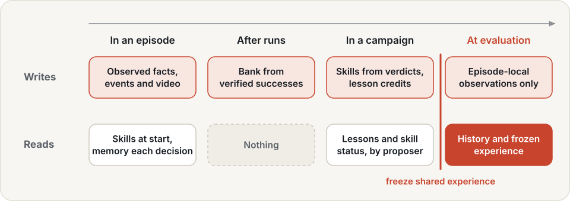
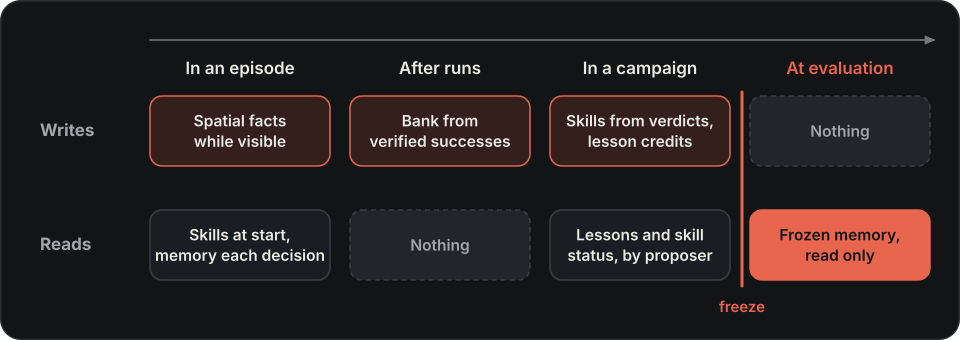

# Memory

Give an agent access to earlier observations and experience. Memory can retain object locations, recall event
history, supply video context, retrieve successful motions or inform the next proposed change.

## Memory types { #memory-and-its-consumers }

| Capability | Use | Consumer |
|---|---|---|
| Recall object locations | [Spatial memory](spatial.md) | a composable agent or reasoner |
| Recall event order and counts | [Event memory](events.md) | an agent with an observation extractor |
| Use earlier camera frames | [Video memory](video.md) | a compatible frozen SimpleMemVLA agent |
| Retrieve successful motions | [Action memory](action.md) | a flow policy supporting memory steering |
| Learn from previous attempts | [Lessons](lessons.md) | the `experience` proposer |

A backend needs a consumer that reads it. Adding a memory plugin alone does not make an arbitrary model use
memory. For reusable procedures and agent changes, see [Skills](../skills.md).

## Quickstart

[Use memory](../using-memory.md) starts with a CPU event-recall example, then explains how to connect a consumer.
Choose a backend above for its configuration and integration steps.

## Design { #design-space }

An observation is incomplete and temporary: a target leaves view, an instruction refers to an earlier event, or
a useful motion was discovered in a previous development run. Memory retains the evidence needed for those
different decisions. The query determines the representation: positions and time ranges need structured fields,
event order needs a journal, video-conditioned models need frame history, and a motion policy needs action data.

Each memory also needs provenance and a consumer. Remembering a location records where and when it was observed;
retrieving a motion identifies the episode it came from. The consuming agent decides how to use that evidence.
Storage does not make stale evidence current or turn a perception error into a reliable fact.

## Retrieval mechanisms

### Spatial and event memory

Spatial memory stores identity, pose, frame, time and scope as fields. This supports queries such as “where was
the target?” or “which objects were near this point?” without encoding coordinates only as text. New evidence
can invalidate a previous location while retaining the old record, so replay can reconstruct what the agent
knew when it acted. A recalled location may still need fresh perception before a grasp.

Event memory records an ordered journal within an episode. Queries retrieve the latest or nth observation,
counts, sequences and pending events with evidence references. Answers distinguish known, partial and unknown
information. An observed count is only a lower bound without complete coverage; failing to observe an event
does not establish that it never happened. An extractor must first turn permitted observations into events.

### Video history

The SimpleMemVLA integration samples chronological camera frames and supplies them, with current observations,
to a compatible frozen model. The model uses that context when producing subtasks and action chunks. This path
uses an episode buffer and feature cache rather than semantic queries over a shared database. Reset clears the
history; a checkpoint must already support video context, and the integration remains experimental.

### Action priors

Action memory retrieves successful development motions using the policy's observation features. Similarity
filters and motion-consistency checks select compatible segments; weighted aggregation produces a motion prior,
with a vote for gripper state so open and closed grasps are not simply averaged together.

The prior biases a compatible flow policy's sampling while that policy still responds to the current scene.
This allows adaptation to differences between a remembered motion and the present task. Retrieval similarity
and agreement control the bias strength; without a usable match the policy samples without a memory prior.
Similarity is not proof of suitability, so the same policy with and without memory must be compared on the target
task. Recorded LIBERO results do not establish a reliable action-memory gain.

### Lessons

Lessons retain short strategies and pitfalls for a proposer planning its next change. A reflector proposes
small, evidence-citing edits from development episodes; the lesson book validates and logs those operations.
The outcomes of candidates that cited a lesson update helpful or harmful counts, and repeatedly harmful lessons
retire from retrieval while remaining in the record. This ties retained advice to outcomes and keeps a model
from silently rewriting the entire history. Lessons affect behaviour through a model that actually reads them.

## Memory lifetime { #when-it-is-written-and-read }

| Scope | Written | Read |
|---|---|---|
| Episode history | from permitted observations during an episode | by the agent in that episode |
| Action banks | from successful development episodes | by a compatible policy, with the bank frozen |
| Lessons | from development diagnostics and credited campaign outcomes | by a proposer planning its next change |

Episode history and persistent experience have different evaluation roles. An agent may need to remember what
it saw earlier in the same task. Updating a shared bank from scored episodes would instead let one evaluation
task teach the next, making results depend on episode order. Freeze shared banks, skill libraries and lesson
books during evaluation, while allowing the protocol's permitted episode history to update and reset normally.
Record persistent sources by digest so a result identifies the experience it used.

{ .hylo-diagram .only-light }
{ .hylo-diagram .only-dark }

## Constraints { #limits }

- Scope and reset episode history so another evaluation episode cannot read it. A persistent journal can retain
  audit evidence without exposing that evidence to later episodes.
- Freeze shared banks, skill libraries and lesson books during evaluation. Record their digests with the agent.
- Verify that the consumer uses the retrieved context. Lessons require a model that reads them; action-memory
  benefit depends on retrieval quality and needs a comparison on the target task.
- Tool-agent and world-session context stays within its episode or session. Role campaigns reuse experience
  across tasks through [recipe skills](skills.md#recipe-skills).

## Studio { #in-the-studio }

The Experience page shows skill libraries, lesson books and action banks under the runs directory, with their
status and evidence.

<video src="../../assets/videos/studio-experience.mp4" poster="../../assets/videos/studio-experience.jpg" controls muted playsinline preload="none" width="100%" aria-label="Studio Experience: skill libraries, lesson books and action banks"></video>

## Next

- [Use memory](../using-memory.md): connect a backend to an agent.
- [Memory reference](../../reference/memory.md): fields, queries and storage rules.
- [Recorded results](../../developer-guide/validation/guide-results.md): measured benefits and failures.
