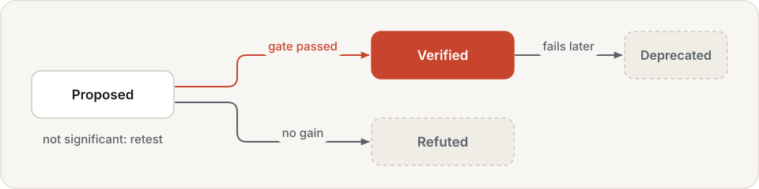
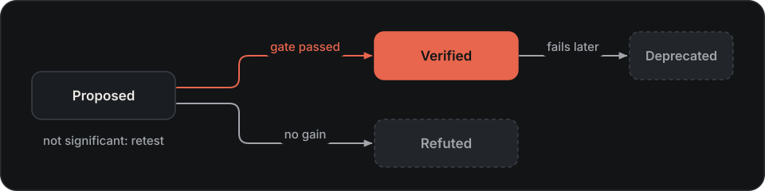

# Skill library

The library stores versioned [skills](../skills.md), their applicability, status and evidence. Its records hold data:
a configuration change, a subgoal plan, a reference to trained weights or to a sealed program, or a list of tool calls. A skill library is a
folder with one JSON file per skill version (`<name>@<version>.json`). Agents look skills up when a task starts,
when a code agent writes its next block, when a proposer plans a round, or when a goal fails.

## Design

**A skill is data, never code.** A skill is a configuration patch, a plan template, a rule set, a weight reference,
a list of recorded tool calls, or a reference to a sealed program. Data can be read by a person, compared between
versions, applied to an agent and taken back afterwards. Program skills are the one place where code is involved,
and there the skill holds only the program's path and digest: the program runs inside the code agent's sandbox,
and only after its digest has been checked again.

**Skills come only from places that already produce evidence.** Nothing writes a verified skill directly, not even
a model that is sure. Steering and weights skills come from improvement campaigns, program skills from research
sessions whose programs a campaign promoted, recipe skills from role campaigns. Each source has its own test: a
paired gate for the first two, a replay without a model on fresh copies of the task for recipes.

**Status follows the evidence.** A new skill is proposed; a passed gate verifies it; a failed gate with no gain
refutes it; a gain that was not significant leaves it proposed, with the numbers attached, so it can be tested
again with more episodes. Refuted skills stay in the library: a proposer that sees them does not suggest them again.

**A skill says when it applies.** Benchmark tasks come in families with recognisable instructions, so a trigger can
be an instruction pattern with named slots (`put both the {a} and the {b} in the basket`), task tags or an
environment. Worlds have no task families: the same failure turns up under many different requests. There a trigger
is a failure signature, the reason codes a goal check reported (`NOT_LIFTED`), so a recipe is offered because the
task is failing in the same way, not because it has the same name.

**A skill applies for one episode.** The `skills` agent applies the best match of each kind when an episode starts
and takes it back when the episode ends, so a skill that does not fit one task cannot leak into the next. One skill
per kind keeps the outcome attributable to it, and each application is a `skill.applied` trace event.

**Models see verdicts, not statistics.** A proposer sees each skill's status, but not the gate's effect sizes or
p-values: a proposer that read them could tune its proposals to the gate split, and the gate would stop being an
independent test.

## Skill kinds

| Kind | Body | Applied by |
|---|---|---|
| `steering` | a partial steering configuration (samples, noise scale, execution steps, ...) | the `skills` agent, merged into the steered agent it wraps |
| `recovery` | trigger rules for the steered agent (what to do when progress stalls) | the `skills` agent, appended to the agent's rules |
| `plan` | subgoal templates with slots, such as `pick up the {a}` | the `skills` agent, through a subgoal planner |
| `weights` | a configuration patch that points to other weights | an improvement campaign, as a candidate configuration |
| `program` | a sealed `solve(robot)` program: path, digest and entry point | `code.llm`, as `skills.<name>(robot)` |
| `recipe` | the tool calls that solved a world task, by surface | role campaigns, offered when a goal fails for the same reasons |

Every skill also has a name, a version, a description (what a language model reads first), a trigger, a status,
usage verdicts and its evidence.

??? example "The verified skill from the MuJoCo memory example (its rationale omitted)"

    ```json
    {
      "name": "skill-290658004a",
      "version": "1",
      "description": "sampling noise 3.0 is too wide for this policy; 0.99 keeps samples near the data",
      "trigger": {"instruction_pattern": null, "task_tags": ["reach"], "env": "mujoco.planar_reach"},
      "kind": "steering",
      "body": {"steering": {"n_samples": 1, "noise_scale": 0.99}},
      "status": "verified",
      "verdicts": {},
      "evidence": {
        "verdict": "promoted", "candidate": "cand-290658004a", "digest": "4c9a55f25df13988",
        "generator": "examples.noise_scale@0.1",
        "effect": 0.42, "p_value": 2.56e-12, "n_pairs": 100, "gate_split": "gate", "wins": 43, "losses": 1
      }
    }
    ```

    The evidence ties the skill to the campaign candidate it came from (by id and content digest) and to the gate
    result that verified it: 43 wins and 1 loss over 100 paired episodes.

## Triggers

A trigger says when a skill applies. All parts that are set must fit.

| Part | Fits when |
|---|---|
| `instruction_pattern` | a regular expression matches the whole normalised instruction; named groups become slots, for example `put both the (?P<a>.+) and the (?P<b>.+) in the basket` |
| `task_tags` | the task has all of these tags |
| `env` | the environment has this name |
| `reason_codes` | a goal check failed with all of these reason codes (`NOT_LIFTED`, `DISTANCE_NOT_MET`, ...) |

Only verified skills match. When several fit, the most specific comes first (a pattern before tags before the
environment alone), then the one with more useful than misleading verdicts. Program skills have no pattern; they are
ranked by how close the instruction is to the skill's description and to the instructions it was developed on.

## Status

{ .hylo-diagram .only-light }
{ .hylo-diagram .only-dark }

New skills start as `proposed`. Only evidence moves them on, and no other transition is allowed:

| Evidence | Status |
|---|---|
| a campaign promoted the candidate (it passed the gate) | `verified`, with the gate's effect, p-value and pairs |
| the gate failed with no gain, or the candidate was rejected early | `refuted` |
| the gate failed with a gain that was not significant, or the candidate was archived | stays `proposed`, with its numbers attached (worth retesting with more episodes) |
| a promoted program fails revalidation later | `deprecated` |
| a recipe's model-free replay achieves the goal | `verified` |

Refuted skills stay in the library, so a proposer can see what was tried and failed. Separately, each use can be
marked `useful`, `misleading` or `not_applicable`; these verdicts accumulate per version and break ties.

## Building a library

```bash
# steering and weights skills from an improvement campaign's archive
uv run hylo skills runs/campaigns/l10 --out runs/skills/libero10 --tags libero libero_10 --env libero
# program skills from a campaign's promoted code candidates
uv run hylo research skills runs/campaigns/pick --library runs/skills/manip --family pick_place
```

`hylo skills` turns every decided archive entry into a skill version with the status its evidence supports, and is
safe to run again: entries already in the library are skipped. Candidates that change something other than the
steering configuration or the weights are not expressible as skills and are listed as skipped.

The `experience` proposer runs the same conversion before every round of a campaign, so a library grows while the
campaign runs (see [Lessons](lessons.md#the-experience-proposer)). Role campaigns add recipe skills themselves, after
the verifier's replay.

## Applying skills

### The skills agent

```yaml
agent:
  type: skills
  params:
    skills: {type: skill_library, params: {path: runs/skills/libero10, frozen: true}}
    kinds: [steering, recovery, plan]              # the default
    inner:
      type: planner.subgoal
      params: {inner: {type: steered, params: {...}}}
```

At the start of each episode the library is matched against the task's instruction, tags and environment. The best
skill of each kind is applied for that episode only:

- a steering skill is merged into the nearest steered agent in the wrapped chain;
- a recovery skill's rules are appended to that agent's rules (at most four rules in total);
- a plan skill's templates are filled with the trigger's slots and given to the nearest subgoal agent; a plan with
  a missing slot is not applied.

Everything is undone at the end of the episode. Each application is a `skill.applied` event, and the episode ends
with a summary of the skills used and the outcome, so results can be attributed to the skill.

??? example "A skill.applied event"

    ```json
    {"type": "skill.applied", "seq": 3,
     "payload": {"skill": "skill-290658004a@1", "kind": "steering", "bindings": {},
                 "description": "sampling noise 3.0 is too wide for this policy; 0.99 keeps samples near the data"}}
    ```

The agent spec names the library by digest, for example
`library(<digest>,verified=1,kinds=steering,recovery,plan)`.

### Program skills

```yaml
agent:
  type: code.llm
  params:
    model: {backend: ollama, model: qwen3.5:35b-a3b, vision: true}
    skills: runs/skills/manip        # a path opens the library frozen
    max_skills: 3
    min_skill_similarity: 0.2
```

The most similar verified program skills are offered to the model as functions, `skills.<name>(robot, **kw)`, with
their descriptions and preconditions. Before a skill is offered, its program is read back, its digest compared with
the one in the skill, and its source checked by the sandbox; a skill that fails is skipped and reported. See
[Program research](../research-and-skills.md#reuse-a-promoted-program).

### Recipe skills

In a role campaign, a solved development task becomes a recipe keyed by the reason codes its goal failed with at
the start. When a later task fails for the same reasons, the matching recipes, with their steps, are offered to the
worker on its retry. Held-out tasks run last with the library frozen. See
[Worlds](../worlds.md#tasks-with-roles).

### For a language model

`SkillLibrary.export_skill_md(dir)` writes one `SKILL.md` per verified skill (name and description as front matter,
trigger, body and evidence below), so a model can scan the index and read a skill only when it needs it. Proposers
get an index of all skills with their status but without gate numbers: a proposer that saw effect sizes could fit
itself to the gate split.

## What it achieved

On MuJoCo planar reach, a campaign proposed four noise-scale changes. One passed its gate (+0.42, p = 3e-12) and
became a verified skill; three stayed proposed. The `skills` agent then applied it on fresh scenes, disjoint from
every campaign split: 0.47 → 0.86 (200 pairs, p = 6e-19), with `skill.applied` in all 200 episodes.

On LIBERO-10, the library built from two campaigns holds eight skills, none verified: the two most promising
(+8 and +9 points on the gate) were not significant and are recorded as proposed.

```bash
uv run python examples/memory/04_skill_library.py      # in the harness repository
```

## Limits

- `hylo skills` recognises the steering path of a remote agent (`agent.params.params.steering`); campaigns that
  steer a local agent need the conversion functions called from a script, as the memory example does.
- Weights skills are not applied per episode; reloading a policy is a configuration change for a campaign.
- Matching instructions to programs uses word overlap, not embeddings.
