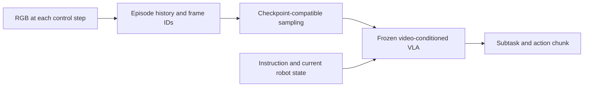

# Video memory { #video-memory }

SimpleMemVLA is an optional visual-memory agent in Hylo. It keeps sampled episode video
and lets a compatible frozen video-conditioned model use that history when producing
subtasks and action chunks. Hylo owns the history buffers and sampling; the pinned
upstream runtime supplies the neural model and action head. No new training is performed.

This option uses its own streaming history interface. It does not implement the semantic
`MemoryStore` query API, and requires a checkpoint trained to consume video context.
Other memory and agent options remain independently selectable.

## Configuration

This is an **experimental integration** requiring a compatible environment and model runtime. It is not a
standalone runnable benchmark config. Before using the agent fragment below:

1. Prepare the inference dependencies and pinned source described in the
   [adapter README](https://github.com/HyloAI/hylo-harness/tree/main/adapters/hylo-policy-simplememvla#reproduction).
2. Make the local checkpoint and camera/state mappings available in that same runtime.
3. Match the Panda controller interface below. A full native Hylo kernel-to-RoboMME evaluation remains unverified.

Install the optional `hylo-policy-simplememvla` workspace adapter in the inference
environment. Make the pinned upstream source importable there and supply an existing
local checkpoint; the adapter does not download weights or install model dependencies.

```yaml
agent:
  type: simplememvla
  params:
    checkpoint: /models/simplememvla_robomme
    camera_map: {front: front, wrist: wrist}
    joint_key: joint_pos
    gripper_key: gripper_pos
    execution_steps: 16
```

The released RoboMME checkpoint expects the Panda joint-position/gripper interface at
20 Hz. State consists of seven arm joints and the first finger position; actions contain
seven joint targets and one gripper value. The environment must supply matching units
and gripper conventions. The adapter does not translate robot embodiments.

## History

The released configuration samples 120 front-camera frames across a roughly 60-second
window at 2 fps and includes the current wrist image. Sampling follows native frame
indices at 20 Hz. The raw buffer retains at most 1,191 front frames and one wrist frame.
Fixed short histories repeat the first available frame; checkpoint configurations can
instead enable the upstream variable-history rule.



`on_step()` records executed control-step observations. Calling `act()` again on the same
step does not duplicate its frame. `observe_history(prefix)` can supply public demonstration
observations after reset and before the first decision; the prefix excludes the current
observation. The environment integration must explicitly provide that prefix.

Each session owns its buffers and feature cache. Reset and episode completion clear them.
Task IDs, rewards, evaluator success and extra simulator fields are not sent to the model.
Older frames leave the rolling window; there is no longer-term video archive or
cross-episode retrieval in this implementation.

## Batching

`SimpleMemVLARuntime.infer_batch()` shares model weights across independent sessions and
preserves row order. Callers assemble batches explicitly. The native agent's `act()` sends
one row; automatic batching across agents is not implemented.

The native agent derives a seed for each decision. Upstream-style shared-stream batching
can draw different noise when batch composition changes. Fix the batching and RNG protocol
when comparing variants; matching initial scene seeds alone does not ensure matching actions.

<span id="sources"></span>

[Pinned dependencies](../../developer-guide/validation/video-memory.md#dependencies) lists source and checkpoint
revisions, attribution and reproduction instructions.

<span id="verification"></span>

[Recorded integration checks](../../developer-guide/validation/video-memory.md) cover upstream parity and regression episodes,
with their scope and limitations. They do not establish a gain over another memory method.

## Next

- [Use memory](../using-memory.md): choose another memory or consuming agent.
- [Adapter API](../../api/packages/hylo-policy-simplememvla.md): native lifecycle and batching.
