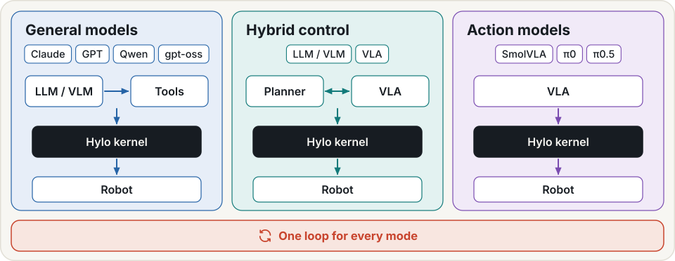
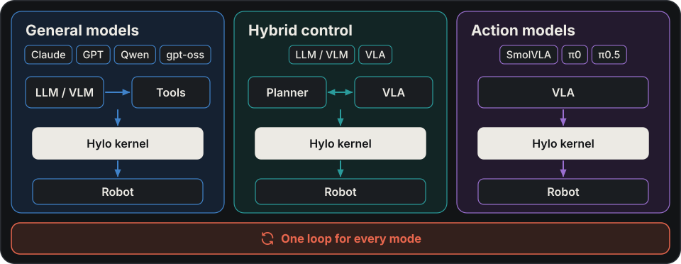
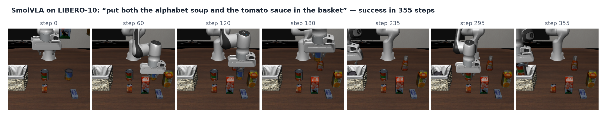

# Policies

This page shows how to run your model in Hylo and which agent to wrap it in.

In the [robot-skill lifecycle](skills.md), a policy is one possible executable implementation of task capabilities.
An agent runs it; task/config records state its scope, and runs and scorecards record validation evidence. Adding
a policy does not automatically create a verified skill-library record.

To construct task logic using perception and motion tools, see [Developing robot skills](developing-strategies.md).
`code.program` runs a task program, while `code.llm` writes code during an episode. They use the same agent contract
and execution kernel as the policy agents documented here.

## Design

**The loop knows only agents.** The episode loop calls an agent and nothing else. Policies, reasoners, memory and
world models live inside agents. Building a reasoner-plus-policy loop into the core would fix one way of thinking
about robots in place, and an end-to-end model that needs no reasoner would then be the odd one out.

**A policy proposes, an agent decides.** A policy samples action chunks from an observation. An agent decides how to
use them: how many to sample, which to take, how many steps to run before asking again, when to resample, whether
memory or a critic biases them. Keeping the two apart means every steering, memory and critic technique works with
every policy, and every policy runs under every agent.

**Randomness comes only from seeds.** A stochastic policy may draw its noise only from the seeds it is given, and
agents derive the seeds from the task, the chunk and the sample. Two agents compared on the same initial state draw
the same noise, so a paired comparison measures the difference between them, not between their luck, and an episode
can be replayed exactly.

**Heavy stacks stay out of process.** A policy with its own dependencies runs in its own runtime behind the same
contract, and its trace events are relayed to the episode. No simulator, model framework or vision-language-action
model is required by the core.

**The contract is checked, not assumed.** A conformance check runs every policy through shape, finiteness and seed
determinism before it is used.

## Policy and agent

A **policy** returns action chunks from an observation. An **agent** holds a policy and decides how to use its
chunks ([concepts](../getting-started/concepts.md)). Any policy runs under any of the agents below.

Policies are one of three control modes. A general model can also call robot tools or write programs
([tool-calling agents](tool-agents.md)), and a planner can set sub-goals for a policy (`planner.subgoal`).

{ .hylo-diagram .only-light }
{ .hylo-diagram .only-dark }

## Agents that run a policy

| Agent | Runs the policy | Key params |
|---|---|---|
| `policy` | chunk by chunk, with seeded noise | `policy`, `execution_steps`, `seed_noise`, `noise_scale` |
| `temporal_ensemble` | every step, exponentially weighted over overlapping chunks (as in ACT) | `policy`, `m` (weight decay; 0 = plain average) |
| `steered` | draws `n_samples` seeded chunks per decision and executes one, with optional recovery rules | `sampler`, `steering` |

=== "policy"

    ```yaml
    agent:
      type: policy
      params:
        policy: {type: policy.bc, params: {path: "artifact:policy.bc"}}
        execution_steps: 8
    ```

=== "temporal_ensemble"

    ```yaml
    agent:
      type: temporal_ensemble
      params:
        policy: {type: policy.bc, params: {path: "artifact:policy.bc"}}
        m: 0.01
    ```

=== "steered"

    ```yaml
    agent:
      type: steered
      params:
        sampler: {type: policy.flow, params: {path: "artifact:policy.flow"}}
        steering: {n_samples: 4, selector: medoid}
    ```

    `sampler` takes a policy spec, like `policy` in the other two agents.

A policy returns chunks of `T` actions. `policy` and `steered` execute the first `execution_steps` of each chunk
(default: the policy's `default_execution_steps()`, capped at `T`). `temporal_ensemble` asks at every step.

Use `policy` to run a policy chunk by chunk. The other two fit these cases:

- **`temporal_ensemble`** gives smoother motion from a deterministic chunk policy, at the price of one policy call
  per step. It returns one action per call, so it works only with sync timing
  ([experiments](experiments.md#timing-sync-and-realtime)).
- **`steered`** suits stochastic policies (flow matching, diffusion), when you can afford `n_samples` calls per
  decision. Everything in `steering` is data, so a [campaign](campaigns.md) can propose and gate changes to it.

`steering` keys:

| Key | Default | Meaning |
|---|---|---|
| `n_samples` | 1 | chunks drawn per decision (1 to 8; cost grows linearly on CPU) |
| `selector` | `first` | `first`, `medoid`, or `gripper_vote_medoid` (keep the chunks that agree with the gripper majority, then take their medoid) |
| `noise_scale` | 1.0 | scale of the initial noise |
| `execution_steps` | the policy's | actions executed from each chunk |
| `seed_noise` | true | derive the noise from seeds (see [below](#the-policy-contract)) |
| `rules` | `[]` | up to 4 recovery rules |

A rule watches one feature and fires an action when the feature crosses a threshold:

```yaml
steering:
  n_samples: 4
  selector: gripper_vote_medoid
  rules:
    - {name: unstick, feature: still_steps, op: ">=", value: 20, action: resample, params: {noise_scale: 1.5}}
    - {name: regrasp, feature: grasp_attempts, value: 3, action: backoff, params: {steps: 8, dz: 0.5}, max_fires: 1}
```

- Features: `still_steps`, `grasp_attempts`, `disagreement` (spread between samples), `steps`. `eef_key` and
  `gripper_key` rename the state keys the first two read (default `eef_pos`, `gripper_qpos`).
- Actions: `resample` (with `params.noise_scale`) and `backoff` (up along action dimension 2 and open the gripper;
  end-effector delta control only, such as LIBERO).
- `cooldown` (default 30 steps) and `max_fires` (default 3 per episode) limit firing.

## The policy contract

A policy is a `policies` plugin with four methods:

```python
class ChunkPolicy(Protocol):
    def spec(self) -> AgentSpec: ...
    def reset(self, ctx: EpisodeContext) -> None: ...
    def default_execution_steps(self) -> int: ...
    def sample(self, observation: Observation, seeds: list[int] | None, noise_scale: float) -> np.ndarray:
        """(N, T, A) action chunks in the environment's units, one per seed."""
```

Deterministic policies (regression, retrieval, scripted) ignore the seeds. Stochastic ones (diffusion, flow
matching, sampled tokens) must take their randomness from the seeds only. Agents compute the seeds from the task,
the chunk index and the sample index. So two agents compared on the same init state draw the same noise, which keeps
paired comparisons fair.

```bash
uv run hylo plugin new policy NAME      # scaffold a policy package
uv run hylo plugin check policy NAME    # conformance: shape, finiteness, seed determinism
```

The [adding a policy](../developer-guide/adding-a-policy.md) tutorial walks through one, and
[extending](../harness/extending.md) lists what the check covers.

## Reference policies

`hylo-policies` ships one small, weights-free implementation of each common policy family, in numpy only. You train
them from your own runs and they are sealed as artifacts. They are not the published architectures at scale.

| Plugin | Family | Idea (reference) | Stochastic |
|---|---|---|---|
| `policy.knn` | retrieval | nearest neighbours in observation space, averaged chunks (VINN) | no |
| `policy.bc` | regression BC | MLP from observation to an action chunk, MSE (BC with chunking) | no |
| `policy.flow` | flow matching | velocity field from noise to the chunk, Euler integration (pi0, SmolVLA action experts) | yes |
| `policy.tokens` | tokenized actions | each dimension binned, categorical heads, sampled (RT-1, OpenVLA-style) | yes |
| `policy.mpc` | model-based planning | cross-entropy method over action sequences in a learned world model (MPC) | yes |

Learners of the same names build `policy_params` artifacts from successful episodes. `world_model.state` builds
the world model that `policy.mpc` plans in ([learning](learning.md)).

### Train and score them on MuJoCo reach

=== "All at once"

    ```bash
    cd bench
    uv run python examples/policies/compare.py    # data -> every learner -> mujoco-reach scorecards -> leaderboard (~3 min)
    ```

=== "Step by step"

    ```bash
    cd bench
    uv run hylo run examples/configs/mujoco_reach.yaml --split search --output runs/policies/demos \
        --set benchmark.params.protocol=rsi                    # demonstrations, from a development split
    uv run hylo learn examples/policies/jobs/flow.json           # a sealed policy_params artifact
    uv run hylo store ls --kind artifact                         # its id: artifact:policy.flow@<digest>
    uv run hylo run examples/configs/mujoco_policy_flow_steered.yaml
    uv run hylo bench run mujoco-reach --name flow-steered \
        --policy examples/configs/mujoco_policy_flow_steered.yaml
    ```

    The example uses the name-only id `artifact:policy.flow`. Pin its digest before
    [comparing runs](experiments.md#what-is-measured-the-digest).

Compare two scorecards with `hylo bench compare A.json B.json` (an exact paired McNemar test) before reading a
difference into them. The results of `compare.py` are on the [leaderboard](../benchmarking/leaderboard.md).

## LeRobot and openpi policies

=== "LeRobot (SmolVLA, pi0, ...)"

    The `hylo-policy-lerobot` adapter runs LeRobot policies on CPU, in the `lerobot` runtime that bench's LIBERO
    setup installs. It registers `lerobot` twice:

    - as a policy, for Hylo's agents (`policy: {type: lerobot, ...}`), with noise from Hylo's seeds;
    - as an agent (`type: lerobot`), which runs chunk by chunk, LeRobot's way, with unseeded noise.

    The factories below wrap the policy in an agent for you:

    | Agent | What it adds |
    |---|---|
    | `lerobot` | the policy, chunk by chunk |
    | `lerobot.steered` | the `steered` agent: seeded noise, sample-and-select, recovery rules |
    | `lerobot.critic_steered` | samples `n_samples` chunks and executes the one a learned chunk critic values most |
    | `lerobot.memory_steered` | starts flow sampling from an action retrieved from its own successes (action memory) |
    | `lerobot.noise_steered` | biases the initial noise towards noise that produced similar successful chunks |

    ```yaml
    agent:
      type: remote
      params:
        ref: lerobot.steered
        runtime: lerobot
        params: {repo_id: lerobot/smolvla_libero, num_threads: 4, steering: {n_samples: 1, seed_noise: true}}
    ```


=== "openpi"

    `openpi` (`hylo-policy-openpi`) is an agent that calls an openpi policy server over WebSocket. Its params are
    `url` (default `ws://127.0.0.1:8000`) and an input `preset` (default `libero`). The
    [plugin catalogue](../developer-guide/plugin-catalogue.md) says how far it is verified.

{ .hylo-figure }

*SmolVLA (`lerobot/smolvla_libero`) on a LIBERO-10 task, every 10th camera frame of one episode.*

Weight licences differ per checkpoint: PaliGemma-based pi0 and pi0.5 checkpoints are under the Gemma Terms of Use.
The [plugin catalogue](../developer-guide/plugin-catalogue.md) lists each plugin's maturity and licences.

## Next

- [Benchmarking](../benchmarking/index.md): score your agent under an evaluation protocol.
- [Run a component in another process](experiments.md#where-components-run), or
  [serve a policy to a robot](deployment.md#3-serving-a-policy).
