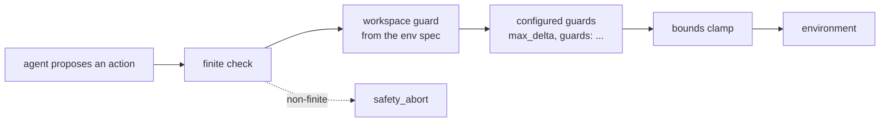

# Safety

Every action any agent proposes passes through the **safety shield** (`core.safety.SafetyShield`) before it reaches
an environment, in benchmarks, campaigns and on robots alike. The kernel builds the shield from the environment's
spec and the experiment's `safety:` config; agents never see or construct it, and nothing can bypass it.

## What the shield does



- **Mandatory guards, first and last.** A finite check runs first: a NaN or infinite action aborts the episode. A
  bounds clamp runs last: the action is clipped to the environment's action space, so no guard in between can push
  an action out of bounds. Rotation dimensions (quaternions, rot6d) are never clamped per dimension: an
  out-of-bounds rotation aborts instead.
- **Environment guardrails.** An environment that declares a workspace (`EnvSpec.workspace`) gets a workspace
  guard, always on: delta-position components that would move the controlled point further outside the workspace
  are zeroed.
- **Configured guards** run in between, in the order given.

Every review is recorded in the trace (`safety.review`: proposed action, approved action, whether it was modified,
reasons), so interventions can be counted, replayed and audited.

## Interventions and aborts

A guard that changes an action is a **safety intervention**: it is counted in the episode's
`safety_interventions` score, and the rest of the agent's planned chunk is discarded, because the plan no longer
matches what will happen. A bounds clip within `clip_tolerance` (default 0.05) is bookkeeping, not an
intervention: policies routinely overshoot normalised bounds slightly (a gripper at 1.03).

On a real robot (`EnvSpec.capabilities.real_robot`), the tolerance is 0 and **every** intervention aborts the
episode (`safety_abort`), and the kernel calls the environment's `stop()` so the arm brakes or holds.

## Configure guards

```yaml
safety:
  max_delta: 0.5                 # shorthand for a delta_limit guard
  clip_tolerance: 0.05
  guards:
    - {type: norm_limit, params: {max_norm: 1.2}}
    - {type: keep_out, params: {state_key: eef_pos, low: [0.3, -0.1, 0.0], high: [0.5, 0.1, 0.3], action_dims: [0, 1, 2], margin: 0.02}}
```

Built-in guards (`guards` plugin group):

| Guard | Params | Effect |
|---|---|---|
| `delta_limit` | `max_delta` (scalar or per dimension) | rate limit: each step's action stays within `max_delta` of the previous one |
| `norm_limit` | `max_norm`, `dims` (default: all) | scales the selected dimensions down so their Euclidean norm stays within `max_norm` (a speed limit) |
| `keep_out` | `state_key`, `low`, `high`, `action_dims`, `margin` | a box the controlled point must not enter: motion into or deeper into it is zeroed |
| `workspace` | `state_key`, `low`, `high`, `action_dims` | the workspace guard, configured explicitly |

Guard plugins from other packages work the same way. The plugins repository's `examples.slow_zone` slows the
fingertip near a target:

```bash
cd plugins && uv run hylo run examples/configs/mujoco_guarded.yaml
```

Write your own with `hylo plugin new guard NAME` and check it with `hylo plugin check guard NAME`; see
[extending](../harness/extending.md).

## Safety in campaigns

Improvement campaigns cannot weaken safety:

- candidates may not patch the `safety` scope, or the benchmark, trace, scorers, environment or evolution settings
  (`evolve.candidate.PROTECTED_PREFIXES`); such a candidate is rejected at stage 0;
- the gate has a **safety veto**: a candidate whose mean safety interventions exceed the parent's by more than
  `protocol.max_safety_increase` (default 1.0 per episode) is not promoted, whatever its success rate;
- a **regression veto** refuses a candidate that loses more than `protocol.max_task_regression` (default 0.15) on any
  task.

See [campaigns](campaigns.md).

## Safety on robots

Workcells add an operator channel to the same loop: stop, a latched e-stop that blocks new episodes until cleared,
reset confirmation and verdicts; a watchdog ends an episode after `timing.max_hold_steps` consecutive hold steps. A
robot environment's spec sets `real_robot`, which switches the shield to abort on any intervention. Keep-out zones and
limits for a cell belong in the lab's deployment repository. See [deployment](deployment.md) and
[deployments repository](../configuration/deployments-repo.md).
