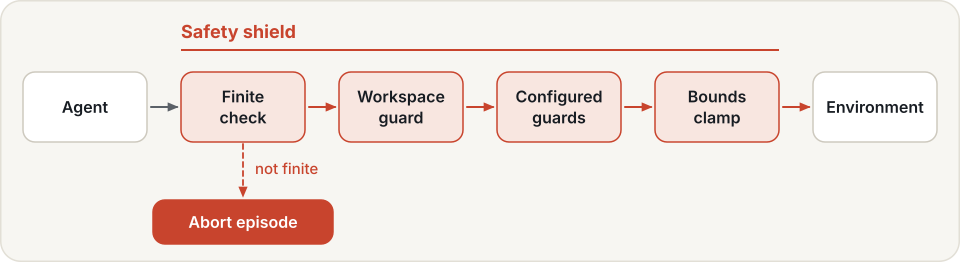
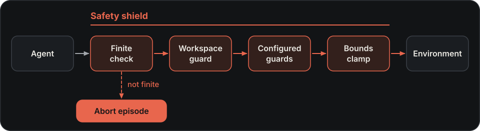

# Safety

Whenever Hylo runs the episode loop (in `hylo run`, benchmarks, campaigns, the Studio live sandbox and workcells),
every action passes through the **safety shield** before it reaches the environment. The episode loop builds the
shield from the environment's spec and the experiment's `safety:` config. Agents never see or build it.

The shield does not cover two cases:

- When `hylo serve policy` answers an external openpi client on `/openpi`, Hylo only computes action chunks. The
  client runs its own control loop and applies its own limits ([deployment](deployment.md#policy-server)).
- A config can load any Python code by `module:attr`. The shield checks actions, not the code that produces them
  ([security](security.md)).

!!! warning "Not a certified safety function"
    The shield is a software layer. On a real robot, keep the robot's own limits (for example LeRobot's
    `max_relative_target` and torque limits) and a hardware e-stop within reach.

## Design

**One checkpoint, owned by the loop.** Actions come from many sources: policies, language models, recovery rules,
campaign candidates, hold actions. They all pass the same shield, and the shield belongs to the episode loop, not to
any agent. Letting a benchmark or a model framework own the loop instead would leave safety and timing to code Hylo
does not control.

**An order that cannot be undone by configuration.** The finite check comes first, because a NaN cannot be repaired.
The bounds clamp comes last, so no configured guard can push an action out of the action space. Guards added in a
config sit in between: they can make an action safer, never loosen the mandatory limits.

**Correct in simulation, stop on a robot.** In simulation a small correction is recorded and the episode goes on,
without the rest of the agent's plan, which no longer matches what will happen. On a real robot any intervention ends
the episode: a policy that had to be corrected once is not one to keep running on hardware.

**Safety runs where the robot is.** On a workcell the shield runs in the process next to the robot, so a network
fault between the policy server and the robot cannot bypass it.

**Improvements cannot buy their score with safety.** Campaign candidates may not change the safety settings, and the
gate vetoes a candidate that needs noticeably more interventions than its parent.

**Every review is evidence.** Each review is a trace event with the proposed and the approved action and the reason,
and interventions are counted in every score, so safety is measured as well as enforced.

## What the shield does

{ .hylo-diagram .only-light }
{ .hylo-diagram .only-dark }

- **Mandatory guards.** A NaN or infinite action aborts the episode. The bounds clamp runs last, so no guard can
  push an action out of the environment's action space.
- **Rotations.** If the action space uses quaternions or rot6d, the bounds check clamps nothing. Any out-of-bounds
  dimension aborts the episode, even a gripper slightly over its limit, and the clip tolerance does not apply.
- **Environment guardrail.** An environment that declares a workspace gets a workspace guard, always on. It zeroes
  delta-position components that would move the controlled point further outside the workspace.
- **Configured guards** run in between, in the order given.

Hold actions, which the episode loop executes when no policy action is ready, pass through the shield too. Every
review is recorded in the trace as a `safety.review` event: the proposed and approved actions, whether the action
was modified, and why.

## Interventions and aborts

A guard that changes an action makes a **safety intervention**. The rest of the agent's planned chunk is discarded,
because the plan no longer matches what will happen. A bounds clip within `clip_tolerance` (default 0.05) is not an
intervention: it is recorded in the review, and the chunk is kept.

These events end the episode at once as `safety_abort`: a non-finite action, an out-of-bounds rotation, a hold
under absolute control with no target to hold, an intervention on a real robot (below), and an operator stop or
e-stop. A watchdog abort ends it as `error` ([episode statuses](experiments.md#runs-and-traces)).

The episode's `safety_interventions` score counts the modified actions, plus one if the episode ended in any of
these aborts, the watchdog included. Campaigns compare this score in their safety veto
([below](#safety-in-campaigns)).

An environment that declares itself a real robot (`real_robot` in its spec) changes the rules. The clip tolerance
becomes 0, and **any** intervention ends the episode as `safety_abort`.

After any abort, the watchdog included, the loop calls the environment's `stop()`. Its effect depends on the
environment plugin. The LeRobot robot adapter commands the arm's current measured position.

## Configure guards

```yaml
safety:
  max_delta: 0.5                 # shorthand for a delta_limit guard
  clip_tolerance: 0.05
  guards:
    - {type: norm_limit, params: {max_norm: 1.2}}
    - {type: keep_out, params: {state_key: eef_pos, low: [0.3, -0.1, 0.0], high: [0.5, 0.1, 0.3], action_dims: [0, 1, 2], margin: 0.02}}
```

Built-in guards:

| Guard | Params | Effect |
|---|---|---|
| `delta_limit` | `max_delta` (scalar or per dimension) | rate limit: each action stays within `max_delta` of the previous one |
| `norm_limit` | `max_norm`, `dims` (default: all) | scales the selected dimensions down so their Euclidean norm stays within `max_norm` (a speed limit) |
| `keep_out` | `state_key`, `low`, `high`, `action_dims`, `margin` | when the next step would land inside the box (grown by `margin`), zeroes the delta components that move into it or deeper into it |
| `workspace` | `state_key`, `low`, `high`, `action_dims` | the workspace guard, configured explicitly |

`keep_out` adds the action to the position in `state_key`. So it only works when the action is a delta of that
position, in the same units. It does not protect a box under joint-space or absolute control, such as the SO-101
template.

Guard plugins from other packages work the same way ([extending](../harness/extending.md)).

## Safety on robots

On a robot, three layers act, each with its own job:

| Layer | What it does |
|---|---|
| Safety shield | Reviews every action. Because the environment sets `real_robot`, any intervention aborts the episode. |
| Episode loop | With `clock: wall`, holds the arm when the policy is late, and ends the episode as `error` after more than `max_hold_steps` holds in a row (the watchdog; `runtime.max_hold_steps` in a workcell config). |
| Workcell | Gives the operator stop, a latched e-stop that blocks new episodes until cleared, reset confirmation and verdicts ([deployment](deployment.md#4-operating-a-workcell)). |

!!! danger "Hold and watchdog need `clock: wall`"
    On the default `virtual` clock, the loop blocks in each policy call and sends no commands while it waits. The
    watchdog cannot fire during that wait. A stalled remote policy ends the episode only when its call times out
    (600 s by default for a `remote.ws` policy), as `error`, without calling `stop()`. Set `clock: wall` on hardware
    ([deployment](deployment.md#2-the-robot-computer)).

The move to the home pose at the start of an episode does not pass through the shield. The LeRobot robot adapter
interpolates to `home` in small steps and clips each step to the action box only. Confirm the reset only when the
path to `home` is clear.

Keep-out zones and limits for a cell belong in the lab's
[deployments repository](../configuration/deployments-repo.md).

## Safety in campaigns

A campaign proposes changes to an experiment config as patches. It rejects any candidate whose patch touches one of
these top-level keys:

`safety`, `benchmark`, `trace`, `scorers`, `env`, `evolution`, `schema_version`

Everything else can change. In particular:

- `agent` is not protected. A patch can replace the agent, including with any `module:attr`.
- `timing` is not protected. A patch can raise `timing.max_hold_steps` and so loosen the watchdog.

The gate's **safety veto** rejects a candidate whose mean safety interventions per episode exceed the parent's by
more than `max_safety_increase`. The default, 1.0, lets a candidate need up to one more intervention per episode
than its parent. Set it in the campaign's top-level `protocol:` block, which holds the gate settings
([campaigns](campaigns.md#reference)).

## Next

- [Security](security.md): who can reach which service, and what a token allows.
- [Deployment](deployment.md): bring a workcell up, first without hardware.
