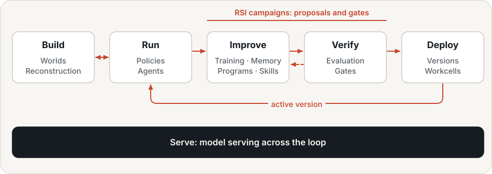
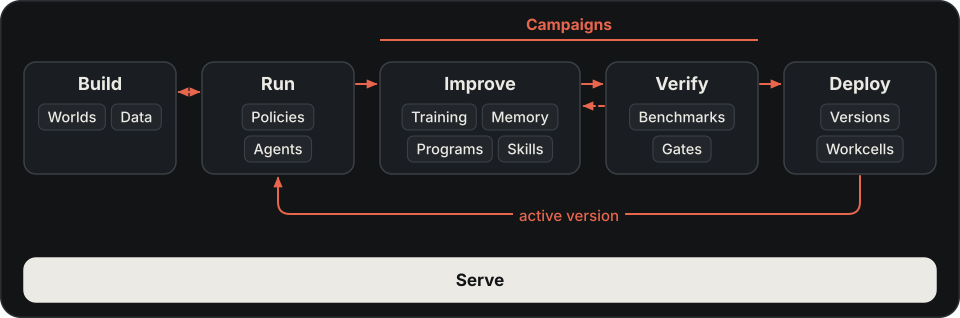

# Robot skills and their lifecycle

Hylo helps teams develop, validate, deploy and accumulate robot skills. A skill is a reusable ability to carry
out a class of tasks under stated conditions: for example, stack blocks on a table with a particular robot and
observation setup. New tasks, changed scenes and goals for speed or reliability can all motivate skill development.

This is the user-facing way to connect the stack. The kernel, agents, policies, tools, evaluation and deployment
services retain their technical responsibilities.

Skills are one of the things the [Physical RSI](../physical-rsi.md) loop improves, alongside settings, programs,
memory, learned components and policy weights. Developing, validating, deploying and reusing a skill follows the same
loop as every other improvement.

{ .hylo-diagram .only-light }
{ .hylo-diagram .only-dark }

## Develop, validate, deploy and reuse

1. **Define the goal (Build).** Describe the task, robot, observations, success conditions and constraints, and
   the world or benchmark it runs in.
2. **Develop and run (Run, Improve).** Bring a policy or controller, write a program using robot tools, or use a model-assisted
   research session. Inspect execution and iterate on development cases.
3. **Validate (Verify).** Freeze the implementation and test separate cases. A first skill is checked against its task
   requirements. A claimed improvement also needs comparison with the previous version; campaign promotion uses the gate.
4. **Version and deploy (Deploy).** Review the implementation, evidence and dependencies. Configure the selected agent or
   campaign version on a policy server and workcell, and validate it on the target robot.
5. **Reuse and improve (Run, Improve).** Retrieve a verified program skill, reuse an implementation/configuration, or develop a new
   version. Collect execution evidence and revalidate when conditions change.

These activities have multiple starting points. An existing policy can enter execution and validation directly;
a new task can begin with development. A failure is one kind of evidence, alongside new requirements and efficiency goals.

## Development, verification and deployment status

The lifecycle above describes activities; it is not a single status field implemented across all packages.

- Development sessions record attempts and frozen submissions. Freezing preserves an implementation; it does not
  mark it verified or deploy it.
- The current `Skill`/`SkillLibrary` records use `proposed`, `verified`, `refuted` and `deprecated`. They support
  plan, steering, recovery, weights and program kinds. Automatic derivation and reuse depend on the kind; the
  documented new path derives program skills from promoted code candidates.
- A campaign's active version is recorded separately in `active.json`. A policy server and workcell must be
  configured to run it. `verified` is not a deployment status.

The current interfaces are research sessions, runs, artifacts, campaign versions and skill-library records.
There is no universal skill dashboard or common skill wrapper for every policy. The guides map each lifecycle
activity to the mechanisms available today.

## Robot skills, program skills and coding-agent skills

| Term | Meaning |
|---|---|
| Robot skill | the task capability used to explain the product workflow |
| Program skill | a `Skill(kind="program")` record referencing a sealed program, applicability and gate evidence; a code agent can retrieve and call it |
| Recipe skill | a `Skill(kind="recipe")` record: the tool calls that solved a world task, keyed by the reasons its goal failed at the start, admitted only after a replay without a model achieved the goal |
| Coding-agent skill | a `SKILL.md` instruction file under `harness/agent-skills/` teaching a software agent to operate Hylo commands |

Program skills are one implementation/reuse path for robot capabilities. The instruction files document how to
operate the tooling; they do not themselves provide a robot's task behaviour.

## Where to start

- [Developing robot skills](developing-strategies.md): tools, program agents and a reference execution.
- [Skill research, validation and reuse](research-and-skills.md): development sessions, independent checks, campaigns and program skills.
- [Memory](memory/index.md): spatial memory, action memory, skill libraries and lessons.
- [Policies](policies.md): connect an existing model or controller.
- [Benchmarking](../benchmarking/index.md): fixed protocols and comparable evidence.
- [Deployment](deployment.md): policy servers, workcells and target validation.
- [Studio](studio.md): inspect the records from these activities.

The [showcase](../showcase/tool-agents.md) reports what has run, under which conditions, including unsuccessful
results and unrun workflows. It does not establish general autonomous skill acquisition or cross-robot transfer.
