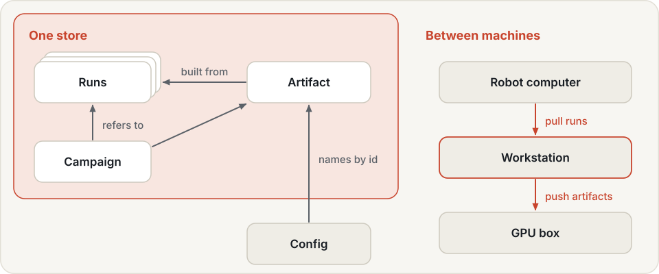
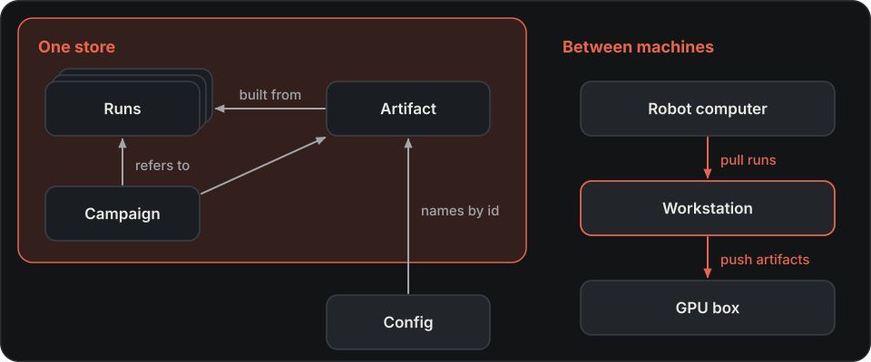

# Store { #run-and-artifact-store }

The store holds runs and artifacts referenced by experiments, campaigns and skill-library records.

Configs name runs and artifacts by **id**, not by path, so the same config works on every machine. Each machine has
one **store**: a directory tree that maps ids to local paths. It protects entries that other entries still name from
deletion, and copies entries between machines.

{ .hylo-diagram .only-light }
{ .hylo-diagram .only-dark }

## Setup { #set-up-the-store }

Installation registers `bench/runs` as the store, and commands on this page run from `bench/`:

```bash
cd bench
uv run hylo store init runs                # make this directory the store, recorded in the profile
uv run hylo store where                    # the store in use
uv run hylo store ls                       # every run and artifact, by id
uv run hylo store ls --kind artifact --json
```

`--root DIR` selects another store for one command. [Profiles](../configuration/profiles.md#store) gives the lookup
order.

Workcell `output_dir` and campaign `out_dir` are relative to the working directory. Make the directory they write to
your store root, or a directory inside it.

## Ids

| Id | Names |
|---|---|
| `run:<run_id>` | a run (a directory with `evallog.json`); run ids end in a random suffix, so they are unique across machines |
| `artifact:<name>@<digest>` | a sealed artifact (a directory with `artifact.json`): its manifest name and content digest |
| `artifact:<name>@<prefix>` | the same, with a digest prefix of at least 8 hex characters |
| `artifact:<name>` | allowed only while exactly one artifact has that name |

```bash
uv run hylo store ref runs/policies/artifacts/flow      # -> artifact:policy.flow@218d7147b2d05110
uv run hylo store show artifact:policy.flow             # entry, local path, what it was built from, referrers
```

An id that does not resolve says why: not found, ambiguous, or removed
([messages](../developer-guide/troubleshooting.md#the-store)).

## Artifact references { #reference-artifacts-in-configs }

```yaml
sampler: {type: policy.flow, params: {path: "artifact:policy.flow@218d7147b2d05110"}}
```

- An id with a digest pins the artifact's content in the experiment digest. A name-only id does not: if the
  artifact is replaced, the experiment digest stays the same. Pin with `@digest` whenever runs must be
  [comparable](experiments.md#what-is-measured-the-digest).
- Ids become this machine's paths only when a component is built, after the digest is taken. A plugin still
  receives a path.
- The run's `manifest.json` records every id the config used, with the full id and the local path (`artifacts:`).
  A name-only id is pinned there, after the fact.

## Deletion { #delete-safely }

```bash
uv run hylo store rm run:<run_id>
uv run hylo store rm artifact:old-critic@1a2b3c4d --force --reason "superseded"
```

`hylo store rm` refuses while another entry refers to the one you delete, and lists what does. These references
count:

- an artifact refers to the runs and artifacts it was built from;
- a campaign refers to every run and artifact its archive or promotion ledger names.

The store knows only the references in its index. A config file or a script that names an id does not protect it.

`--force` deletes anyway. Either way a tombstone in `<root>/.hylo-store/tombstones.jsonl` records what was removed,
when, why, and what referred to it. A later lookup of that id says it was removed instead of "not found".

!!! warning
    Do not delete run directories by hand. An artifact's provenance or a campaign's archive may still name them.

## Transfer { #move-runs-and-artifacts-between-machines }

```bash
uv run hylo store pull robot-host:/home/lab/runs                        # runs recorded on the robot computer
uv run hylo store push gpu-box:/data/runs artifact:policy.flow@218d7147 --with-sources
uv run hylo store push /mnt/backup/runs --dry-run                       # what would be copied
```

| Option | Meaning |
|---|---|
| `LOCATION` | `PATH` or `HOST:PATH` (ssh and rsync) |
| `IDS ...` | what to copy (default: everything) |
| `--with-sources` | also copy what the selected artifacts were built from |
| `--dry-run` | print the plan |
| `--remote-command` | the `hylo` command on the other machine (default `hylo`) |

The other side is listed with its own `hylo store ls --json`, so `hylo` must be on the remote machine's
non-interactive ssh `PATH`. In a uv workspace it usually is not: pass, for example,
`--remote-command 'uv run --project /path/to/workspace hylo'`.

Sealed artifacts are never copied again or overwritten. If the same path holds a different entry on the other side,
that is a conflict, and nothing is copied. Runs and [mutable artifacts](learning.md#artifact-roles), such as lesson
books, are brought up to date.

Push and pull have been tested between local stores. Transfers over ssh have not been tested.

## Import runs { #adopt-older-directories }

An artifact built before manifests existed can be sealed in place, with the runs it was built from:

```bash
uv run hylo store adopt runs/memory/my-action-memory --kind action_memory --role behaviour \
    --source run:<run_id>
```

`--source` can be repeated. The sources are recorded as you state them. Hylo refuses a gate or held-out source, but
it cannot check that your list is complete.

Without any `--source`, the provenance is recorded as unknown. Such an artifact can still be used in experiments,
but a campaign refuses it at stage 0 as a behaviour artifact in a candidate, because a leak of gate or held-out data
cannot be ruled out.

## Next

- Score agents under a fixed protocol: [benchmarking](../benchmarking/index.md).
- Train artifacts from stored runs: [learning](learning.md).
