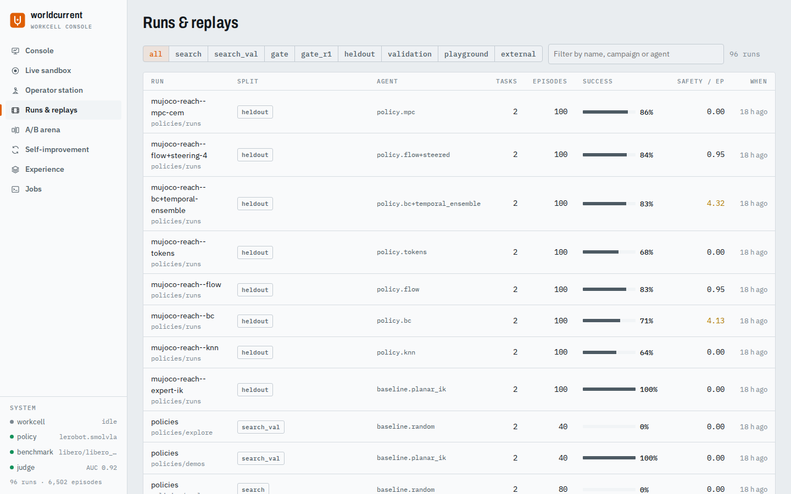
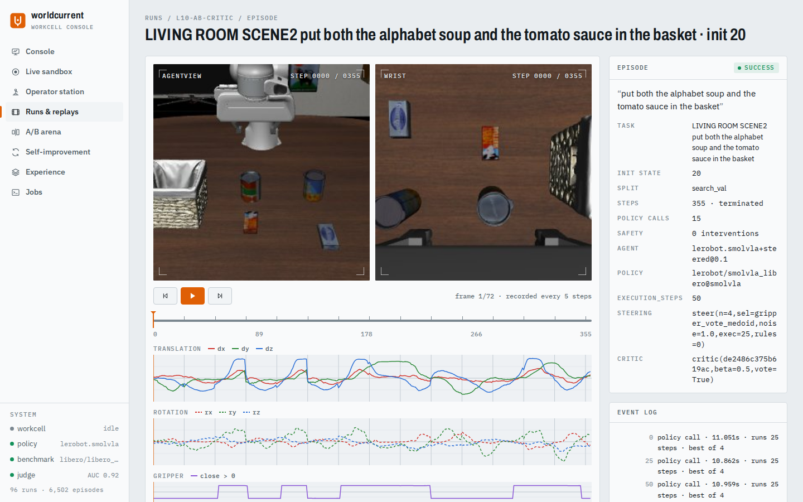
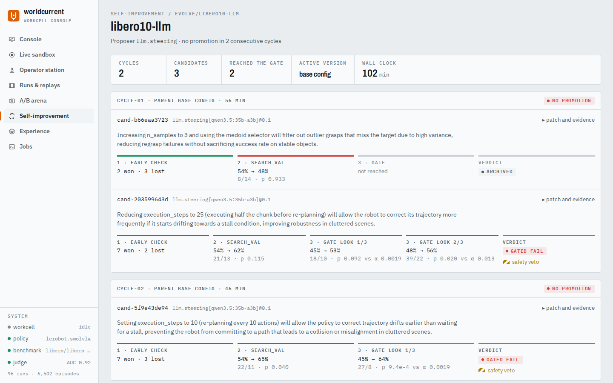
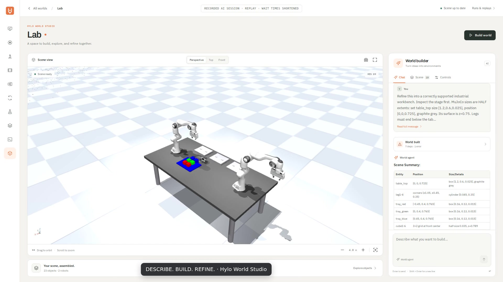
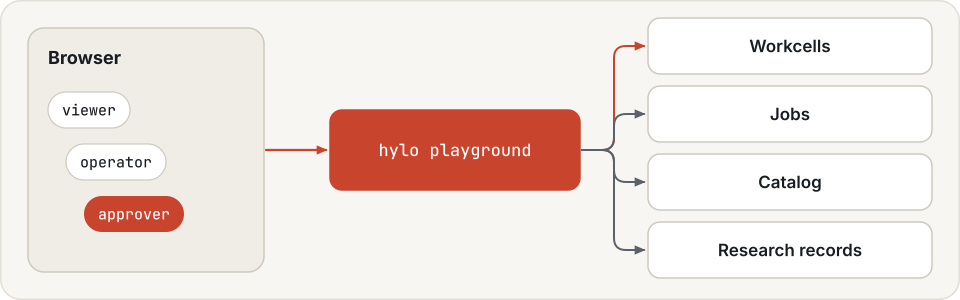
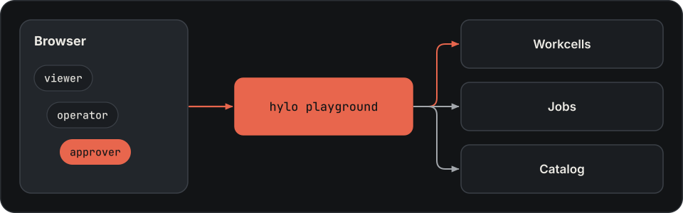

# Studio

Studio is Hylo's web UI. It shows research sessions, runs, campaigns and artifacts, and it is the control plane for workcells.
Start it with `hylo playground`. It runs the same `hylo` commands a person would type, with the same checks, and
talks to workcells through the workcell API. It never sends actions to a robot.

Use these views to inspect the [robot-skill lifecycle](skills.md): Research shows development, Runs and A/B arena
show execution and validation, Self-improvement shows candidate versions, Experience shows skill-library records
and artifacts, and Operator handles deployed execution. These remain separate views over the current records.

{ .hylo-figure }

## Setup { #starting-it }

Build the web UI once first ([installation](../getting-started/installation.md)). Until then, Studio answers
"frontend not built". Then start Studio from the workspace directory:

```bash
uv run hylo playground --repo bench          # http://127.0.0.1:8765
```

| Option | Default | Meaning |
|---|---|---|
| `--repo DIR` | `.` | the working directory: Studio lists its `examples/configs` and `examples/evolve`, and runs jobs in it (for example a bench checkout) |
| `--root DIR` | `runs` | the runs directory, relative to `--repo` |
| `--workcell NAME=URL[#TOKEN]` | none | a workcell to operate; repeatable |
| `--policy NAME=WS_URL[#TOKEN]` | none | a policy server endpoint; repeatable |
| `--sessions [LABEL=]DIR` | none | another directory with research sessions or code-agent runs, relative to `--repo`; repeatable |

`hylo playground --help` lists the rest; tokens are under [access](#roles).

## Pages

| Page | What it shows and does |
|---|---|
| Console | runs, campaigns and artifacts at a glance, with recent activity |
| Live sandbox | one episode of any experiment config, streamed frame by frame |
| Operator station | episodes on a workcell with a chosen policy server; reset, verdicts, stop, e-stop |
| Runs & replays | every recorded run, per-task success, and episode replay |
| A/B arena | two runs compared, paired on task and init state |
| Self-improvement | campaigns: cycles, candidates, gate statistics, the promotion ledger; approve or roll back |
| Research | research sessions and code-agent runs: every turn's text, code, output and images, submissions, the frozen program, usage and cost |
| Experience | skill libraries, lesson books, action memories, and sealed artifacts with provenance and calibration |
| Jobs | `hylo run`, `hylo evolve run` and `hylo calibrate` in the background, with their logs |
| World | stages and the worlds built from them: a view to orbit, actions and checks by hand, chat sessions with a model |

### Live sandbox

Runs one episode of any experiment config through the episode loop and its safety shield, streamed as it happens.
You choose the task and init state from the benchmark's splits, change config overrides, and give the agent a
different instruction. The environment's task and success check stay the same. The environment and the agent stay
loaded between episodes of the same config.

The sandbox refuses overrides of `safety`, `benchmark`, `trace`, `scorers`, `evolution` and `schema_version`. This
list differs from what campaigns protect: it does not include `env` ([safety](safety.md#safety-in-campaigns)).
Any other override is accepted, including `agent.type=module:attr`, which runs arbitrary code. That is why the
sandbox needs the operator role.

Live episodes are saved under `runs/playground/live/<run_id>` with the split `playground`, which learners do not
read by default.

For a step-by-step illustration, [watch the recorded AI robot-control demo](tool-agents.md#recorded-robot-control-demo):
an English stacking instruction, model tool calls, grasp and place motions, and the task verdict. This is a
presentation of a recorded episode; the [Live sandbox recording](tool-agents.md#run-it) shows how to launch an agent
in Studio.

### Operator station

Operates a workcell (`--workcell`) with a policy server (`--policy`): start episodes, follow the live stream,
confirm resets, give verdicts, stop, e-stop and clear faults. What each event does is in
[deployment](deployment.md#4-operating-a-workcell), with a
[bring-up without hardware](deployment.md#1-bring-up-without-hardware).

### Runs & replays

Lists every run under the runs directory with its benchmark, split, agent, success and episodes, filtered by split
or text. Opening an episode replays it from its trace: camera frames, executed actions, chunk boundaries, safety
interventions, and the success judge's progress estimate along the episode. The judge is set with `--judge`. By
default it is the LIBERO-10 trace judge, if it is in Studio's runs directory.

{ .hylo-figure }

### A/B arena

Two runs of the same split, paired on task and init state, with the same one-sided exact McNemar test as
`hylo bench compare` ([compare two scorecards](../benchmarking/index.md#statistics)), plus
side-by-side replays of the pairs where one run succeeded and the other failed.

### Self-improvement

Every campaign under the runs directory: its cycles, the candidates with their hypotheses, the gate statistics,
vetoes, the promotion ledger and the active version ([campaigns](campaigns.md)). A candidate that passed the gate
and waits for approval can be approved here, which runs `hylo evolve approve`. The active version can be rolled
back with a reason, which runs `hylo evolve rollback`. Both need the approver role.

{ .hylo-figure }

### Research

Use this page to inspect strategy development records. Start sessions through
[the research CLI](research-and-skills.md); this page does not provide an interactive authoring editor.

Lists every research session under the runs directory, and the scene-builder, motion-studio and replay runs under
each `--sessions` directory, with the model, task, best development score, turns, tokens, cost, wall time and why
the session stopped. Opening one shows:

- the timeline: for each turn, the model's text and reasoning, the code it ran, the printed output or error, and
  the images it was shown; resets, submissions and tool calls in between;
- a usage panel: prompt tokens (and the cached part) and model latency per turn, the turns that submitted, and the
  totals;
- the submissions, each with its outcome, steps and printed output per development case, and its source;
- the frozen program: its source, digest and provenance;
- a link to the campaign candidate the program became, found through the candidate's `evidence.session`; the
  campaign page links back.

Studio reads the session files directly (`log.jsonl` or `turns.jsonl`, `summary.json`, `submissions/`, `frozen/`),
so a session that is still running or was interrupted shows what it has so far. It serves files only from inside a
session directory, and only images, videos and text.

### World

[](worlds.md#chat-to-world-demo)

[Watch the full English demo · 2:10](worlds.md#chat-to-world-demo). Recorded AI session replay; waits are shortened.

Lists the stages under `runs/world/stages` (create one from the page), and for a stage:

- **Scene view:** orbit by dragging, zoom with the wheel, choose Perspective, Top or Front, fit the scene,
  save a snapshot or enter fullscreen. Build world compiles the newest stage revision;
- **Chat:** a message starts `hylo world chat` in the background, or goes to the inbox of a running session.
  Read model messages and expand grouped tool activity, including failures; scene changes update the view;
- **Scene:** search the object collection, filter robots, inspect an object's position and focus the camera on it;
- **Controls:** run any [world action](worlds.md#running-a-world) or goal check on the current generation and inspect
  the returned result.

Sessions are written to `runs/world/sessions/<stage>` and can be followed with `hylo watch`.

### Jobs

Starts `hylo run`, `hylo evolve run` or `hylo calibrate` (and `hylo learn`, through `POST /api/jobs`) as a local
subprocess in `--repo`, with its log in `runs/playground/jobs/<id>.log`. Jobs start as soon as you submit them;
they are not queued.

## Roles

{ .hylo-diagram .only-light }
{ .hylo-diagram .only-dark }

Studio binds to `127.0.0.1` by default. Without `--token` or `--role-token`, anyone who can reach the port has every
role, including approver. Roles, tokens and what each role can do are on the [security](security.md#studio-roles)
page.

## Next

- [Deployment](deployment.md): bring up a workcell to operate from Studio.
- [Campaigns](campaigns.md): what the Self-improvement page shows.
- [Tool-using agents](../rfcs/RFC-0006-tool-using-agents.md): what research sessions are.
- [Worlds](worlds.md): what the World page builds and runs.
