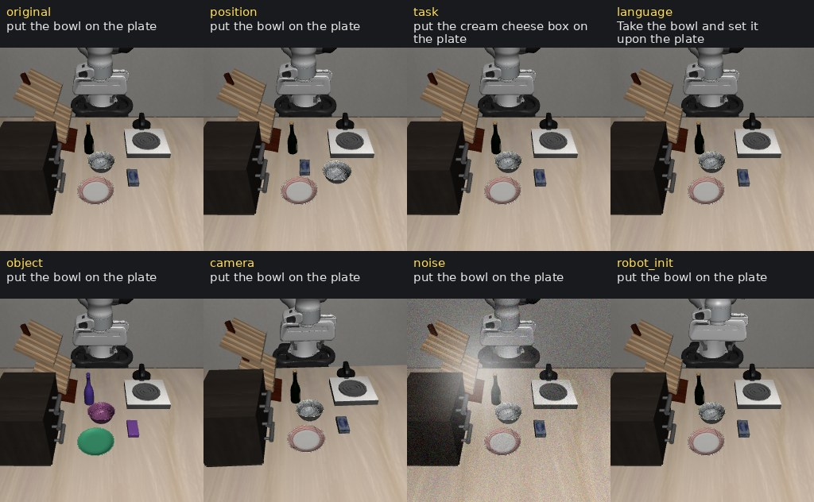

# Tool-calling agents

`tools.llm` lets a chat model operate a robot through typed tools, one checked action at a time. The model can
measure freely: find objects, turn pixels into world points, compute, and ask for grasp poses. Every action it
takes is a proposal that runs through the kernel and the safety shield, and the next message brings a measured
receipt and fresh camera images. The task's own check decides success; the model never sees it.

Use it to try a model on a task without writing a program, to watch how a model approaches a robot problem, and to
collect conversations that worked. For a frozen, model-free implementation use `code.program`; for a model that
writes Python against the same tools use `code.llm` (see [Developing robot skills](developing-strategies.md)).

<video src="../../assets/videos/tools-llm-stack.mp4" poster="../../assets/videos/tools-llm-stack.jpg" controls muted loop playsinline preload="none" width="100%" aria-label="A tools.llm stack episode with the model's turns and tool calls captioned"></video>

*A `stack` episode with a local model: locate both blocks, choose a grasp option, grasp, locate the target again,
place. Five model calls, two actions.*

## Why tool calls

Hylo's code agents let a model write Python against the robot's toolkit. That works, but a program block can move
the robot many times before anyone sees the result, small models fail on syntax, and most served models are trained
to call tools with JSON arguments rather than to write programs. Comparing models on a robot also needs a record
that holds up afterwards: which prompt and tools the model had, what it was shown, and proof that nothing in the
trace was changed. `tools.llm` is designed for those three needs: step-by-step control with checked actions, native
tool calls, and evidence.

## Design

{ .hylo-diagram .only-light }
{ .hylo-diagram .only-dark }

**Looking is separate from acting.** Read tools (locate, measure, compute, ask for grasp poses) can be batched in one
reply and change nothing. An action must be the only call in its reply. It is recorded as a proposal tied to the
observation it was decided on, runs through the kernel and the safety shield, and is answered with a measured
receipt and fresh images. The model therefore sees the effect of every action before it decides the next one.

**Measurements expire.** A target or grasp handle is tied to the moment it was measured. Once the robot has moved,
an old handle is refused as stale and the model has to measure again: positions taken before a motion may no longer
be true after it.

**Refusing is not failing.** An action the shield or the planner refuses, and that moved nothing, does not count as a
decision, so a model is not punished for asking for something impossible and then correcting itself. Three identical
refusals in a row end the episode, so it cannot loop forever.

**The task decides success.** `finish(success)` records what the model believes. The episode is scored by the task's
own check, which the model never sees: a model that could see the check could stop the moment it passed, or argue
with it.

**Nothing is dropped from the record.** Long episodes outgrow the model's context, so what the model is sent is a
projection: recent turns verbatim, older results as references it can reopen, and under pressure a structured
summary. The conversation itself is append-only, and everything left out of the projection stays in the trace.

**The evidence holds up.** The prompt is recorded layer by layer with digests, every trace line carries the hash of
the line before it, and a sealed run can be checked later for any change. A person can steer a running episode, but
any message marks it as human-assisted, and such episodes are kept out of autonomous results and training exports.

**Tools are declared once.** Each tool is one declaration (a kind, a closed argument schema and structured help).
The same declaration serves native tool calls, a text protocol for models without them, the MCP server and these
docs, so they cannot drift apart.

**The same execution path as every agent.** A tool action becomes action chunks that the episode kernel executes
step by step through the safety shield, exactly as it does for a policy or a code agent. A model's run is therefore
scored, traced and limited in the same way as any other agent's, and the results can be compared directly.

??? info "Under the hood"

    - **Tool surface.** Every tool is typed: a name, a kind (`read`, `act` or `end`), a closed JSON schema for its
      arguments, and help in six parts (purpose, when to use, effect, returns, limits, errors). Calls are checked
      against the schema before they run; a bad call returns a structured error, not an exception.
    - **Model backends.** Messages use one neutral format with tool calls and tool results; adapters translate it for
      OpenAI-compatible endpoints (including reasoning replay for models that need it) and the Anthropic API. Models
      without native tool calls write fenced `tool` blocks, which are parsed into the same calls.
    - **Prompt layers.** The system prompt is built from four layers (protocol, evidence rules, boundary, robot
      description), each recorded with its digest.
    - **Context.** Older tool results are stored and replaced by references the model can reopen with `read_artifact`;
      under token pressure older turns are folded into a summary with seven fixed keys (`progress`, `confirmed`,
      `ruled_out`, `attempts`, `constraints`, `avoid`, `next_checks`). A tool call and its result are always
      kept or dropped together.

??? example "One recorded episode, call by call"

    The `stack` episode in the video, with `qwen3.5:35b-a3b` running locally:

    | Call | The model | The robot and the tools |
    |---|---|---|
    | 1 | locates both blocks in one reply: two read calls | purple block `t1` and green block `t2`, measured in 3D at step 0 |
    | 2 | asks for grasp options on `t1` | options that fit the open hand; `g3` is top-down with no IK error |
    | 3 | grasps with `g3`: an action, alone in its reply | proposal tied to step 0; receipt after 84 steps: closed with 0.6 mm error, lifted with 4.0 mm, holding before and after the lift |
    | 4 | locates the green block again, since the robot has moved and `t2` would now be refused as stale | the same block as `t7`, measured at step 84 |
    | 5 | places on `t7` | lowered and released with 1.4 mm error; the episode ends, and the task's check reports success |

    Five model calls, two decisions, no refusals, 127 control steps, 93 seconds of wall time.

## Run it

The environment must publish a robot description (`mujoco.panda_table`, `mujoco.aloha_table`, `mujoco.g1_table`,
or `libero` in its tool mode). An experiment config:

```yaml
schema_version: hylo.experiment/v0.1
name: tools-llm-stack
benchmark: {type: mujoco/manip-v0, params: {tasks: [stack], validation: 3}, split: validation}
env: {type: mujoco.panda_table, params: {cameras: [front, side, wrist], segmentation: true}}
agent:
  type: tools.llm
  params:
    model: {backend: ollama, model: qwen3.5:35b-a3b, vision: true, reasoning_effort: none}
    max_decisions: 20        # actions that moved (or could have moved) the robot
    max_calls: 60            # model calls in the episode
    inbox: runs/steer/inbox.jsonl
trace: {record_privileged: false}
```

```bash
uv run hylo preflight runs/configs/tools-llm-stack.yaml --out runs/tools-llm-stack   # check before running
MUJOCO_GL=osmesa uv run hylo run runs/configs/tools-llm-stack.yaml
uv run hylo watch runs/<run-dir>                                                     # follow it in the terminal
```

`hylo preflight` loads the config and its plugins, checks free storage, makes four live calls to the model (a text
reply, an image, a tool call with the right arguments, an answer that uses a tool result) and resets the
environment once. With `--out` the results are kept with the run.

Models: any OpenAI-compatible endpoint (Ollama, vLLM, DeepSeek), the Anthropic API, or a coding-agent CLI. Models
without native tool calls get the tools described in the prompt and write calls as fenced blocks. For local
reasoning models, `reasoning_effort: none` keeps replies short.

<video src="../../assets/videos/studio-live.mp4" poster="../../assets/videos/studio-live.jpg" controls muted playsinline preload="none" width="100%" aria-label="A tool-calling agent running one MuJoCo stack episode from the Studio's Live sandbox"></video>

*The same agent started from the Studio's Live sandbox: cameras (RGB, depth, segmentation) and the event log while a local model stacks two blocks, then the replay.*

## Tools

| Tool | Kind | What it does |
|---|---|---|
| `robot_state` | read | each arm's tool pose, joints, hand opening and whether it holds something |
| `look` | read | the camera images with each camera's position, direction and intrinsics |
| `locate` | read | objects described in words, measured in 3D; returns target handles and an outlined image |
| `pixel_to_world`, `world_to_pixel` | read | pixels to world points from depth (named points are cross-checked between cameras); points to pixels with occlusion evidence |
| `calc` | read | exact arithmetic with numpy and rotation helpers |
| `grasp_options`, `reach_check` | read | grasp poses for a target that fit the open hand; whether a pose is reachable |
| `read_artifact`, `report_issue` | read | reopen an older result the context stored; note an interface problem |
| `move_tcp` | action | move the tool point to a pose, on a collision-free path or in a straight line |
| `grasp`, `place` | action | execute a grasp option (approach, close, lift); put the held object at a point or on a target |
| `gripper`, `recover`, `wait` | action | open or close; back to the previous or home posture; let time pass |
| `finish` | end | success with the evidence, give up with a reason, or abort |

Rules the agent works under:

- Read tools can share one reply. An action must be the only call in its reply, and ends the model's turn.
- Target and grasp handles are tied to the moment they were measured; after the robot moves they are refused as
  stale and must be measured again.
- A refused action that moved nothing does not count as a decision. The same action refused three times in a row
  ends the episode.
- `finish(success)` states the model's view only. Episodes are scored by the task's check.

## Watch and steer

```bash
uv run hylo watch runs/<run-dir>                        # the newest episode, followed while it runs
uv run hylo watch runs/<run-dir> --replay --speed 4     # a finished episode on its recorded timing
uv run hylo watch runs/<run-dir> --inbox runs/steer/inbox.jsonl --interactive   # type to steer
uv run hylo watch --say "the target is the small cup" --inbox runs/steer/inbox.jsonl
```

Each model turn, tool call, receipt and operator message is one line. A message sent to the inbox reaches the model
before its next call. Any message marks the episode `human_assisted`; such episodes do not count as autonomous
results and are left out of training exports.

<video src="../../assets/videos/terminal-watch.mp4" poster="../../assets/videos/terminal-watch.jpg" controls muted playsinline preload="none" width="100%" aria-label="hylo watch replaying a recorded tool-calling episode in a terminal"></video>

*`hylo watch --replay` on a recorded episode: each model turn, read calls in blue, actions in orange with their receipts, a refused call in red that the model then corrects, and the verdict.*

## Read the results

Per episode, the trace has the model's turns (`agent.tool.turn`), every tool result, every action proposal and its
receipt, and a summary: model calls, decisions, refusals, tokens, cost, why it stopped, and the outcome the model
stated. The prompt is recorded by layer (protocol, evidence rules, boundary, robot description), each with a digest,
together with the digest of the tool set.

??? example "The first model call in the trace (abridged)"

    ```json
    {"type": "agent.tool.turn", "seq": 4,
     "payload": {"call": 1, "images": 2, "model": "qwen3.5:35b-a3b", "backend": "ollama",
                 "tool_calls": [{"id": "call_ay5zhb6m", "name": "locate", "arguments": {"text": "purple block"}},
                                {"id": "call_53rblsls", "name": "locate", "arguments": {"text": "green block"}}],
                 "tokens_in": 5873, "tokens_out": 132, "cached_tokens": 5408, "latency_s": 17.5, "stop_reason": "tool_calls"},
     "prev": "a46a5428…", "h": "37…"}
    ```

??? example "A proposal and its receipt (abridged)"

    ```json
    {"type": "agent.tool.proposal", "seq": 10,
     "payload": {"action_id": "a6", "tool": "grasp", "arguments": {"option": "g3"}, "observation_step": 0}}
    {"type": "agent.tool.receipt", "seq": 349,
     "payload": {"action_id": "a6", "tool": "grasp", "status": "arrived", "steps": 84, "counted_as_decision": true,
                 "stages": [{"stage": "approach and close", "steps": 69, "tcp_error_mm": 0.6, "rotation_error_deg": 0.1,
                             "holding_after_close": true},
                            {"stage": "lift", "steps": 15, "tcp_error_mm": 4.0, "rotation_error_deg": 0.0}],
                 "holding": true, "holding_after_lift": true, "verdict": "holding the object"}}
    ```

??? example "The episode's summary"

    ```json
    {"type": "agent.tool.summary", "seq": 531,
     "payload": {"calls": 5, "decisions": 2, "refused": 0, "stopped": "episode ended", "operator_messages": 0,
                 "human_assisted": false, "steps": 127, "context": {"stored": 2, "summaries": 0, "reopened": 0},
                 "usage": {"tokens_in": 34965, "tokens_out": 678, "cost_usd": 0.0, "latency_s": 83.92}, "wall_s": 92.6}}
    ```

```bash
uv run hylo seal runs/<run-dir>             # check every hash chain, list every file, make the run read-only
uv run hylo seal --verify runs/<run-dir>    # anything changed, added or removed since sealing
uv run hylo chats runs/<run-dir> --out chats.jsonl   # successful, unsteered conversations as training records
```

Every trace line carries the hash of the line before it, so a changed, removed or reordered line is found. Sealing
is refused when a chain is broken or when a model-visible event contains privileged keys.

## Perturbed LIBERO

LIBERO tasks can be changed in seven ways, to measure what an agent or a policy relies on. Declare them on the
benchmark; each variant is its own task:

```yaml
benchmark:
  type: libero
  params: {suite: libero_goal, task_indices: [8], perturb: [position, language, task]}   # three variants
  # perturb: [[position, object]]                                                          # one combined variant
env: {type: libero, params: {control: joint_position, tool_obs: true, segmentation: true}}
```



| Perturbation | What changes |
|---|---|
| `position` | the object the goal moves trades start positions with another movable object |
| `task` | a different goal in the same scene, with a rewritten instruction, checked by LIBERO's own goal predicate (27 of the 40 tasks of four suites have one) |
| `language` | the instruction is replaced by a paraphrase (three per instruction) |
| `object` | movable objects are recoloured |
| `camera` | the main camera moves about its view axis |
| `noise` | pixel noise and a glare spot on every image |
| `robot_init` | the arm starts from offset joints |

Every observation reports what was changed. Perturbations work in both LIBERO modes, for VLA policies as well as
tool agents.

## Next

- [Worlds](worlds.md): build scenes with other robots and let a model run them.
- [Developing robot skills](developing-strategies.md): programs and code agents with the same tools.
- [Showcase](../showcase/tool-agents.md#tool-calling-agents): measured results and what does not work yet.
