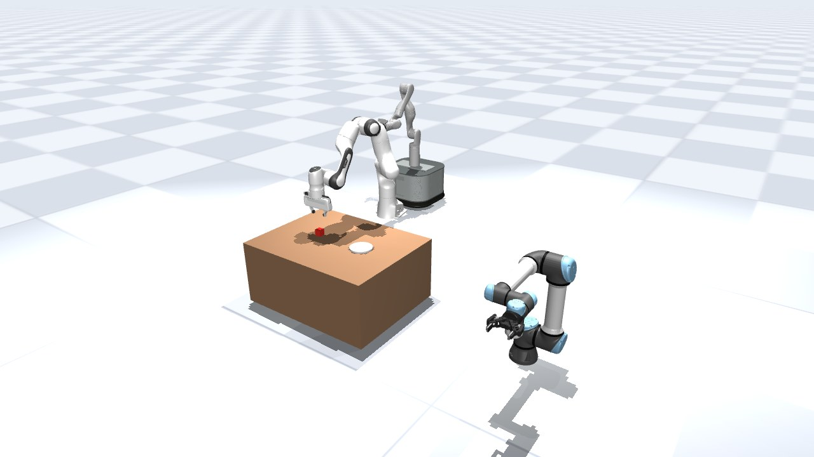
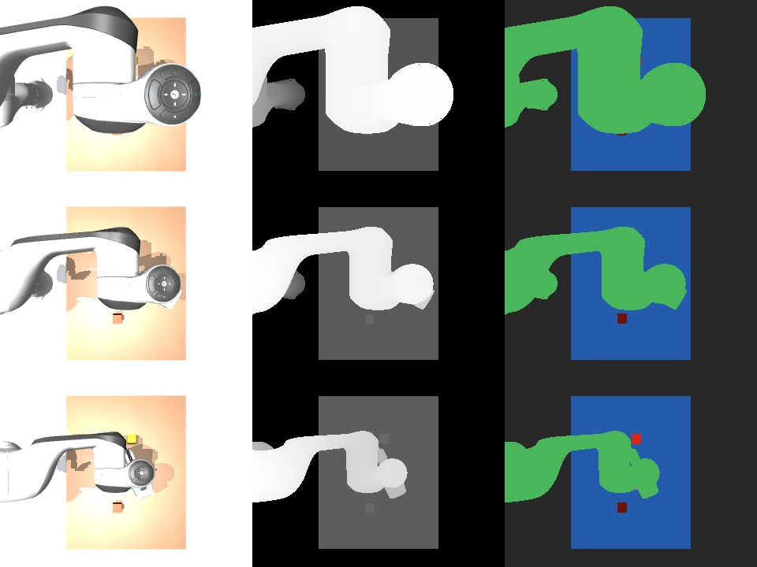

# Worlds

A world is a place to try robots outside a benchmark: put a quadruped next to a table, mount a gripper on an arm,
let people walk past, and record what the cameras see. You describe the scene as a stage, build it into a MuJoCo
simulation, run robots in it with actions, and check goals. A chat model can do all of this through the same tools,
and so can a coding agent over MCP.



*A world seen from a free viewpoint (the `view` tool): a Panda at a table with a cube and a plate, a UR5e with a
Robotiq gripper mounted on its wrist, and a TidyBot mobile manipulator, all from one stage.*

## Stages

A stage is a list of entities, each with a pose and one kind of content:

| Content | Fields |
|---|---|
| `shape` | `box`, `sphere`, `cylinder`, `capsule` or `plane`, size (half extents for boxes), colour |
| `mesh` | an obj or stl file and a scale; collision geometry from `collision` |
| `body` | for shapes and meshes: `dynamic: true` makes it movable, mass or density, friction |
| `robot` | a pack name, base `fixed` or `free`, `mount` onto another entity's body, start joints |
| `camera` | field of view and image size; it looks along its own −z axis (`look_at` builds a pose) |
| `light`, `human` | a light; a walking person with a route, speed and height |

Every change is a patch against the revision you read (add, remove, update, reparent). A patch written against an
older revision is refused, so two editors cannot overwrite each other. Every revision is kept and any one can be
restored.

```bash
uv run hylo stage new lab                       # in runs/stages (or $HYLO_STAGES)
uv run hylo stage patch lab patch.json          # {"expected_revision": 0, "ops": [{"op": "add", "entity": {...}}]}
uv run hylo stage history lab
uv run hylo stage restore lab 3
```

A shape or mesh without `body: {dynamic: true}` is fixed in place. Free-base robots (quadrupeds, humanoids, drones)
take x, y and yaw from their pose and their height from the pack.

## Robot packs

| Family | Packs | Actions |
|---|---|---|
| Arms | `panda`, `ur5e`, `ur10e`, `iiwa14`, `xarm7`, `so101`, `vx300s`, `aloha` | joints, gripper, tool pose |
| Gripper and hands | `robotiq_2f85` (mount it on an arm), `leap`, `allegro`, `shadow` | gripper, joints |
| Quadrupeds | `go2`, `go1`, `a1`, `spot` | joints, walk |
| Humanoids | `g1`, `h1`, `t1`; `g1_legs`, `h1_legs` with walking policies | joints; policy |
| Drones | `crazyflie`, `x2` | fly |
| Mobile manipulator | `tidybot` | base, joints, gripper, tool pose |

<div class="grid" markdown>

<figure markdown>
<video src="../../assets/videos/world-quadrupeds.mp4" poster="../../assets/videos/world-quadrupeds.jpg" controls muted loop playsinline preload="none" width="100%" aria-label="Go2, Go1, A1 and Spot trotting side by side, then turning"></video>
<figcaption>Go2, Go1, A1 and Spot: 0.78 to 1.31 m forward in 4 s, then a turn, all in the same steps.</figcaption>
</figure>

<figure markdown>
<video src="../../assets/videos/world-humanoids.mp4" poster="../../assets/videos/world-humanoids.jpg" controls muted loop playsinline preload="none" width="100%" aria-label="Unitree G1 and H1 walking under pretrained policies, then turning"></video>
<figcaption>G1 and H1 leg models under pretrained walking policies: 2.2 and 2.0 m in 5 s, then a turn.</figcaption>
</figure>

<figure markdown>
<video src="../../assets/videos/world-drones.mp4" poster="../../assets/videos/world-drones.jpg" controls muted loop playsinline preload="none" width="100%" aria-label="A Crazyflie and a Skydio X2 flying three waypoints each"></video>
<figcaption>Crazyflie 2 and Skydio X2 flying three waypoints each.</figcaption>
</figure>

<figure markdown>
<video src="../../assets/videos/world-arms.mp4" poster="../../assets/videos/world-arms.jpg" controls muted loop playsinline preload="none" width="100%" aria-label="A Panda picks a cube onto a plate while a UR5e with a mounted gripper and a TidyBot base move"></video>
<figcaption>A Panda picks a cube onto a plate; a UR5e with a mounted Robotiq and a TidyBot base move in the same steps.</figcaption>
</figure>

</div>

Robot models come from MuJoCo Menagerie (and the two policy leg models from Unitree's training repository), fetched
at a pinned commit on first use and checked file by file against recorded digests; nothing is vendored. The `packs`
tool lists each pack's controls and status.

## Running a world

Build the newest revision with `world_build`; it reports the robots with their controls, the cameras, which
entities are fixed in place, and any parts that overlap at the start. Then act:

| Action | What it does | The receipt measures |
|---|---|---|
| `joints` | moves joints (or actuators) to targets over a duration | the largest joint error |
| `gripper` | open, close, or a fraction | opening, and `holding` when the fingers stop on something |
| `tcp` | moves an arm's tool point to a position (and orientation; by default it keeps the current one) | joint error at the end |
| `walk` | a quadruped trot, forward speed and turn in −1..1 | distance, turn, whether it stayed upright |
| `policy` | a pretrained walking policy with a velocity command | distance, speed, turn, upright |
| `fly` | a drone to a position and heading | distance from the target |
| `base` | a mobile base to x, y, yaw | joint error |
| `hold` | keeps still (drones hover) | — |

Every action names the world generation it was decided on; after a rebuild or reset an old action is refused as
stale. Actions for different robots in one call run in the same simulation steps. Time passes only during actions
and `advance`. `act` and `advance` can record a video.

Pretrained policies are read from their files as tensors and run with numpy; nothing in a weights file is executed.
Before running one, the world compares what the policy expects (robot, joints, drive, timestep) with the robot and
refuses on any difference. `policies` lists them and reports such differences.

## Checking goals

`check` evaluates a goal on the world without stepping it. Atoms: `in_box`, `near`, `apart`, `above`, `contact`,
`no_contact`, `joint_range`, `settled`, `upright`, `lifted`, `reachable`, `no_penetration`; combined with `all`,
`any` and `not`.

```json
{"op": "all", "terms": [{"op": "lifted", "entity": "cube", "min_z": 0.5},
                        {"op": "near", "a": "cube", "b": "arm", "max_m": 0.05}]}
```

A failed atom returns what was expected, what was measured and a reason code (`NOT_LIFTED`, `DISTANCE_NOT_MET`,
`CONTACT_MISSING`, ...). `gate` checks a goal before work starts: it refuses goals naming missing entities and flags
goals that already hold.

## Cameras and data

- `capture`: images from camera entities, all from the same step, with depth and segmentation by entity kept for
  `pixel_to_world` (a pixel as a world point and the entity it shows).
- `view`: a picture from any viewpoint, without a camera entity.
- `lidar`: a grid of rays over a camera's field of view or a horizontal ring; hits per entity.
- `camera_fit`: a camera's pose from six or more world points and the pixels they appear at.
- `export`: frames over time while actions run: `samples.jsonl` (step, camera pose and world state per frame),
  RGB png, depth npy in metres, segmentation png, and a calibration file.



*Three exported frames of a top camera while the Panda moves: RGB, depth (nearer is brighter) and segmentation by
entity.*

For meshes, `hylo tool physicalize MESH` writes collision geometry the stage can use: one box, the convex hull,
convex parts or voxel boxes, chosen from the mesh's shape, with its mass from volume and density.

## People

A `human` entity walks its route (looping or not, with a pause at each waypoint), plans around the footprints of
everything else, and stops for anything in front of it. The `people` tool sends a person somewhere, stops them or
lets them walk on.

<video src="../../assets/videos/world-crowd.mp4" poster="../../assets/videos/world-crowd.jpg" controls muted loop playsinline preload="none" width="100%" aria-label="Four people walking routes around two crates while a Go1 trots across"></video>

*Four people on routes around two crates while a Go1 trots across: they plan around the crates and the dog and touch
nothing.*

## A model at work

```bash
MUJOCO_GL=osmesa uv run hylo world chat "a table with a red cube, a Panda that picks it up, a Go2 walking past" \
    --stage lab --vision --out runs/world-chat/lab --inbox runs/world-chat/lab/inbox.jsonl
uv run hylo watch runs/world-chat/lab
uv run hylo world tools                         # the tool manual
```

The model reads the stage before editing it, builds, acts and checks; a vision model also gets a view after every
action. The session is traced like an episode and can be steered through its inbox.

Coding agents can use the same tools over the Model Context Protocol:

```json
{"command": "uv", "args": ["run", "hylo", "mcp", "--surface", "mujoco.world", "--param", "stage=lab"]}
```

Models do make mistakes here: forgetting to make an object movable, or weakening a check until it passes. Read the
receipts and run the checks yourself before relying on a session's own summary.

## Tasks with roles

`hylo roles run CAMPAIGN.yaml` works through a set of tasks, each a stage, a request and a goal, split into
development and held-out tasks.

- A worker session solves each development task on a fresh copy of its stage. Every tool call goes into a ledger
  and counts against the task's budget.
- A solved task's actions become a recipe skill, keyed by the reasons its goal failed at the start.
- A verifier replays the recipe on fresh copies without a model. The skill joins the library only if the goal
  then holds.
- Held-out tasks run last; they are never used to propose or verify skills. When a task's goal fails with the
  same reasons, the matching skills are offered to the worker.

## In the Studio

The World page lists stages, builds a stage's world, shows a view you can orbit, runs actions and checks by hand, and
runs chat sessions with their transcript. See [Studio](studio.md#world).

## Next

- [Tool-calling agents](tool-agents.md): a model operating a robot in benchmark tasks.
- [Showcase](../showcase/tool-agents.md#worlds): recorded scenes with their measured receipts.
- [Security](security.md#worlds-and-mcp): what the world tools and the MCP server expose.
