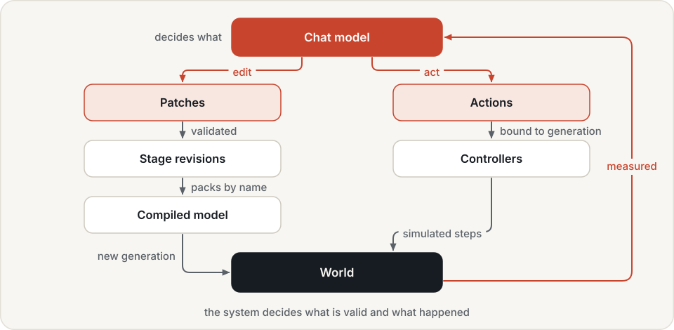
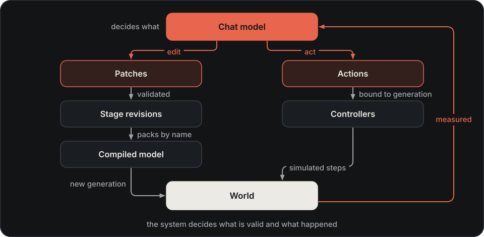

# Worlds

A world is a simulation in which agents can act and receive measured feedback. It contains robots, objects,
cameras and goals. Use it to develop a task or explore a scene; use a benchmark when you need a fixed comparison.

## World model { #stage-world-and-task }

| Term | Meaning |
|---|---|
| Stage | The saved scene description: entities, poses and robot packs, with revision history |
| World | The running simulation built from a stage revision |
| Task | An instruction and an explicit goal checked against what happened |

Changing a stage does not change a running world until it is rebuilt. Actions name the world generation they
were planned for, so an action based on an earlier build can be refused. Receipts describe the measured motion;
goal checks decide whether the requested result holds.

## From intent to simulation

A model can choose what a scene should contain and what to try next. Geometry, scene consistency and physical
outcomes need explicit checks. Hylo therefore turns an intention into a sequence of validated edits, a compiled
simulation and measured actions.

{ .hylo-diagram .only-light }
{ .hylo-diagram .only-dark }

1. **Edit a stage.** Small patches add, move or change entities against a known revision. Validation checks names,
   parents, rotations and mounting relationships before applying the patch. An invalid or outdated patch leaves
   the stage unchanged; revision history lets an editor restore an earlier scene.
2. **Build a world.** Robot packs supply existing models, home postures and supported controls. The compiler
   combines them with scene geometry and cameras in MuJoCo. A build starts a new world generation and reports
   fixed and movable entities, available controls and initial overlaps.
3. **Execute an intent.** Controllers translate requests such as moving a tool point, walking or flying to a
   waypoint into simulation-rate commands. This separates the model's decision pace from the robot's control
   rate and avoids requiring the model to generate joint torques.
4. **Inspect the outcome.** Receipts report measured motion and contact or grasp information. Goal checks evaluate
   predicates on the resulting world and return expected values, measurements and failure reasons.

Patches make changes reviewable and recoverable. Robot packs reuse pinned assets instead of generating a new
robot description for every scene. A shared stage gives the Studio, command-line tools and agents the same
scene to inspect.

## Feedback and timing

An action is bound to the world generation it was planned for. Rebuilding or resetting invalidates old actions,
so a decision based on an earlier world cannot silently execute in a new one. A repeated action ID does not
execute the same action twice. Actions for multiple robots in one call share the same simulation steps.

In interactive world sessions, time advances during actions or an explicit advance request. The world waits
while a model decides. This makes inspection and replay practical, but does not measure how that model would
behave while a physical robot keeps moving during inference.

For example, a lift command can complete while the block remains too low. The action receipt describes the
motion; the task check reports the unmet height and its measured value. Keeping these separate lets an agent
correct the attempt without treating an accepted command as task success.

## Agent integration { #how-agents-use-worlds }

A person, a model or a coding agent can edit a stage, build it, act and check outcomes through the same world
tools. Robot packs supply models and supported controls. Camera observations can feed an agent's memory;
role campaigns can retain replay-verified action recipes as skills.

A successful goal check establishes an outcome in that scene. Comparing improvements across tasks requires a
separate evaluation protocol; a world session alone is not that comparison.

For evaluated tasks, define the goal outside the acting agent's session. An agent that can lower its own target
can make a check pass without improving the intended outcome. Role campaigns separate task definition, execution
and verification, and can replay successful tool sequences before retaining them as recipes. Simulation still
depends on the chosen geometry, dynamics, sensors and controllers; those assumptions bound what a result proves.

## Next

- [Create and run a world](../worlds.md): build a small scene and check a physical outcome.
- [World reference](../../reference/worlds.md): stage fields, robot packs, actions and goals.
- [World examples](examples.md): recorded scenes, robot motions and their conditions.
