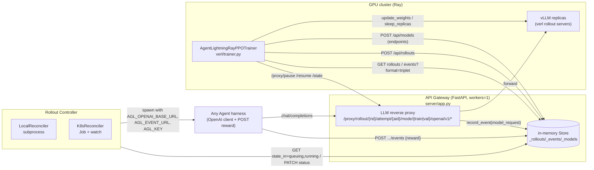

# agent-lightning Source-Level Architecture Study

> Subject: `references/evolution/agent-lightning` (microsoft/agent-lightning @ `05c7fe1`, package version `1.0.2`, MIT)
> Method: static reading only (read / grep / `python3 -I` ast); no dependencies were installed, and no tests or training were run
> Audience: the Evolution Layer and Tracing design of `worldcurrent`, and cross-project comparison
> Tags: **[Implemented]** traceable in code · **[Docs/Interface only]** only documentation or abstract interfaces · **[Unverified]** code exists, but this study did not run it to verify · **[Needs model/hardware]** needs GPU or weights

---

## 0. Key Premise: v1.0 Is a Complete Rewrite; None of the Core v0.x Abstractions Are in This Commit

The task brief listed LitAgent / Trainer / Store / Algorithm / Runner / Tracer / Adapter / APO / OpenTelemetry / AgentOps. These are **v0.x** concepts. At `05c7fe1`:

- README verbatim: "Agent Lightning was completely refactored in v1.0. For legacy releases earlier than v1.0, see [this branch](…/tree/v0.x)" (`references/evolution/agent-lightning/README.md:11`).
- Grepping `litagent|opentelemetry|agentops|APO|Tracer|LightningStore` in `*.py/*.md/*.toml/*.yaml` yields **no code hits at all**. The only remnant is a dead link `examples/apo/apo_debug.py` in a docs macro (`references/evolution/agent-lightning/docs/macros/source_links.py:22`); the corresponding directory does not exist.
- The `agentlightning/` package totals **5,063 lines of Python** (the README claims "~3,500 lines", `README.md:22`, presumably not counting `verl/`).

The mapping of old v0.x concepts to v1.0 is as follows (the rest of this document uses the v1.0 names):

| v0.x concept | v1.0 counterpart | Location |
|---|---|---|
| `LitAgent` | Any class with a `run()` method, or any K8s Job container (endpoints injected via environment variables) | `agentlightning/controller/local_reconciler.py:35-50` |
| `LightningStore` | In-process dict plus FastAPI routes (the "API Gateway") | `agentlightning/server/store.py:13-18` |
| `Tracer` (OTel/AgentOps) | **An LLM reverse proxy captures requests and responses at the HTTP layer**; no OTel | `agentlightning/server/proxy.py:96-149`, `:223-254` |
| `Adapter` (TraceToTriplet) | Server-side `format=triplet` trimming, plus the training-side `RolloutAdapter` | `agentlightning/server/routes/events.py:184-253`, `agentlightning/verl/rollout_adapter.py:376-900` |
| `Runner` | Rollout Controller (Local subprocess / K8s Job reconciler) | `agentlightning/controller/*.py` |
| `Algorithm` / `Trainer` | Only `AgentLightningRayPPOTrainer` (a verl subclass) | `agentlightning/verl/trainer.py:100` |
| APO (prompt optimization) | **Removed**. The "Agent Lightning Skill" is a Markdown file for coding agents to read, not code | `skills/agent-lightning/SKILL.md:1-90` |
| Resource versioning (`ResourcesUpdate`) | Only the `Model.version: int = 0` field remains, and **the trainer never writes it** | `agentlightning/schemas.py:69-74`, `agentlightning/verl/agl_rollout_manager.py:293-303` |

---

## 1. Positioning and Core Capabilities

agent-lightning v1.0 is a **"harnessed agentic RL" infrastructure**: it does not require the agent to be written with any particular framework, only that the agent points its OpenAI-compatible `base_url` at the Gateway. The Gateway acts as a reverse proxy capturing the token ids and logprobs of each LLM call, and the agent finally POSTs a `reward` event itself. The training side is a verl `RayPPOTrainer` subclass: it creates rollouts over HTTP, polls for completion, pulls events, and then converts the events into verl `DataProto` for GRPO/PPO updates.

Core capabilities:
- **"Zero-change" agent onboarding**: only change `base_url` and POST a reward once. **[Implemented]** (`agentlightning/server/routes/proxy.py:37-102`; example `examples/gsm8k/gsm8k_agent.py:63-111`)
- **Rollout lifecycle + K8s-native execution**: QUEUING→RUNNING→SUCCEEDED/FAILED, with the Store enforcing legal state transitions. **[Implemented]** (`agentlightning/schemas.py:77-100`, `agentlightning/server/routes/rollouts.py:182-213`)
- **Token-level trace capture**: `return_token_ids` / `logprobs`, optional MoE `routed_experts` (R3). **[Implemented]** **[Needs model/hardware]**: depends on vLLM returning token ids (`agentlightning/server/proxy.py:63-84`)
- **Two-level transition / trajectory aggregation**; trajectory level merges only when token prefixes are strictly contiguous. **[Implemented]** (`agentlightning/verl/rollout_adapter.py:540-648`)
- **Rollout-level advantage and per-rollout-mean loss**. **[Implemented][Needs model/hardware]** (`agentlightning/verl/rollout_level_advantage.py:15-72`, `agentlightning/verl/per_rollout_loss.py:17-46`)
- **Colocated asynchronous training**: carries over incomplete groups, and pauses/drains the Gateway before updating weights. **[Implemented][Needs model/hardware]** (`agentlightning/verl/trainer.py:171-193`, `agentlightning/verl/agl_rollout_manager.py:596-679`)
- **Multimodal (image) transition-level training**: a patch marked `[multimodal-patch]`. **[Implemented][Unverified]** (`agentlightning/verl/agl_rollout_manager.py:144-251`)
- **Prompt optimization / APO / automatic agent improvement**: **[Docs/Interface only]**, only a SKILL.md.

## 2. Directory Layout and Architecture

```
agentlightning/
  schemas.py            # Pydantic contracts such as Event / Rollout / Model (185 lines)
  hooks.py              # RolloutHooks (training-side lifecycle hooks) + TraceWriter Protocol
  client.py             # httpx sync/async client (with bearer + retries)
  server/               # "API Gateway" = Store + LLM proxy (FastAPI, single worker)
    store.py            # module-level dicts: _rollouts/_events/_models/_terminal_order
    proxy.py            # ProxyRouter, forward_request, _capture_event
    routes/{rollouts,events,models,proxy}.py
  controller/           # "Rollout Controller": reconcile loop
    local_reconciler.py # subprocess mode
    k8s_reconciler.py   # K8s Job mode (kr8s + Jinja2 templates)
  verl/                 # "Customized Trainer" (requires verl/torch/ray/vLLM)
    trainer.py          # AgentLightningRayPPOTrainer
    agl_rollout_manager.py  # creates rollouts, polls, assembles CompletedRollout/Triplet
    rollout_adapter.py  # CompletedRollout -> verl DataProto
    rollout_level_advantage.py / per_rollout_loss.py / entrypoint.py / dataset.py
  config/{server,controller}.yaml, verl/config.yaml   # Hydra configs
examples/  calc_x gsm8k science_world search_r1 llm-in-sandbox swe_smith multimodal_qa
skills/agent-lightning/SKILL.md   # "optimize the agent" prompt for coding agents to read (no code)
tests/  server controller verl examples (105 test_ functions in total)
```



## 3. Core Interfaces and Key Classes (signatures)

**Data contracts** (`agentlightning/schemas.py`)
```python
class Event(BaseModel):                 # :13-26  an event's position in the list is its identity; there is no separate event id
    event_type: str                     # "model_request" | "reward" | any custom type
    rollout_id: str; attempt_id: str
    timestamp: float                    # written by the store
    data: dict[str, Any]
class ModelRequestData(BaseModel):      # :36-53  for documentation/validation only, not enforced by the Store
    model: str; model_version: int|None; request: dict; adjusted_params: dict|None
    response: dict; latency_ms; http_status; status="ok"; retry_count=0; usage; finish_reason
class RewardData(BaseModel):            # :56-66  value: float (required); message; source; reason
class Model(BaseModel):                 # :69-74  model: str; endpoint: str; version: int = 0
class RolloutState(StrEnum): QUEUING RUNNING SUCCEEDED FAILED      # :77-83
VALID_TRANSITIONS                       # :87-93
class RolloutCreate(BaseModel):         # :135-143 input: Any; is_train; config; metadata; rollout_id (idempotent)
class Rollout(BaseModel):               # :177-185 rollout_id; input; is_train; config; metadata; status
```

**Minimal Agent contract** (no base class; relies on duck typing and environment variables)
```python
# Local mode: agentlightning/controller/local_reconciler.py:35-50
loaded = getattr(importlib.import_module(module), cls); result = loaded().run()   # no-arg constructor + run(), sync or async
# Injected environment variables: local_reconciler.py:226-234 / k8s_reconciler.py:86-101
AGL_OPENAI_BASE_URL = {base}/proxy/rollout/{rid}/attempt/{aid}/mode/{train|val}/openai/v1
AGL_EVENT_URL       = {base}/api/rollouts/{rid}/attempt/{aid}/events
AGL_KEY             = bearer key
# Task input: env_map maps paths in rollout.input to environment variables: local_reconciler.py:63-91
# Success/failure = process exit code 0/non-0 or K8s Job Complete/Failed
```

**Training-side hooks** (`agentlightning/hooks.py:15-33`)
```python
class TraceWriter(Protocol):
    def add_event(self, rollout_id, attempt_id, event_type, data) -> Any: ...
class RolloutHooks:
    def on_startup(self, store=None) -> None
    def on_enqueue(self, request: RolloutCreate) -> RolloutCreate
    def on_succeeded(self, rollout, events: dict[str, list[Any]], store: TraceWriter) -> None
    def on_failed(self, rollout, store: TraceWriter) -> None
def load_hooks(path: str) -> RolloutHooks      # :36-63, loads the single subclass from a .py file
```

**Training-side bridge** (`agentlightning/verl/agl_rollout_manager.py`)
```python
class Triplet(BaseModel): prompt; response; reward: float|None; metadata; image_urls   # :41-50
class CompletedRollout(BaseModel): rollout_id; data_id; step; final_reward; triplets; events; rollout_state; ...  # :67-84
class AglRolloutManagerBase:
    def register_model(self, server_addresses: list[str]) -> list[Model]                 # :293-303
    def _create_rollouts(self, data, *, is_train) -> list[EnqueuedRollout]                # :379-428
    def _build_completed_rollout(self, enqueued, rollout) -> CompletedRollout             # :469-536
class AglRolloutManager.enqueue_and_wait_until_completed(data, *, is_train)               # :540-590
class AglAsyncRolloutManager.enqueue_and_wait_until_group_completed(data, carry_over, *, is_train, target_finished_group_num)  # :596-679
class RolloutAdapter.get_train_data_batch(completed_rollouts, *, global_steps) -> (DataProto, metrics)  # rollout_adapter.py:404-845
class AgentLightningRayPPOTrainer(RayPPOTrainer): _rollout / _train_step / fit / _validate  # trainer.py:100, :365, :461, :661, :747
```

**HTTP API** (all require bearer or `x-api-key`, `agentlightning/server/app.py:34-50`)

| Method / Path | Purpose | Location |
|---|---|---|
| `POST /api/rollouts` | Batch enqueue (`rollout_id` pre-allocated, hence idempotent) | `server/routes/rollouts.py:95-122` |
| `GET /api/rollouts?state_in=` | List by state (full table scan) | `:125-133` |
| `GET /api/rollouts/terminal?after=` | Terminal-state cursor pagination | `:143-171` |
| `PATCH /api/rollouts/{id}` | State transition (illegal transitions rejected with 409) | `:182-213` |
| `DELETE /api/rollouts/{id}` | Delete rollout and events | `:216-220` |
| `POST /api/rollouts/{id}/attempt/{aid}/events` | Append event | `server/routes/events.py:230-233` |
| `GET /api/rollouts/{id}/events?format=triplet` | Query or trim events | `:236-253` |
| `POST/DELETE /api/models` | Register or clear inference endpoints | `server/routes/models.py:15-31` |
| `POST /proxy/rollout/{rid}/attempt/{aid}/mode/{mode}/openai/v1/{path}` | LLM proxy (supports only chat/completions, completions) | `server/routes/proxy.py:37-102` |
| `POST /proxy/pause` `/proxy/resume`, `GET /proxy/state` | Pause/drain for asynchronous training | `:120-160` |

## 4. Core Execution Flow

```mermaid
sequenceDiagram
  participant TR as Trainer (verl/trainer.py)
  participant RM as AglRolloutManager
  participant GW as Gateway Store+Proxy
  participant CT as Controller (Local/K8s)
  participant AG as Agent process / Job
  participant VL as vLLM

  TR->>TR: fit(): update_weights(global_steps) (:677)
  loop each training step (_train_step :461)
    TR->>GW: POST /proxy/resume (async only, :167-169)
    TR->>RM: _make_rollout_manager (:139-152)
    RM->>GW: DELETE /api/models; POST /api/models [endpoints] (version=0)
    RM->>GW: POST /api/rollouts (n per sample, hooks.on_enqueue, :379-428)
    loop reconcile tick (poll_interval)
      CT->>GW: GET /api/rollouts?state_in=queuing,running
      CT->>AG: spawn subprocess / create Job with AGL_* env
      CT->>GW: PATCH status RUNNING
    end
    AG->>GW: POST /proxy/.../mode/train/openai/v1/chat/completions
    GW->>VL: forward (+return_token_ids, logprobs, temperature override)
    VL-->>GW: response with token ids
    GW->>GW: record_event("model_request", ...) (proxy.py:223-254)
    GW-->>AG: JSON response
    AG->>GW: POST .../events {"event_type":"reward","data":{"value":r}}
    AG-->>CT: exit 0 / Job Complete
    CT->>GW: PATCH status SUCCEEDED|FAILED
    loop poll (1s)
      RM->>GW: GET /api/rollouts/{id}
    end
    RM->>RM: hooks.on_succeeded/on_failed (may add events)
    RM->>GW: GET events (raw) + GET events?format=triplet
    RM->>RM: _build_completed_rollout: triplets, reward -> last triplet (:469-536)
    RM->>GW: DELETE /api/rollouts/{id} (bound memory)
    TR->>TR: RolloutAdapter.get_train_data_batch -> DataProto (:440-446)
    TR->>GW: POST /proxy/pause + poll /proxy/state until inflight=0 (async) / abort vLLM (sync)
    TR->>TR: drop same-reward groups to fit mini-batch (:525-547)
    TR->>VL: sleep_replicas; old_log_prob/ref; advantage (rollout-level opt.); update_actor
    TR->>VL: checkpoint_manager.update_weights(global_steps) (:654-655)
  end
```

Key points:
- **Decoupling of algorithm and execution** relies entirely on **HTTP plus the rollout_id embedded in the URL**. The agent knows nothing about training, and the trainer knows nothing about the agent's implementation; the two sides share only the Gateway's REST contract and the `Event` schema. **[Implemented]**
- **Credit assignment**: each rollout takes only the **last** reward event (`agentlightning/verl/agl_rollout_manager.py:506-510`) and writes it onto the **last** triplet (`:512-513`). In the RolloutAdapter, the transition level assigns final_reward to **every turn** (`agentlightning/verl/rollout_adapter.py:540-555`); the trajectory level merges prefix-contiguous turns into one row and sets the mask of observation tokens to 0 (`:572-583`). The score is placed only on the last valid token of each row (`:783-786`). With `enable_rollout_level_advantage` on, all rows of the same rollout share one advantage scalar (`agentlightning/verl/rollout_level_advantage.py:41-72`). **No per-step reward, no discounted back-propagation, no turn-level critic.**
- **FAILED rollouts are not filtered out**: their triplets still go into training, with reward filled in with `reward_fillna_value` (default 0.0) (`agentlightning/verl/rollout_adapter.py:897-900`; grepping `rollout_state` in the adapter/trainer yields no hits). This means infrastructure failures and policy failures are lumped together as a score of 0.

## 5. Extension Points and Plugin Mechanism

| Extension point | Mechanism | Location | Status |
|---|---|---|---|
| Agent implementation | Any `module:Class` with `run()`; or any container image + Jinja2 Job template | `controller/local_reconciler.py:35-50`, `controller/k8s_reconciler.py:43-101` | [Implemented] |
| Task input injection | `env_map: {ENV: "input.a.b"}`; `{{ input.x }}` in K8s templates | `local_reconciler.py:63-91`, `k8s_reconciler.py:50-53` | [Implemented] |
| Custom events | Any `event_type`, passed through as-is (not trimmed by the triplet view either) | `server/routes/events.py:184-197` | [Implemented] |
| Training-side lifecycle hooks | `RolloutHooks` subclass file path `agentlightning.hooks` | `hooks.py:19-63`, `verl/trainer.py:119-127` | [Implemented]; **no example in the repo uses it** (grep finds it only in a comment in `examples/calc_x/eval_utils.py:7`) |
| Trace aggregation granularity | `trace_aggregator.level: transition|trajectory` | `verl/config.yaml:24-27`, `verl/rollout_adapter.py:411-413` | [Implemented] |
| Policy loss | Registers `per_rollout_mean` / `cispo_per_rollout_mean` via verl `register_policy_loss`, injected by the Ray worker setup hook | `verl/per_rollout_loss.py:13-14,135`, `verl/entrypoint.py:56-60` | [Implemented][Needs model/hardware] |
| Proxy parameter rewriting | train/val temperature override, logprobs, routed_experts | `server/proxy.py:63-84`, `config/server.yaml` | [Implemented] |
| New algorithm / new training backend | **No Algorithm abstraction**; the only option is to write another HTTP client similar to `AglRolloutManager` | — | [Docs/Interface only] (the REST contract itself is reusable) |

## 6. Dependencies and Runtime Requirements

- Core package: Python ≥3.12; `fastapi, uvicorn, pydantic>=2.10, httpx, httpx-retries, hydra-core==1.3.2, omegaconf==2.3.0, structlog, jinja2, kr8s, pyyaml` (`pyproject.toml:21-33`). The Gateway and Controller themselves are lightweight and do not depend on torch.
- Training: `verl>=0.7.1,<0.9.0`, torch, ray, tensordict, vLLM (the comment on the `verl-cpu` group in `pyproject.toml` explains the reason for the upper bound: verl 0.9 renamed `TaskRunner`). **[Needs model/hardware]**
- **Hard dependency on vLLM**: the proxy forcibly adds `return_token_ids: True` (`server/proxy.py:69,81`), and triplets depend on `prompt_token_ids` / `token_ids` in the response (`server/routes/events.py:133-156`). If the upstream is a closed API such as OpenAI/Anthropic, no token ids are returned and triplets are discarded (`verl/agl_rollout_manager.py:482-483`). In other words, **this trace pipeline only serves RL on open-weight models**.
- **No streaming support** (`server/proxy.py:120-121`).
- Controller: K8s mode needs a cluster and RBAC; Local mode does not support native Windows (`_is_native_windows` in `controller/local_reconciler.py`).
- Tests: CI runs `pytest tests` and installs the `verl-cpu` group (`.github/workflows/tests.yml:60-76`). `tests/verl/*` is guarded by `importorskip("verl")`. 14 test files and 105 test functions in total (server 20, controller 12, verl 34, examples 32, etc.). **This study did not run them [Unverified]**.

## 7. License and Reuse Constraints

- **MIT** (`LICENSE`, `license = "MIT"` in `pyproject.toml`). It can be used as a dependency, or vendored or rewritten; copyright notices must be retained.
- The README carries Microsoft trademark terms: derivatives must not imply Microsoft endorsement.
- `examples/llm-in-sandbox/vendor/llm-in-sandbox` in the examples is third-party vendored code whose license needs to be checked separately (not covered by this study).
- The real reuse constraints come from **the code rather than the license**: the Store is a module-level global dict (`server/store.py:13-18`), so a process can have only one instance; the training side is deeply coupled to verl private APIs (`verl/trainer.py:20-33` imports internal functions of `RayPPOTrainer` and uses `hasattr(self, "llm_server_manager")` to stay compatible with 0.7 and 0.8, see `:367-372`).

## 8. Strengths, Weaknesses and Risks

**Strengths**
1. **Extremely minimal contract**: the agent only needs a base_url plus one reward POST; cross-language, cross-framework, and existing harnesses (SWE agents, ScienceWorld, sandboxes) can plug in directly.
2. **Token-level fidelity**: directly records the token ids and logprobs returned by the inference server, avoiding retokenization drift. Trajectory merging requires strict prefix contiguity; on mismatch it degrades to multiple rows and uploads mismatched samples to W&B for diagnosis (`verl/rollout_adapter.py:596-614`).
3. **Idempotent and robust**: the client pre-allocates `rollout_id`, so enqueueing can be retried (`server/routes/rollouts.py:95-107`); upstream retries use jittered backoff (`server/proxy.py:162-215`); upstream requests are cancelled when the agent disconnects (`server/routes/proxy.py:79-102`); the state machine is enforced by the Store (`:191-194`).
4. **Reconcile pattern**: the Controller is stateless and periodically reconciles against the Gateway as the source of truth (K8s mode additionally has a watch).
5. **Colocated async**: carry-over groups plus pause/drain, completing by group, thereby preserving GRPO group statistics.

**Weaknesses and Risks**
1. **No Store persistence, single worker**: `uvicorn.run(workers=1)` (`server/__main__.py:17-23`), all state lives in in-memory dicts, and everything is lost when the Gateway restarts. The trainer **actively DELETEs rollouts** after consuming them (`verl/agl_rollout_manager.py:555-558`), so **by default there is no replayable trace archive** (only truncated, compressed samples uploaded to W&B).
2. **No real versioning**: `Model.version` defaults to 0, and `register_model` does not pass a version (`verl/agl_rollout_manager.py:297-298`). The comment on `model_version` in events says it is the "training step of the serving model" (`schemas.py:44`), but in practice it is **always 0**. To judge the staleness of asynchronous rollouts, one can only look at `EnqueuedRollout.step`.
3. **The Attempt concept is an empty shell**: there is only `DEFAULT_ATTEMPT_ID = "0"` (`schemas.py:102`), K8s sets `backoffLimit: 0` (`controller/k8s_reconciler.py:72`), and failures are not retried.
4. **Coarse credit assignment**: only a terminal scalar, and only the last reward event is taken; intermediate reward events are ignored. The environment's step reward is actively discarded by the examples (`examples/science_world/agents/sw_agent.py:168`, `_step_reward`).
5. **No distinction between FAILED and real failure**: infrastructure failures enter training as fillna score 0 (see §4).
6. **Polling overhead**: the trainer issues a separate GET per pending rollout every second (`verl/agl_rollout_manager.py:560-584`), and `list_rollouts` does an O(N) full table scan (`server/routes/rollouts.py:131-133`). This will become a bottleneck at scale.
7. **Security**: the default is `key: ""`, in which case only a warning is printed and authentication is disabled (`server/app.py:58-59`, `config/server.yaml:3`).
8. **Only LLM text/image tokens are supported**: the Gateway only proxies OpenAI-format `chat/completions` / `completions` (`server/routes/proxy.py:44-45`), and cannot capture a VLA's continuous action head or diffusion policy outputs.

## 9. Components Worth Reusing

| Component | Reuse approach | Rationale |
|---|---|---|
| **Zero-intrusion tracing pattern of "rollout_id embedded in the proxy URL"** | **Pattern**, implement ourselves | The lowest-cost tracing method for LLM/VLM reasoning modules (planner, reflector); `worldcurrent`'s Reasoning layer can capture uniformly at the model gateway layer without changing agents. |
| **Open `Event{event_type, rollout_id, attempt_id, timestamp, data}` schema + "two well-known types + pass through the rest"** | **Borrow the protocol** | The same event stream can hold custom types such as `observation` / `action` / `reasoning` / `memory_retrieval` (passed through as-is at `server/routes/events.py:196-197`). We need to add: event id, step index, parent span, binary blob references (images/point clouds), persistence. |
| **Rollout state machine + idempotent enqueue + terminal-state cursor pagination** | **Borrow the design directly** (about 200 lines of code, can be rewritten) | `VALID_TRANSITIONS` plus 409, client-pre-allocated ids, append-only `_terminal_order` cursor (`server/routes/rollouts.py:143-171`) — suitable for our episode queue and eval queue. |
| **Reconciler pattern (Local subprocess / K8s Job + Jinja2 templates)** | **Pattern**; the K8s Job template rendering can serve as reference | Simulator episodes (Isaac/MuJoCo containers) naturally fit "one episode, one Job", with the Gateway as the source of truth. |
| **Pause/drain protocol** (`/proxy/pause` → poll inflight → update → `/resume`) | **Pattern** | Guarantees no mixed-version requests during hot-swapping of weights or LoRA; we can reuse it directly for candidate switching or shadow deployment. |
| **Strict trajectory prefix merging + observation mask=0** | **Algorithm pattern** (if we do RL on an LLM planner) | `verl/rollout_adapter.py:572-583`, with mismatch diagnostics. |
| **`RolloutHooks.on_succeeded(…, TraceWriter)`** to backfill reward / diagnostic events on the training side | **Pattern** | Suitable for "offline judge / rule-based reward computed outside the agent", and for writing back our Failure Diagnosis results. |

**Not recommended as a direct Python dependency**: the package is small, but the Store is a global singleton with no persistence and no versioning. Our Evolution Layer needs a replayable archive and candidate version management, which conflicts with its "delete on consume" semantics. Only in an experimental branch **dedicated to GRPO on an open-source LLM planner** is it worth using the whole Gateway + Controller + verl trainer set as an external toolchain ([Needs model/hardware]).

## 10. Capabilities Not Worth Rebuilding

- **GRPO/PPO training pipeline for open-source LLM agents** (verl integration, token-id capture, async carry-over, R3 routed experts): if `worldcurrent` needs agentic RL on the reasoning LLM, **calling agent-lightning directly (as an external service and training scripts)** is far cheaper than building our own verl bridge.
- **Retries, disconnect cancellation, and temperature override in an OpenAI-compatible proxy**: mature, small code; rewrite it directly if needed rather than designing from scratch.
- **K8s Job reconciler**: if we adopt K8s, refer directly to `controller/k8s_reconciler.py` (362 lines).
- **Conversely, the parts we must build ourselves (which agent-lightning lacks)**: persistent trace archive, candidate and resource version store, shadow eval, regression testing, promotion/rollback, per-step reward and embodied observation/action schemas, capture of non-LLM policies (VLA continuous actions).

## RSI Capability Matrix

| RSI capability | Present in agent-lightning? | Evidence | Tag |
|---|---|---|---|
| Failure Diagnosis | Passive recording only: `RolloutLifecycleStatus.error_message`, `model_request.status/http_status`, trajectory-merge mismatch tables uploaded to W&B; **no automatic attribution** | `schemas.py:146-155`, `verl/rollout_adapter.py:596-614`, `:118-129` | [Implemented] (recording) / diagnosis logic missing |
| Reflection | No code; "Reading the evidence" in SKILL.md is a prompt for coding agents | `skills/agent-lightning/SKILL.md:46-66` | [Docs/Interface only] |
| Candidate Generation | RL gradient updates (implicit candidate = next checkpoint); prompt / tool candidate generation exists only in the "Action space" table of SKILL.md | `verl/trainer.py:649-655`; `SKILL.md:29-44` | [Implemented][Needs model/hardware] (weights) / [Docs/Interface only] (prompt / structure) |
| Recovery Skills | None; Job `backoffLimit: 0`, no attempt retries; SKILL.md mentions a "Conditional repair" lever | `controller/k8s_reconciler.py:72`, `SKILL.md:40` | [Docs/Interface only] |
| Shadow Evaluation | None. `mode/val` is just the same model with a different temperature (`config/server.yaml:10-11`); candidates cannot be compared side by side with the online version | `server/proxy.py:76-83` | Missing |
| Regression Testing | No per-case regression; only periodic `_validate()` outputting an aggregate `val/reward` metric | `verl/trainer.py:722-729`, `:747-780`, `verl/rollout_adapter.py:847-895` | [Implemented] (aggregate validation) / regression missing |
| Held-out Benchmark | `val_dataset` must be provided, `test_freq` periodic evaluation, `val_before_train` as baseline; the SKILL's experiments evaluate on a held-out split (README data unverified) | `verl/entrypoint.py:44-45`, `verl/trainer.py:679-685` | [Implemented][Needs model/hardware]; README numbers [Unverified] |
| Promotion / Rollback | None. `save_freq` saves checkpoints, `_load_checkpoint` resumes training; **no metric-based promote / rollback / best-ckpt selection** | `verl/trainer.py:675-677`, `:731-735` | Missing (only verl checkpoint primitives) |

## Verification Status Summary

| Capability / claim | Status | Basis |
|---|---|---|
| Zero-change agent onboarding (change base_url + POST reward) | [Implemented] | `server/routes/proxy.py:37-102`, `examples/gsm8k/gsm8k_agent.py:77-111` |
| Rollout state machine enforcement | [Implemented], has tests (not run) | `server/routes/rollouts.py:191-194`, `tests/server/test_endpoints.py:235` |
| Triplet trimming and per-prompt dedup | [Implemented], has tests (not run) | `server/routes/events.py:208-253`, `tests/server/test_endpoints.py:258,307` |
| Local / K8s execution | [Implemented][Unverified] | `controller/*.py`, `tests/controller/*` (only 1 test for K8s) |
| Transition / trajectory aggregation | [Implemented], has tests (not run) | `verl/rollout_adapter.py:540-648`, `tests/verl/test_rollout_adapter.py:203` |
| GRPO/PPO training, async carry-over, R3 | [Implemented][Needs model/hardware] | `verl/trainer.py`, `verl/agl_rollout_manager.py:596-679` |
| Multimodal transition training | [Implemented][Unverified] (marked as a patch) | `verl/agl_rollout_manager.py:144-251` |
| `model_version` = training step | **[Docs/Interface only]**: the field exists but is always 0 | `schemas.py:44`, `verl/agl_rollout_manager.py:298` |
| Attempt / retry | **[Docs/Interface only]**: only the constant "0" | `schemas.py:102` |
| APO / prompt optimization / LitAgent / Tracer (OTel) | **Not present in this commit** (only in the v0.x branch) | `README.md:11`; grep has no hits |
| Agent Lightning Skill (automatic agent improvement) | [Docs/Interface only]: pure Markdown prompt | `skills/agent-lightning/SKILL.md` |
| SWE-bench 41.8→56.4, 47.8→61.6 and other results | [Unverified][Needs model/hardware] | `README.md:15,25` |
| "~3,500 lines" | Does not match measurement: `agentlightning/` totals 5,063 lines | `wc -l` |

## 11. Source Index of Key Implementations

All paths are prefixed with `references/evolution/agent-lightning/`.

| Concern | file:line | Note |
|---|---|---|
| Event schema | `agentlightning/schemas.py:13-26` | Position is identity, `data` is an open dict |
| model_request / reward structure | `agentlightning/schemas.py:36-66` | Not enforced by the Store |
| Model endpoint and version | `agentlightning/schemas.py:69-74` | version defaults to 0 |
| Rollout state machine | `agentlightning/schemas.py:77-100` | No transitions out of terminal states |
| Global in-memory Store | `agentlightning/server/store.py:13-18` | No locks, no persistence |
| Single-worker startup | `agentlightning/server/__main__.py:17-23` | `workers=1` |
| Authentication | `agentlightning/server/app.py:34-59` | Disabled when key is empty |
| Idempotent enqueue | `agentlightning/server/routes/rollouts.py:95-122` | Pre-allocated rollout_id |
| Status PATCH + terminal log | `agentlightning/server/routes/rollouts.py:182-213` | `_terminal_order` append-only |
| Event writes | `agentlightning/server/routes/events.py:46-66` | Bucketed by attempt |
| Triplet trimming | `agentlightning/server/routes/events.py:125-197` | token ids, logprobs, reward scalar |
| Prompt dedup | `agentlightning/server/routes/events.py:208-227` | Keeps the last occurrence of the same prompt |
| Proxy entry | `agentlightning/server/routes/proxy.py:37-102` | Cancels on disconnect |
| Pause/drain | `agentlightning/server/routes/proxy.py:120-160`, `agentlightning/server/proxy.py:106-117` | Returns 429 + Retry-After while paused |
| Server selection (rollout stickiness) | `agentlightning/server/proxy.py:53-61` | sha256(rollout_id) modulo, reuses prefix cache |
| Request rewriting | `agentlightning/server/proxy.py:63-84` | Forces `return_token_ids` |
| Event capture | `agentlightning/server/proxy.py:223-254` | Automatically writes `model_request` |
| No streaming support | `agentlightning/server/proxy.py:120-121` | Returns 400 |
| Hooks | `agentlightning/hooks.py:15-63` | TraceWriter Protocol |
| Local worker contract | `agentlightning/controller/local_reconciler.py:35-50` | `Class().run()` |
| Environment variable injection | `agentlightning/controller/local_reconciler.py:216-262` | AGL_* |
| Local reconcile | `agentlightning/controller/local_reconciler.py:137-183` | SIGKILL the process group on timeout |
| K8s Job rendering | `agentlightning/controller/k8s_reconciler.py:43-101` | Jinja2, `backoffLimit=0` |
| K8s reconcile | `agentlightning/controller/k8s_reconciler.py:161-240` | Job conditions to rollout states |
| Endpoint registration (no version) | `agentlightning/verl/agl_rollout_manager.py:293-303` | |
| Rollout creation (n copies, GRPO) | `agentlightning/verl/agl_rollout_manager.py:379-428` | Calls the `on_enqueue` hook |
| Triplet and reward assembly | `agentlightning/verl/agl_rollout_manager.py:469-536` | Reward written to the last triplet |
| Synchronous wait + delete | `agentlightning/verl/agl_rollout_manager.py:540-590` | DELETE after consumption |
| Async group completion + carry-over | `agentlightning/verl/agl_rollout_manager.py:596-679` | |
| DataProto construction | `agentlightning/verl/rollout_adapter.py:404-845` | transition / trajectory |
| Score placement | `agentlightning/verl/rollout_adapter.py:780-787` | Last token of each row |
| fillna | `agentlightning/verl/rollout_adapter.py:897-900` | FAILED also goes into training |
| Rollout-level advantage | `agentlightning/verl/rollout_level_advantage.py:15-72` | One scalar per rollout |
| Per-rollout loss | `agentlightning/verl/per_rollout_loss.py:17-46,135` | Registered with verl |
| Trainer rollout phase | `agentlightning/verl/trainer.py:365-459` | |
| Pause/drain client | `agentlightning/verl/trainer.py:167-193` | |
| Training step and weight push | `agentlightning/verl/trainer.py:461-659` | Same-reward groups dropped first |
| fit / validate / ckpt | `agentlightning/verl/trainer.py:661-780` | No promote/rollback |
| Trainer config | `agentlightning/verl/config.yaml:12-30` | Defaults to trajectory level + per_rollout_mean |
| ScienceWorld discards step reward | `examples/science_world/agents/sw_agent.py:168,198-211` | Sends only the terminal reward |
| SWE custom events + anti-reward-hacking | `examples/swe_smith/agents/smith_agent.py:257-275,933-948` | `agent_output` event |
| Agent improvement Skill | `skills/agent-lightning/SKILL.md:29-90` | Pure prompt |

---

### Appendix: Direct Answer to Q2 (Can It Record Embodied Episodes?)

- **It can record them, but only in the sense of "can store"**: `EventCreate{event_type, data}` accepts any type, and the triplet view passes non-`model_request` / `reward` types through as-is (`agentlightning/server/routes/events.py:196-197`). `obs` / `action` / `reasoning` / `memory_retrieval` can be POSTed to `AGL_EVENT_URL` as custom events; swe_smith's `agent_output` is a precedent.
- **It cannot train on them or replay them**: the training conversion only recognizes `model_request` (which must carry vLLM token ids) plus the last `reward`. There is no step index, causal chain (parent/child span), binary blob, or per-step reward; the Store is in memory and deletes after consumption. For VLA (continuous actions, high-frequency control), the proxy layer cannot capture the policy output at all.
- **Conclusion**: as a **reference design for the event envelope and rollout lifecycle** of `worldcurrent` Tracing, it is worth borrowing; as a **storage or training backend** for embodied traces, it is not suitable.
