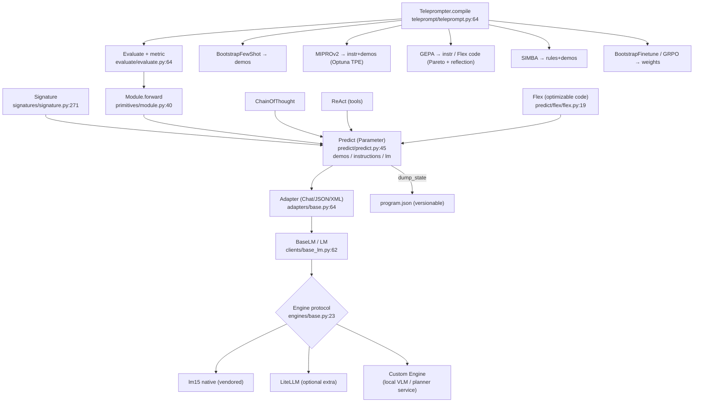
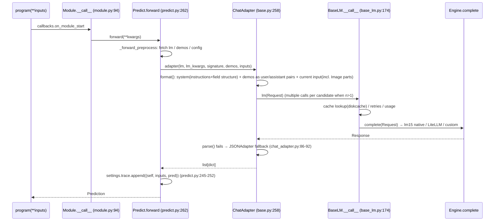

# DSPy Source-Level Architecture Study (worldcurrent Reasoning / Improvement Layer Selection)

- Repository: `references/reasoning/dspy` (stanfordnlp/dspy @ `25162c4`, 2026-10-29, `pyproject.toml` version 3.4.1, MIT)
- Method: purely static reading (read / grep / `python3 -I` parsing `uv.lock`); **nothing was installed or run, and no LLM was called**.
- Tag conventions: **[Implemented]** code exists and is traceable; **[Docs/Interface only]** only documentation or abstract interfaces; **[Unverified]** code exists but was not run to verify; **[Needs model/hardware]** needs an LLM API key / weights / GPU.
- Path prefix convention: `DS/` = `references/reasoning/dspy/dspy/` (full form `references/reasoning/dspy/dspy/<path>:<line>`).

---

## 1. Positioning and Core Capabilities

DSPy is a framework for "**writing LM calls as program modules with typed signatures, then using metric-driven optimizers to automatically rewrite the program's parameters**". Its "parameters" are not tensors but: instruction text (instructions), few-shot examples (demos), LM weights (via finetune / RL), and, in newer versions, **the module source code itself** (`dspy.Flex` + GEPA).

| Capability | Description | Status |
|---|---|---|
| Signature | Pydantic model + metaclass, declaring input/output fields and instructions | [Implemented] `DS/signatures/signature.py:271` |
| Module / Predict | PyTorch-style `Module.forward`; `Predict` is the only "learnable parameter" unit (`demos`, `signature.instructions`, `lm`) | [Implemented] `DS/primitives/module.py:40`, `DS/predict/predict.py:45` |
| ChainOfThought / ReAct | CoT = prepend a `reasoning` field to the signature; ReAct = thought/tool/args loop + extract | [Implemented] `DS/predict/chain_of_thought.py:12`, `DS/predict/react.py:17-120` |
| Adapter | Signature+demos+inputs → messages → LM → parse; ChatAdapter falls back to JSONAdapter on parse failure | [Implemented] `DS/adapters/base.py:64`, `DS/adapters/chat_adapter.py:31`, `:86-92` |
| LM abstraction | `BaseLM` + **Engine protocol `complete(Request)->Response`**; defaults to the vendored lm15 native engine, **LiteLLM has been downgraded to optional** | [Implemented] `DS/clients/base_lm.py:62`, `DS/clients/engines/base.py:23` |
| Example / Prediction | dict-like data containers; `with_inputs()` distinguishes inputs from labels | [Implemented] `DS/primitives/example.py:4`, `DS/primitives/prediction.py:4` |
| Evaluate | Runs the devset multi-threaded and averages `metric(example, pred)` | [Implemented] `DS/evaluate/evaluate.py:64-200` |
| Optimizers | BootstrapFewShot, MIPROv2, GEPA, SIMBA, COPRO, BootstrapFinetune, GRPO, BetterTogether, etc. | [Implemented] (running [Needs model/hardware]) `DS/teleprompt/` |
| Save/load | `module.save("x.json")` stores only state (JSON, diffable); `save_program=True` uses cloudpickle | [Implemented] `DS/primitives/base_module.py:172-260` |
| Multimodal | `dspy.Image`, `Audio`, `File`, `BoundingBox` (normalized coordinates) | [Implemented] `DS/adapters/types/image.py:29`, `DS/adapters/types/bounding_box.py:8` |
| Callbacks / tracing | `BaseCallback` covers module/lm/adapter/tool/evaluate/compile events | [Implemented] `DS/utils/callback.py:25-312` |

One-line verdict: **DSPy's most valuable parts are its optimizers (especially GEPA / MIPROv2) and the abstraction "program parameters = serializable JSON state"; it is a strong candidate for "Candidate Generation" in worldcurrent's RSI. Its Module/Adapter as an online inference runtime is optional.**

---

## 2. Directory Layout and Architecture

```
dspy/
├── signatures/   # Signature, InputField/OutputField, string signature parsing
├── primitives/   # BaseModule/Module, Example, Prediction, PythonInterpreter (Deno sandbox)
├── predict/      # Predict, ChainOfThought, ReAct, Refine, BestOfN, Parallel, RLM, flex/(Flex)
├── adapters/     # Adapter, ChatAdapter, JSONAdapter, XMLAdapter, TwoStepAdapter, types/(Image, BoundingBox, Tool...)
├── clients/      # BaseLM, LM, engines/(lm15, litellm, dummy), cache, Provider(finetune), lm_local
├── _vendor/lm15/ # vendored lm15 1.5.0 (MIT) multi-vendor native client
├── evaluate/     # Evaluate, metrics
├── teleprompt/   # all optimizers; gepa/ is an adapter to the external gepa package
├── propose/      # GroundedProposer (MIPRO instruction generation)
├── datasets/     # gsm8k, hotpotqa, alfworld(EnvPool) ...
└── dsp/utils/settings.py  # global config with contextvar overrides
```



---

## 3. Core Interfaces and Key Classes (signatures)

```python
# Signature  DS/signatures/signature.py:271, :278, :524 ; DS/signatures/field.py:79,84
class Signature(BaseModel, metaclass=SignatureMeta):
    @classmethod
    def with_instructions(cls, instructions: str) -> type["Signature"]
    @classmethod
    def dump_state(cls) / load_state(cls, state)
def InputField(**kwargs); def OutputField(**kwargs)

# Module  DS/primitives/module.py:40-131 ; DS/primitives/base_module.py:24, :157, :172, :251
class Module(BaseModule, metaclass=ProgramMeta):
    def __call__(self, *args, **kwargs) -> Prediction        # :94 goes through callbacks
    def named_predictors(self) -> list[tuple[str, Predict]]   # :131
    def set_lm(self, lm) ; def batch(self, examples, num_threads=...)
    def save(self, path, save_program=False, modules_to_serialize=None)
    def load(self, path, allow_pickle=False, allow_unsafe_lm_state=False)

# Predict  DS/predict/predict.py:45-290
class Predict(Module, Parameter):
    def __init__(self, signature: str | type[Signature], callbacks=None, **config)
    # learnable state: self.demos, self.signature(.instructions), self.lm, self.traces, self.train
    def dump_state(self, json_mode=True) -> dict              # :74
    def load_state(self, state, *, allow_unsafe_lm_state=False)  # :98
    def forward(self, **kwargs) -> Prediction                 # :262

# ReAct  DS/predict/react.py:18
class ReAct(Module):
    def __init__(self, signature: type[Signature], tools: list[Callable], max_iters: int = 20)

# Adapter  DS/adapters/base.py:64, :258, :311, :651
class Adapter:
    def __call__(self, lm: BaseLM, lm_kwargs: dict, signature: type[Signature],
                 demos: list[dict], inputs: dict) -> list[dict]
    def format(self, signature, demos, inputs) -> Prompt
    def parse(self, signature, completion: str) -> dict

# LM  DS/clients/base_lm.py:62-222 ; DS/clients/engines/base.py:23-46 ; DS/clients/lm.py:144
class Engine(Protocol):
    def complete(self, request: Request) -> Response
class BaseLM:
    def __init__(self, model: str, model_type="chat", temperature=None, max_tokens=None, cache=True,
                 callbacks=None, num_retries=3, engine: Engine | None = None,
                 async_engine: AsyncEngine | None = None, **kwargs)
    def __call__(self, prompt: Request | str | None = None, *, cache=None, rollout_id=None, **options)
class LM(BaseLM):  # engine: Engine | Literal["auto","lm15","litellm"] = "auto"
    def finetune(...) ; def reinforce(self, train_kwargs) -> ReinforceJob   # :409, :444

# Evaluate  DS/evaluate/evaluate.py:71
class Evaluate:
    def __init__(self, *, devset: list[Example], metric: Callable | None = None, num_threads=None,
                 display_progress=False, max_errors=None, failure_score=0.0, save_as_json=None, ...)

# Optimizer base class and metric contract
class Teleprompter:  # DS/teleprompt/teleprompt.py:53
    def compile(self, student: Module, *, trainset: list[Example], teacher=None, valset=None, **kw) -> Module
# BootstrapFewShot/MIPROv2: metric(example, prediction, trace=None) -> float|bool   DS/teleprompt/bootstrap.py:209
# GEPA: metric(gold, pred, trace, pred_name, pred_trace[, program_trace]) -> float | ScoreWithFeedback
class GEPAFeedbackMetric(Protocol)       # DS/teleprompt/gepa/gepa.py:34
class ScoreWithFeedback(Prediction):     # DS/teleprompt/gepa/gepa_utils.py:70
    score: float; feedback: str; objective_scores: dict[str, float] | None
```

---

## 4. Core Execution Flow

### 4.1 Inference: One `Predict` Call



### 4.2 Optimization: How the Metric Drives It (GEPA as an Example)

```mermaid
sequenceDiagram
    participant G as GEPA.compile (gepa.py:545)
    participant AD as DspyAdapter (gepa_utils.py:108)
    participant PG as student program
    participant MT as metric(gold,pred,trace,pred_name,pred_trace)
    participant RL as reflection_lm
    G->>AD: optimize(seed_candidate={predictor: instruction, flex: module_src}) (gepa.py:656)
    loop until max_metric_calls
        AD->>PG: build_program(candidate) (gepa_utils.py:208)
        AD->>PG: run on minibatch and capture trace (bootstrap_trace_data)
        PG->>MT: score each sample + text feedback (+ objective_scores)
        AD->>AD: make_reflective_dataset (gepa_utils.py:341)
        AD->>RL: propose_new_texts: reflect on failed trajectories, rewrite a component's instruction / code
        AD->>AD: valset evaluation, maintain Pareto front; optionally merge two candidates
    end
    G-->>G: build_program(best_candidate) → new_prog.detailed_results (gepa.py:688-694)
```

The core of BootstrapFewShot is simpler: the teacher program runs on the trainset, and for samples where `metric(example, prediction, trace)` passes (or is ≥ threshold), the (inputs, outputs) of each predictor in the trace become that predictor's demos (`DS/teleprompt/bootstrap.py:185-260`), which are then concatenated with randomly selected labeled samples (`:262-275`). MIPROv2 has three steps: bootstrap multiple sets of demo candidates → GroundedProposer generates instruction candidates → Optuna TPE performs minibatch Bayesian search over (instruction, demo-set) combinations (`DS/teleprompt/mipro_optimizer_v2.py:230-274`, `:658-659`).

---

## 5. Extension Points and Plugin Mechanism

| Extension point | Mechanism | Significance for worldcurrent |
|---|---|---|
| Custom Engine | Any object implementing `complete(Request)->Response` passed into `BaseLM(engine=...)` (`DS/clients/base_lm.py:87-134`) [Implemented] | **Plug our own reasoning model / VLM / local service into DSPy without going through LiteLLM** |
| Custom BaseLM subclass | Override dump_state/load_state (`DS/clients/base_lm.py:223-308`) [Implemented] | Can record the model version into program.json |
| Custom Adapter | Subclass `Adapter`, override `format/parse` [Implemented] | Output structured action/plan schemas (Pydantic) |
| Custom Type | Subclass `dspy.Type` (e.g. `Image`, `BoundingBox`) [Implemented] `DS/adapters/types/base_type.py` | Define input types such as `Pose6D`, `SceneGraph` |
| Tools | `dspy.Tool` / any callable given to ReAct [Implemented] | Skill APIs as tools |
| metric | Any Python callable; signatures in Section 3 [Implemented] | **Sim rollout success rate / multi-objective cost used directly as the metric** |
| GEPA proposer / component selector | `instruction_proposer`, `code_proposer`, `component_selector` parameters (`DS/teleprompt/gepa/gepa.py:399-420`) [Implemented] | Can inject proposers with domain priors |
| Flex interpreter | `interpreter_factory` defaults to a Deno/Pyodide sandbox (`DS/predict/flex/flex.py:19-60`) [Implemented][Unverified] | Sandboxed execution of planner code generated by the optimizer |
| Finetune Provider | Subclass `Provider.finetune` (`DS/clients/provider.py:180-269`) [Implemented] | Hook into our own VLA/LLM training pipeline |
| Callbacks | `BaseCallback` + `with_callbacks` (`DS/utils/callback.py:25`, `:312`) [Implemented] | Connect to OpenTelemetry / experiment tracking |

---

## 6. Dependencies and Runtime Requirements

- Hard dependencies (`references/reasoning/dspy/pyproject.toml:23-39`) [Implemented]: `openai, regex, orjson, tqdm, requests, certifi, pydantic, pyyaml, jsonschema, diskcache, json-repair, anyio, cachetools, cloudpickle, gepa[dspy]==0.1.4`.
- **LiteLLM is now an optional extra** (`pyproject.toml` `[project.optional-dependencies] litellm`); the default `engine="auto"` prefers the vendored lm15 (`DS/clients/backend_selection.py:28-60`, `DS/lm15.py:1-30`, `DS/_vendor/lm15-provenance.txt`); LiteLLM is lazily imported only when lm15 cannot express the request (`DS/clients/_litellm.py:30`) [Implemented][Unverified]. This corrects the old impression that "DSPy is tightly bound to LiteLLM"; if litellm is installed, it pulls in `boto3, huggingface-hub, tokenizers, tiktoken, aiohttp, jinja2...` (from parsing `uv.lock`) — noticeably heavier.
- The `openai` SDK is still a hard dependency (top-level import in `DS/clients/embedding.py:7`; the finetune provider in `DS/clients/openai.py:43`) [Implemented]; its transitive dependencies are light (`httpx, jiter, pydantic, distro...`).
- `gepa` 0.1.4 has no extra dependencies in the lock [Implemented].
- Optional: `optuna` (required by MIPROv2, `DS/teleprompt/mipro_optimizer_v2.py:28-35`, pulls in sqlalchemy/alembic/numpy), `deno` (Flex/PythonInterpreter sandbox), `langchain_core` (adaptation only), `numpy`. Local finetuning needs `sglang, torch, transformers, trl, datasets` (`DS/clients/lm_local.py:31`, `:202-204`, `:236`) → [Needs model/hardware].
- Global state: a `dspy.settings` singleton + thread-level `contextvars` overrides (`DS/dsp/utils/settings.py:50`, `:220-262`); the disk cache writes to the user directory by default (`DS/clients/__init__.py:15`, `:61-80`). For multi-process/multi-robot concurrency, cache directories must be isolated explicitly.
- Python `>=3.10,<3.16`; all optimizers at runtime are [Needs model/hardware] (at least one LM API or local service).

---

## 7. License and Reuse Constraints

- `references/reasoning/dspy/LICENSE`: MIT, Copyright (c) 2023 Stanford Future Data Systems [Implemented].
- Vendored lm15: MIT (`DS/_vendor/lm15-LICENSE`, Copyright 2026 lm15 contributors); provenance and patch list in `DS/_vendor/lm15-provenance.txt` [Implemented].
- The external `gepa` package's license is not in this repository and needs to be checked separately [Unverified].
- Reuse constraints: no copyleft; but `save_program=True` / `.pkl` use cloudpickle, so **loading untrusted artifacts = arbitrary code execution** (warning at `DS/primitives/base_module.py:214-215`); `load_state` sanitizes `api_base/base_url` by default (`DS/predict/predict.py:27-43`).

---

## 8. Strengths, Weaknesses and Risks

**Strengths**
1. **Program parameters are fully serializable**: `Predict.dump_state` = `{demos, signature(instructions+fields), lm, traces, train}`, written to disk as JSON, naturally git-diffable / versionable / rollback-able (`DS/predict/predict.py:74-96`, `DS/primitives/base_module.py:157-235`) [Implemented].
2. **The metric is an ordinary Python function**, decoupled from the evaluated object → robot success rate, collision count, and elapsed time can all be plugged in [Implemented].
3. GEPA supports **text feedback + multi-objective `objective_scores` + Pareto selection + code-level optimization (Flex)** (`DS/teleprompt/gepa/gepa_utils.py:70-80`, `DS/teleprompt/gepa/gepa.py:34-68`) [Implemented], highly isomorphic to the RSI "reflect-propose-evaluate" loop.
4. The LM abstraction has switched to a narrow Engine protocol, so the cost of plugging in our own models is low [Implemented].
5. Ships with an ALFWorld environment pool example (`DS/datasets/alfworld/alfworld.py:52-138`: multiprocess environment pool + session context), demonstrating that the "embodied environment rollout as metric" pattern is feasible within the framework [Implemented][Unverified].

**Weaknesses / Risks**
1. **GEPA is marked `@experimental`** (`DS/teleprompt/gepa/gepa.py:192`) and depends on a pinned version of the external `gepa` package → unstable API.
2. Optimizer budgets are counted in "metric calls" (GEPA `max_metric_calls`); when each metric call = one sim rollout the cost is enormous; MIPROv2 defaults to minibatch 35 (`DS/teleprompt/mipro_optimizer_v2.py:121`). It must be paired with a parallel sim pool and early stopping.
3. Evaluation parallelism uses **threads** (`DS/utils/parallelizer.py:35`, `:187`), while physics simulators are usually not thread-safe → they need to be wrapped in a process pool as ALFWorld does [Implemented].
4. The global `settings` singleton + thread-local overrides easily lead to implicit state coupling when embedded in a long-running robot process [Implemented].
5. Only **language/code-level** parameters are optimized; weight optimization of VLA action policies has to go through `BootstrapFinetune/GRPO` → `Provider.finetune`, and the default providers target OpenAI or local sglang+trl (text LMs), not suited to VLA training [Implemented][Needs model/hardware].
6. `ReAct` is a synchronous serial loop with at least 1 LM call per step (`DS/predict/react.py:96-120`), so it **cannot be used for 5–50 Hz control** [Implemented].
7. Multimodal: `dspy.Image` is encoded as base64/URL parts (`DS/adapters/types/image.py:191-290`); no direct support for numpy frames (must go through PIL), no video/point cloud types; whether it works depends on the backend VLM [Needs model/hardware].
8. Version drift: a docstring already mentions "DSPy 3.5 removed messages= / forward()" (`DS/clients/base_lm.py:74-77`); the API is still converging quickly.

---

## 9. Components Worth Reusing

| Component | Reuse approach |
|---|---|
| GEPA (+ DspyAdapter) | As one implementation of worldcurrent's `CandidateGenerator`, optimizing the planner prompt / planner code (Flex) |
| MIPROv2 | Baseline generator for joint instruction + demo search |
| BootstrapFewShot / SIMBA | Automatically extract demos from successful episodes, and summarize rules from failures (`DS/teleprompt/simba_utils.py:73-170`) |
| `Predict.dump_state` JSON format | Use directly as the versioned format for "prompt program artifacts", stored in the worldcurrent artifact registry |
| Engine protocol | Wrap our Reasoner model service as an Engine, so DSPy optimization calls the same backend |
| Signature / Pydantic output types | Declare the planner's structured outputs (SkillCall, Subgoal, BoundingBox) |
| ALFWorld EnvPool pattern | Borrow as a reference implementation for "SimPool + metric" |

## 10. Capabilities Not Worth Rebuilding

- Complete optimizers with instruction proposal + Bayesian/Pareto search + reflective mutation (GEPA/MIPROv2/SIMBA).
- The few-shot demo bootstrapping (trace → demo) logic.
- Structured output parsing + fallback (ChatAdapter → JSONAdapter).
- Multi-vendor LM client, caching, retries, usage accounting (lm15).
- JSON serialization and safe loading of program state (endpoint sanitization).

Should not be handed to DSPy: online high-frequency control, long-term memory storage, episode data management, VLA weight training pipelines.

---

## 11. Source Index of Key Implementations

| Topic | Location | Tag |
|---|---|---|
| Signature class / with_instructions | `references/reasoning/dspy/dspy/signatures/signature.py:271`, `:278` | [Implemented] |
| InputField / OutputField | `references/reasoning/dspy/dspy/signatures/field.py:79`, `:84` | [Implemented] |
| Module / named_predictors | `references/reasoning/dspy/dspy/primitives/module.py:40`, `:94`, `:131` | [Implemented] |
| save / load | `references/reasoning/dspy/dspy/primitives/base_module.py:172-260` | [Implemented] |
| dspy.load (whole program) | `references/reasoning/dspy/dspy/utils/saving.py:27` | [Implemented] |
| Predict state / forward | `references/reasoning/dspy/dspy/predict/predict.py:45-131`, `:262` | [Implemented] |
| Trace recording | `references/reasoning/dspy/dspy/predict/predict.py:245-252` | [Implemented] |
| ChainOfThought | `references/reasoning/dspy/dspy/predict/chain_of_thought.py:37-57` | [Implemented] |
| ReAct loop | `references/reasoning/dspy/dspy/predict/react.py:18`, `:96-120` | [Implemented] |
| Flex (optimizable code) | `references/reasoning/dspy/dspy/predict/flex/flex.py:19` | [Implemented][Unverified] |
| Adapter pipeline | `references/reasoning/dspy/dspy/adapters/base.py:64`, `:258-288` | [Implemented] |
| JSON fallback | `references/reasoning/dspy/dspy/adapters/chat_adapter.py:86-92` | [Implemented] |
| Image / BoundingBox | `references/reasoning/dspy/dspy/adapters/types/image.py:29`; `bounding_box.py:8` | [Implemented]/[Needs model/hardware] |
| BaseLM / Engine protocol | `references/reasoning/dspy/dspy/clients/base_lm.py:62-222`; `clients/engines/base.py:23-46` | [Implemented] |
| Backend selection (lm15 vs LiteLLM) | `references/reasoning/dspy/dspy/clients/backend_selection.py:28` | [Implemented][Unverified] |
| LM.finetune / reinforce | `references/reasoning/dspy/dspy/clients/lm.py:409`, `:444` | [Needs model/hardware] |
| Local finetune (torch/trl) | `references/reasoning/dspy/dspy/clients/lm_local.py:146`, `:202-204` | [Needs model/hardware] |
| settings / contextvars | `references/reasoning/dspy/dspy/dsp/utils/settings.py:50`, `:220` | [Implemented] |
| Callbacks | `references/reasoning/dspy/dspy/utils/callback.py:25`, `:312` | [Implemented] |
| Evaluate | `references/reasoning/dspy/dspy/evaluate/evaluate.py:64`, `:173-176` | [Implemented] |
| ParallelExecutor (threads) | `references/reasoning/dspy/dspy/utils/parallelizer.py:35`, `:187` | [Implemented] |
| Teleprompter base class | `references/reasoning/dspy/dspy/teleprompt/teleprompt.py:53-64` | [Docs/Interface only] |
| BootstrapFewShot | `references/reasoning/dspy/dspy/teleprompt/bootstrap.py:36`, `:185-275` | [Implemented] |
| MIPROv2 | `references/reasoning/dspy/dspy/teleprompt/mipro_optimizer_v2.py:60`, `:109`, `:230-274`, `:658` | [Implemented][Needs model/hardware] |
| GEPA metric / compile | `references/reasoning/dspy/dspy/teleprompt/gepa/gepa.py:34`, `:399`, `:545-694` | [Implemented][Needs model/hardware] |
| GEPA DspyAdapter | `references/reasoning/dspy/dspy/teleprompt/gepa/gepa_utils.py:70`, `:108-341` | [Implemented] |
| SIMBA | `references/reasoning/dspy/dspy/teleprompt/simba.py:17`; `simba_utils.py:73`, `:108` | [Implemented][Needs model/hardware] |
| BootstrapFinetune / GRPO | `references/reasoning/dspy/dspy/teleprompt/bootstrap_finetune.py:35`; `grpo.py:25` | [Needs model/hardware] |
| Candidate program persistence | `references/reasoning/dspy/dspy/teleprompt/utils.py:210` | [Implemented] |
| ALFWorld EnvPool | `references/reasoning/dspy/dspy/datasets/alfworld/alfworld.py:52-138` | [Implemented][Unverified] |

---

## Verification Status Summary

| Capability | Tag | Notes |
|---|---|---|
| Signature/Module/Predict/Adapter inference pipeline | [Implemented] | Running needs an LM → [Needs model/hardware] |
| LiteLLM optional, lm15 default | [Implemented][Unverified] | Confirmed statically from pyproject + backend_selection |
| Custom Engine integration | [Implemented] | Extremely narrow protocol |
| Optimizers (BFS/MIPRO/GEPA/SIMBA) | [Implemented][Needs model/hardware] | Not run |
| Flex code optimization + sandbox | [Implemented][Unverified] | Needs Deno |
| Finetune / GRPO | [Needs model/hardware] | Targets text LMs |
| JSON state save/load | [Implemented] | |
| Multimodal Image/BoundingBox | [Implemented][Needs model/hardware] | Depends on the VLM backend |
| Robot metric integration | [Docs/Interface only] | Allowed by the framework; no ready-made robot implementation; ALFWorld is a text-based embodied reference |

---

## 12. Mapping to worldcurrent Reasoner / Memory / Improvement Interfaces

**(d) DSPy as the Candidate Generation engine for RSI**: yes, and GEPA is recommended as the primary with MIPROv2 as the control. The optimized object = the planner's DSPy program (the instructions + demos of each `Predict`, plus the source code of `Flex` submodules). How the robot success metric is plugged in:

```python
class SimRolloutMetric:                       # implements the GEPAFeedbackMetric protocol
    def __init__(self, sim_pool): self.pool = sim_pool          # process-level SimPool, modeled on ALFWorld EnvPool
    def __call__(self, gold, pred, trace=None, pred_name=None, pred_trace=None):
        with self.pool.session() as sim:
            sim.reset(gold.task_spec, seed=gold.seed)
            result = sim.execute_plan(pred.plan, controller=gold.policy_ref)   # the 5–50Hz closed loop runs inside the sim/controller
        return dspy.Prediction(                                 # = ScoreWithFeedback
            score=float(result.success),
            feedback=result.failure_summary,                    # e.g. "grasp slipped at subgoal 3"
            objective_scores={"success": result.success, "time": -result.duration,
                              "collisions": -result.n_collisions})
```

Key points: (1) the program's `forward` only produces the plan, and the rollout happens in the metric (or the program calls sim tools internally and the metric reads the result); (2) use the `seed`/`task_spec` fields to fix randomness, otherwise Pareto comparisons are noisy; (3) the budget is counted in number of rollouts; set `max_metric_calls`, and `num_threads` = SimPool size; (4) the artifacts `program.json` + metric report go into worldcurrent's artifact registry, and the Gate (offline regression + safety checks) decides whether to promote.

**Reasoner mapping**: a DSPy program can serve as one implementation of `Reasoner` (`DSPyReasoner`), calling our own reasoning model / VLM through a custom `Engine`; but online inference can also do without DSPy — simply export the optimization results (instructions/demos) into our own prompt templates, avoiding a runtime dependency.

**Memory mapping**: DSPy has no long-term memory storage; `demos` can be viewed as a "programmatic curated selection of episodic memory", which can be retrieved by worldcurrent Memory and injected at runtime (the `KNNFewShot` idea, `DS/teleprompt/knn_fewshot.py`).

**Improvement interface**:

```python
class CandidateGenerator(Protocol):
    def propose(self, base: ProgramArtifact, trainset, valset, metric: Metric, budget: Budget) -> list[ProgramArtifact]: ...

class DSPyGEPAGenerator(CandidateGenerator):   # optional adapter package worldcurrent-improve-dspy
    # base.load → dspy.Module; GEPA(metric=SimRolloutMetric(...), reflection_lm=..., max_metric_calls=B).compile(...)
    # returns dump_state() of each Pareto-front candidate in detailed_results → ProgramArtifact(json, parent_id, metrics)
```

**(e)/(f) Dependencies and integration pattern**: the core dependency surface is moderate (openai SDK, pydantic, diskcache, cloudpickle, gepa), without torch/litellm; MIPRO needs optuna, Flex needs deno. Recommended as an **optional adapter package**, installed only in the Improvement worker (offline optimization process); the online Reasoner does not depend on DSPy by default and only reads its exported JSON state.
