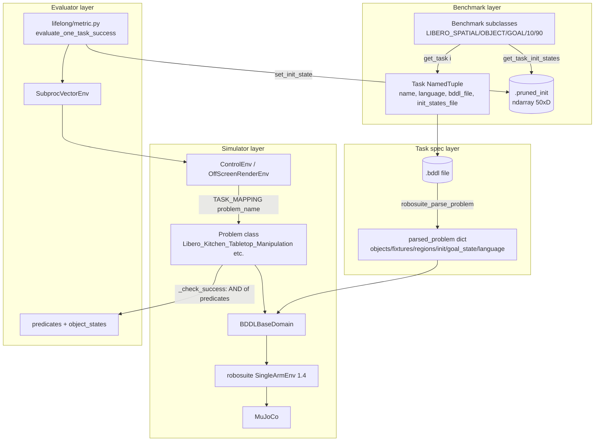
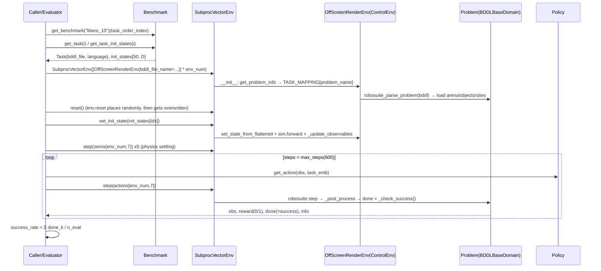

# LIBERO Source-Level Architecture Study

> Repository: `references/benchmarks/LIBERO` (Lifelong-Robot-Learning/LIBERO @ `8f1084e`, MIT, commit date 2025-03-15)
> Method: static analysis only (read / grep / `python3 -I` + `ast` / `zipfile` + `pickletools`); nothing installed, run, or downloaded (no assets or datasets).
> Tags: **[Implemented]** code exists and is traceable; **[Docs/Interface only]** only documentation or an abstract interface; **[Unverified]** code exists but we have not run it; **[Needs model/hardware]** requires GPU/EGL/assets/datasets, etc.
> Path prefix: `references/benchmarks/LIBERO/` is abbreviated as `L/`.

---

## 1. Positioning and Core Capabilities

LIBERO is a benchmark for **lifelong / multi-task robot imitation learning**, built on top of **robosuite 1.4 + MuJoCo**. Its core value lies not in the simulator itself, but in three things:

1. **Symbolic task specification BDDL** (Behavior Domain Definition Language, a PDDL dialect): each task is a `.bddl` file that declares regions, fixtures, objects, `:init` and `:goal` predicates, and the natural-language instruction `:language`. [Implemented] `L/libero/libero/envs/bddl_utils.py:87-172`
2. **Fixed initial-state files** (`.pruned_init`): for each task, 50 MuJoCo flattened states are pre-sampled and saved; at evaluation time they are applied directly via `set_state`, thereby avoiding the non-reproducibility caused by random sampling. [Implemented] `L/libero/libero/benchmark/__init__.py:158-165`; format in §4.
3. **Task suite registry**: five suites `libero_spatial / libero_object / libero_goal / libero_10 / libero_90`, with 130 BDDL files in total (10+10+10+10+90). [Implemented] `L/libero/libero/benchmark/libero_suite_task_map.py:1-142`, `L/libero/libero/benchmark/__init__.py:56-77`

On top of this it provides lifelong learning algorithms (Sequential/ER/EWC/AGEM/PackNet/Multitask/SingleTask), three BC policies (RNN/Transformer/ViLT), and accompanying hydra training/evaluation scripts. [Implemented] `L/libero/lifelong/algos/*.py`, `L/libero/lifelong/main.py`

Capability boundaries: only a single-arm Panda (`MountedPanda` / `OnTheGroundPanda`), only OSC end-effector control, success checks only support **conjunctive (And)** goals; no reward shaping (only sparse 0/1).

## 2. Directory Layout and Architecture

```
L/libero/libero/
  __init__.py                 # ~/.libero/config.yaml path management (may prompt via input() on import!)
  benchmark/                  # Benchmark base class + suite registration + task_orders + libero_suite_task_map
  bddl_files/<suite>/*.bddl   # task specifications (130 + libero_10/tasks_info.txt)
  init_files/<suite>/*.pruned_init|*.init   # numpy initial states saved with torch.save
  envs/
    bddl_base_domain.py       # BDDLBaseDomain(SingleArmEnv) core env + TASK_MAPPING registration
    bddl_utils.py             # BDDL parsing (depends on scan_tokens/package_predicates from external bddl==1.0.1)
    problems/                 # 6 problem classes (scene families), each implementing _check_success
    predicates/               # In/On/Up/Open/Close/TurnOn/TurnOff predicates
    object_states/            # ObjectState/SiteObjectState: geometric implementation of predicates
    objects/ arenas/ regions/ robots/   # asset wrappers, scenes, placement samplers, robots
    env_wrapper.py            # ControlEnv / OffScreenRenderEnv / SegmentationRenderEnv
    venv.py                   # Dummy/SubprocVectorEnv (tianshou style, extended with set_init_state)
  assets/                     # 405 MB meshes/textures (in-repo)
  utils/                      # procedural task generation (mu_utils/task_generation_utils/bddl_generation_utils), downloads
L/libero/lifelong/            # algorithms, models, datasets, metric (evaluation loop), main/evaluate entry points
L/libero/configs/             # hydra configs (data/eval/policy/lifelong/train)
L/scripts/ L/benchmark_scripts/  # dataset creation, demonstration collection, downloads, suite checks
```



## 3. Core Interfaces and Key Classes (Signatures)

**Benchmark / Task** [Implemented]
```python
# L/libero/libero/benchmark/__init__.py:35-41
class Task(NamedTuple):
    name: str; language: str; problem: str; problem_folder: str
    bddl_file: str; init_states_file: str          # always f"{name}.pruned_init"
# :14-16 registration (lowercased class name); :27-28 get_benchmark(name)
class Benchmark(abc.ABC):                          # :108-168
    def __init__(self, task_order_index=0)
    def get_num_tasks(self) -> int
    def get_task(self, i) -> Task
    def get_task_bddl_file_path(self, i) -> str    # :136-142
    def get_task_init_states(self, i)              # :158-165, torch.load(...) -> np.ndarray[N, state_dim]
    def get_task_demonstration(self, i) -> str     # hdf5 path relative to the datasets directory
    def set_task_embs(self, task_embs) / get_task_emb(self, i)
```
`task_orders` (21 permutations of 10 tasks, `:83-105`) only applies to 10-task suites; `LIBERO_90` asserts `task_order_index == 0` (`:199-201`).

**Environment** [Implemented]
```python
# L/libero/libero/envs/env_wrapper.py:12-42
class ControlEnv:
    def __init__(self, bddl_file_name, robots=["Panda"], controller="OSC_POSE",
                 camera_names=["agentview","robot0_eye_in_hand"], camera_heights=128,
                 camera_widths=128, control_freq=20, horizon=1000, hard_reset=True, ...)
    def reset(self) -> OrderedDict                     # :90-101 swallows RandomizationError and retries forever
    def step(self, action) -> (obs, reward, done, info)  # :87-88 old gym 4-tuple
    def set_init_state(self, init_state) -> obs        # :136-145 set_state_from_flattened + forward
    def check_success(self) -> bool                    # :103-104
    def get_sim_state(self) -> np.ndarray              # :118-119
    def seed(self, seed)                               # -> BDDLBaseDomain.seed: np.random.seed (global)
class OffScreenRenderEnv(ControlEnv)                   # :152-161 forces offscreen
class SegmentationRenderEnv(OffScreenRenderEnv)        # :164-261 instance segmentation
```
```python
# L/libero/libero/envs/bddl_base_domain.py
TASK_MAPPING = {}; def register_problem(cls)          # :26-31
class BDDLBaseDomain(SingleArmEnv):                   # :37
    def __init__(self, bddl_file_name, robots, controller_configs=None, ..., control_freq=20,
                 horizon=1000, camera_names="agentview", camera_heights=256, ...)   # :42-160
    def reward(self, action=None) -> float            # :165-189 sparse 1.0 * reward_scale
    def _reset_internal(self)                         # :731-777 property sampler + placement sampler
    def _check_success(self) -> bool                  # :779-786 base class returns False, overridden by problem classes
    def step(self, action)                            # :800-809 done := _check_success()
```

**Success predicate** [Implemented]
```python
# L/libero/libero/envs/problems/libero_kitchen_tabletop_manipulation.py:136-163
def _check_success(self):
    goal_state = self.parsed_problem["goal_state"]
    result = True
    for state in goal_state: result = self._eval_predicate(state) and result
    return result
# L/libero/libero/envs/predicates/__init__.py:4-18  VALIDATE_PREDICATE_FN_DICT
#   {"true","false","in","on","up","printjointstate","open","close","turnon","turnoff"}
# :21-22 update_predicate_fn_dict(fn_key, fn_name) registers via eval(fn_name)()
```
Geometric semantics of the predicates (`L/libero/libero/envs/object_states/base_object_states.py`):
- `On(a,b)` → `b.check_ontop(a)`: z lower, in contact, xy distance < 0.03 m (`:78-94`); the site version has a separate implementation (`:178`).
- `In(a,b)` → `b.check_contact(a) and b.check_contain(a)` (`L/.../predicates/base_predicates.py:57-59`); contain is decided with `in_box` (`base_object_states.py:59-68`).
- `Open/Close/TurnOn/TurnOff` → read joint qpos against object-specific thresholds (`:100-130`).

**Algorithm registration** [Implemented]: `register_algo` (`L/libero/lifelong/algos/base.py:18`) + automatic registration via the `AlgoMeta` metaclass (`:40-51`), base class `Sequential(nn.Module)` (`:54`).

## 4. Core Execution Flow



Source mapping: `L/libero/lifelong/metric.py:52-161` (`evaluate_one_task_success`): init states loading `:103-107`, modulo indexing by `i*env_num..` `:111-112`, `set_init_state` `:117`, 5 zero-action steps `:119-122`, main loop `:130-150`, success rate `:152-157`. Single-checkpoint evaluation is in `L/libero/lifelong/evaluate.py:243-287` (fixed 20 parallel envs). Defaults are `n_eval: 20`, `max_steps: 600`, `num_procs: 20` (`L/libero/configs/eval/default.yaml:5-9`).

**Init states file format** (static parse of `turn_on_the_stove.pruned_init`): a zip container (torch.save format) containing `archive/data.pkl`; the pickled object is an `ndarray` reconstructed by `numpy.core.multiarray._reconstruct`, shape `(50, 79)`. That is, 50 flattened MuJoCo states (time+qpos+qvel), whose dimensionality is tied to the specific scene model. [Implemented] (format) / [Unverified] (compatibility with the state layout of the current MuJoCo version)

**Action space**: `ControlEnv` defaults to `controller="OSC_POSE"` (`env_wrapper.py:17,47`) → 7-D: `[dx,dy,dz, dax,day,daz, gripper]`, normalized to [-1,1] and scaled by robosuite 1.4's OSC controller; if `action_dim==4` (OSC_POSITION), the 7-D action is truncated to `[:3]+[-1]` (`bddl_base_domain.py:800-804`). During evaluation the dummy action is fixed to `np.zeros((env_num, 7))` (`metric.py:120`). [Implemented]

**Observation space** (robosuite OrderedDict): `agentview_image`, `robot0_eye_in_hand_image` (default 128×128, upside down per the OpenGL convention), `robot0_joint_pos` (forced active, `bddl_base_domain.py:436`), `robot0_gripper_qpos`, `robot0_eef_pos/quat`, plus for each object `{obj}_pos/_quat/_to_robot0_eef_pos/_quat` (`:494-560`). Training-side key mapping: `agentview_rgb→agentview_image`, etc. (`L/libero/configs/data/default.yaml:30-34`). There is no gym `observation_space` object (only robosuite's `observation_spec()`). [Implemented]

## 5. Extension Points and Plugin Mechanism

| Extension point | Mechanism | Location | Status |
|---|---|---|---|
| New benchmark suite | Decorate a `Benchmark` subclass with `@register_benchmark`; but `_make_benchmark` depends on the module-level `task_maps`, so the `libero_suites` list must be changed as well | `L/libero/libero/benchmark/__init__.py:14-16,56-77,115-122` | [Implemented], extension is not clean |
| New problem (scene family) | Subclass `BDDLBaseDomain` with `@register_problem`; `(problem X)` in the BDDL must equal the lowercased class name (`_assert_problem_name`) | `bddl_base_domain.py:29-31,191-195` | [Implemented] |
| New object | `register_object` registers into `OBJECTS_DICT` via CamelCase→snake_case | `L/libero/libero/envs/base_object.py:7-12`, `objects/__init__.py:13-14` | [Implemented] |
| New predicate | Modify `VALIDATE_PREDICATE_FN_DICT` or use `update_predicate_fn_dict` (internally uses `eval`) | `L/libero/libero/envs/predicates/__init__.py:4-27` | [Implemented], eval risk |
| Procedural task generation | `@register_mu` scene template + `register_task_info(language, scene_name, objects_of_interest, goal_states)` + `generate_bddl_from_task_info` | `L/libero/libero/utils/mu_utils.py:15`, `task_generation_utils.py:14,54`, example `L/scripts/create_libero_task_example.py` | [Implemented]/[Unverified] |
| New robot | Write into robosuite's global `ROBOT_CLASS_MAPPING` | `L/libero/libero/envs/robots/__init__.py:7-12` | [Implemented] (global monkey-patch) |
| New lifelong algorithm | Automatic registration via the `AlgoMeta` metaclass | `L/libero/lifelong/algos/base.py:18-54` | [Implemented] |

## 6. Dependencies and Runtime Requirements

- **Python**: the README requires `python=3.8.13` (`L/README.md:51`); `setup.py` only specifies `python_requires=">=3"` and `install_requires=[]` (`L/setup.py:18-19`): all dependencies are in `requirements.txt`, so `pip install -e .` installs nothing. [Docs/Interface only]
- **Hard pins** (`L/requirements.txt`): `robosuite==1.4.0`(:10), `numpy==1.22.4`(:2), `bddl==1.0.1`(:11), `robomimic==0.2.0`(:7), `gym==0.25.2`(:15), `transformers==4.21.1`(:5), hydra-core 1.2.0, wandb 0.13.1; torch is specified by the README as `torch==1.11.0+cu113` (`L/README.md:56`).
- **MuJoCo**: not pinned directly; determined indirectly via robosuite 1.4.0 (the official DeepMind `mujoco` bindings); the code calls `mujoco.mj_step1(self.sim.model._model, self.sim.data._data)` directly (`bddl_base_domain.py:13,755`), relying on internal fields of robosuite 1.4's `MjSim`. [Unverified]
- **robosuite 1.4-specific APIs**: `robosuite.environments.manipulation.single_arm_env.SingleArmEnv` (`bddl_base_domain.py:6`), `robosuite.robots.single_arm.SingleArm` (`robots/__init__.py:4`), `suite.load_controller_config` (`env_wrapper.py:47`). In robosuite 1.5 these are replaced by the `ManipulationEnv` / composite controller system, so **LIBERO cannot run directly on robosuite ≥1.5**. [Unverified, static inference]
- **Rendering**: offscreen requires EGL/OSMesa; the README binds the GPU with `MUJOCO_EGL_DEVICE_ID` (`L/README.md:144-146`). [Needs model/hardware]
- **Global state side effects**: on `import libero.libero`, if `~/.libero/config.yaml` does not exist, it calls `input()` to ask for the dataset path (`L/libero/libero/__init__.py:62-94`); in CI / TTY-less subprocesses this will block or raise EOFError. A config can be pre-seeded with `LIBERO_CONFIG_PATH` (`:5-8`). [Implemented]
- **torch.load**: both init states and checkpoints are loaded with `torch.load(path)` without a `weights_only` argument (`benchmark/__init__.py:164`, `metric.py:107`). Under torch ≥2.6, where the default is `weights_only=True`, loading pickled numpy may fail. [Unverified]
- **Assets**: in-repo, `libero/libero/assets` is 405 MB (meshes, textures, scene XML); datasets must be downloaded (original links or HuggingFace, `L/benchmark_scripts/download_libero_datasets.py`). [Needs model/hardware]

## 7. License and Reuse Constraints

- Code: MIT (`L/LICENSE`). Datasets: the README claims CC BY 4.0 (`L/README.md:180-184`). [Docs/Interface only]
- **Assets have no per-item license files** (`find assets -iname '*licen*'` is empty). Asset sources can be identified from directory names: `stable_scanned_objects` (Google Scanned Objects, originally CC BY 4.0), `stable_hope_objects` (NVIDIA HOPE dataset, whose original license must be verified separately), `turbosquid_objects` (purchased TurboSquid models; the TurboSquid standard license generally does **not allow** redistribution of the original model files). LIBERO redistributes these meshes directly in the repo. [Unverified]: if worldcurrent packages or mirrors LIBERO assets, a license review is mandatory; the safest approach is to **not package them and only fetch them on the user side from the original repository**.
- BDDL files and init states are part of the code repository's content and can be treated as MIT.

## 8. Strengths, Weaknesses and Risks

**Strengths**
- Task specifications are declarative, human-readable and procedurally generatable; success predicates and the scene description live in the same file, making task-level version management easy.
- Fixed init states make evaluation reproducible, and evaluation does not depend on the randomness of the placement sampler.
- The suite split (spatial/object/goal/long-horizon) has clear semantics along VLA generalization dimensions and has become the de facto standard in the VLA community (OpenVLA/π0 etc. all report LIBERO).

**Weaknesses / code defects (static findings, all [Unverified])**
- `LIBERO_100` is registered (`benchmark/__init__.py:214-219`), but `libero_suites` does not contain `libero_100` (`:56-62`), so instantiating it raises `KeyError`.
- `BDDLBaseDomain.language_instruction` reads `parsed_problem["language"]` (`bddl_base_domain.py:840-842`), but the key returned by the parser is `language_instruction` (`bddl_utils.py:166`) → KeyError; the outer `ControlEnv.language_instruction` (`env_wrapper.py:55`) works.
- `get_scenes` references the undefined variable `region` (`bddl_utils.py:52`), so any BDDL with `:scene_properties` will raise NameError.
- `get_regions` uses `eval(x)` on `:yaw_rotation` (`bddl_utils.py:36`); `update_predicate_fn_dict` uses `eval` (`predicates/__init__.py:21-22`): untrusted BDDL carries a code-execution risk.
- The `while ... try/except RandomizationError/finally: continue` structure in `ControlEnv.reset` swallows **all** exceptions and retries forever (`env_wrapper.py:90-101`).
- `seed()` only calls the global `np.random.seed` (`bddl_base_domain.py:162-163`), with no isolation when multiple envs share a process; reproducibility relies entirely on the init states.
- `step()` overwrites done with `_check_success()` (`:807`), losing horizon-truncation semantics; there is no terminated/truncated distinction.
- Goals only support `And` (the `:goal` of all 130 BDDL files is `(And ...)`, counted via grep); no Or/Not/temporal constraints.
- `SegmentationRenderEnv.segmentation_to_rgb` calls `cv2.imshow` (`env_wrapper.py:257-259`), which crashes in headless environments.
- No unit-test directory; only manual check scripts such as `benchmark_scripts/check_task_suites.py`.

**Risks**
- The dependency stack is frozen in 2022 (py3.8/numpy1.22/robosuite1.4/gym0.25) and conflicts with the modern VLA stack (numpy2, torch≥2.4, py≥3.10), so process isolation is mandatory.
- The init state vector is tightly bound to the model XML structure: changes to assets or to MuJoCo/robosuite versions will silently misalign `set_state_from_flattened`.

## 9. Components Worth Reusing

1. **BDDL task files + 130 ready-made tasks** (`bddl_files/`): read directly as source data for `TaskSpec`; the parser `robosuite_parse_problem` can be reused after stripping its robosuite dependency (it only depends on `bddl.parsing.scan_tokens/package_predicates`).
2. **Init states files**: as the authoritative source for `TaskSpec.init_state` (`episode_index → flattened state`), ensuring comparability with numbers reported by the community.
3. **Suite definitions and task_orders** (`libero_suite_task_map.py`, `task_orders`): used directly as the benchmark manifest.
4. **Evaluation protocol**: `reset → set_init_state → 5 zero-action steps → ≤600 steps → success=any(done)`; worldcurrent's LIBERO Evaluator should replicate it step by step (`metric.py:110-157`) to ensure comparability.
5. **Geometric predicate implementations** (`object_states/`) as a reference implementation for a "physical predicate library" (thresholds for On/In/Open/TurnOn).

## 10. Capabilities Not Worth Rebuilding

- Do not rewrite LIBERO's scenes/assets/robosuite env: call `OffScreenRenderEnv` as is in an isolated process.
- Do not develop an alternative syntax for BDDL parsing; if extension is needed (Or/Not/temporal), do it in our own predicate DSL and provide a one-way BDDL→internal AST conversion.
- Do not reuse LIBERO's lifelong algorithms and BC policy code as worldcurrent components (the models are outdated and tightly coupled to hydra/robomimic 0.2); use them only as baseline references.
- Do not reuse `venv.py` (an early tianshou fork + gym 0.25); worldcurrent should have its own env worker/RPC layer.

## 11. Source Index of Key Implementations

| Topic | File:line | Tag |
|---|---|---|
| Benchmark registration / Task NamedTuple | `L/libero/libero/benchmark/__init__.py:14-41` | [Implemented] |
| Suite list and task_maps construction | `L/libero/libero/benchmark/__init__.py:56-77` | [Implemented] |
| task_orders | `L/libero/libero/benchmark/__init__.py:83-105` | [Implemented] |
| Init states loading | `L/libero/libero/benchmark/__init__.py:158-165` | [Implemented] |
| Suite→task name mapping | `L/libero/libero/benchmark/libero_suite_task_map.py:1-142` | [Implemented] |
| Path config / input() on import | `L/libero/libero/__init__.py:5-8,38-50,62-94` | [Implemented] |
| BDDL parsing | `L/libero/libero/envs/bddl_utils.py:9-44,63-172` | [Implemented] |
| Problem registration TASK_MAPPING | `L/libero/libero/envs/bddl_base_domain.py:26-31` | [Implemented] |
| BDDLBaseDomain construction | `L/libero/libero/envs/bddl_base_domain.py:42-160` | [Implemented] |
| Sparse reward | `L/libero/libero/envs/bddl_base_domain.py:165-189` | [Implemented] |
| Internal sampling on reset | `L/libero/libero/envs/bddl_base_domain.py:731-777` | [Implemented] |
| step / done=success | `L/libero/libero/envs/bddl_base_domain.py:800-809` | [Implemented] |
| _check_success (conjunction) | `L/libero/libero/envs/problems/libero_kitchen_tabletop_manipulation.py:136-163` | [Implemented] |
| Predicate table | `L/libero/libero/envs/predicates/__init__.py:4-35` | [Implemented] |
| Predicate classes | `L/libero/libero/envs/predicates/base_predicates.py:57-118` | [Implemented] |
| Predicate geometry | `L/libero/libero/envs/object_states/base_object_states.py:47-135` | [Implemented] |
| ControlEnv / OffScreenRenderEnv | `L/libero/libero/envs/env_wrapper.py:12-161` | [Implemented] |
| Vectorized env set_init_state | `L/libero/libero/envs/venv.py:349,504` | [Implemented] |
| Evaluation loop | `L/libero/lifelong/metric.py:52-179` | [Implemented]/[Needs model/hardware] |
| Single-ckpt evaluation | `L/libero/lifelong/evaluate.py:235-300` | [Implemented]/[Needs model/hardware] |
| Evaluation config | `L/libero/configs/eval/default.yaml:5-9` | [Implemented] |
| Observation key mapping | `L/libero/configs/data/default.yaml:22-34` | [Implemented] |
| Seed control | `L/libero/lifelong/utils.py:17-22` | [Implemented] |
| Algorithm registration | `L/libero/lifelong/algos/base.py:18-54` | [Implemented] |
| hdf5 dataset writing | `L/scripts/create_dataset.py:77-118,236-271` | [Implemented]/[Needs model/hardware] |
| Procedural task generation | `L/libero/libero/utils/mu_utils.py:15`, `task_generation_utils.py:14,54` | [Unverified] |
| Dependency pins | `L/requirements.txt:1-15`, `L/README.md:51-61` | [Docs/Interface only] |

**Dataset (hdf5) format** (`L/scripts/create_dataset.py`): `data.attrs` contains `env_name`, `problem_info`(json), `macros_image_convention`, `bddl_file_name`, `bddl_file_content`, `env_args`(json) (`:77-118`); each `data/demo_i` contains `obs/{agentview_rgb, eye_in_hand_rgb, gripper_states, joint_states, ee_states, ee_pos, ee_ori, [*_depth]}`, `actions`, `states`, `robot_states`, `rewards`, `dones` (last step=1), with attrs `num_samples`, `model_file`(xml), `init_state` (`:236-271`). It is robomimic-style. [Implemented]

## Verification Status Summary

| Capability | Status | Basis |
|---|---|---|
| 5 suites / 130 BDDL tasks | [Implemented] | Directory count + `libero_suite_task_map.py` |
| LIBERO_100 benchmark | [Unverified], statically appears to raise KeyError | `benchmark/__init__.py:56-62,214-219` |
| BDDL parsing | [Implemented], depends on the lexer of external `bddl==1.0.1` (case-normalization behavior unverified) | `bddl_utils.py` |
| Conjunctive-goal success check | [Implemented] | `_check_success` is isomorphic across the 6 problem classes |
| Or/Not/temporal goals | [Docs/Interface only] (does not exist) | grep of `:goal` shows only And |
| Init states (50×79 example) | [Implemented] (format statically parsed) | pickletools disassembly |
| State compatibility across MuJoCo versions | [Unverified] | — |
| OSC_POSE 7-D action | [Implemented] (provided by robosuite 1.4) | `env_wrapper.py:17,47` |
| Offscreen rendering / segmentation | [Needs model/hardware] | EGL |
| Parallel evaluation SubprocVectorEnv | [Implemented]/[Unverified] | `venv.py` |
| Lifelong algorithms and BC policies | [Implemented]/[Needs model/hardware] | `lifelong/` |
| Dataset download | [Needs model/hardware] | `download_libero_datasets.py` |
| Unit tests | Do not exist | No tests directory |

## 12. Mapping to worldcurrent Environment/Task/Evaluator Interfaces

| worldcurrent concept | LIBERO counterpart | Adaptation points |
|---|---|---|
| `Benchmark` | `Benchmark` subclasses + `libero_task_map` | `BenchmarkSpec(id="libero_10", tasks=[...], task_order)`; `libero_90` has no order |
| `TaskSpec.id` | `f"libero/{suite}/{task.name}"` | `task.name` is the BDDL file stem; the 130 file names have no duplicates across suites (`uniq -d` is empty), but libero_10 and libero_90 share scene prefixes such as `KITCHEN_SCENE*`, so IDs should still carry the suite prefix to express differences in evaluation protocol |
| `TaskSpec.instruction` | `Task.language` (derived from the file name, `benchmark/__init__.py:44-53`) or BDDL `:language` | The two may disagree; BDDL `:language` (`ControlEnv.language_instruction`) takes precedence |
| `TaskSpec.init_state` | `.pruned_init[k]`, `k ∈ [0,50)` | Model as `InitStateRef(file, index)`; `episode_index → k = index % 50` (same as `metric.py:111`) |
| `TaskSpec.success` | BDDL `:goal` conjunctive predicates → `_check_success()` | Declarative `SuccessPredicate(kind="bddl", expr=goal_state)`; execution is still delegated to the env |
| `Simulator` | robosuite 1.4 + MuJoCo (BDDLBaseDomain) | Must run in a separate Python 3.8 process (see §6) |
| `Environment.reset(seed, options)` | `env.reset()` + `env.set_init_state(init_states[k])` + 5×`step(zeros(7))` | `seed` is only used to select `k` (or passed through to `np.random.seed`); `options={"init_state_index": k}`; returns `(obs, info{"language":...})` |
| `Environment.step(action) -> StepResult` | `step(a[7]) -> (obs, r, done, info)` | `StepResult(obs, reward=r, terminated=done(=success), truncated=steps>=max_steps, info{"success": done})`; truncation is counted by the wrapper |
| `observation_spec` | robosuite OrderedDict | Normalize to `{"rgb/agentview": (H,W,3) uint8 flipped, "rgb/wrist": ..., "proprio/joint_pos": 7, "proprio/gripper_qpos": 2, "proprio/eef_pos": 3, "proprio/eef_quat": 4}`; the `[::-1]` flip must be done in the wrapper and the convention recorded |
| `action_spec` | OSC_POSE delta EEF 7-D ∈ [-1,1] | `ActionSpec(type="ee_delta_pose", frame="base", dims=6+1, gripper=-1 open/+1 close)` |
| `Evaluator` | `evaluate_one_task_success` | `LiberoEvaluator(n_eval=50 or 20, max_steps=suite-dependent, warmup_steps=5)`; metric success_rate; lifelong metrics (FWT/NBT/AUC, `main.py:141-142`) as an optional `LifelongEvaluator` |

Conclusion: LIBERO is well suited to be worldcurrent's **first "Benchmark = task files + init states + evaluation protocol" template**; the Simulator layer is hosted through an RPC adapter, while the Task/Evaluator layers are re-expressed with our own data structures and reference LIBERO's files read-only.
