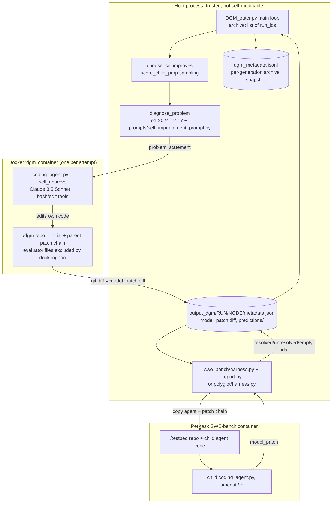
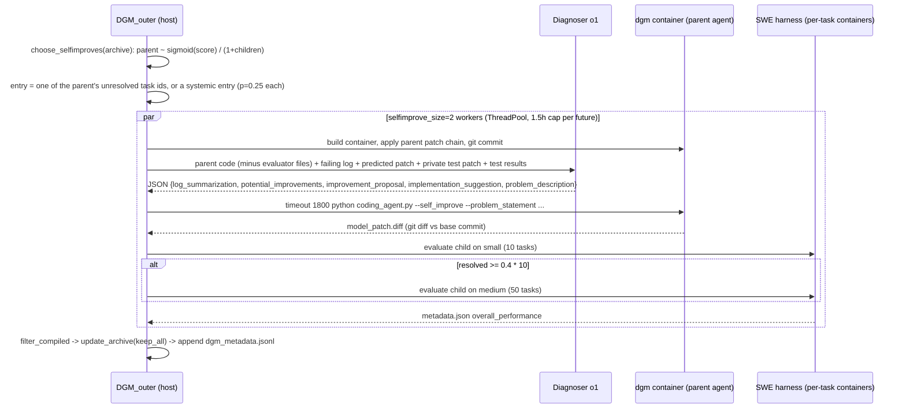

# Darwin Gödel Machine (DGM): Source-Level RSI Study

> Subject: `references/evolution/dgm` (jennyzzt/dgm @ `a565fd2`, 2025-08-13, Apache-2.0). This is the official code linked from arXiv:2505.22954 (Zhang, Hu, Lu, Lange, Clune).
> Method: static reading only. Nothing was installed or run, and no Docker images or SWE-bench/Polyglot data were pulled.
> Audience: the `worldcurrent` offline improvement loop (diagnose -> declarative candidates -> protected-scope check -> paired McNemar on validation -> held-out report -> registry promote/rollback).
> Tags: **[Implemented]** traceable in code · **[Docs/Interface only]** only in README, prompts or analysis scaffolding · **[Unverified]** paper claim or code path not checked end to end · **[Needs model/hardware]** needs paid LLM APIs, Docker or SWE-bench images

---

## 1. Positioning

DGM is an **open-ended evolutionary search over a coding agent's own source code**. Every archive node is a version of the repository, represented as a chain of git diffs. In each generation the outer loop:

1. samples parents from the archive, weighting by score and penalising nodes that already have many children;
2. asks o1 to diagnose one failure of the parent and write a "GitHub issue" against the agent's own code;
3. runs the **parent agent itself** inside Docker to implement that issue on its own repo, which gives a self-modification;
4. evaluates the child on SWE-bench Verified (or Polyglot) subsets in stages;
5. adds every child that "compiles" to the archive.

The paper's pitch is to "replace the Gödel proof with empirical validation". In this code, empirical validation means **a single run of raw accuracy on 10 tasks, then 50 tasks**. There is no seed control, no repeat-based variance estimate and no statistical test (§7).

What is distinctive: (a) the archive is never pruned by default, so it stays open-ended; (b) the improver is also the improved artifact, because the parent's own `coding_agent.py` performs the edit; (c) the evaluator is kept out of the self-modification container by `.dockerignore`.

## 2. Architecture



## 3. Core data structures & interfaces

| Concept | Representation | Cite |
|---|---|---|
| Archive | `list[str]` of run_ids, starting with `['initial']`; resumed from the last line of `dgm_metadata.jsonl` | `references/evolution/dgm/DGM_outer.py:15-35` |
| Candidate (node) | Directory `output_dgm/<run>/<run_id>/` holding `model_patch.diff`, `metadata.json` (`run_id`, `parent_commit`, `entry`, `problem_statement`, `overall_performance`) and `predictions/` | `references/evolution/dgm/self_improve_step.py:250-258,326-327,419` |
| Version / lineage | Implicit **patch chain**: walk `parent_commit` up to `initial`, then apply all diffs in order with `patch -p1` | `references/evolution/dgm/utils/evo_utils.py:28-41`, `references/evolution/dgm/self_improve_step.py:293-300` |
| Fitness | `overall_performance = {accuracy_score, total_resolved_ids, total_unresolved_ids, total_emptypatch_ids, total_submitted_instances}` aggregated over every result JSON whose name contains the run_id | `references/evolution/dgm/utils/evo_utils.py:43-94` |
| Validity predicate | `is_compiled_self_improve(metadata, num_swe_issues)`: required keys present, at least one non-empty patch, and `submitted >= num_swe_issues[0]` | `references/evolution/dgm/utils/evo_utils.py:96-127` |
| Generation log | `{"generation", "selfimprove_entries", "children", "children_compiled", "archive"}` appended per generation | `references/evolution/dgm/DGM_outer.py:325-332` |

Key signatures:

```python
# references/evolution/dgm/DGM_outer.py:50
def choose_selfimproves(output_dir, archive, selfimprove_size, method='random', run_baseline=None, polyglot=False) -> list[tuple[str, str]]  # (parent_run_id, entry)
# references/evolution/dgm/DGM_outer.py:174
def update_archive(output_dir, archive, new_ids, method='keep_all', noise_leeway=0.1) -> list[str]
# references/evolution/dgm/self_improve_step.py:223
def self_improve(parent_commit='initial', output_dir=..., force_rebuild=False, num_evals=1, post_improve_diagnose=True,
                 entry=None, test_task_list=None, test_more_threshold=None, test_task_list_more=None,
                 full_eval_threshold=None, run_baseline=None, polyglot=False) -> dict  # metadata
# references/evolution/dgm/coding_agent.py:67  -- the self-modifiable artifact
class AgenticSystem: __init__(problem_statement, git_tempdir, base_commit, chat_history_file, test_description, self_improve, instance_id); forward()
```

## 4. The improvement loop



Evidence: parent sampling `references/evolution/dgm/DGM_outer.py:91-100`; systemic entries `references/evolution/dgm/DGM_outer.py:124-141`; worker pool and 1.5 h cap `references/evolution/dgm/DGM_outer.py:282-313`; container and patch chain `references/evolution/dgm/self_improve_step.py:270-309`; self-modification command `references/evolution/dgm/self_improve_step.py:347-358`; staged eval `references/evolution/dgm/self_improve_step.py:125-178`; archive update `references/evolution/dgm/DGM_outer.py:315-332`. All **[Implemented][Needs model/hardware]**.

## 5. Candidate generation

- **Two LLM roles.** (1) The *diagnoser* is fixed to `o1-2024-12-17` (`references/evolution/dgm/self_improve_step.py:28`). It is the host-side "meta" prompt, and the agent cannot edit it. (2) The *implementer* is the parent's own `coding_agent.py`, running Claude 3.5 Sonnet through Bedrock (`references/evolution/dgm/llm_withtools.py:13`) with only `bash` and `edit` tools. **[Implemented]**
- **What the diagnoser sees** (`references/evolution/dgm/prompts/self_improvement_prompt.py:77-120`, assembled at `:305-336`):
  - the agent's current code (`coding_agent.py`, `tools/`, `utils/`) plus the parent's patch chain. Evaluator files are excluded: `utils/evo_utils.py`, `utils/docker_utils.py`, `utils/swe_log_parsers.py` and `prompts/self_improvement_prompt.py` (`references/evolution/dgm/prompts/self_improvement_prompt.py:326-334`);
  - the **first** run log of the failed task, clipped to 250k characters (`references/evolution/dgm/prompts/self_improvement_prompt.py:241-252`). Lines starting with `Error in get_response_withtools` are filtered out (`references/evolution/dgm/prompts/self_improvement_prompt.py:183-198`);
  - the GitHub issue, the agent's predicted patch, the **SWE-bench private test patch** and the FAIL_TO_PASS/PASS_TO_PASS results (`references/evolution/dgm/prompts/self_improvement_prompt.py:95-105`, `:371-407`). In effect, the diagnoser gets oracle information. The prompt asks it to propose a *general* improvement that is "not specific to any particular GitHub issue" (`references/evolution/dgm/prompts/self_improvement_prompt.py:71`).
- **Structured output.** The diagnoser returns JSON with `log_summarization`, `potential_improvements`, `improvement_proposal`, `implementation_suggestion` and `problem_description`, and is retried up to 3 times (`references/evolution/dgm/self_improve_step.py:30-67`). Only `implementation_suggestion` and `problem_description`, prefixed by a hand-written "Coding Agent Summary" (`references/evolution/dgm/prompts/self_improvement_prompt.py:6-27`, `:174-181`), are passed to the implementer as its problem statement.
- **Systemic diagnoses.** Besides per-task failures, three canned entries target population-level problems: `solve_empty_patches` (when at least 10% of patches are empty, p=0.25), `solve_stochasticity` (p=0.25) and `solve_contextlength` (when context overflow is detected, p=0.25) (`references/evolution/dgm/DGM_outer.py:124-141`; prompts at `references/evolution/dgm/prompts/self_improvement_prompt.py:122-172`). For Polyglot, the stochasticity prompt is drawn with p=0.25 regardless (`references/evolution/dgm/prompts/self_improvement_prompt.py:362-364`). **[Implemented]**
- **Implementation-time guardrails** come only from prompt text: "Do not use 'while True' loops", "Update requirements.txt", "Tools should be ... general" (`references/evolution/dgm/prompts/self_improvement_prompt.py:21-26`). The implementer is told to test against its own repo through `get_test_description(swerepo=False)` (`references/evolution/dgm/self_improve_step.py:338`). **[Docs/Interface only]**: nothing enforces these rules.
- **Hooks seeded for evolution.** The initial agent defines `get_regression_tests`, `run_regression_tests` (`references/evolution/dgm/coding_agent.py:98-151`) and an LLM `score_tie_breaker` (`references/evolution/dgm/utils/eval_utils.py:51-97`), but `forward()` never calls them (`references/evolution/dgm/coding_agent.py:153-169`). They exist so that children can wire them in.
- **Unit of improvement.** Any file in the agent repo (code, prompts, tools, `requirements.txt`). The candidate is an unconstrained git diff (`references/evolution/dgm/coding_agent.py:197-201`).
- **Optional post-hoc diagnosis.** `diagnose_improvement` compares before and after logs, including the answer patch, to judge whether the patch helped (`references/evolution/dgm/prompts/diagnose_improvement_prompt.py:5-37`). It is off by default (`--post_improve_diagnose`, `references/evolution/dgm/DGM_outer.py:235`), and its output is stored but never consumed by selection.

## 6. Selection & archive

- **Archive policy.** The default is `keep_all`: every child that compiles is appended permanently (`references/evolution/dgm/DGM_outer.py:186-188`, default at `:232`). The alternative `keep_better` admits a child only if `score >= initial_score - eval_noise (0.1)` (`references/evolution/dgm/DGM_outer.py:178-185`). Children that fail to compile are logged in `children` but never become parents. **[Implemented]**
- **Parent selection** (`references/evolution/dgm/DGM_outer.py:78-109`):
  - `score_child_prop` (default): `p ∝ sigmoid(10·(acc−0.5)) · 1/(1+n_children)`. This mixes fitness with a novelty or exploration bonus based on how many children a node already has.
  - `score_prop`: sigmoid only. `random`: uniform. `no_darwin` baseline: always the latest commit, which turns the search into hill-climbing.
  - Parents are drawn **with replacement** (`random.choices`), so one parent can get both slots.
- **Population per generation.** `selfimprove_size=2`, `selfimprove_workers=2`, `max_generation=80` (`references/evolution/dgm/DGM_outer.py:223-225`). That is at most 160 children per run. **[Implemented]**
- **Task (entry) selection.** For SWE, a random unresolved id of the parent (`references/evolution/dgm/DGM_outer.py:143-148`). For Polyglot, empty plus unresolved ids (`references/evolution/dgm/DGM_outer.py:117-120`). Failure targeting therefore comes from the same 60 tasks used for fitness (§7).
- **Code defects found while reading** (matter if you fork it):
  - The argparse `choices` list is missing a comma: `'score_child_prop' 'best'` becomes `'score_child_propbest'` (`references/evolution/dgm/DGM_outer.py:228`). The default still works, but passing `--choose_selfimproves_method score_child_prop` or `best` explicitly fails.
  - `best` sorts **ascending** and takes the first k, which selects the *worst* nodes (`references/evolution/dgm/DGM_outer.py:103-104`).
  - `if unresolved_ids == 0` compares a list with an int, so it never triggers. A parent with no unresolved ids would crash `random.choice([])` (`references/evolution/dgm/DGM_outer.py:144-147`).
  - The run never seeds `random`: there is no `random.seed` anywhere in the outer loop or utilities. Sampling is not reproducible.

## 7. Evaluation & gating

| Aspect | What the code does | Cite / tag |
|---|---|---|
| Benchmarks | SWE-bench Verified (via `princeton-nlp/SWE-bench_Verified` and the swebench harness) and Aider Polyglot | `references/evolution/dgm/swe_bench/harness.py:205-207`, `references/evolution/dgm/polyglot/harness.py` [Implemented][Needs model/hardware] |
| Stage 1 | `swe_bench/subsets/small.json` with 10 tasks | `references/evolution/dgm/DGM_outer.py:258` |
| Stage 2 | `medium.json` with 50 tasks, only if resolved ≥ 0.4·10 | `references/evolution/dgm/DGM_outer.py:268`, `references/evolution/dgm/self_improve_step.py:152-178` |
| Stage 3 | `big.json` (140 tasks) and `get_full_eval_threshold` (2nd-best full score, ≥0.4) are computed and passed in, but `self_improve` **never uses `full_eval_threshold` or `test_task_list_big`** | `references/evolution/dgm/DGM_outer.py:192-219,296`, `references/evolution/dgm/self_improve_step.py:234,258` → **[Docs/Interface only]** in this release |
| Splits | small, medium and big are disjoint (checked: 0 overlap). Fitness and failure targeting both use small+medium. Big is the only unused (held-out-like) pool, and it is not wired in | `references/evolution/dgm/swe_bench/subsets/*.json` |
| Noise handling | `num_swe_evals=1` by default (repeats are supported via `num_evals`). `eval_noise=0.1` is a fixed leeway used only by `keep_better`. **No CI, no paired test, no seeds**; LLM sampling at temperature 0.7-0.75 | `references/evolution/dgm/DGM_outer.py:234,238`, `references/evolution/dgm/llm.py:96,179` |
| Validity | "Compiled" = non-empty patches exist and all stage-1 tasks were submitted | `references/evolution/dgm/utils/evo_utils.py:96-127` |
| Regression checks | Inside a task: PASS_TO_PASS tests from SWE-bench. Across versions: none. A child that regresses can still enter the archive (`keep_all`) | `references/evolution/dgm/prompts/self_improvement_prompt.py:394-405` |
| Test tampering | Hunks touching `/test/`, `/tests/`, `/test_`, `tox.ini` are stripped from the predicted patch before grading | `references/evolution/dgm/swe_bench/report.py:37-65` [Implemented] |
| Baseline | `initial/metadata.json`: 12/60 = 0.20 (SWE); `initial_polyglot`: 32/225 = 0.142 | `references/evolution/dgm/initial/metadata.json` |

## 8. Safety & isolation

- **Self-modification sandbox.** One Docker container per attempt, built from `python:3.10-slim` with `COPY . .` (`references/evolution/dgm/Dockerfile:1-20`). `.dockerignore` keeps **the outer loop, self-improve step, diagnosis prompts, evo/docker utils and the swe_bench/polyglot harnesses out of the image** (`references/evolution/dgm/.dockerignore:9-39`). The agent therefore cannot edit, or even read, its evaluator or its selection logic. This is the main anti-reward-hacking mechanism, and it is structural, not prompt-based. **[Implemented]**
- **Evaluation sandbox.** Every benchmark task runs the child agent in a fresh SWE-bench instance container, copying in only agent files (`references/evolution/dgm/swe_bench/harness.py:73-82`). Grading uses the official swebench harness on the host from the emitted patch. For Polyglot, grading happens in the same container, after `git reset --hard <test_commit>` and `git clean -fd` restore the official tests (`references/evolution/dgm/polyglot/harness.py:161-182`). **[Implemented]**
- **Resource limits.**
  - Wall-clock only: 30 min for self-modification (`references/evolution/dgm/self_improve_step.py:348`), 1.5 h per attempt future (`references/evolution/dgm/DGM_outer.py:305`), **9 h per SWE task** (`references/evolution/dgm/swe_bench/harness.py:124`), 10 min per Polyglot task, and 120 s per bash call (`references/evolution/dgm/tools/bash.py:33`).
  - `containers.run(image, name, detach=True)` sets **no CPU, memory or network limits** (`references/evolution/dgm/utils/docker_utils.py:133`).
  - The tool loop is `while tool_use:` with no step cap (`references/evolution/dgm/llm_withtools.py:380`).
- **Secrets.** Anthropic, AWS and OpenAI keys are injected as env vars into the self-modifying container (`references/evolution/dgm/self_improve_step.py:339-346`). Model-written code can read them.
- **Human oversight.** None in the loop. The README carries a warning about "executing untrusted, model-generated code" (`references/evolution/dgm/README.md:88`), and lineage can be audited after the fact (§9). **[Docs/Interface only]**
- **Objective hacking.** The paper's "tool-use hallucination" case study expects a `hallucination_performance` block in metadata, and `analysis/visualize_archive.py:70-89` reads it. **No code in the repo produces it** → **[Docs/Interface only]**.

## 9. Dependencies, cost, license; promotion / rollback / lineage

- **License:** Apache-2.0 (top-level `LICENSE`). Deps: `anthropic[bedrock]`, `openai`, `docker`, `datasets`, `GitPython`, plus a pinned SWE-bench checkout (`references/evolution/dgm/requirements.txt`, `references/evolution/dgm/README.md:51-58`).
- **Promotion.** There is no explicit promotion step. The "best agent" is whichever archive node has the highest `accuracy_score`, picked offline by the analysis scripts (`references/evolution/dgm/analysis/plot_progress.py`). No node is ever removed, so **rollback is trivial**: any node can be rebuilt from `initial` plus its patch chain (`references/evolution/dgm/utils/evo_utils.py:28-41`). **[Implemented]**
- **Lineage.** `parent_commit` in each node's metadata, plus `dgm_metadata.jsonl` per generation. `analysis/visualize_archive.py:92` renders the tree. **[Implemented]**
- **Reproducibility.** It is weak: unseeded parent and entry sampling, stochastic LLMs, `git commit` with a fixed dummy identity, and a timestamped run_id (`references/evolution/dgm/self_improve_step.py:252,305`). Resume works from `--continue_from` (`references/evolution/dgm/DGM_outer.py:21-25`).
- **Compute.** Code-level budget per run: 80 generations × 2 attempts × (1 diagnose call + one ≤30 min self-mod + 10-60 SWE tasks, each ≤9 h). That is roughly ≤9,600 agent-task executions. The paper reports a SWE-bench run costing about two weeks and roughly USD 22k of API spend. **[Unverified]**: this number is not in code or configs.

## 10. Strengths / weaknesses / risks

**Strengths**
- The evaluator and selector are physically absent from the mutable workspace (`.dockerignore`), which beats any prompt-level "please don't" (`references/evolution/dgm/.dockerignore:31-39`).
- Lineage is cheap (diff chains) and rollback is free (`references/evolution/dgm/utils/evo_utils.py:28-41`).
- The parent prior is simple and effective (fitness × 1/(1+children)), which keeps stepping-stone nodes alive (`references/evolution/dgm/DGM_outer.py:91-100`).
- Staged evaluation saves cost (10 → 50 tasks) (`references/evolution/dgm/self_improve_step.py:152-155`).
- Systemic failure classes (empty output, stochasticity, context overflow) are diagnosed alongside per-task failures (`references/evolution/dgm/DGM_outer.py:124-141`).

**Weaknesses / risks**
- Statistically naive: one run, raw accuracy, 10-60 tasks, no paired comparison against the parent. On 10 tasks the 0.4 stage gate has very wide binomial noise.
- The diagnoser sees the private tests of the tasks used for fitness, and the failure target is drawn from the fitness set. This invites overfitting to the 60 tasks. The disjoint `big` set would detect it, but it is not used in this release.
- The archive grows without bound, and regressed children stay selectable (with low weight).
- Sandboxing is coarse: no resource or network limits, and API keys sit inside the container.
- Several bugs in non-default paths (§6). The third evaluation stage is dead code.

## 11. What worldcurrent should adopt (concrete)

| DGM mechanism | worldcurrent adaptation (frozen SmolVLA, LIBERO) |
|---|---|
| Archive tree + `score_child_prop` parents | Extend the registry from a linear promote/rollback history into a **candidate archive with `parent_id`**. Sample proposal parents with `sigmoid(k·(sr−sr0))/(1+children)`, but **promote** only through our McNemar gate. Search breadth (archive) stays separate from deployment (promoted pointer). |
| Lineage as diff chain | Our candidates are declarative (critic/recovery rules, prompt templates, controller params, skill library entries). Store each as `parent_id + delta` with a content hash, and materialise by replay. A rollback is then just a pointer move. |
| `.dockerignore`-style evaluator exclusion | Make the protected-scope check **structural**. The proposer/implementer worker gets a workspace that physically lacks the kernel, SafetyShield, success predicates, the LIBERO task set and the McNemar gate. Our protected-scope check then acts as a second line on the delta. |
| Staged eval 10 → 50 → full | Stage 0: schema/static check plus a shield dry-run on replayed traces (no sim). Stage 1: cheap smoke run of about 1 seed × 10 tasks, killed early if worse than the parent by a margin. Stage 2: paired McNemar on the validation split. Stage 3: held-out report only for promotion candidates. **Wire stage 3, unlike DGM.** |
| Diagnoser JSON schema | Reuse the 5-field schema (`log_summarization → potential_improvements → improvement_proposal → implementation_suggestion → problem_description`), with the input being our replayable event trace, shield interventions and the success-predicate diff. Require the output to be one declarative candidate of an allowed unit type. |
| Systemic entries with fixed probability | Reserve a fraction of proposals for population-level failure classes: timeouts, shield vetoes, gripper-stall loops, perception misses. These come from trace aggregates, not single episodes. |
| Oracle info to diagnoser | Allowed only with **validation-split** privileged sim state, such as object poses and predicate traces. Never from held-out episodes. Log which split fed each proposal. |
| Test-hunk stripping | Equivalent rule: any candidate touching predicate, reward or termination definitions is rejected before evaluation. |

**Do not transfer.**
- Unconstrained self-editing of agent source. With a kernel-owned control loop and a SafetyShield, the unit must stay declarative and must not change the control-loop code.
- Single-run raw accuracy as fitness. Physical rollouts are noisier than SWE-bench, so we keep paired seeds and McNemar.
- Unlimited Docker or 9 h tasks. Use per-episode step caps and CPU budgets.
- Secrets inside the mutable workspace.
- `keep_all` admission without a minimum validity bar beyond "compiles". For us that bar is "no new shield violations on replay".

## 12. Source index

| Concern | file:line | Note |
|---|---|---|
| Outer loop | `references/evolution/dgm/DGM_outer.py:221-332` | 80 generations × 2 attempts |
| Parent selection | `references/evolution/dgm/DGM_outer.py:50-150` | score_child_prop default |
| Systemic entries | `references/evolution/dgm/DGM_outer.py:124-141` | p=0.25 each |
| Archive update | `references/evolution/dgm/DGM_outer.py:174-190` | keep_all / keep_better (leeway 0.1) |
| Full-eval threshold (unused) | `references/evolution/dgm/DGM_outer.py:192-219` | never consumed |
| Argparse choices bug | `references/evolution/dgm/DGM_outer.py:228` | missing comma |
| Self-improve attempt | `references/evolution/dgm/self_improve_step.py:223-420` | container → diagnose → self-mod → eval |
| Diagnoser model | `references/evolution/dgm/self_improve_step.py:28` | o1-2024-12-17 |
| Staged eval | `references/evolution/dgm/self_improve_step.py:125-178` | 10 → 50 at ≥40% |
| Self-mod command | `references/evolution/dgm/self_improve_step.py:347-358` | timeout 1800 |
| Diagnose prompt | `references/evolution/dgm/prompts/self_improvement_prompt.py:64-120` | includes private tests |
| Evaluator hidden from diagnoser | `references/evolution/dgm/prompts/self_improvement_prompt.py:326-334` | exclude_files |
| Evaluator hidden from container | `references/evolution/dgm/.dockerignore:31-39` | structural protection |
| Patch-chain lineage | `references/evolution/dgm/utils/evo_utils.py:28-41` | rebuild any node |
| Fitness aggregation | `references/evolution/dgm/utils/evo_utils.py:43-94` | raw accuracy |
| Validity check | `references/evolution/dgm/utils/evo_utils.py:96-127` | "compiled" |
| Test-hunk stripping | `references/evolution/dgm/swe_bench/report.py:37-65` | anti test edit |
| Per-task eval container | `references/evolution/dgm/swe_bench/harness.py:24-182` | 9 h timeout |
| Polyglot test restore | `references/evolution/dgm/polyglot/harness.py:161-182` | reset/clean before grading |
| No resource limits | `references/evolution/dgm/utils/docker_utils.py:133` | plain containers.run |
| Unbounded tool loop | `references/evolution/dgm/llm_withtools.py:380` | while tool_use |
| Seeded-but-unused hooks | `references/evolution/dgm/coding_agent.py:98-151` | regression-test helpers |
| Hallucination metric reader | `references/evolution/dgm/analysis/visualize_archive.py:70-89` | no producer in repo |

## Verification status

| Claim | Status |
|---|---|
| Archive with score×(1/(1+children)) parent sampling | [Implemented][Unverified]: read, not run |
| Self-modification by parent agent in Docker | [Implemented][Needs model/hardware] |
| Two-stage eval 10 → 50 | [Implemented][Needs model/hardware] |
| Third-stage full eval on 140/200 tasks | [Docs/Interface only]: args computed, never used |
| Evaluator excluded from mutable workspace | [Implemented]: `.dockerignore` |
| Statistical test / CI / seeds | Absent |
| Hallucination / objective-hacking detector | [Docs/Interface only]: reader without producer |
| SWE 20% → 50%, Polyglot 14.2% → 30.7% | [Unverified]: paper; initial 0.20/0.142 confirmed in `initial*/metadata.json` |
| ~2 weeks / ~USD 22k per run | [Unverified]: paper only |
