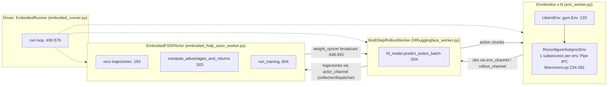
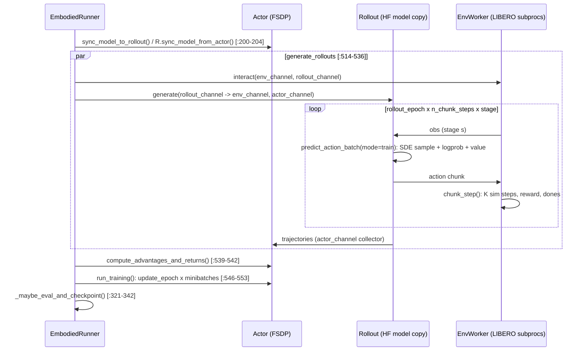

# RLinf: Source-Level Study for Weight-Level RSI (VLA RL in Simulation)

> Subject: `references/evolution/RLinf` (RLinf/RLinf @ `d80cf00`, 2026-10-30, Apache-2.0, package version 0.4.0)
> Method: static analysis only (read / grep / line-number checks). Nothing installed or run; no weights, Docker images or assets downloaded.
> Size: `rlinf/` ~226k lines of Python (968 `.py` files repo-wide). This study covers the **embodied** path only (LIBERO/ManiSkill, OpenPI pi0/pi0.5, OpenVLA-OFT, LeRobot pi0-FAST, RECAP).
> Tags: **[Implemented]** traceable code; **[Docs/Interface only]** docs, README or stubs only; **[Unverified]** code exists, but we have not checked its behavior or numbers; **[Needs model/hardware]** needs weights or a GPU. All success rates and speedups are **reported, not verified**.
> Related studies: `rpent.md` (RPent imports `rlinf.envs.sim.libero.LiberoEnv` and `rlinf.models.embodiment.openpi`), `openpi.md`, `lerobot.md`, `libero.md`, `agent-lightning.md`.

---

## 1. Positioning

RLinf is a **general distributed RL system** (Ray-based scheduler + typed channels + FSDP/Megatron engines). On top of it sits a large **embodied RL stack**: about 20 VLA/policy families, about 15 simulators and real robots, and PPO / GRPO / SAC / DSRL / NFT / DAgger / OPD / RECAP. For worldcurrent it is the most complete public reference for weight-level VLA improvement. It is also the only one with:

- On-policy RL for **flow-matching VLAs** (pi0/pi0.5) via a stochastic-denoising log-prob, in four variants (`flow_ode`, `flow_sde`, `flow_cps`, `flow_noise`). [Implemented] `rlinf/models/embodiment/openpi/sampling/rl_sampler.py:30-87`
- An **offline, advantage-conditioned** pipeline (RECAP, the pi*0.6 recipe) that needs no online log-probs. [Implemented] `rlinf/algorithms/offline/process/advantage.py:15-69`, `rlinf/models/embodiment/openpi_cfg/openpi_cfg_action_model.py:103-150`
- A **LeRobot-policy wrapper** pattern (pi0-FAST via `lerobot.policies.pi0_fast.PI0FastPolicy`). [Implemented] `rlinf/models/embodiment/pi0_fast/__init__.py:35-52`
- Explicit **AMD ROCm** plumbing. [Implemented] in the scheduler; end-to-end status [Unverified] `rlinf/scheduler/hardware/accelerators/amd_gpu.py:128-209`

It does **not** support SmolVLA. The model registry `rlinf/config.py:87-134` has no `smolvla` entry. It also has no held-out initial-state protocol for LIBERO by default (see §7).

## 2. Architecture

Driver → `Cluster` (Ray) → three worker groups (actor / rollout / env), plus an optional reward group, wired by **Channels**. `train_embodied_agent.py:42-45` builds the cluster and placement. `:105-119` launches `EmbodiedFSDPActor`, `MultiStepRolloutWorker` and `EnvWorker`. `:163-172` hands them to `EmbodiedRunner`. [Implemented]

**Placement** (`cluster.component_placement`) supports three modes. [Implemented in the scheduler; modes documented in `docs/.../embodied/pi0.rst:250-285`]
- Colocated: `actor,env,rollout: all` (default in most LIBERO configs, `libero_spatial_ppo_openpi.yaml:16-19`). It relies on offload (`enable_offload`) to time-share GPU memory.
- Disaggregated: `env: 0-1, rollout: 2-5, actor: 6-7`, with no offload needed.
- Hybrid / pipelined: `rollout.pipeline_stage_num: 2` splits envs into stages so env stepping overlaps with inference. `env_worker.py:76` reads `stage_num`, and the inner loop runs over `stage_id` at `env_worker.py:1130-1134`.
- Heterogeneous **node groups**, including a CPU-only `node` group (`docs/.../guides/hetero.rst:4,89`). For us this is the hook to run LIBERO envs on the 128-core host. [Docs/Interface only] We did not trace the env-on-CPU path end-to-end.

**Simulator vectorization (LIBERO).** `LiberoEnv` owns a `ReconfigureSubprocEnv` (`libero_env.py:199-201`), a tianshou-style `SubprocVectorEnv` with one process and one `Pipe` per env (`libero/venv.py:234-262`). Envs are *reconfigured in place* to a new task and init state instead of being re-created. `chunk_step` (`libero_env.py:933-1000`) executes a whole action chunk inside the worker. With `skip_intermediate_renders` (`:183-184`, `:946-958`), cameras are disabled for every sub-step except the last, which directly cuts CPU rendering cost. ManiSkill is GPU-vectorized and is the case the RLinf-VLA paper's "hybrid fine-grained pipeline" speedups target.

## 3. Core data structures & interfaces

| Interface | Location | Contract | Tag |
|---|---|---|---|
| `BasePolicy` | `rlinf/models/embodiment/base_policy.py:32-81` | `predict_action_batch(env_obs, mode)` → `(actions, {prev_logprobs, prev_values, forward_inputs})`; `default_forward(forward_inputs)` → `{logprobs, values, entropy}` (replay) | [Implemented] |
| `ForwardType` | `base_policy.py:19` | DEFAULT / SFT / SAC / NFT / DAgger dispatch | [Implemented] |
| `Pi0RLConfig` | `openpi/tasks/rl.py:40-55` | `noise_method`, `noise_level`, `joint_logprob`, `ignore_last`, `add_value_head`, `train_expert_only` | [Implemented] |
| `forward_inputs` (pi0) | `openpi/tasks/rl.py:302-312` | stores the **full denoising chain** `chains[B, K+1, H, D]`, `denoise_inds`, prompt tokens, actions; replay recomputes log-probs from it | [Implemented] |
| `SupportedModel` registry | `rlinf/config.py:49-134` | string → model family (`openpi`, `openvla_oft`, `pi0_fast`, `gr00t`, `recap_value_model`, `cfg_model`, ...) | [Implemented] |
| Advantage / loss registries | `rlinf/algorithms/registry.py:33-95`; `advantages.py:24,89,168,302,368,411`; `losses.py:452,465,496,577` | `gae`, `grpo`, `grpo_dynamic`, `reinpp`, `opd`, `raw`; losses `actor_critic`, `decoupled_actor_critic`, `actor` (GRPO), `opd` | [Implemented] |
| `Channel` | `rlinf/scheduler/channel/`; created in `embodied_runner.py:99-110` | typed async queues; the actor channel has a pluggable trajectory *collector* and *dispatcher* | [Implemented] |
| Checkpoint | `fsdp_model_manager.py:390-419` → `strategy/base.py:189-258` | `dcp_checkpoint/` (model + optimizer + LR scheduler, resumable) and `model_state_dict/full_weights.pt` | [Implemented] |

## 4. Training loop

The synchronous loop is in `embodied_runner.py:490-576`. The pipelined variant `run_pipeline` is at `:578`.

Notes:
- The rollout worker holds a **separate model copy**. Weights are pushed by `weight_syncer` (a "patch_syncer" in the pi0 configs: `libero_spatial_ppo_openpi.yaml:6`), and the receiver applies a versioned update (`huggingface_worker.py:681-682`). [Implemented]
- With `rollout.recompute_logprobs: False` (`libero_spatial_ppo_openpi.yaml:93`), the behavior log-probs come from the rollout pass. The actor can recompute them (`embodied_fsdp_actor_worker.py:409`). [Implemented]
- The env worker can pre-fetch the next bootstrap observation while the actor trains (`embodied_runner.py:547-555`). [Implemented]

## 5. Algorithms & log-probs for flow policies

**The core trick (pi0/pi0.5, `openpi/tasks/rl.py:178-319`).** The deterministic Euler ODE is replaced, at one (or every) denoising step, by a Gaussian transition `x_{t-Δ} ~ N(μ(x_t, v_t), σ_t²)`. The log-probability of that transition is the policy log-prob.

1. Pick one denoising index per batch, uniformly from `[0, K-1]`, or `[0, K-2]` if `ignore_last` (`rl.py:213-218`). All other steps stay `flow_ode`. With `joint_logprob=True`, every step is stochastic and log-probs are averaged (`rl.py:210-212, 285-286`).
2. For each step, `sample_mean_var` (`rl_sampler.py:30-87`) computes `x0_pred = x_t - v_t·t` and `x1_pred = x_t + v_t·(1-t)`, then the mean and std:
   - `flow_sde`: σ_i = `noise_level·sqrt(t/(1-t))`, with a drift correction `- σ²Δ/(2t)` (`:56-63`). This is the "Flow-SDE" of the πRL report.
   - `flow_cps`: cos/sin split of the noise level (`:64-71`).
   - `flow_noise`: σ comes from a **learnable `noise_head`** (`:72-79`; `rl.py:248-249`). This is "Flow-Noise".
3. `gaussian_logprob` (`rl_sampler.py:90-102`) is per-element and set to 0 where σ = 0. It is cropped to `[action_chunk, action_env_dim]` (`rl.py:282-284`), so padded action dims (pi0 pads to 32, `model/pi0.yaml:29`) do not contribute.
4. **Replay is cheap.** `default_forward` (`rl.py:422-500`) rebuilds the prefix KV cache, then re-runs **only the stored denoise step** (`num_recompute = 1`, `rl.py:450-451`) on `chains[denoise_ind] → chains[denoise_ind+1]`. Training cost is about one prefix forward plus one action-expert step per sample.
- Defaults: `num_steps: 4`, `noise_level: 0.5`, `noise_method: flow_sde`, `train_expert_only: True` (`examples/embodiment/config/model/pi0.yaml:14-26`). Only the ~300M action expert is trained; the VLM is frozen (`pi0.yaml` comment and `libero_spatial_ppo_openpi.yaml:133-137`).

**Autoregressive policies.** pi0-FAST (LeRobot) uses teacher-forced replay of the sampled FAST tokens: `compute_token_logprobs` (`pi0_fast/fast_replay.py:22-66`) and `generate_action_tokens_with_logprobs` (`:248-335`). OpenVLA-OFT uses discrete action-token logits (same idea as SimpleVLA-RL). [Implemented]

**Advantages.**
- GAE with a value head on the action expert's suffix or on the VLM prefix (`rl_sampler.py:121-170`; `advantages.py:24`). PPO configs use `gamma 0.99, lambda 0.95, update_epoch 4, clip 0.2/0.2, dual-clip c=3` (`libero_spatial_ppo_openpi.yaml:39-63`).
- GRPO: group-normalize the episode reward (`advantages.py:89-121`) with `group_size: 8` and `update_epoch: 2` (`libero_spatial_grpo_openpi.yaml:42,50-52`). Envs in a group share a reset state (`libero_env.py:145-146`).
- `grpo_dynamic` / `filter_rewards`: groups whose mean reward falls outside [0.1, 0.9] are **masked out of the loss**, not resampled (`embodied_fsdp_actor_worker.py:251-298`).
- Granularity is configurable: `reward_type`/`logprob_type: chunk_level` vs `token_level` (`libero_spatial_ppo_openpi.yaml:46-48`).

**Reward.** Sparse success. `_calc_step_reward` = `reward_coef·termination` (+ optional −1 step penalty). With `use_rel_reward`, it emits the *difference*, so the success bonus is paid once (`libero_env.py:1099-1109`; env default `use_rel_reward: True`, `env/libero_spatial.yaml:11`). [Implemented]

**KL control.** `kl_beta: 0.0` in all LIBERO configs inspected (`libero_spatial_ppo_openpi.yaml:54`). There is no reference model in the embodied loop; the trust region comes only from PPO clipping and a small LR (5e-6). [Implemented]

**Other algorithms present.** SAC-Flow, DSRL (SAC in the noise space of a frozen pi0), NFT, DAgger, OPD (on-policy distillation), IQL. Registered in `train_embodied_agent.py:51-103`. [Implemented; not studied in depth]

## 6. Data path & throughput

- **Obs → policy.** `EnvWorker._run_interact_once` (`env_worker.py:1102-1223`) loops `rollout_epoch × n_train_chunk_steps × stage`. It receives an action chunk (`:1138`), calls `env_interact_step` → `LiberoEnv.chunk_step`, and publishes obs, reward and dones on the rollout channel (`:1181-1190`).
- **Chunking.** The env executes `num_action_chunks` actions per policy call: 5 in the pi0 LIBERO RL configs (`libero_spatial_ppo_openpi.yaml:113`), 10 in the model default. The network horizon (pi0: 50) is separate from the executed chunk (`docs/.../pi0.rst` §2.1). Done flags inside a chunk are resolved to the first done (`libero_env.py:986-995`). Log-probs, values and advantages are **per chunk** (`chunk_level`).
- **Batch sizes (pi0 PPO, LIBERO-Spatial).** 64 train envs × 8 rollout epochs × 240 steps gives **≈122,880 env steps (≈24.6k chunk decisions) per update**. `global_batch_size 2048`, `micro_batch_size 128`, 4 PPO epochs (`libero_spatial_ppo_openpi.yaml:72-76,105-106`; `embodied_fsdp_actor_worker.py:643-651`). Quickstart: 32 envs × 2 epochs, global batch 256, offload on (`docs/.../pi0.rst:377-390`). [Implemented config]
- **Eval.** 500 envs = all 10 tasks × 50 init states, `ignore_terminations: True`, video on (`libero_spatial_ppo_openpi.yaml:77-89`).
- **Reported throughput.** [Unverified]
  - README: "hybrid execution mode for embodied RL achieves up to **2.434×** throughput compared to existing frameworks" (`README.md:130`).
  - RLinf-VLA paper: 1.61–1.88× on ManiSkill (arXiv 2510.06710 abstract).
  - BEHAVIOR rollout 1028.7 → 41.2 ms/step (README news).
  - No LIBERO steps/s figure is given. The quickstart was compared on **4 × H100** (`pi0.rst:390`).
- **Our LIBERO cost model** (EnvServer, ~150 ms/step CPU-rendered). One full PPO update at the default config ≈ 122,880 × 0.15 s / 64 parallel envs ≈ **290 s of env time**, before inference. `skip_intermediate_renders` (used in `libero_10_ppo_openpi_pi05.yaml:76`) should cut this substantially, because only 1 of 5 sub-steps renders. [Estimate, Unverified]

## 7. Evaluation & reported gains

Reported LIBERO results (`docs/.../embodied/pi0.rst:642-700`). [Unverified; Needs model/hardware]

| Model | Spatial | Object | Goal | Long | Avg |
|---|---|---|---|---|---|
| pi0 few-shot SFT | 65.3 | 64.4 | 49.8 | 51.2 | 57.6 |
| + GRPO | 97.8 | 97.8 | 83.2 | 81.4 | 90.0 |
| + PPO | 98.4 | 99.4 | 96.2 | 90.2 | 96.0 |
| pi0.5 few-shot SFT | 84.6 | 95.4 | 84.6 | 43.9 | 77.1 |
| + GRPO / + PPO | 97.4 / 99.6 | 99.8 / 100 | 91.2 / 98.8 | 77.6 / 93.0 | 91.5 / 97.9 |

RLinf-VLA abstract: 98.11% across 130 LIBERO tasks and 97.66% on 25 ManiSkill tasks.

**Protocol caveats (from code):**
- Train and eval draw from the **same pool of LIBERO initial states**. Training shuffles all `total_num_group_envs` ids (`libero_env.py:552-557`). Eval enumerates the same ids interleaved (`:541-550`). `task_id_filter` (`:485-510`) restricts *tasks*, not states. The headline numbers are therefore **in-distribution init-state success**, not held-out generalization. OOD evidence would come from the separately supported LIBERO-Plus/Pro and ManiSkill OOD splits (README), which we did not inspect.
- The starting SFT checkpoints are deliberately weak "few-shot" models published by RLinf (`pi0.rst:143-158`). The large deltas partly reflect headroom.
- Eval is a single pass over 500 states. There is no paired statistics or CI in `compute_evaluate_metrics`; a multi-seed protocol is not visible in code.

## 8. Hardware / CPU / ROCm feasibility

| Item | Finding | Tag |
|---|---|---|
| Accelerator abstraction | `AcceleratorType` includes `AMD_GPU` and `NO_ACCEL` (`accelerator.py:113-123`). `AMDGPUManager` sets `HIP_VISIBLE_DEVICES`, uses NCCL (= RCCL on ROCm) and the `torch.cuda` platform (`amd_gpu.py:148-209`). | [Implemented] |
| Install / Docker | `install.sh --platform amd` is labelled **"experimental, ROCm"** (`requirements/install.sh:159-160`). The Dockerfile defaults to `ROCM_VER=7.2`, `ROCM_ARCHS=gfx90a;gfx942` (MI200/MI300, CDNA) (`docker/Dockerfile:9-10`). The AMD LIBERO doc ships `rocm7.2` images and warns to match `ROCM_ARCHS` (`_amd_libero.rst:1-36`). | [Docs/Interface only] for us |
| RDNA4 (R9700, gfx1201) | No gfx12/RDNA4 arch in defaults. `install.sh:691-705` mentions RDNA only for Vulkan rendering (RADV). flash-attn and the openpi JAX path (`requirements/embodied/models/openpi.txt`: `jax[cuda12]==0.5.3`) are CUDA-first. | [Unverified] |
| CPU | LIBERO envs are subprocesses and CPU-friendly. Use OSMesa or EGL (`run_embodiment.sh:7-8` defaults to EGL; the doc suggests osmesa, `pi0.rst:401`). Rollout and actor assume an accelerator (FSDP, `torch_platform`). A CPU-only training run is not a supported configuration. | Env [Implemented]; CPU training [Unverified] |
| Memory | pi0 PPO: actor with `sharding_strategy: no_shard`; the quickstart needs offload on 4 × H100 80 GB. 2 × 32 GB consumer GPUs is below every documented configuration. | [Docs] |

**Bottom line for this machine.** RLinf as a *dependency* is not runnable today: no ROCm is installed, and RDNA4 is not a documented target. Its *algorithms* (`rl_sampler.py`, `advantages.py`, `losses.py`) are small, self-contained PyTorch that runs on CPU or ROCm unchanged.

## 9. Dependencies, cost, license

- **License.** Apache-2.0 (top-level `LICENSE`). Bundled third-party code: vendored OpenPI PyTorch (Apache-2.0); LeRobot is pinned per model (`requirements/embodied/models/*.txt`). Model weights carry their own licenses (pi0: Gemma terms). See `research/comparisons/license-matrix.md`.
- **Core deps.** `ray[default]>=2.47`, `torch>=2.5`, hydra, plus per-model venvs (`pyproject.toml:33-41`). It expects **one venv per model family**: `switch_env openpi` (`docs/.../recap.rst`). The Docker images are the supported path.
- **Cost.** All reported LIBERO RL runs are multi-GPU H100/A800-class. Exact GPU-hours are not published in the files inspected. [Unverified]

## 10. Strengths / weaknesses / risks

Strengths
- The only open code with working **flow-matching PPO/GRPO** and cheap one-step replay.
- Clean registries for advantages, losses and models. The `BasePolicy` contract is small: two methods.
- Includes the **RECAP offline** path, which maps directly onto our offline improvement loop (no simulator in the inner loop; value model + advantage labels + CFG training).
- Env-side engineering we can copy directly: reconfigure-in-place subprocess envs, chunk execution inside the env worker, render skipping, pipeline stages, bootstrap prefetch.
- Resumable DCP checkpoints with optimizer state, plus a full-weights export.

Weaknesses / risks
- Very large and fast-moving: commits daily; 226k LOC; dozens of venv-pinned stacks. Adopting it as a runtime dependency means owning a fork.
- No held-out init-state split and no paired statistics. Reported gains are in-distribution.
- ROCm support targets CDNA via Docker. RDNA4 consumer GPUs are untested. CPU training is unsupported.
- SmolVLA is unsupported. A wrapper is required (≈ `pi0_fast` LeRobot IO + `Pi0RL` sampler).
- `kl_beta=0` everywhere. Drift from the SFT policy is controlled only by clip and LR, which is risky for a gated promote loop that also cares about non-target tasks.

## 11. What worldcurrent should adopt (concrete)

**Reuse as code (copy with attribution, Apache-2.0).**
1. `rl_sampler.sample_mean_var` + `gaussian_logprob` (`rl_sampler.py:24-110`, ~90 lines). It is exactly what a SmolVLA policy needs. SmolVLA's `sample_actions`/`denoise_step` (`references/policies/lerobot/src/lerobot/policies/smolvla/modeling_smolvla.py:777-863`) uses the same NOISE_AT_ONE convention and the same prefix-KV + suffix-denoise split as `Pi0RL._predict_train`.
2. `compute_grpo_advantages` (`advantages.py:89-121`) and the clipped PPO actor loss (`losses.py:179-260`).

**Reuse as protocol/pattern.**
3. The `predict_action_batch(mode) → (actions, {prev_logprobs, forward_inputs})` / `default_forward(forward_inputs)` split. Our AgentServer policy gets a `train` mode that returns the denoising chain and the chosen index. The trace stores `forward_inputs` so learner replay is deterministic and **replayable from our traces**.
4. Env side, in our EnvServer: `chunk_step` with `skip_intermediate_renders`, reset-to-(task, init-state-id), group reset (8 envs share one init state for GRPO).
5. The RECAP pipeline shape: returns → value model → top-30% advantage label → conditioned SFT. This becomes an *offline* weight candidate generator that consumes our existing traces.

**Avoid.**
- Ray, Channels, FSDP hybrid engine and weight syncer at our scale (1 host, ≤2 GPUs). A single-process learner plus our out-of-process EnvServer is sufficient.
- Their train/eval init-state overlap. Our gate must use disjoint init-state ids (see §11.1).

### 11.1 Plugging into the candidate registry

A weight candidate = `Candidate(kind="policy_ref", patch={"agent.policy.ref": "smolvla-libero@<sha256-of-safetensors>"}, evidence={rl_run_id, base_ref, algo, cfg_hash, train_init_state_ids_digest, steps, wall_clock})`.
- `policy_ref` exists in `CandidateKind` but is **not in `ENABLED_KINDS`** (`packages/wc-evolve/src/worldcurrent/evolve/candidate.py:27,31`). Enabling it requires (a) an immutable artifact store keyed by digest, and (b) an AgentServer that can hot-load a ref.
- The gate is unchanged (`loop.py:93-120`, paired McNemar + per-task regression + safety). Add one check: the candidate's `train_init_state_ids` ∩ (validation ∪ heldout) = ∅.
- Export: RLinf-style `full_weights.pt` → LeRobot `save_pretrained` (safetensors) so the AgentServer loads it like any LeRobot checkpoint.

### 11.2 Minimal weight-level RSI on our stack (sketch; full plan in `rsi-simplevla-rl.md` §11)

GRPO + flow-SDE on **SmolVLA, action expert only**, 3 LIBERO tasks with SFT success between 0.2 and 0.8, group size 8, `noise_level 0.5`, one stochastic denoise step, chunk-level log-prob, `kl_beta` > 0 against the frozen SFT expert (cheap: same prefix). Compute estimates are in the sibling document.

## 12. Source index

| Topic | File:line |
|---|---|
| Entry point / worker groups | `examples/embodiment/train_embodied_agent.py:42-45,105-119,163-172` |
| Runner loop / sync / eval / ckpt | `rlinf/runners/embodied_runner.py:99-110,200-204,321-342,490-576,658-667` |
| Env worker loop | `rlinf/workers/env/env_worker.py:76,1102-1223` |
| Rollout predict / weight sync | `rlinf/workers/rollout/hf/huggingface_worker.py:504-595,646-691` |
| Actor batch / filter / advantages / epochs | `rlinf/workers/actor/embodied_fsdp_actor_worker.py:215-300,303-338,643-651` |
| LIBERO env | `rlinf/envs/sim/libero/libero_env.py:133,183-184,199-201,476-510,540-569,933-1000,1099-1109` |
| Subprocess vector env | `rlinf/envs/sim/libero/venv.py:81-92,234-262` |
| Flow log-prob math | `rlinf/models/embodiment/openpi/sampling/rl_sampler.py:24-170` |
| pi0 RL sample / replay | `rlinf/models/embodiment/openpi/tasks/rl.py:40-55,178-319,422-500` |
| GRPO / GAE / losses | `rlinf/algorithms/advantages.py:24,89-121`; `rlinf/algorithms/losses.py:179-260,465,577` |
| LeRobot pi0-FAST wrapper | `rlinf/models/embodiment/pi0_fast/__init__.py:35-52`; `fast_replay.py:22-66,248-335` |
| RECAP | `rlinf/algorithms/offline/process/advantage.py:15-69`; `openpi_cfg/openpi_cfg_action_model.py:103-150`; `docs/source-en/rst_source/examples/embodied/recap.rst` |
| Checkpoint | `rlinf/hybrid_engines/fsdp/fsdp_model_manager.py:390-419`; `strategy/base.py:189-258` |
| AMD / accelerators | `rlinf/scheduler/hardware/accelerators/amd_gpu.py:128-209`; `accelerator.py:113-123`; `docker/Dockerfile:9-10`; `requirements/install.sh:159-160,691-705` |
| Configs | `examples/embodiment/config/libero_spatial_ppo_openpi.yaml`, `libero_spatial_grpo_openpi.yaml`, `model/pi0.yaml`, `env/libero_spatial.yaml` |

## Verification status

| Claim | Status |
|---|---|
| Ray + channel architecture, three placement modes | [Implemented] (code traced) |
| Flow-SDE / Flow-Noise / CPS log-prob, one-step replay | [Implemented] (code traced) |
| GRPO / PPO / filter-by-mask / sparse relative reward / kl_beta=0 | [Implemented] (code + configs) |
| LIBERO train/eval share the init-state pool | [Implemented] (code traced; no held-out split by default) |
| RECAP offline pipeline | [Implemented] code; results [Unverified] |
| LeRobot pi0-FAST integration | [Implemented]; runtime [Needs model/hardware] |
| SmolVLA support | Absent (registry has no entry) |
| pi0/pi0.5 LIBERO gains (57.6→96.0, 77.1→97.9) | [Unverified] (docs only) |
| 2.434× / 1.61–1.88× throughput | [Unverified] (README/paper) |
| AMD ROCm end-to-end on R9700 (RDNA4) | [Unverified]; documented only for CDNA images |
| CPU-only training | Not supported by design; env-only CPU placement [Docs/Interface only] |
