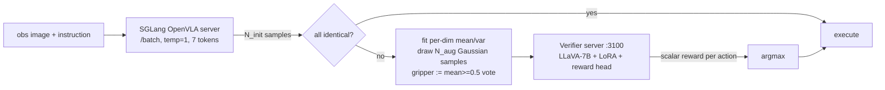
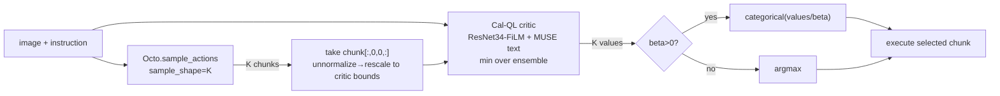
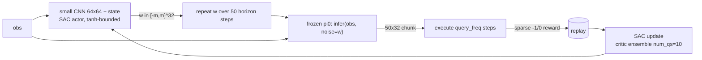
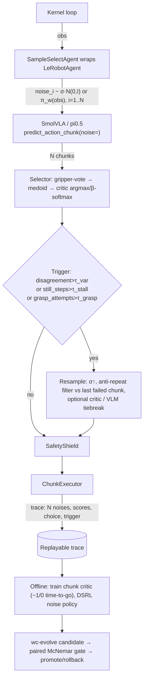

# Steering a Frozen VLA at Inference Time: RoboMonkey, V-GPS, DSRL and Runtime Failure Monitors

> Subjects: `references/evolution/RoboMonkey` (robomonkey-vla/RoboMonkey @ `db9f8d3`, MIT), `references/evolution/V-GPS` (nakamotoo/V-GPS @ `912a290`, **no LICENSE file**), `references/evolution/dsrl_pi0` (nakamotoo/dsrl_pi0 @ `7f48937`, MIT), `references/evolution/dsrl` (ajwagen/dsrl @ `8d21b9c`, **no LICENSE file**), `references/evolution/SAFE` (vla-safe/SAFE @ `b8e31df`, MIT), `references/evolution/FAIL-Detect` (CXU-TRI/FAIL-Detect @ `b758e55`, **CC-BY-NC-4.0**)
> Method: static reading only. Nothing was installed, run, or downloaded (no weights). Clones were made with `--no-recurse-submodules`. In three repos the key selection or steering code lives in **git submodules**, so I read those files read-only from `raw.githubusercontent.com` at the **SHA pinned by the parent repo**. They are cited as `owner/repo@sha7:path:line`.
> Audience: the `worldcurrent` policy-wrapper Agent, runtime critic, and the offline RSI loop (paired McNemar gate in `packages/wc-evolve/src/worldcurrent/evolve/loop.py:93`)
> Tags: **[Implemented]** traceable in code · **[Docs/Interface only]** · **[Unverified]** code exists but was not run here · **[Needs model/hardware]** needs GPU or weights

Motivating diagnosis (ours): SmolVLA-on-LIBERO failures are dominated by **repeated failed grasps** (51/72 failures have ≥3 grasp attempts) and **stalls** (23/72 have ≥30 still steps). Successes almost never stall. Every design choice below is judged against those two modes.

---

## 0. TL;DR

| | RoboMonkey | V-GPS | DSRL (pi0) |
|---|---|---|---|
| What changes at inference | Picks 1 of N sampled + Gaussian-augmented **single-step** actions | Picks 1 of K sampled **chunks** (scored on the chunk's first action) | **Replaces the initial noise** of the flow policy with a learned noise policy |
| Frozen | VLA (OpenVLA) | Generalist policy (Octo, etc.) | pi0 weights; the denoiser runs unchanged |
| Scorer | LLaVA-7B + LoRA + scalar reward head, trained on 20M synthetic preference pairs | 25.6M-param Cal-QL Q-function (ResNet-34 + FiLM) | Small SAC actor/critic (CNN on 64×64 image + state), trained **online** per task |
| CPU per decision | Infeasible as shipped (7B, hard-coded `.cuda()`) | Feasible (one small batched CNN pass) | Feasible at runtime (tiny actor); training needs ~10k env steps |
| Our first move | Borrow **gripper majority vote + consensus early-exit** only | Borrow the **-1/0 time-to-go critic** recipe, scored on the whole chunk | Phase 3: per-task noise policy; SmolVLA's noise shape (50×32) matches pi0's |

**Recommendation:** first ship a training-free **Sample-and-Select wrapper** around SmolVLA. It passes N explicit noise tensors through `predict_action_chunk(noise=...)`, selects by gripper vote plus medoid, and is driven by a **sample-disagreement / stall / grasp-retry trigger**. Second, add a V-GPS-style small critic trained on our own traces. DSRL comes third. Details in §6.

---

## 1. RoboMonkey (Kwok et al., CoRL 2025, arXiv 2506.17811)

**Positioning.** Test-time scaling for VLAs: sample a few actions, widen them with a Gaussian proposal, and let a learned VLM verifier choose. The repo has three parts: the verifier server, an SGLang serving fork, and the eval loop in an `openvla-mini` fork. The latter two are submodules pinned at `sglang-vla@66160f1` and `openvla-mini@8038e8e` (`git ls-tree HEAD`).

**Core interfaces.**
- `get_vla_action(...)` orchestrates everything (`robomonkey-vla/openvla-mini@8038e8e:experiments/robot/openvla_utils.py:291-364`). **[Implemented]**
- `get_batch_actions(instruction, image_path, batch_size, temperature)` sends N **sequential** HTTP requests, each with batch_size=1 (`openvla_utils.py:79-113`). **[Implemented]**
- `generate_augmented_samples_from_batch(batch_actions, num_samples)` (`openvla_utils.py:115-160`). **[Implemented]**
- Verifier `POST /process {instruction, image_path, action[2D]} -> {rewards}` (`references/evolution/RoboMonkey/monkey-verifier/src/infer_server.py:259-285`). **[Implemented]**

**Inference loop** (`openvla_utils.py:332-364`):
1. Draw `initial_samples` from the VLA at temperature 1 (`:335-341`). The SGLang server generates `max_new_tokens=7` action tokens (`sglang-vla@66160f1:openvla_server.py:134-139`).
2. Two early exits. If `initial=1, augmented=1`, the baseline action is returned (`:344-345`). If all samples **decode to the same token tuple**, the verifier is skipped (`:346-349`). That second exit is a free consensus gate.
3. Fit an independent per-dimension Gaussian from the samples' mean and variance, draw `augmented_samples` actions, and clip them to hard-coded Bridge bounds. The **gripper is set by majority vote**: `augmented_array[:, -1] = (mean_values[-1] >= 0.5)` (`:141-154`).
4. Deduplicate, score each candidate with the verifier, and take `np.argmax(rewards)` (`:358-364`).

Defaults are `initial_samples=5, augmented_samples=32` (`run_simpler_eval.py:97-98`). The README's per-task table uses 5–9 initial and 16–32 augmented samples (`references/evolution/RoboMonkey/README.md:100-105`).

**Verifier model.**
- Architecture: the LLaVA-v1.5-7B SFT backbone with a QLoRA adapter (r=64 on all projections) plus a `nn.Linear(hidden,1)` reward head on the last token's hidden state (`infer_server.py:32-61,112-118`; `monkey-verifier/src/models/reward_model.py:166,203-219`). **[Implemented]** **[Needs model/hardware]**
- Input: one image (the primary camera, written to `reward_img.jpg` by `openvla-mini@8038e8e:experiments/robot/simpler/simpler_utils.py:100-120`), the instruction, and **one 7-DoF action injected as 7 raw OpenVLA action-token IDs** into the prompt (`infer_server.py:162-201`, with the injection at `:197`). The model never sees an action chunk or an outcome. It judges "is this a good next delta action".
- Training loss: a Bradley–Terry log-sigmoid with a margin term. The term `alpha*(Δ*−Δ̂)²` pushes the predicted reward gap toward the gap in **normalized RMSE to the ground-truth action** (`reward_model.py:276-340`). **[Implemented]** The paper says it uses 20M synthetic comparisons from Bridge V2. **There is no data-generation script and no training launcher in the repo.** Only the loss, the dataset class and the collator exist (`monkey-verifier/src/data_utils/data_utils_rm.py:141-417`). **[Docs/Interface only]** for the pipeline.
- Cost: `get_rewards` posts candidates **2 at a time** "so the reward model fits in a RTX4090" (`openvla_utils.py:55-77`). Each pass is a 7B forward over ~576 image tokens plus about 100 text tokens. Device placement is hard-coded to `.cuda(0)` (`infer_server.py:232-234`).

**Integration hooks & CPU feasibility.** The hook is purely around `predict()`: samples in, one action out. On our 128-core CPU, a 7B LLaVA prefill per candidate is likely seconds. With 16–32 candidates, a decision would take minutes **[Unverified estimate]**, so it is not usable per decision. The verifier is also **single-step and OpenVLA-token-specific** (`action_processing.py:36-45` maps actions into the last vocab bins). It cannot score SmolVLA's 50×7 chunks without retraining. Qwen3.5 via Ollama cannot replace it zero-shot either, because RoboMonkey's verifier reads raw action tokens it was fine-tuned on.

**Results — reported vs verified.**
- README (SIMPLER, 3 seeds): Eggplant 54→73%, Carrot 20→25%, Spoon 45→47%, Stack 35→45% (`README.md:100-105`).
- Paper:
  - SIMPLER in-distribution averages 47.5%, +9 points over OpenVLA.
  - Real WidowX out-of-distribution: 35→60%, against 30% for V-GPS.
  - LIBERO-Long: 49.8→56.5% when both the VLA and the verifier are fine-tuned, over 500 trials.
  - Latency: 16 candidates in about 650 ms on one **H100**, using 28 GB.
- All of these are **reported**. None was reproduced here.

**License.** The repo is MIT (`LICENSE`), as are `openvla-mini` (MIT) and `sglang-vla` (Apache-2.0). The HF weights `robomonkey-vla/monkey-verifier-7b` are tagged MIT, but they derive from LLaVA-v1.5-7B (Vicuna/Llama-2), **so upstream Llama-2 terms likely apply**. Treat the weights as **restricted** until reviewed.

**Adopt / avoid.**
- Adopt: the gripper majority vote (`openvla_utils.py:147`), the consensus early exit (`:347-349`), and the Bradley–Terry-with-margin loss as a recipe for training a preference critic.
- Avoid: the 7B verifier on CPU, single-step scoring, and file-path IPC through `./transfer_images/*.jpg`, which is racy and not replayable.

---

## 2. V-GPS — Value-Guided Policy Steering (Nakamoto et al., CoRL 2024, arXiv 2410.13816)

**Positioning.** V-GPS re-ranks K sampled actions from any generalist policy using a language-conditioned **offline-RL Q-function** trained on OXE data. The policy is untouched. The repo holds the critic training (jaxrl_m) and eval glue. Sampling and selection live in the `nakamotoo/SimplerEnv@f343c82` submodule.

**Core interfaces.**
- `OctoInference.init_vgps(num_samples, get_values, critic_text_processor, action_temp, ...)` and `get_vgps_action(image)` (`nakamotoo/SimplerEnv@f343c82:simpler_env/policies/octo/octo_model.py:191-260`). **[Implemented]**
- `agent.get_q_values(observations, goals, actions)` applies the critic with **target params** and takes the **min over the ensemble** (`references/evolution/V-GPS/jaxrl_m/agents/continuous/cql.py:396-405`). **[Implemented]**
- `load_vgps_checkpoint(path, wandb_run)` (`experiments/eval_vgps.py:32-89`). Flags: `--num_samples` (default 10) and `--action_temp` β (`:29-30`). The shipped eval script uses K=50 and β=1.0 (`experiments/scripts/eval_vgps.sh:17-18`).

**Inference loop** (`octo_model.py:200-260`):
1. One batched call samples K chunks: `self.model.sample_actions(..., sample_shape=(self.num_samples,))` (`:220`).
2. The critic scores **only the first action of each chunk**: `norm_raw_actions[:, 0, 0, :]` (`:224`). Scores use only the last image frame (`:230`).
3. Selection is a softmax sample with temperature β, or argmax when β=0 (`:239-245`). The whole selected chunk is then passed through Octo's action ensembler (`:249-251`).

**Value model.**
- Architecture: Cal-QL, i.e. CQL with `use_calql=True` (`jaxrl_m/agents/continuous/calql.py:13`). Settings are `cql_alpha=5.0` and discount 0.98, with a ResNet-34 FiLM encoder, MUSE text embedding and 256×256 MLP heads (`experiments/configs/train_config.py:18-69`; `experiments/scripts/launch_calql.sh:5-25`). **[Implemented]** **[Needs model/hardware]**
- Training data and reward: Bridge plus Fractal (`data_config.py:100`). The reward is labeled **without success annotations**. Every step gets −1, the final 3 steps get 0, and MC returns are computed by reverse scan (`nakamotoo/octo@38b9b76:octo/data/dataset.py:385-397`, with `num_final_repeat=3` at `V-GPS/experiments/configs/data_config.py:105`). The Q-value is therefore roughly a **discounted time-to-go / progress estimate**. That is exactly the signal a stall detector wants.
- Cal-QL also overwrites MC returns for negative (relabelled) goals with `-1/(1-γ)` (`cql.py:32-41`).

**Integration hooks & CPU feasibility.** The hook is again a sampling wrapper. It requires the policy's sampler to accept a batch or sample shape. The critic is 25.6M params (paper), which is cheap on CPU: one batched forward over K images and actions. The paper's overhead on Octo-small (GPU) is ×1.28 at K=10 and ×1.59 at K=50 (reported). On our stack, the cost is dominated by **K SmolVLA samples, not the critic**. The checkpoint is on Google Drive (`README.md:76`) and trained on WidowX and Google-robot data. It is **not transferable to LIBERO/Franka** without retraining.

**Results — reported vs verified.**
- SIMPLER, Cal-QL critic (paper Table 2):
  - Octo-small 0.27→0.34
  - Octo-small-1.5 0.02→0.18
  - RT-1-X 0.12→0.14
  - OpenVLA 0.24→0.27
- Real WidowX with Octo-small-1.5: 0.24→0.44 (+82.8% relative), K=50, β→0.
- IQL critics degrade at large K while Cal-QL is robust (Table 10).
- In the DSRL paper, V-GPS "is not able to significantly improve" pi0 on a LIBERO-90 task.
- All of the above are reported. None was verified.

**License.** **No LICENSE file** in V-GPS (GitHub API `license: null`), which means all rights are reserved by default. The submodules `nakamotoo/octo` and `nakamotoo/SimplerEnv` are MIT. **Re-implement; do not vendor.**

**Adopt / avoid.**
- Adopt: the −1/0 time-to-go labeling (it needs no success labels and works on demos), the min-over-ensemble pessimism, the β-softmax selection knob, and the batched `sample_shape` API pattern.
- Avoid: scoring only `a[0]` when executing 50-step chunks. Our critic must take the **whole chunk**, or at least its first `n_action_steps`.

---

## 3. DSRL — Diffusion Steering via RL (Wagenmaker, Nakamoto, et al., CoRL 2025, arXiv 2506.15799)

**Positioning.** DSRL does RL in the **latent-noise space** of a frozen diffusion or flow policy. A small SAC actor π_w(s) outputs the initial noise. The frozen denoiser maps that noise to an action chunk, and the env executes it. There are two official repos: `ajwagen/dsrl` (Robomimic/Gym, SB3 fork, DSRL-SAC and DSRL-NA) and `nakamotoo/dsrl_pi0` (pi0 via an openpi fork, JAX, DSRL-SAC only).

**Core interfaces.**
- pi0 noise hook (fork): `Policy.infer(obs, noise=None)` passes noise straight to `sample_actions` (`nakamotoo/openpi@a6d2400:src/openpi/policies/policy.py:44-70`). **[Implemented]**
- Upstream openpi already supports this hook natively: `Policy.infer(obs, *, noise=None)` (`references/policies/openpi/src/openpi/policies/policy.py:68-88`) and `Pi0.sample_actions(..., noise=None)` (`references/policies/openpi/src/openpi/models/pi0.py:217-231`). The `Pi0` class also serves pi0.5 (`pi0.py:69`), so **pi0.5 is steerable the same way**.
- Noise-space action: `Box(-1, 1, shape=(1, 32))`, commented "32 is the noise action space of pi 0" (`references/evolution/dsrl_pi0/examples/train_sim.py:76`; the same appears in `train_real.py:50`). **[Implemented]**
- Generic wrapper (Robomimic): `DiffusionPolicyEnvWrapper` turns the action space into noise space and denoises inside `step_async` (`references/evolution/dsrl/env_utils.py:193-218`). The DPPO base is called with `cond={"state", "noise_action"}` and `deterministic=True` (`dsrl/utils.py:12-18`).

**Inference loop** (`dsrl_pi0/examples/train_utils_sim.py:225-248`):
1. At each `t % query_freq == 0`, the actor outputs a 32-d noise. It is **repeated across all 50 horizon steps** (`:239-242`), so the steered latent has 32 dimensions, not 1,600.
2. `agent_dp.infer(obs_pi_zero, noise=noise)` runs (`:244`), and `query_freq` actions are executed (`:248`). For LIBERO, `query_freq=20` and `action_magnitude=1.0` (`examples/scripts/run_libero.sh:31-33`).
3. Real Franka uses magnitude 2.5, `query_freq=10` and `num_qs=2` (`run_real.sh:30-35`). Aloha uses magnitude 2.0 (`run_aloha.sh:32-33`).
4. Reward is sparse: −1 per decision and 0 on the success step (`train_utils_sim.py:277-287`). The discount is applied per chunk as `discount**query_freq` (`:188`).

**Value model / learner.**
- `PixelSACLearner` uses a small CNN encoder (32×4 features) on a 64×64 image plus 8-d state, a 50-d bottleneck, 3×128 MLPs, an ensemble of 10 Qs, and `LearnedStdTanhNormalPolicy` bounded to ±`action_magnitude` (`launch_train_sim.py:29-52`; `jaxrl2/agents/pixel_sac/pixel_sac_learner.py:175,192`). **[Implemented]**
- The setting is one task, `libero_90` task 57 (`train_sim.py:113-115`), with `pi0_libero` weights from S3 (`:148-155`). **[Needs model/hardware]**
- DSRL-NA (Robomimic only) trains an **action-space** critic Q^A. Its target backs up through the frozen denoiser (`ajwagen/stable-baselines3-dsrl@10e5d31:stable_baselines3/dsrl/dsrl.py:277`). A **noise-space** critic Q^W is then distilled by sampling w~N(0,I), denoising, and regressing Q^A (`dsrl.py:349-362`). Because Q^A is defined on executed actions, it can ingest **offline/logged data**, which DSRL-SAC cannot. The README recommends NA over SAC, `action_magnitude≈1.5`, UTD≈20 and 3×2048 MLPs (`references/evolution/dsrl/README.md:68-70`).

**Integration hooks & CPU feasibility.**
- **SmolVLA already exposes the exact hook.** `predict_action_chunk(batch, *, noise=None)` → `_get_action_chunk` → `VLAFlowMatching.sample_actions(..., noise=None)` (`references/policies/lerobot/src/lerobot/policies/smolvla/modeling_smolvla.py:240-252,777-795`).
- SmolVLA's noise shape is `(B, chunk_size=50, max_action_dim=32)` (`configuration_smolvla.py:29,42`). That is **identical to pi0's (50, 32)**, so DSRL-pi0's 32-d repeated latent ports directly.
- Our adapter currently calls `predict_action_chunk(self.pre(batch))` without `noise` (`adapters/wc-policy-lerobot/src/worldcurrent/policies/lerobot/agent.py:81`). The change is a one-line kwarg.
- Runtime cost: the actor is a tiny CNN, so it adds negligible latency on CPU.
- Training cost:
  - DSRL-SAC needs no extra VLA calls beyond normal rollouts. It does need ~10k env steps per task (paper LIBERO: pi0 ≈20%→≈100% in ≈10k online samples, reported). On CPU, that is **one SmolVLA chunk per 20 env steps, about 500 VLA calls per 10k steps**. That is feasible overnight per task **[Unverified]**.
  - DSRL-NA calls the denoiser on every critic update with a full batch (`dsrl.py:277,352`). With SmolVLA on CPU, that is **infeasible** at UTD 20 × batch 256.

**Results — reported vs verified.**
- Reported: LIBERO-90 single task ≈20%→≈100% after ≈10k samples.
- Reported, real Franka with pi0-DROID: toaster 5/20→18/20 in 80 episodes, and spoon 15/20→19/20 in 65 episodes.
- Reported limitations: exploration is bounded by the base policy's support, and steerability is not guaranteed if the action distribution is concentrated.
- Not verified here.

**License.** `dsrl_pi0` is MIT. Its submodules are `nakamotoo/openpi` (Apache-2.0) and `nakamotoo/LIBERO`. `ajwagen/dsrl` has **no LICENSE** (API `license: null`), while its forks `stable-baselines3-dsrl` and `dppo-dsrl` are MIT.

**Adopt / avoid.**
- Adopt: the 32-d repeated noise latent, the tanh-bounded noise magnitude as a tunable knob, the sparse −1/0 chunk-level reward, and the critic ensemble.
- Avoid for now: DSRL-NA on CPU, and multi-task noise policies (the paper's pi0 runs are single-task).

---

## 4. Runtime failure detection (2025–2026)

| Work | Repo (verified official) | License | Signal | Needs failures to train? | Cloned |
|---|---|---|---|---|---|
| **SAFE** (Gu et al., NeurIPS 2025) | [vla-safe/SAFE](https://github.com/vla-safe/SAFE), linked from vla-safe.github.io | MIT | MLP/LSTM on VLA internal features + functional conformal band; baselines include sample variance and STAC | Yes (success/fail rollouts) | `b8e31df` |
| **FAIL-Detect** (Xu et al., RSS 2025) | [CXU-TRI/FAIL-Detect](https://github.com/CXU-TRI/FAIL-Detect), linked from project site | **CC-BY-NC-4.0** | logpZO (flow-matching density of obs embedding), RND, STAC + time-varying CP band | No (successes only) | `b758e55` |
| **FIPER** (Römer et al., NeurIPS 2025) | [learnsyslab/fiper](https://github.com/learnsyslab/fiper) (redirect from utiasDSL/fiper, linked from project page) | MIT | Embedding-OOD + action-chunk entropy, both CP-calibrated, alarm when both fire | No | not cloned |
| FOREWARN (Wu et al., 2025) | `yilin-wu98/forewarn` is an 86-byte README placeholder with no license | — | VLM-in-the-loop steering over world-model foresight (Llama-3.2-11B-V) | — | no code |

**SAFE internals.**
- The pi0 feature is `pre_velocity`: the action expert's last hidden state before the velocity projection, shaped (10 flow steps, 50 horizon, 1024), and averaged over both (`references/evolution/SAFE/failure_prob/data/pizero.py:31-33,72-81`; `conf/__init__.py:133-135`). **[Implemented]** **[Needs model/hardware]** It requires instrumented rollouts from the `vla-safe/openpi` fork.
- SAFE-MLP projects each step to a scalar and **cumsums** it over time (`model/indep.py:57-69`). SAFE-LSTM outputs a sigmoid per step (`model/lstm.py:63`).
- Thresholds come from a functional conformal one-sided band built on successful calibration rollouts (`utils/conformal/functional_predictor.py:104-152`). The paper uses α=0.15.
- **Training-free baselines are in the same code:**
  - Sample total variance over b sampled chunks (`utils/failure_metrics.py:125-156`)
  - Linkage-cluster entropy (`:158-165`)
  - STAC-single, the disagreement between overlapping parts of consecutive chunks (`:91-117`)
- **Decision-relevant (reported, SAFE Table 1, pi0 on LIBERO-10):** *Action total variance (sampled)* scores ROC-AUC 77.20 on seen tasks and 75.18 on unseen. SAFE-LSTM scores 76.98 and 71.09. In this setting, **a zero-training sample-disagreement score matches the learned detector**.
- **Code caveat (verified by reading):** the per-axis variances index into the flattened (horizon·A) covariance. `pos_var=X_cov[:, :3, :3]` covers only the first step's xyz, and `gripper_var=X_cov[:, 6:, 6:]` covers **everything from index 6 to the end of the chunk** (`failure_metrics.py:138,146-148`). That explains why "gripper total var" (77.19) ≈ "action total var" (77.20) in the paper. It is not a gripper-specific signal.
- The MMD-STAC path hard-codes `.cuda()` (`data/pizero_fast.py:71`).

**FAIL-Detect internals.**
- logpZO trains a small flow-matching UNet on **observation embeddings of successful demos** (`UQ_baselines/logpZO/train.py:55-65`).
- At runtime it does one Euler step from t=0 and scores `‖x+v̂‖²`, i.e. the distance from the Gaussian centre. A higher value means more OOD (`UQ_test/eval_load_baseline.py:134-148`).
- The threshold is either a CP band or a quantile (`UQ_test/plot_with_CP_band.py:208-213`).
- It is cheap on CPU **[Unverified]**. It is evaluated only on Robomimic with its own diffusion/flow policies (reported).
- **Non-commercial license**: read only, do not vendor.

**Signals usable as runtime critics in `worldcurrent` (ranked by cost).**
1. **Kinematic stall / grasp-retry counters** from the trace. This is free and directly matches our diagnosis. It is already computable from per-step obs.
2. **Sample disagreement** across N noises at the same obs: total variance, or the medoid distance. It costs nothing extra once we sample N anyway. SAFE's evidence puts it on par with learned detectors on pi0/LIBERO.
3. **STAC-single**: the disagreement between the new chunk and the unexecuted tail of the previous chunk. It costs zero extra samples.
4. Learned progress/value (V-GPS style), where a time-to-go plateau indicates a stall.
5. Feature-probe detectors (SAFE/FIPER) on SmolVLA expert hidden states. These need a forward hook before `action_out_proj` plus labelled rollouts.

---

## 5. Comparison table

| Dimension | RoboMonkey | V-GPS | DSRL-SAC (pi0) | DSRL-NA | SAFE / FAIL-Detect |
|---|---|---|---|---|---|
| Mechanism | Re-rank single-step samples | Re-rank chunks | Learned initial noise | Learned noise via distilled critic | Monitor (no action change) |
| Policy hook | Token sampling (temp) | `sample_shape=K` | `infer(noise=)` | Denoiser in critic backup | Hidden-state / output taps |
| Scorer size | 7B VLM | 25.6M CNN | ~small CNN + MLP | 3×2048 MLP | 2.3M LSTM / small UNet |
| Scorer training data | 20M synthetic RMSE-pref pairs (Bridge) | OXE demos, −1/0 time-to-go | Online env reward per task | Online + offline | Labelled rollouts / successes only |
| Extra VLA calls per decision | N_init (5–9) | K (10–50) | 0 | 0 at runtime | 0 (or N for sampled signals) |
| CPU feasible on our box | No (verifier) | Yes (critic); K×SmolVLA is the cost | Yes runtime; training ~hours/task [Unverified] | No (training) | Yes |
| Targets our grasp-retry mode | Gripper vote, partially | If critic sees gripper outcome | Yes (learns per-task bias) | Yes | Detects, does not fix |
| Targets our stall mode | No | Time-to-go plateau | Yes (reward = time) | Yes | Detects |
| Reported best gain | +9 pt ID SIMPLER, +25 pt OOD real | +82% rel. real | 20→~100% one LIBERO task | 2× sample-eff. vs SAC (Robomimic) | ROC-AUC ~77 (pi0 LIBERO-10) |
| Code license | MIT (weights: Llama-2-derived) | none | MIT | none (SB3 fork MIT) | MIT / CC-BY-NC |

---

## 6. Recommended design for `worldcurrent`

### 6.1 Components

### 6.2 Phases

**Phase A: training-free Sample-and-Select. Ship first.**
- **Hook.** Pass `noise=` into `predict_action_chunk` (`agent.py:81` → `modeling_smolvla.py:240-252`). Generate noise in the wrapper with an explicit seed so the trace can replay the exact noise. This makes selection **bit-replayable**, which RoboMonkey's file-IPC is not.
- **Batching.** Repeat the observation N times in the batch dimension: `sample_actions` takes `bsize = state.shape[0]` (`modeling_smolvla.py:788-795`). Note that the VLM prefix and KV cache are computed **per call over the whole batch** (`:797-809`), so naive batching pays the prefix cost N times. Optimisation (wrapper-only, no weight change): run `embed_prefix` + prefill once, then repeat-interleave the `DynamicCache` and `prefix_pad_masks` to N before `euler_integrate`. **[Unverified]** This needs care with the cache layout at `smolvlm_with_expert.py:281-348`. Expected cost ≈ 1 prefix + N×10 expert steps. Measure on CPU before choosing N.
- **Step 0 experiment (cheap, decisive).** At fixed observations from our failed traces, sample N=8 noises and measure the chunk spread: total variance and gripper-dim disagreement. If the spread is tiny, best-of-N cannot help (DSRL's "concentrated distribution" limitation), and the RSI unit becomes the **noise scale σ>1** (cf. DSRL bounds 1.0–2.5 in `run_libero.sh:32`, `run_real.sh:32`).
- **Selector, in order:**
  1. **Gripper majority vote** over the chunk's gripper channel (RoboMonkey `openvla_utils.py:147`). Drop candidates that disagree with the majority on close/open timing.
  2. **Medoid** chunk, minimising the mean L2 to the other candidates. This is a cheap consensus analogue of voting and is robust to outlier samples.
  3. If all candidates agree within ε, skip selection entirely (RoboMonkey's early exit, `:347-349`).
- **Trigger** (the critic that drives resampling), using our diagnosis directly:
  - `still_steps ≥ τ_stall` (successes almost never stall), or
  - `grasp_attempts ≥ τ_grasp`, or
  - sample total variance > τ_var (SAFE evidence), or
  - STAC-single > τ_stac.
  - On fire: resample with σ↑ and an **anti-repeat filter** that rejects candidates within δ of the previous failed grasp chunk. Log everything to the trace.
- Every selected chunk still goes through SafetyShield. Steering never bypasses it.

**Phase B: learned chunk critic (V-GPS recipe, our data).**
- Label our replayable traces V-GPS style: −1 per chunk decision and 0 at the success step (`octo/dataset.py:385-397`). Failed episodes are all −1, as in DSRL (`train_utils_sim.py:284-287`).
- Train a small ensemble Q(obs image 64–128px + state + **full executed chunk**) with MC-regression or Cal-QL. Take the min over the ensemble (`cql.py:404`).
- This is CPU-trainable at the 25M-param scale or smaller. Replace the medoid with argmax or β-softmax over Q. A plateau in max Q becomes an additional stall trigger.
- **Data multiplier only possible in sim:** from LIBERO state snapshots, roll out each of the N candidate chunks and record the resulting progress. This gives *outcome-grounded* preference pairs, a stronger version of RoboMonkey's RMSE-to-demo labels. Train with RoboMonkey's BT-with-margin loss (`reward_model.py:324-340`).
- This is offline only. It is not a runtime oracle.

**Phase C: DSRL-SAC noise policy, per task, for chronic failures.**
- A 32-d tanh-bounded latent repeated over 50 steps, exactly as in `train_utils_sim.py:239-242`. Train it on the LIBERO tasks with the worst grasp-retry rates.
- Use the noise policy as the *proposal* in Phase A, i.e. sample around π_w(obs) instead of N(0, I). That composes DSRL with best-of-N.
- pi0.5 via upstream openpi `infer(noise=)` (`policy.py:68-88`) uses the same interface.

**Qwen3.5 (Ollama) role.** Not a per-decision verifier: there is no action-token fine-tune, and the latency is too high. Use it in two ways:
- (a) As an **offline labeler/classifier** of failure modes on traces, e.g. "missed grasp / object slipped / wrong object".
- (b) As a **trigger-time tiebreaker** only when Phase A fires. Render the N candidates' end-effector paths, projected with LIBERO camera intrinsics, onto the image, and ask it to pick one. **[Unverified idea]**; it must win a McNemar gate before use.

### 6.3 RSI improvement units (each one a `wc-evolve` Candidate, gated by the paired McNemar test)

| Unit | Range / form | Source of idea |
|---|---|---|
| `n_samples` N | 1, 2, 4, 8, 16 | RoboMonkey N_init, V-GPS K |
| `noise_scale` σ (and tanh bound) | 0.8–2.5 | DSRL `action_magnitude` |
| `selector` | first / medoid / gripper-vote+medoid / critic-argmax / critic-softmax(β) | RoboMonkey, V-GPS β |
| `trigger` thresholds | τ_stall, τ_grasp, τ_var, τ_stac, cooldown | SAFE/FAIL-Detect CP (calibrate τ as the (1−α) quantile on successful traces, α≈0.1–0.2) |
| `resample_policy` | σ schedule, anti-repeat δ, max resamples | ours |
| `critic_ckpt` | trained on traces up to round r | V-GPS / DSRL critic |
| `noise_policy_ckpt` | per-task π_w | DSRL |
| `vlm_tiebreak_prompt` | prompt text + overlay style | RoboMonkey prompt (`robot_reward_prompt.txt:1-2`) as a seed |

Gate on success, but also on **mean still-steps and grasp-attempt counts** as secondary metrics, and track latency per decision. A CPU-latency regression is a reject reason, as with safety interventions in `loop.py:93-99`.

---

## 7. Source index

| Topic | Location |
|---|---|
| RoboMonkey select loop | `robomonkey-vla/openvla-mini@8038e8e:experiments/robot/openvla_utils.py:291-364` |
| Gaussian augmentation + gripper vote | `…/openvla_utils.py:115-160` (vote `:147`) |
| Consensus early exit | `…/openvla_utils.py:344-349` |
| Verifier server / prompt / action-token injection | `references/evolution/RoboMonkey/monkey-verifier/src/infer_server.py:153-240` |
| Verifier BT+margin loss | `references/evolution/RoboMonkey/monkey-verifier/src/models/reward_model.py:276-345` |
| V-GPS selection | `nakamotoo/SimplerEnv@f343c82:simpler_env/policies/octo/octo_model.py:200-260` |
| V-GPS critic query | `references/evolution/V-GPS/jaxrl_m/agents/continuous/cql.py:396-405` |
| V-GPS reward labeling | `nakamotoo/octo@38b9b76:octo/data/dataset.py:385-397` |
| V-GPS train config | `references/evolution/V-GPS/experiments/configs/train_config.py:18-69` |
| DSRL-pi0 noise injection | `references/evolution/dsrl_pi0/examples/train_utils_sim.py:225-248` |
| DSRL-pi0 noise action space | `references/evolution/dsrl_pi0/examples/train_sim.py:76` |
| DSRL-pi0 SAC learner | `references/evolution/dsrl_pi0/jaxrl2/agents/pixel_sac/pixel_sac_learner.py:130-200` |
| DSRL generic env wrapper | `references/evolution/dsrl/env_utils.py:193-230` |
| DSRL-NA noise-critic distillation | `ajwagen/stable-baselines3-dsrl@10e5d31:stable_baselines3/dsrl/dsrl.py:349-362` |
| openpi noise hook (upstream) | `references/policies/openpi/src/openpi/policies/policy.py:68-88` |
| SmolVLA noise hook | `references/policies/lerobot/src/lerobot/policies/smolvla/modeling_smolvla.py:240-252,777-826` |
| Our policy call site | `adapters/wc-policy-lerobot/src/worldcurrent/policies/lerobot/agent.py:81` |
| SAFE detectors | `references/evolution/SAFE/failure_prob/model/indep.py:49-69`, `model/lstm.py:33-72` |
| SAFE sample-variance / STAC | `references/evolution/SAFE/failure_prob/utils/failure_metrics.py:91-165` |
| SAFE conformal band | `references/evolution/SAFE/failure_prob/utils/conformal/functional_predictor.py:104-165` |
| FAIL-Detect logpZO | `references/evolution/FAIL-Detect/UQ_baselines/logpZO/train.py:55-65`, `UQ_test/eval_load_baseline.py:134-148` |

## 8. Verification status

| Claim | Status |
|---|---|
| RoboMonkey sample→augment→verify→argmax loop | [Implemented] (submodule, read at pinned SHA) |
| RoboMonkey synthetic-data pipeline and verifier training launcher | [Docs/Interface only]: loss and dataset class exist, no generator or launcher |
| RoboMonkey verifier runs on CPU | Not supported: hard-coded `.cuda(0)` (`infer_server.py:232-234`) |
| V-GPS scores only the first action of each chunk | [Implemented] (`octo_model.py:224`) |
| V-GPS reward = −1/0 time-to-go without success labels | [Implemented] (`octo dataset.py:385-397`) |
| DSRL-pi0 latent is 32-d, repeated over 50 steps | [Implemented] (`train_utils_sim.py:239-242`, `train_sim.py:76`) |
| SmolVLA accepts external noise of shape (B, 50, 32) | [Implemented] (`modeling_smolvla.py:791-795`, config `:29,42`) |
| Shared-prefix batched sampling for SmolVLA | [Unverified]: proposed design, needs implementation and a CPU benchmark |
| SAFE "gripper var" is effectively whole-chunk variance | [Implemented] (indexing at `failure_metrics.py:146-148`); consistent with reported 77.19≈77.20 |
| All success-rate / ROC-AUC / latency numbers | Reported only (papers, READMEs). None reproduced; no weights downloaded |
| CPU latency of N×SmolVLA per decision | [Unverified]: must be measured (Step 0) |
| Weights for any method | [Needs model/hardware] |
