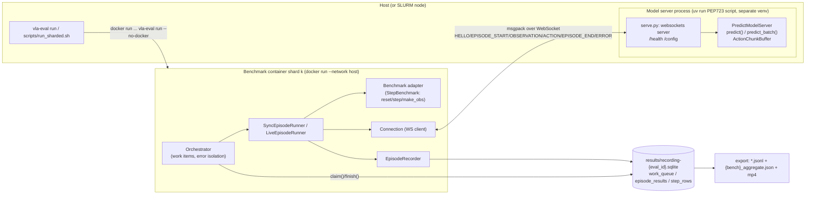

# vla-evaluation-harness (allenai) Source-Level Architecture Study

> Subject: `references/harness/vla-evaluation-harness` (allenai/vla-evaluation-harness @ `0cd7deb`, commit date 2026-10-28, Apache-2.0)
> Method: purely static reading (nothing installed, run, or pulled - no images/weights). Every capability claim carries a tag:
> **[Implemented]** code exists and the path is traceable · **[Docs/Interface only]** only docs or an abstract interface/stub · **[Unverified]** code exists but we could not verify it works · **[Needs model/hardware]** requires weights, GPU, simulation assets or a robot.
> Citation format: `references/harness/vla-evaluation-harness/<path>:<line>`. Line numbers were checked with `grep -n` / `sed -n`.
> Size: `src/vla_eval` is about 21k lines of Python in total, including 20 benchmark adapters, 17 model server scripts with PEP 723 headers, and 35 test files.

---

## 1. Positioning and Core Capabilities

**Positioning**: an **evaluation** harness for VLA (Vision-Language-Action) policies. The core idea is "decoupling benchmark from model": simulators/benchmarks run in Docker containers (heavy dependencies, long-frozen environments such as Python 3.8), while the model runs as a WebSocket server in a separate process (a `uv run` PEP 723 script with its own dependencies); the two interact only through a msgpack-over-WebSocket protocol. It does not cover training, reasoning, memory or self-improvement; only `examples/pusht_train_eval` demonstrates embedding evaluation in a training loop.

| Capability | Tag | Evidence |
|---|---|---|
| Benchmark abstraction (async `Benchmark` + sync `StepBenchmark` bridge) | [Implemented] | `references/harness/vla-evaluation-harness/src/vla_eval/benchmarks/base.py:54-200`, `:209-279` |
| Synchronous episode loop (obs→act→step) | [Implemented] (with stub unit tests) | `references/harness/vla-evaluation-harness/src/vla_eval/runners/sync_runner.py:30-72` |
| Real-time (live) loop: fixed Hz, ActionBuffer, hold action | [Implemented]; only Kinetix declares hold → [Needs model/hardware] | `references/harness/vla-evaluation-harness/src/vla_eval/runners/live_runner.py:55-180`, `references/harness/vla-evaluation-harness/src/vla_eval/benchmarks/kinetix/benchmark.py:323-324` |
| WebSocket + msgpack protocol, numpy/image codec | [Implemented] | `references/harness/vla-evaluation-harness/src/vla_eval/protocol/messages.py:15-82`, `references/harness/vla-evaluation-harness/src/vla_eval/protocol/numpy_codec.py:41-76` |
| ModelServer / PredictModelServer (chunking, batched predict) | [Implemented] | `references/harness/vla-evaluation-harness/src/vla_eval/model_servers/predict.py:63-438` |
| Continuous Inference / LAAS | [Unverified] (source self-annotated DRAFT, untested) | `references/harness/vla-evaluation-harness/src/vla_eval/model_servers/predict.py:6-10`, `:444-507` |
| Episode sharding (static split + SQLite dynamic work queue) | [Implemented] | `references/harness/vla-evaluation-harness/src/vla_eval/orchestrator.py:66-73`, `references/harness/vla-evaluation-harness/src/vla_eval/recording.py:228-266` |
| Docker / Charliecloud container launch, GPU/CPU partitioned per shard | [Implemented], actual run [Needs model/hardware] | `references/harness/vla-evaluation-harness/src/vla_eval/cli/_docker.py:300-394`, `references/harness/vla-evaluation-harness/src/vla_eval/docker_resources.py:173` |
| SQLite recording (episode/step rows, video mp4) → JSONL/JSON export | [Implemented] | `references/harness/vla-evaluation-harness/src/vla_eval/recording.py:36-94`, `references/harness/vla-evaluation-harness/src/vla_eval/results/export.py:39-62` |
| wandb / trackio tracking | [Implemented] (optional dependency, unverified) | `references/harness/vla-evaluation-harness/src/vla_eval/tracking.py:87`, `:137`, `:199` |
| Action/Obs spec cross-check (DimSpec) | [Implemented], but only emits warnings | `references/harness/vla-evaluation-harness/src/vla_eval/specs.py:30-136`, `references/harness/vla-evaluation-harness/src/vla_eval/orchestrator.py:286-308` |
| 20 benchmark adapters (LIBERO family, SimplerEnv, CALVIN, RoboTwin, RoboCasa, BEHAVIOR-1K...) | [Needs model/hardware] (`ty` type checking explicitly excludes adapters) | `references/harness/vla-evaluation-harness/pyproject.toml:76` |
| 17 model servers (OpenVLA, π0, GR00T, X-VLA, LeRobot bridge...) | [Needs model/hardware] | `references/harness/vla-evaluation-harness/src/vla_eval/model_servers/openvla.py:1-19` |
| "47× throughput", "6 models reproduced within 2pp" | [Unverified] (README/docs claim; `docs/reproductions/data` has result JSON, but we did not re-run) | `references/harness/vla-evaluation-harness/README.md:32`, `:39` |
| Leaderboard (2,456 models × 18 benchmarks) | [Implemented], but the data comes from **LLM-extracted paper scores**, unrelated to this harness's run results | `references/harness/vla-evaluation-harness/leaderboard/scripts/extract.py:9-17` |

---

## 2. Directory Layout and Architecture

```
src/vla_eval/
  types.py            # Observation/Action/Task/EpisodeResult = Dict[str, Any] (convention, not schema)
  specs.py            # DimSpec + predefined constants (POSITION_DELTA, ROTATION_AA, GRIPPER_*...)
  registry.py         # "module.path:Class" import string resolution (lazyregistry)
  config.py           # ServerConfig / DockerConfig / EvalConfig dataclass
  orchestrator.py     # main controller of each shard process: connect, construct benchmark, work items, error isolation
  connection.py       # benchmark-side WebSocket client (HELLO, act, listener, reconnect)
  runners/            # SyncEpisodeRunner / LiveEpisodeRunner / ActionBuffer / Clock
  benchmarks/<name>/  # 20 adapters + base.py + video.py
  model_servers/      # ModelServer / PredictModelServer / serve.py / chunking.py + per-model scripts
  protocol/           # msgpack message, numpy codec, image codec
  recording.py        # SQLite RecordingStore + EpisodeRecorder + StepRecorder + work_queue
  results/            # ResultCollector (in-memory aggregation), export (SQLite→JSONL/JSON)
  watchdog.py         # OS-thread watchdog, os._exit(124) on hang
  tracking.py         # wandb/trackio
  api.py              # serve_background / run / evaluate (embed in training scripts)
  cli/                # vla-eval run|serve|export|test; _docker.py, _charliecloud.py, smoke.py
docker/               # Dockerfile.base + one Dockerfile per benchmark (22)
configs/benchmarks/*  configs/model_servers/*   # YAML (benchmark side / model side separated)
leaderboard/          # literature score extraction and static site (decoupled from harness runs)
skills/               # agent SKILL.md for add-benchmark / add-model-server / run-evaluation
docs/rfcs/            # 0001-0008 design RFCs (realtime, protocol, isolation, sharding, batch, API)
```



---

## 3. Core Interfaces and Key Classes

### 3.1 Data contract (types.py) - all `Dict[str, Any]`

```python
Observation: TypeAlias = Dict[str, Any]   # recommended keys: images{cam: HWC uint8}, task_description: str, state: np.ndarray
Action: TypeAlias = Dict[str, Any]        # conventional key "actions": (action_dim,) or (chunk, action_dim)
Task: TypeAlias = Dict[str, Any]          # conventionally name, suite; may contain arbitrary non-serializable objects (e.g. LIBERO task_obj)
EpisodeResult: TypeAlias = Dict[str, Any] # at least {"success": bool}
```
`references/harness/vla-evaluation-harness/src/vla_eval/types.py:14-60` - [Implemented], but **only a convention**; there is no runtime schema validation. Actual keys are not consistent: LIBERO emits `states`/`controller_states` (`references/harness/vla-evaluation-harness/src/vla_eval/benchmarks/libero/benchmark.py:284-292`), Kinetix/RoboTwin/RoboCasa365 emit `state` (grep results), inconsistent with the `state` recommended in types.py.

### 3.2 Benchmark (environment side)

```python
class Benchmark(ABC):                                     # base.py:54
    render_backends: ClassVar[frozenset[str]] = {"gpu"}
    @classmethod configure_render(cls, mode) -> dict[str,str]
    def get_tasks(self) -> list[Task]                     # abstract
    async def start_episode(self, task, recorder=None)    # abstract
    async def apply_action(self, action: Action) -> None  # abstract, fire-and-forget
    async def get_observation(self) -> Observation        # abstract
    async def is_done(self) -> bool                       # abstract
    async def get_time(self) -> float                     # abstract
    async def get_result(self) -> EpisodeResult           # abstract
    def get_action_spec(self) / get_observation_spec(self) -> dict[str, DimSpec]  # raises by default
    def get_metric_keys(self) -> dict[str, str]           # default {"success": "mean"}
    def get_metadata(self) -> dict                        # max_steps, max_episodes_per_task...
    def get_hold_action(self, last_action) -> Action      # must be implemented for live mode, raises by default
    def cleanup(self); def render(self)

class StepBenchmark(Benchmark):                           # base.py:209
    def reset(self, task) -> raw_obs; def step(self, action) -> StepResult
    def make_obs(self, raw_obs, task) -> Observation; def get_step_result(self, sr) -> EpisodeResult
    def check_done(self, sr) -> bool  # default sr.done
```
`references/harness/vla-evaluation-harness/src/vla_eval/benchmarks/base.py:54-279` - [Implemented]. Note that the bridge calls `reset/step` **synchronously** inside the event loop; the source itself comments that this blocks the event loop (`references/harness/vla-evaluation-harness/src/vla_eval/benchmarks/base.py:251-257`); this is why `watchdog` is needed.

### 3.3 EpisodeRunner

```python
class EpisodeRunner(ABC):                                 # runners/base.py:45
    async def run_episode(self, benchmark, task, conn, *, max_steps=None, recorder=None) -> EpisodeResult
class EpisodeError(RuntimeError): phase: ClassVar[str]    # env_start / env_step / model_act → failure_reason
```
`references/harness/vla-evaluation-harness/src/vla_eval/runners/base.py:17-66` - [Implemented]. The `phase()` context manager wraps any exception into an `EpisodeError` carrying the phase name, but lets `ConnectionError/TimeoutError/ConnectionClosed/RecordingError` pass through to the orchestrator (`:35-42`).

### 3.4 ModelServer (model side)

```python
class SessionContext:   # model_servers/base.py:19 — session_id(across episodes), episode_id, eval_id,
                        # recording_db_path, step, is_first, mode, async send_action(action)
class ModelServer(ABC): # model_servers/base.py:100
    async def on_serve_start(self, tg)                       # optional
    async def on_observation(self, obs, ctx) -> None         # abstract; pushes back via ctx.send_action
    async def on_episode_start(self, config, ctx); async def on_episode_end(self, result, ctx)
    def get_action_spec(self) / get_observation_spec(self) -> dict[str, DimSpec]
    def get_observation_params(self) -> dict                 # returned at HELLO, auto-merged into benchmark constructor params
class PredictModelServer(ModelServer):                       # predict.py:63
    def __init__(self, *, chunk_size=None, action_ensemble="newest", ema_alpha=0.5,
                 max_batch_size=1, max_wait_time=0.01, continuous_inference=False, laas=False, hz=10.0)
    def predict(self, obs, ctx) -> Action                    # blocking, runs in a thread pool
    def predict_batch(self, obs_batch, ctx_batch) -> list[Action]
```
`references/harness/vla-evaluation-harness/src/vla_eval/model_servers/base.py:19-157`, `references/harness/vla-evaluation-harness/src/vla_eval/model_servers/predict.py:131-212` - [Implemented]. `on_observation` is push-style (the server can send 0..N ACTIONs for one obs), which is the foundation of live mode.

### 3.5 Protocol

```python
class MessageType(str, Enum): HELLO, OBSERVATION, ACTION, EPISODE_START, EPISODE_END, ERROR   # messages.py:15-21
PROTOCOL_VERSION = 1                                                                          # messages.py:24
@dataclass class Message: type; payload: dict; seq: int = 0; timestamp: float                 # messages.py:34-39
# wire = msgpack({"type","payload","seq","timestamp"}), ndarray → {"__ndarray__":True,"data","dtype","shape"}
# HWC uint8 (C∈{1,3,4}) → {"__image__":True,"format":"png|jpeg|raw","data","shape"}
```
`references/harness/vla-evaluation-harness/src/vla_eval/protocol/messages.py:42-82`, `references/harness/vla-evaluation-harness/src/vla_eval/protocol/numpy_codec.py:22-76`, `references/harness/vla-evaluation-harness/src/vla_eval/protocol/image_codec.py:27-90` - [Implemented]. The dtype whitelist is only bool/int/uint/float (`numpy_codec.py:23`, `:74-75`), rejecting object dtype (safe). Images default to **PNG** (`numpy_codec.py:27`); `set_image_format()` has no callers in the repo → effectively not configurable. `protocol_version` is only exchanged in HELLO, with no compatibility check whatsoever (grep finds only one occurrence, `messages.py:31`).

### 3.6 Specs (DimSpec)

```python
@dataclass(frozen=True)
class DimSpec: name; dims; format; range=None; accepts: frozenset|None=None; description=""
def check_specs(server_action, bench_action, server_obs, bench_obs) -> list[str]
```
`references/harness/vla-evaluation-harness/src/vla_eval/specs.py:30-136` - [Implemented]. The semantic format strings (`delta_xyz`, `axis_angle`, `binary_close_positive`, `quaternion_xyzw`, `rgb_hwc_uint8`..., `:143-191`) are one of the most valuable designs in this project, but they are **decoupled from the actual dict keys**: the OpenVLA server declares obs `{"image","language"}` (`references/harness/vla-evaluation-harness/src/vla_eval/model_servers/openvla.py:81-82`), LIBERO declares `{"agentview","language"}` (`references/harness/vla-evaluation-harness/src/vla_eval/benchmarks/libero/benchmark.py:316-325`), so by the `check_specs` logic a mismatch warning is reported for `image`; and a mismatch is always only a `logger.warning` (`references/harness/vla-evaluation-harness/src/vla_eval/orchestrator.py:302-308`).

---

## 4. Core Execution Flow

**Loop ownership: the benchmark side (client) owns the loop.** The Orchestrator runs inside the benchmark container, and the runner drives `obs → conn.act → apply_action → is_done`; the model server is a passive RPC service, stateless apart from "episode progress" (it only sees EPISODE_START / OBSERVATION / EPISODE_END).

```mermaid
sequenceDiagram
  autonumber
  participant CLI as vla-eval run (host)
  participant ORC as Orchestrator (container)
  participant B as Benchmark
  participant C as Connection
  participant S as serve.py + PredictModelServer
  participant DB as SQLite
  CLI->>ORC: docker run --network host ... vla-eval run --no-docker
  ORC->>DB: RecordingStore(schema), set_run_metadata
  ORC->>C: connect(benchmark) (5 retries, 2^n backoff)
  C->>S: HELLO{harness_version, protocol_version}
  S-->>C: HELLO{observation_params, action_spec, observation_spec}
  ORC->>B: resolve_import_string + configure_render + __init__(params ⊕ observation_params)
  ORC->>ORC: check_specs (warn only), max_steps = cfg or metadata
  loop each work item (task, ep) — static split or DB claim()
    ORC->>B: start_episode(task+episode_idx, recorder)
    B-->>ORC: get_observation()
    ORC->>C: EPISODE_START{task(primitive fields), recording{sid,eid,eval_id,db_path}}
    C->>S: on_episode_start (clear chunk buffer)
    loop step < max_steps
      C->>S: OBSERVATION(obs, seq)
      S->>S: chunk buffer hit? otherwise predict()/predict_batch() thread pool
      S-->>C: ACTION(seq) or ERROR
      ORC->>B: apply_action(action); watchdog.pet()
      alt is_done()
        Note over ORC: break
      end
    end
    ORC->>B: get_time(), get_result()
    ORC->>C: EPISODE_END{metrics, steps, elapsed_sec}
    ORC->>DB: recorder.close → episode_results + step_rows (+ mp4)
    ORC->>DB: finish(item)
  end
  ORC->>B: cleanup(); conn.close()
  CLI->>DB: vla-eval export → *.jsonl + <bench>_aggregate.json
```

Key code: `references/harness/vla-evaluation-harness/src/vla_eval/orchestrator.py:261-530`, `references/harness/vla-evaluation-harness/src/vla_eval/runners/sync_runner.py:30-72`, `references/harness/vla-evaluation-harness/src/vla_eval/model_servers/serve.py:75-217`.

**Lifecycle details (answering Q1)**
- **Reset / step / close**: `start_episode` (= `reset` + initial obs) → `apply_action` (= `step`) → `get_result`; `cleanup()` is called only once, when the whole benchmark entry finishes (`orchestrator.py:525-528`); the env is reused across episodes (LIBERO only rebuilds when the task changes, `libero/benchmark.py:189-202`).
- **Termination**: `is_done()` or `max_steps` (config > `get_metadata()["max_steps"]` > 300, `orchestrator.py:320`). Reaching max_steps is not an error, only success=False.
- **Timeouts**: each `act`'s `recv` times out after 30s (`ServerConfig.timeout`, `config.py:53-54`; `connection.py:158`); the process-level watchdog defaults to `os._exit(124)` after 1200s with no progress (`cli/main.py:209`, `watchdog.py:53-66`) - specifically targeting simulators stuck in SAPIEN/Vulkan native calls. In live mode the listener has no recv timeout (`connection.py:252`) and relies on the hold action and the watchdog.
- **Retry / failure handling**: no episode-level retry. `ConnectionError` (5 failed reconnects) → abort that benchmark and return partial results (`orchestrator.py:459-471`); `ConnectionClosed`/`TimeoutError` → record that episode as failed, `reconnect()`, continue (`:472-512`); other exceptions → record `failure_reason=phase`, continue (`:513-524`). Only `EPISODE_START` auto-reconnects; a disconnect mid-episode fails directly (`connection.py:100-113`). When sharded, if the first 3 episodes all error the shard is deemed unhealthy, exit 3, optionally putting the items back in the queue (`orchestrator.py:45`, `:219-233`).
- **Failures counted in metrics**: errored episodes are recorded as `success=False` and counted in the mean, with `num_errors` reported separately (`results/collector.py:69-88`).
- **Server errors**: an `on_observation` exception → returns an `ERROR` message but does not drop the connection (`serve.py:170-182`); the client's `act` raises RuntimeError → `ModelActError` (`connection.py:159-160`).

**Live mode** (`runners/live_runner.py:55-180`): the environment advances at a fixed `hz` tick; after `conn.listening()`, ACTIONs are received in the background and written into the `ActionBuffer`; when there is no new action, `benchmark.get_hold_action(last)` is called; it produces `rt_metrics` (stale_action_ratio, effective_control_hz, step_time). Only Kinetix implements hold → all other benchmarks fail fast in live mode (`orchestrator.py:322-333`).

---

## 5. Extension Points and Plugin Mechanism

**No entry points / registry**: grep for `entry_points|importlib.metadata` returns nothing. The only mechanism is the import string `"module.path:ClassName"` in YAML, resolved by `lazyregistry.ImportString` (`references/harness/vla-evaluation-harness/src/vla_eval/registry.py:14-21`).

| Extension point | How | Tag / Evidence |
|---|---|---|
| New benchmark | Subclass `StepBenchmark`, implement `get_tasks/reset/step/make_obs/get_step_result` + specs; write `docker/Dockerfile.<name>` (FROM base, conda env, `pip install -e .` installs the harness into the image); write `configs/benchmarks/<name>/*.yaml` filling in the import string and `docker.image` | [Implemented] `references/harness/vla-evaluation-harness/docker/Dockerfile.libero:1-47` |
| Out-of-repo benchmark | Import string points to any importable module + `docker.build` builds the image automatically | [Implemented] `references/harness/vla-evaluation-harness/examples/pusht_train_eval/benchmark/eval.yaml:5-12`, `references/harness/vla-evaluation-harness/src/vla_eval/config.py:69-95` |
| New model server | Subclass `PredictModelServer` implementing `predict()` (or `predict_batch()`), declare dependencies in a PEP 723 header at the top of the script, `run_server(Cls)`; YAML `script:` + `args:` map to `__init__` (jsonargparse) | [Implemented] `references/harness/vla-evaluation-harness/src/vla_eval/model_servers/serve.py:361-394`, `references/harness/vla-evaluation-harness/src/vla_eval/cli/main.py:255-317` |
| Low-level model server | Subclass `ModelServer` directly, custom `on_observation` push strategy (e.g. RTC) | [Implemented] `references/harness/vla-evaluation-harness/src/vla_eval/model_servers/rtc.py` |
| Model→benchmark parameter injection | `get_observation_params()` merged via HELLO into the benchmark constructor params (config takes precedence, unknown keys dropped with a warning) | [Implemented] `references/harness/vla-evaluation-harness/src/vla_eval/orchestrator.py:90-114`, `:277-278` |
| Custom metrics | `get_metric_keys()` → `{field: mean|sum|max|min}` | [Implemented] `references/harness/vla-evaluation-harness/src/vla_eval/benchmarks/base.py:156-167` |
| Render backend | `render_backends` + `configure_render(mode)` (EGL/OSMesa/lavapipe) | [Implemented] `references/harness/vla-evaluation-harness/src/vla_eval/render.py:92`, `:267` |
| Tracker | `tracking.report_to: wandb|trackio` | [Implemented] `references/harness/vla-evaluation-harness/src/vla_eval/tracking.py:199` |
| Agent skills | `skills/add-benchmark/SKILL.md` etc., for coding agents to integrate step by step | [Docs/Interface only] |

Config inheritance: `extends:` + OmegaConf merge + `${oc.env:VAR,default}` (`references/harness/vla-evaluation-harness/src/vla_eval/cli/config_loader.py:11-40`). One YAML can list multiple `benchmarks:` entries, executed sequentially (`orchestrator.py:204-208`), i.e. a "multi-benchmark sweep" is just a serial list; cross-model sweeps need external scripts (`scripts/run_simpler_seeds.sh` etc.).

---

## 6. Dependencies and Runtime Requirements

- **Core package**: `requires-python >=3.8` (so it can be installed in LIBERO's py3.8 container, `references/harness/vla-evaluation-harness/docker/Dockerfile.libero:5`); dependencies are only anyio, websockets>=13, msgpack, numpy, pillow, imageio[ffmpeg], jsonargparse, omegaconf, pyyaml, rich, tqdm, lazyregistry (`references/harness/vla-evaluation-harness/pyproject.toml:10-26`). No torch. Published on PyPI as `vla-eval` (the example depends on `vla-eval>=0.6.0`).
- **Supply-chain protection**: `[tool.uv] exclude-newer = "2026-07-07"` (`pyproject.toml:57`), Dockerfile.base syncs `UV_EXCLUDE_NEWER` (`references/harness/vla-evaluation-harness/docker/Dockerfile.base:54-55`), model server scripts each pin `exclude-newer` (`openvla.py:17-18`).
- **Benchmark side**: one Docker image per benchmark (`ghcr.io/allenai/vla-evaluation-harness/<name>`), based on `nvidia/cuda:12.1.1-runtime-ubuntu22.04` + EGL/Vulkan + Miniforge + uv (`Dockerfile.base:5-55`). Charliecloud is supported for rootless HPC scenarios (`references/harness/vla-evaluation-harness/src/vla_eval/cli/_charliecloud.py`). [Needs model/hardware]
- **Model side**: `vla-eval serve -c <yaml>` → `uv run <script>`, separate venv per model (`cli/main.py:290-317`); needs GPU and HF weights. [Needs model/hardware]
- **Network**: container `--network host`, model server defaults to `ws://localhost:8000` (`references/harness/vla-evaluation-harness/src/vla_eval/cli/_docker.py:327`).
- **SQLite**: needs ≥3.24 with JSON1; uses `journal_mode=DELETE` + `synchronous=EXTRA` (suited to cross-container/shared FS; multiple writers serialized with `BEGIN IMMEDIATE`) (`references/harness/vla-evaluation-harness/src/vla_eval/recording.py:145-196`).
- **CI**: `ty check`, ruff, `pytest tests/` (Python 3.11); no simulation is run (`references/harness/vla-evaluation-harness/.github/workflows/ci.yml:17-38`).

---

## 7. License and Reuse Constraints

- The repo itself is Apache-2.0 (`LICENSE`, `pyproject.toml:11`): can be used as a dependency or copied and modified, keeping the NOTICE/copyright notices and marking modifications.
- **Downstream assets are not licensed under Apache-2.0**: each Dockerfile clones third-party simulators at build time (e.g. LIBERO pinned commit, `Dockerfile.libero:20-28`), and model weights come from HF; their licenses vary. BEHAVIOR-1K has an explicit license gate (`references/harness/vla-evaluation-harness/src/vla_eval/benchmarks/behavior1k/benchmark.py:251`, `references/harness/vla-evaluation-harness/src/vla_eval/dirs.py:100-115`).
- Prebuilt images are on ghcr.io (including a `worv-ai` image mirror, `cli/_docker.py:20`) - reusing the images means inheriting the licenses of everything in them, which must be audited one by one.
- Leaderboard data is the result of LLM extraction of paper scores; citing it requires noting the source and protocol differences (the authors themselves state in `leaderboard/CONTRIBUTING.md:3` that the numbers are not directly comparable).

---

## 8. Strengths, Weaknesses and Risks

**Strengths**
1. **The dependency isolation model is very pragmatic**: sim in a container (can be py3.8), model in a uv script venv; the only shared surface is the lightweight `vla-eval` package + the wire protocol. Completely solves sim/model dependency conflicts. [Implemented]
2. **Minimal protocol**: 6 message types, msgpack + a safe numpy codec; HTTP `/health` as readiness probe, `/config` for hot-tuning batch parameters (`serve.py:220-283`). [Implemented]
3. **Solid throughput engineering**: cross-shard GPU batching (pipelined collect/infer, `predict.py:341-438`), a separate CapacityLimiter to prevent thread-pool starvation (`serve.py:59`, `predict.py:157`), backpressure monitoring, SQLite dynamic work-stealing queue and rerun after crash (`recording.py:228-266`). [Implemented]
4. **Robustness design**: phased error classification (env_start/env_step/model_act), watchdog kills hung native processes, unhealthy shard detection and requeue. [Implemented]
5. **Spec semantic vocabulary** (`specs.py:143-191`) makes the most common silent bugs - "delta vs absolute, axis-angle vs euler, gripper sign" - explicit.
6. **Live/real-time evaluation** brings inference latency into the evaluation (the hold action is decided by the embodiment; the safe default is "no default").

**Weaknesses / Red flags**
1. **Weakly typed contract**: Observation/Action are both `Dict[str, Any]`, key naming conventions are inconsistent (`state` vs `states`), and every model server has to know every benchmark's keys - effectively N×M adaptation (see the combinatorial explosion of `configs/model_servers/<model>/<benchmark>.yaml`).
2. **Spec validation exists in name only**: only warnings; spec keys are decoupled from dict keys, so even normal combinations may report mismatches (§3.6).
3. **`action_ensemble` is dead code on the main path**: the server always dequeues from the buffer first and only calls `push_chunk` when the buffer is empty (`predict.py:293-296`, `:262-265`), so `newest/average/ema` never trigger blending; moreover, the `push_chunk` implementation does not match its docstring example - the tail of the old buffer beyond the new chunk's length is discarded (`references/harness/vla-evaluation-harness/src/vla_eval/model_servers/chunking.py:51` vs `:61-76`). Unit tests only test the buffer directly (`tests/test_chunking.py:21-33`).
4. **Normalization / post-processing is scattered across model servers**: e.g. OpenVLA flips the gripper sign in `predict` (`openvla.py:132-134`), LIBERO binarizes the gripper in `step` (`libero/benchmark.py:230-235`). There is no unified action transform layer.
5. **Protocol version is not checked**; images default to PNG (CPU encoding per step per camera), and the format is not configurable.
6. **The loop is single-agent / single-policy, one request one response**: no multi-agent, no tool calls, no reasoning/memory hooks; `Task` is not serializable (contains `task_obj`), only primitive fields are sent to the model (`sync_runner.py:44`).
7. **Reproducibility partly relies on convention**: the seed is just a benchmark constructor parameter, missing only produces a warning (`orchestrator.py:310-317`); the harness does not uniformly set numpy/torch random seeds; the model side can covertly inject `seed` via `observation_params` (`openvla.py:75-76`), making the benchmark configuration depend on the connected model.
8. **The benchmark is constructed after connecting to the server** (`orchestrator.py:265-281`): the benchmark cannot be instantiated without a model (the smoke test works around this with an echo server, `cli/smoke.py:349-360`).
9. **Maturity**: v0.x, iterating extremely fast (README news up to 2026/07, commit 2026-10-28); adapters are excluded from type checking, CI does not run simulation; CI/LAAS are explicitly marked untested; the default CMD of `Dockerfile.libero:47` points to a non-existent `configs/libero_spatial.yaml` (overridden by the CLI, but shows that image defaults are not maintained).

---

## 9. Components Worth Reusing

| Component | Reuse mode | Rationale |
|---|---|---|
| WebSocket+msgpack protocol (`protocol/`, `connection.py`, `serve.py`) | **Protocol-compatible** (preferred) or depend on `vla-eval` directly | Implementing a compatible server/client gives direct access to its 17 model servers and 20 benchmark images; about 900 lines of code, light dependencies |
| `PredictModelServer`'s batch dispatch (`predict.py:315-438`) | Borrow (design) / depend | Cross-shard GPU batching is key to evaluation throughput, and it already has tests (`tests/test_runner.py:88-115`) |
| `specs.py` semantic format vocabulary | Adopt the vocabulary directly, rewrite as **enforced** validation + automatic conversion | Our Observation/Action contract can use the same set of format strings so as to interoperate with its adapters |
| Benchmark containerization pattern (`Dockerfile.base` + per-bench Dockerfile + `--network host` + GPU/CPU bound per shard) | Use its images directly for baseline evaluation; copy the pattern | Spares us the most painful sim environment builds (LIBERO/SimplerEnv/CALVIN/RoboTwin...) |
| SQLite work queue + recording schema (`recording.py:36-94`, `:228-266`) | Borrow (design) | Cross-process/cross-container dynamic sharding, resume from checkpoint, step-level field merging (json_patch) without Ray/Redis |
| `watchdog.py`, error phase classification (`runners/base.py:17-42`) | Copy the idea directly | Small but critical engineering details |
| `api.evaluate()` in-training evaluation (`api.py:214-223`) | Borrow (design) | Isomorphic to the eval-in-the-loop interface our "recursive self-improvement" loop needs |

---

## 10. Capabilities Not Worth Rebuilding

- **Per-benchmark simulation environment wrappers and Docker images**: use its images + a protocol-compatible client/server to run baselines; do not rebuild LIBERO/SimplerEnv/CALVIN environments ourselves. [Needs model/hardware]
- **Inference servers for mainstream VLAs** (OpenVLA, π0/π0.5, GR00T, X-VLA, CogACT, LeRobot bridge): each has already hit the preprocessing pitfalls (JPEG roundtrip, center crop, unnorm_key, gripper sign), with reproduction reports in `docs/reproductions/`. We only need protocol compatibility to call them. [Needs model/hardware][Unverified]
- **Literature leaderboard**: sufficient as external reference data; not worth building our own extraction pipeline.
- **No need to reuse / should build ourselves**: its Orchestrator and runner (single policy, benchmark owns the loop, no reasoning/memory hooks), weakly typed dict contract, warning-only spec validation, action chunk ensemble (defective) - `worldcurrent` needs an explicit typed contract, a pluggable agent layer (reasoning/memory/self-improve) and trace-based recording; these should be rewritten in our own harness, then made backward compatible with this project via a protocol adapter.

---

## 11. Source Index of Key Implementations

| Concern | file:line | Note |
|---|---|---|
| Obs/Action/Task conventions | `references/harness/vla-evaluation-harness/src/vla_eval/types.py:14-60` | All `Dict[str, Any]` |
| Benchmark ABC | `references/harness/vla-evaluation-harness/src/vla_eval/benchmarks/base.py:54-200` | async contract, get_hold_action has no default |
| StepBenchmark bridge | `references/harness/vla-evaluation-harness/src/vla_eval/benchmarks/base.py:209-279` | sync calls block the event loop (comment `:251-257`) |
| Runner error phases | `references/harness/vla-evaluation-harness/src/vla_eval/runners/base.py:17-42` | env_start / env_step / model_act |
| Sync loop | `references/harness/vla-evaluation-harness/src/vla_eval/runners/sync_runner.py:30-72` | loop `:55-64` |
| Live loop | `references/harness/vla-evaluation-harness/src/vla_eval/runners/live_runner.py:55-180` | ActionBuffer `:93`, rt_metrics `:152-157` |
| Hold action buffer | `references/harness/vla-evaluation-harness/src/vla_eval/runners/action_buffer.py:27-60` | thread-safe, stale statistics |
| Orchestrator body | `references/harness/vla-evaluation-harness/src/vla_eval/orchestrator.py:117-530` | single-shard process main controller |
| Connect to server before building benchmark | `references/harness/vla-evaluation-harness/src/vla_eval/orchestrator.py:265-284` | observation_params injection `:277-278` |
| Spec cross-check | `references/harness/vla-evaluation-harness/src/vla_eval/orchestrator.py:286-308` | warning only |
| Static sharding (seed 42) | `references/harness/vla-evaluation-harness/src/vla_eval/orchestrator.py:63-73` | round-robin after shuffle |
| Dynamic sharding claim | `references/harness/vla-evaluation-harness/src/vla_eval/recording.py:228-266` | work-stealing |
| Error isolation | `references/harness/vla-evaluation-harness/src/vla_eval/orchestrator.py:457-528` | abort / reconnect / continue |
| Unhealthy shard | `references/harness/vla-evaluation-harness/src/vla_eval/orchestrator.py:45`, `:219-233` | exit 3 + requeue |
| Watchdog | `references/harness/vla-evaluation-harness/src/vla_eval/watchdog.py:20-66` | os._exit(124); enabled at `cli/main.py:209` |
| WS client | `references/harness/vla-evaluation-harness/src/vla_eval/connection.py:19-281` | act `:151-163`, reconnect `:201-227` |
| WS server | `references/harness/vla-evaluation-harness/src/vla_eval/model_servers/serve.py:75-217` | HELLO `:102-129` |
| /health /config | `references/harness/vla-evaluation-harness/src/vla_eval/model_servers/serve.py:220-283` | hot-tune max_batch_size |
| run_server entry | `references/harness/vla-evaluation-harness/src/vla_eval/model_servers/serve.py:361-394` | jsonargparse `args:` |
| ModelServer ABC | `references/harness/vla-evaluation-harness/src/vla_eval/model_servers/base.py:100-157` | push-style on_observation |
| PredictModelServer | `references/harness/vla-evaluation-harness/src/vla_eval/model_servers/predict.py:63-309` | float32 normalization `:236-245` |
| Batch dispatch | `references/harness/vla-evaluation-harness/src/vla_eval/model_servers/predict.py:341-438` | pipelined |
| CI / LAAS (DRAFT) | `references/harness/vla-evaluation-harness/src/vla_eval/model_servers/predict.py:444-507` | untested |
| Chunk buffer | `references/harness/vla-evaluation-harness/src/vla_eval/model_servers/chunking.py:43-89` | docstring does not match implementation |
| Message format | `references/harness/vla-evaluation-harness/src/vla_eval/protocol/messages.py:15-82` | PROTOCOL_VERSION=1 not checked |
| numpy / image codec | `references/harness/vla-evaluation-harness/src/vla_eval/protocol/numpy_codec.py:22-76` | default PNG `:27` |
| DimSpec | `references/harness/vla-evaluation-harness/src/vla_eval/specs.py:30-191` | semantic format constants |
| Config dataclass | `references/harness/vla-evaluation-harness/src/vla_eval/config.py:44-262` | EvalConfig `:179-262` |
| extends/OmegaConf | `references/harness/vla-evaluation-harness/src/vla_eval/cli/config_loader.py:11-40` | |
| Import string | `references/harness/vla-evaluation-harness/src/vla_eval/registry.py:14-21` | no entry points |
| Docker command | `references/harness/vla-evaluation-harness/src/vla_eval/cli/_docker.py:300-394` | `--network host` `:327` |
| Local serve via uv | `references/harness/vla-evaluation-harness/src/vla_eval/cli/main.py:255-317` | |
| Sharded launch script | `references/harness/vla-evaluation-harness/scripts/run_sharded.sh:107-131` | N processes + export |
| SQLite schema | `references/harness/vla-evaluation-harness/src/vla_eval/recording.py:36-94` | 6 tables |
| Aggregation | `references/harness/vla-evaluation-harness/src/vla_eval/results/collector.py:56-101` | errors counted as failures |
| Export | `references/harness/vla-evaluation-harness/src/vla_eval/results/export.py:39-62` | `<bench>_aggregate.json` |
| Video | `references/harness/vla-evaluation-harness/src/vla_eval/benchmarks/video.py:82` | streaming mp4 |
| Python API | `references/harness/vla-evaluation-harness/src/vla_eval/api.py:73-223` | serve_background/run/evaluate |
| LIBERO adapter example | `references/harness/vla-evaluation-harness/src/vla_eval/benchmarks/libero/benchmark.py:57-332` | make_obs `:269-294` |
| OpenVLA server example | `references/harness/vla-evaluation-harness/src/vla_eval/model_servers/openvla.py:1-141` | PEP 723 header `:1-19` |
| Out-of-repo benchmark example | `references/harness/vla-evaluation-harness/examples/pusht_train_eval/benchmark/eval.yaml:1-16` | docker.build |

---

## Verification Status Summary

| Tag | Coverage |
|---|---|
| [Implemented] | Protocol and codec, Connection, serve.py, Benchmark/StepBenchmark ABC, Sync/Live runner, Orchestrator error isolation, static/dynamic sharding, SQLite recording + export, DimSpec, config/extends, import-string loading, docker command construction, watchdog, batch dispatch, Python API (all have stub/echo-server unit tests: `tests/test_orchestrator.py:111-347`, `tests/test_runner.py:28-115`, `tests/test_recording_sqlite.py`) |
| [Docs/Interface only] | `skills/*/SKILL.md`, planned items in RFC 0001-0008, recommended key conventions in `types.py`, optional interfaces such as Benchmark's `render()` |
| [Unverified] | Continuous Inference / LAAS (source self-annotated DRAFT), `action_ensemble` (not triggered on the main path), wandb/trackio integration, the "47× throughput" and "reproduced within 2pp" claims, Charliecloud runtime |
| [Needs model/hardware] | All 20 benchmark adapters and their Docker images, all 17 model servers, live mode (only Kinetix usable), GPU/CPU render backends, cross-shard GPU allocation |
