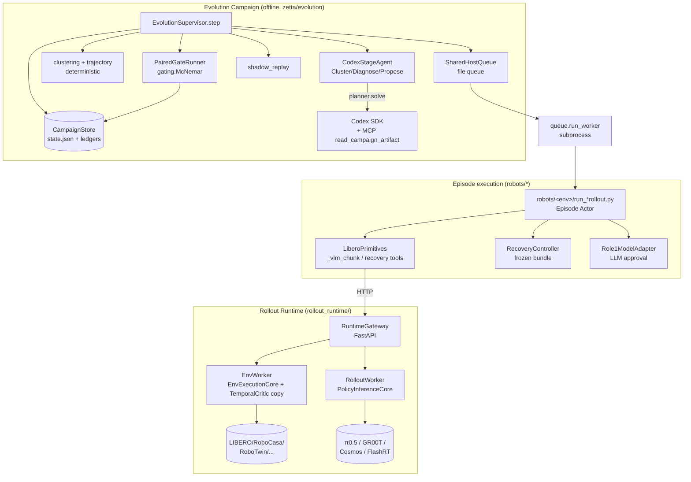
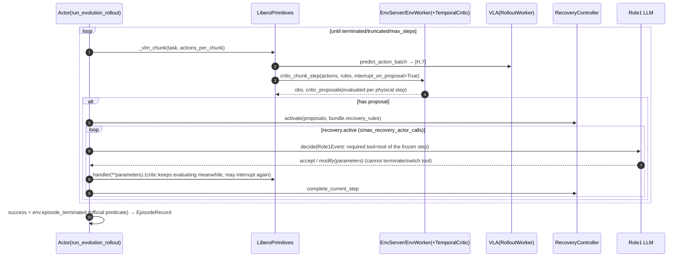

# Zetta-Embodiment Source-Level Architecture Study

> Subject: `references/evolution/Zetta-Embodiment` (air-embodied-brain/Zetta-Embodiment @ `d7fd15e`, package version `0.0.0`, classifier `Development Status :: 2 - Pre-Alpha`, Apache-2.0)
> Method: static reading only (read / grep / `python3 -I` ast). No dependencies were installed, no tests were run, and no simulator or LLM was started. The repository is a shallow clone, so the commit count is not visible.
> Audience: the Harness and Evolution (RSI) Layer design of `worldcurrent`, and cross-project comparison
> Tags: **[Implemented]** traceable in code · **[Docs/Interface only]** only documentation or abstract interfaces · **[Unverified]** code exists, but this study did not run it to verify · **[Needs model/hardware]** needs GPU, weights, simulation assets or a robot

---

## 0. Key Premise: What It Is and What It Is Not

The README describes itself as an "efficient closed-loop embodied harness for self-evolving physical intelligence" (`README.md:15`). Judging from the code, the repository is actually **three loosely coupled subsystems**:

| Subsystem | Essence | Code size | Location |
|---|---|---|---|
| **Rollout Runtime** | Serving layer for VLA inference and simulation environments: Gateway, EnvWorker/RolloutWorker on Ray, session/lease, batch inference, plus 6 sim families and 7 policy backends | ~34k LOC | `rollout_runtime/` |
| **Evolution Campaign** | Offline LLM (Codex)-driven state machine: rollout → cluster → diagnose → propose → shadow replay → paired gate → promote. The unit of improvement is a **declarative Critic+Recovery JSON bundle**; VLA weights always stay frozen | `zetta/evolution/` ~18k LOC | `zetta/evolution/`, `scripts/evolution/` |
| **RPent-derived LLM-agent CLI** | An agentic loop made of an LLM planner and a set of tools (`vla_execute`, `move_to`, etc.); the LLM owns the control loop | Smaller | `zetta/cli/`, `zetta/planner/`, `robots/*/toolkit.py` |

Three claims that need correcting up front:
1. **"code-based runtime critics" are not actually code**. A Critic is a DSL of the form `feature / operator / threshold / dwell_steps / cooldown_steps`, evaluated by a 140-line interpreter (`zetta/evolution/critic.py:45-145`). Executable `tool_plugin` is **hard-disabled** in the Stage2 validator (`zetta/evolution/stages.py:2065-2069`). So code generated by the LLM itself is never executed.
2. **"self-evolving" evolves only the bundle**, i.e. a set of Critic rules plus a set of Recovery rules, and the Recovery rules are merely parameterized compositions over a **hand-written, frozen tool catalog** (LIBERO has 19 primitives, see `robots/libero/tool_catalog.py:14-37`). It does not evolve policy weights, nor does it generate new skill code.
3. The LIBERO campaign **turns on privileged simulator state by default** (`robots/libero/evolution_defaults.py:10`, `LIBERO_PRIVILEGED_EVIDENCE_DEFAULT = True`). Critics read BDDL predicates and object poses, and `privileged_pick_place` in recovery directly reads ground-truth coordinates of objects and targets (`robots/libero/tools.py:1961-2012`). Therefore the SOTA numbers (LIBERO-Pro 90.8%) **cannot be taken directly as sim-to-real transferable capability**.

**Maturity**: 483 `.py` files in total, all parseable by ast, containing 652 classes and 5,690 functions. Code size is zetta 41k, robots 28k, rollout_runtime 34k, scripts 17k LOC. Tests are 46k LOC with about 1,330 test functions; CI runs two jobs on CPU, `-m "not remote and not ray"` and ray (`.github/workflows/unit-tests.yml`). There are 22 occurrences of `NotImplementedError`, almost all in abstract base classes ported from RLinf (e.g. `zetta/policies/openpi/_compat/base_policy.py:57-94`); there are only 5 TODO/FIXME. The engineering is **very audit-heavy**: sha256 binding, append-only ledgers, fail-closed and crash recovery everywhere. But the version is `0.0.0` / Pre-Alpha, some primitives are "same-name fallbacks" (see §8), and only RoboTwin states that "the full pipeline has been run end-to-end on hardware" (`README.md:300-311`). We ran nothing, so all runtime conclusions are **[Unverified]**.

---

## 1. Positioning and Core Capabilities

- **Frozen VLA plus online Critic interrupt plus LLM-approved Recovery**: the VLA executes in chunks. The Critic is evaluated on the env side at every physical step and interrupts the chunk on a hit; the Role1 LLM approves the next recovery step in the frozen bundle; the Actor invokes the primitive. **[Implemented][Unverified][Needs model/hardware]** (`robots/libero/run_evolution_rollout.py:630-797`)
- **Offline RSI campaign state machine**: 9 phases in total, with a legal transition table; every step is recoverable from crashes. **[Implemented]** (`zetta/evolution/models.py:41-50`, `zetta/evolution/store.py:25-56`, `zetta/evolution/supervisor.py:53-191`)
- **Deterministic failure segmentation and clustering**: extracts signals such as critic_reject, tool_error, no_progress from the trajectory, produces FailureSegments, then performs complete-link clustering within hard groups. **[Implemented]** (`zetta/evolution/trajectory.py:247-460`, `zetta/evolution/clustering.py:88-161`)
- **LLM multimodal cluster review, causal diagnosis (Stage1), candidate synthesis (Stage2)**: the LLM has a tool read budget, the access log carries sha proofs, and the JSON output is checked by schema and semantic validators. **[Implemented][Needs model]** (`zetta/evolution/stages.py:954-1442`, `:1520`, `:1663`, `:1812`)
- **Shadow replay**: offline replay of the single critic newly added by the candidate on the parent's immutable trajectories, computing recall and success-control false-positives. **[Implemented]** (`zetta/evolution/shadow_replay.py:38-187`)
- **Paired same-seed / regression / held-out gates**: held-out uses a one-sided exact McNemar test. **[Implemented]** (`zetta/evolution/gating.py:12-23`, `:202-394`)
- **Content-hash-based promotion and generation chaining**: after promote, the next generation's manifest is generated automatically. **[Implemented]** (`zetta/evolution/store.py:345-417`, `zetta/evolution/supervisor.py:424`)
- **Rollout Runtime**: HTTP/FastAPI Gateway (`/v1/sessions`, `/v1/action_step`, `/v1/policy_step`, `/v1/run_episode`...), Ray process isolation, batch inference, dynamic slot pool, Prometheus metrics. **[Implemented][Unverified]** (`rollout_runtime/serve/app.py:562-854`, `rollout_runtime/gateway/gateway.py:110`)
- **6 sim families** (LIBERO / ManiSkill / RoboCasa / RoboTwin / GenieSim / BEHAVIOR) plus one fake family, **7 policy backends** (fake / zetta_openpi / groot / cosmos_lite / geniesim_vla / flashrt / flashrt_groot). **[Implemented][Needs model/hardware]** (`rollout_runtime/backends/__init__.py:37-76`)
- **Task memory**: task-level parameter block, hash-chain versioned, frozen within an episode, rewritten by the LLM after the episode ends. **[Implemented][Needs model]** (`zetta/memory/task_memory.py:258-349`, `scripts/experiments/run_memory_loop.py:773`)
- **Real robots**: **none**. There are only OpenPI data configs such as `realworld_dataconfig.py` and `realworld_policy.py`; no robot driver or adapter. **[Docs/Interface only]**

## 2. Directory Layout and Architecture

```
zetta/
  evolution/        # RSI: models (contracts) store (state machine/ledger) lifecycle (4.8k-line orchestration) stages (LLM stages)
                    # critic (DSL interpreter) clustering trajectory shadow_replay gating gate_runner
                    # queue (file queue + worker) supervisor campaign protocol fault_injection capacity provider_admission
  planner/          # Planner Protocol + api (pydantic-ai) / codex (openai-codex SDK) / claude_code backends, MCP-over-HTTP
  tools/            # Toolkit base class, ToolContract (risk metadata), common file tools
  memory/           # task_memory: episode-frozen parameter block
  envs/             # EnvSpec registration (dynamic import of robots.<name>) + libero/maniskill/robotwin envs ported from RLinf
  policies/openpi/  # OpenPI (π0/π0.5) models and dataconfig ported from RLinf
  cli/ dashboard/   # RPent-derived agent CLI and web monitoring
robots/<env>/       # per environment: tools (primitives) tool_catalog role1_* critic_runtime recovery_controller run_*rollout
rollout_runtime/    # standalone serving layer; test_layering forbids it from importing zetta/robots
  api/ core/ gateway/ transport/ workers/ backends/ adapters/ launch/ serve/ config/presets/*.yaml
scripts/evolution/  # prepare_<env>_campaign.py (freezes the manifest), run_campaign.py
tests/              # 46k LOC; tests/runtime/ mainly targets the fake backend
```



## 3. Core Interfaces and Key Classes (signatures)

```python
# ---- Evolution contracts zetta/evolution/models.py ----
class CampaignPhase(str, Enum): ROLLOUT, CLUSTER, DIAGNOSE, PROPOSE, SAME_SEED_GATE,
                                REGRESSION_GATE, HELDOUT_GATE, PROMOTE, COMPLETE      # :41-50
@dataclass(frozen=True) class CampaignManifest:   # :71-227 rollout/heldout seeds must be disjoint, policy_rng must fully cover
    campaign_id; environment; task; generation; code_commit(40hex); prompt_sha256; model
    tool_catalog_sha256; rollout_seeds; heldout_seeds; policy_rng_by_seed
    parent_bundle_sha256; baseline_mode: "strict_pure_vla"|"active_bundle"; safety_layer; runtime: dict
@dataclass class FailureSegment: failure_class; stage; tool; earliest_divergence_step|None; severity; embedding  # :233-266
@dataclass class EpisodeRecord: seed; policy_rng; bundle_sha256; status: "valid"|"infra_invalid"; success; failure_segments  # :268-368
@dataclass class CausalDiagnosis: root_cause; competing_hypotheses(>=2); owner_layer; falsifier; confidence  # :431-505
@dataclass class CriticRule: feature; operator("lt".."ne","stagnant"); threshold; dwell_steps; cooldown_steps
                             proposal; evidence_ids; activation_conditions: tuple[CriticPredicate]   # :527-550
@dataclass class RecoveryRule: trigger_rule_ids; steps: tuple[RecoveryStep(tool, parameters, stop_when)]
                               safety_constraints; stop_condition; fallback                         # :553-584
@dataclass class CandidateBundle: parent_sha256; diagnosis_sha256; causal_hypothesis; mechanism_change
                                  critic_rules; recovery_rules; tool_plugin(must be None)            # :587-695
@dataclass class GateDecision: kind; passed; conclusive; candidate_wins; parent_wins; p_value; alpha  # :707-735

class TemporalCritic:                              # zetta/evolution/critic.py:45
    def evaluate(self, observation: dict, *, step_index: int) -> list[dict]   # proposals only, environment_write=False

# ---- Planner / Tool (RPent-derived) ----
class Planner(Protocol):                           # zetta/planner/base.py:58-91
    def solve(self, *, system_prompt, user_message, toolkit: Toolkit, max_turns, input_queue=None) -> PlannerResult
def build_planner(planner_type: "api"|"claude_code"|"codex", *, output_dir, recipe_tag, env_name, model, ...)  # :99-224
class Toolkit:                                     # zetta/tools/toolkit.py:87-240
    add_tool(name, spec, handler, contract=None); retain_tools(names); execute_tool(name, input)->ToolResult
@dataclass(frozen=True) class ToolContract:        # zetta/tools/contracts.py:18-39
    capabilities; risk_level: "read_only"|"low"|"medium"|"high"; proposal_only; irreversible; requires_reobservation
@dataclass(frozen=True) class EnvSpec: name; prompts; add_cli_args; parse_config; init_runtime  # zetta/envs/env_spec.py:98-109

# ---- Rollout Runtime ----
class EnvExecutionCore(Protocol):                  # rollout_runtime/core/env_execution.py:440-560 (synchronous, blocking)
    build(env_spec, *, num_envs, seed_offset, total_num_processes); reset(slots, reset_spec)->list[Observation]
    chunk_step(slots, chunk_actions)->list[ChunkOutcome]; observe(slots); extension(slot, ns, method, args); close()
class EnvFamilyAdapter(Protocol): env_family; capability: EnvFamilyCapability; create_core()  # core/env_registry.py:391-413
class PolicyInferenceCore(Protocol):               # core/policy_inference.py:163-225
    load(); infer_batch(requests)->list[ActionResponse]; update_weights(model_version); close()
@dataclass class Observation: main_image/wrist_image: PayloadRef; extra_view_images; state: list[float]
                              instruction; extras: dict                                         # api/messages.py:334-358
class AdapterPlugin(Protocol): name; async invoke(client: RuntimeClient, args) -> dict            # gateway/plugin.py:26-50
```

**Observation/Action/Skill/Tool contracts (Q3)**:
- The Runtime-layer Observation has only one generic field set; family differences go into `extras` and `EnvFamilyCapability` (`rollout_runtime/api/messages.py:128-160`, `:334-358`). Action is a `[chunk, action_dim]` ndarray. LIBERO validates shape `[H,7]` and finiteness, then scales and clips (`robots/libero/tools.py:506-531`). RoboCasa and RoboTwin each have their own `action_contract.py`. **[Implemented]**
- Tools have two layers of contracts: JSON schema plus `ToolContract` risk metadata (`zetta/tools/contracts.py:18-45`), and the campaign's `tool-catalog.json` (its sha is written into the manifest). Recovery step parameters are validated against the catalog in Stage2 (`zetta/evolution/stages.py:276`). **[Implemented]**
- There is no standalone "Skill" abstraction. Hand-written primitives (methods of `LiberoPrimitives`) are the skills, and a RecoveryRule is a composition of skills.

## 4. Core Execution Flow

**Q1 Who owns the loop**: there are two loops in total. (a) The Campaign layer is advanced by `EvolutionSupervisor.step()`, each call taking only one recoverable state-machine step (`zetta/evolution/supervisor.py:53`), called repeatedly from the outside by `scripts/evolution/run_campaign.py`. (b) The Episode layer is owned by the **Python Actor**: the VLA chunk loop (`robots/libero/run_evolution_rollout.py:761-797`). The LLM is not in every step; it is called as Role1 only in the recovery phase after a Critic fires. The RPent CLI path is the opposite: the LLM planner owns the loop (`zetta/cli/main.py:321-336`).

```mermaid
sequenceDiagram
  autonumber
  participant SUP as EvolutionSupervisor
  participant Q as SharedHostQueue/Worker
  participant RT as run_evolution_rollout(Actor)
  participant LLM as Codex StageAgent
  participant G as Gate/Store
  SUP->>Q: ROLLOUT: enqueue 50 seeds (parent bundle or strict_pure_vla)
  Q->>RT: subprocess runs episode → EpisodeRecord + trajectory jsonl
  SUP->>SUP: analyze_failures: trajectory signals → FailureSegment → complete-link clustering
  SUP->>LLM: CLUSTER review(multimodal, read budget) → accepted clusters
  SUP->>LLM: DIAGNOSE(Stage1): CausalDiagnosis(≥2 competing hypotheses, evidence_ids)
  SUP->>LLM: PROPOSE(Stage2): CandidateBundle JSON
  LLM-->>SUP: validator: catalog/collision/atomic-inheritance/feature-catalog
  SUP->>SUP: shadow_replay(only the 1 newly added critic, parent trajectories)
  alt insufficient recall / FP over limit
    SUP->>G: reject → refine(PROPOSE) or switch to secondary cluster or COMPLETE
  else admitted
    SUP->>G: register_candidate → SAME_SEED_GATE
    SUP->>Q: target failure seeds × {parent, candidate} paired rollout
    G->>G: evaluate_paired_gate(same_seed): pass_rate≥0.5 and rescued must diverge+intervene
    opt regression_required
      G->>G: all rollout seeds paired, candidate_successes ≥ parent
    end
    G->>G: HELDOUT(1..20): McNemar(α=0.025); test mode records only, no gating
    G->>G: promote: current_bundle=candidate; bundles/generation-N.json
    SUP->>SUP: build_child_manifest → next-generation ROLLOUT
  end
```



**Interaction of reasoning / skill / policy**: the Critic (DSL) can only raise proposals (`zetta/evolution/critic.py:102`, `environment_write: False`). Role1 can only approve the current frozen step or modify its parameters (`robots/libero/role1_recovery.py:268-290`). Only the Actor writes to the env. This is a **deliberately narrowed LLM role**: the online LLM only does "approve and tune parameters"; all structural decisions live in the offline bundle.

## 5. Extension Points and Plugin Mechanism (Q2)

| Extension point | Mechanism | Location | Assessment |
|---|---|---|---|
| New sim family | Implement `EnvFamilyAdapter`/`EnvExecutionCore`, write a declaration in `ENV_FAMILY_BEHAVIORS`, add an **if branch** in `register_env_family_for` | `rollout_runtime/core/env_registry.py:431-447`, `rollout_runtime/backends/__init__.py:78-133` | Clear protocol, but registration is a hard-coded if-chain with no entry_points |
| New policy backend | `PolicyInferenceCore` Protocol, branch in `build_policy_core` | `rollout_runtime/core/policy_inference.py:163-225`, `backends/__init__.py:135` | Same as above; `update_weights` is an interface that no RSI path uses |
| New agent env (CLI path) | `importlib.import_module(f"robots.{name}")`; the module must provide `get_env_spec`/`get_toolkit` | `zetta/envs/base.py:42-59` | Convention-based plugin |
| Gateway upper-layer plugin | `AdapterPlugin.invoke(client, args)`, access only via RuntimeClient | `rollout_runtime/gateway/plugin.py:26-77` | Clean design |
| Env-private capabilities | `EXTENSION_CALL`, namespace + declarative `extensions` allowlist | `rollout_runtime/core/env_registry.py:84-120` | Good pattern: privileged interfaces must be declared explicitly |
| Onboarding a new env into Campaign | `scripts/evolution/prepare_<env>_campaign.py` freezes the manifest and tool-catalog | `scripts/evolution/` | One 400-800-line script per env, low reuse |
| Configuration | YAML presets plus `rollout_runtime/config/schema.py` (OmegaConf-style merging) | `rollout_runtime/config/presets/*.yaml` | — |

Layering is enforced by AST tests: `rollout_runtime/**` is forbidden from importing `zetta`/`robots` (`tests/runtime/test_layering.py:1-20`). The cost is that the Critic interpreter is **duplicated** (`rollout_runtime/backends/libero_critic.py:1-25`, whose comment admits it "must remain in exact semantic alignment").

## 6. Dependencies and Runtime Requirements

- Core dependencies: `pydantic-ai-slim[anthropic,openai]`, `openai-codex` (py≥3.11), `claude-agent-sdk`, `mcp`, `fastapi/uvicorn/httpx/msgpack`, `numpy` (`pyproject.toml` dependencies).
- Optional dependencies: `runtime` (torch, gym, prometheus), `ray`, `openpi` (`rlinf-openpi`), `maniskill` (mani-skill 3.0.1 / sapien 3.0.2), `sam3`, `cosmos-lite`, `geniesim-vla`. FlashRT must be compiled locally.
- External assets: LIBERO-Pro assets, RoboCasa kitchen assets (about 10GB), RoboTwin assets (about 15-30GB, runnable only inside the RLinf docker), Isaac Sim 5.1 (GenieSim), OmniGibson (BEHAVIOR), and π0.5 / GR00T N1.5 checkpoints. **[Needs model/hardware]**
- LLM: the offline stages **mandate Codex** (`CODEX_API_KEY`); Role1 can use `api` (pydantic-ai multi-provider) or `codex`. The README's experiments use `gpt-5.6-sol` (`README.md:290-292`).
- The LIBERO and RoboCasa tracks cannot share a venv (robosuite version conflict), and RoboTwin also needs its own venv. Real-machine runs must use `--launch ray` for process isolation.
- Order-of-magnitude cost of one campaign: 50 rollouts, plus same-seed pairing (number of target failure seeds ×2), plus held-out 20×2, plus one Role1 LLM call per recovery step. We did not measure it. **[Unverified]**

## 7. License and Reuse Constraints

- Apache-2.0 (`LICENSE`). Commercial use and modification are allowed, but NOTICE and copyright notices must be retained.
- `THIRD_PARTY_NOTICES.md`: `zetta/{cli,context,dashboard,envs,evolution,memory,planner,tools,utils}` derive from **RPent** (Apache-2.0); `zetta/compat`, `zetta/envs/{libero,maniskill,robotwin}`, `zetta/policies/openpi` derive from **RLinf** (Apache-2.0, commit `9ad44393`). Attribution to both upstreams must be retained when copying.
- The models and assets required at runtime (π0.5, GR00T, LIBERO-Pro, RoboCasa, SAM3) each have their own licenses and are not distributed with the repository.

## 8. Strengths, Weaknesses and Risks

**Strengths**
1. **The "narrow RSI" design from causal diagnosis to bundle is very rigorous**. Each candidate binds exactly one causal hypothesis (`models.py:604-609`), every critic must be covered by a recovery (`:632-642`), and shadow replay evaluates only the single newly added critic (`shadow_replay.py:47-52`). This makes each generation's improvement attributable and falsifiable.
2. **The evaluation statistics are right**: same-seed, same-`policy_rng` pairing, one-sided exact McNemar (`gating.py:12-23`); infra failures are recorded separately as `infra_invalid` and excluded from the denominator (`models.py:230`, `rollout_runtime/adapters/eval_adapter.py:28-35`); rollout seeds and held-out seeds are forced to be disjoint (`models.py:145-146`); Stage prompts blind seeds/RNG (`stages.py:194-212`, `models.py:212-227`).
3. **Crash consistency**: atomic writes, append-only ledgers with fsync and duplicate-key rejection (`jsonio.py:108`), LLM attempts can be re-validated and reused without paying again (`stages.py:1222-1297`), plus a dedicated crash-injection harness (`zetta/evolution/fault_injection.py:1-10`).
4. **The Critic cannot write to the environment, Role1 cannot switch tools or terminate, and only the Actor writes to the environment**. The separation of privileges is asserted in code, not just written in prompts (`robots/libero/role1_recovery.py:168-170`, `:268-277`).
5. The Runtime layer is clean: Protocol-driven, layering enforced by tests, and a fake backend supports end-to-end CI tests (`tests/runtime/test_e2e_fake.py`).

**Weaknesses and Risks**
1. **Held-out does not gate by default, and regression is skipped by default**. The dataclass default of `EvolutionProtocol.heldout_mode` is `"test"` (`protocol.py:30`), and the README's LIBERO example also explicitly passes `--heldout-mode test` (`README.md:259-277`). Only the LIBERO prepare CLI's own default is `validation` (`prepare_libero_campaign.py:725-730`). In test mode, held-out goes to PROMOTE regardless of the result (`lifecycle.py:4767-4772`, `store.py:384-394`). The LIBERO prepare script's `--skip-regression-gate` defaults to True (`scripts/evolution/prepare_libero_campaign.py:744-748`). So **under the README's default flow, the only real gate is the same-seed gate run on the target failure seeds, and its pass_rate only needs to be 0.5 by default** (`lifecycle.py:2593`, `gate_runner.py:164-176`). This is essentially validating on the training set, with a risk of overfitting.
   - *Lead reviewer note (source re-checked)*: in test mode, held-out not participating in promotion is **intentional design** — the comment at `lifecycle.py:4767-4771` states the held-out block is an "unbiased report-only measurement… never feeds candidate selection or promotion", the purpose being to avoid contaminating held-out by selecting on it. So the problem is not that held-out is "ignored", but that before promotion there is **no validation split independent of the training failure seeds**; our design should have both a validation gate (participating in selection) and a held-out test (report only).
2. **Privileged state is on by default** (`evolution_defaults.py:10`). Critic features and `privileged_pick_place` directly use simulator ground truth, so learned bundles cannot transfer to a real machine.
3. **"CuRobo/Mink" are same-name fallbacks**. `curobo_reachability` is actually a workspace box plus a distance threshold (`tools.py:1298-1343`), and `mink_*` is an OSC fallback (`tools.py:1414-1428`). The docs admit this themselves (`docs/libero-recovery-tools.md:19-21`).
4. **The Codex sandbox defaults to `full-access`**, with `cwd` at the repository root (`zetta/planner/codex.py:504-506`, `:306-316`). The Stage agent's "read-only" restricts only the Zetta MCP toolkit (`stages.py:1308-1316`); Codex's built-in shell capability is not explicitly disabled, and approval is set to `deny_all`. Whether it can actually write to disk depends on Codex semantics. **[Unverified]**, but this is a risk on the security surface.
5. **Role1 `modify` parameters are only filtered by a "control field" denylist** (`robots/robocasa/role1_agent.py:668-673`), then passed straight to `handler(**effective_parameters)` (`robots/libero/role1_recovery.py:285-299`) without re-validation against the tool schema; it can only rely on range checks inside the primitive.
6. **`SafetyLayerConfig.joint_limit_shield = "not_implemented"`** (`models.py:29`). The safety layer only covers interface and numerical health checks; there is no physical safety shield.
7. There are two copies of the Critic interpreter (`zetta/evolution/critic.py` and `rollout_runtime/backends/libero_critic.py`), with a risk of semantic drift.
8. `lifecycle.py` is a single 4,805-line file, plus many "historical digest compatibility" branches (e.g. `models.py:101-104`, `:185-206`), so the cognitive load is high. Environment onboarding depends on a prepare script of several hundred lines per env.
9. The improvement space is confined to the DSL plus the frozen tool catalog. If the failure's root cause lies in the VLA or the perception layer, it can only be worked around with recovery, not fixed (`CausalDiagnosis.owner_layer` records this, but there is no corresponding execution path).

## 9. Components Worth Reusing

| Component | Approach | Rationale |
|---|---|---|
| `CandidateBundle`/`CriticRule`/`RecoveryRule`/`GateDecision` data contracts and their `__post_init__` invariants | **Borrow the schema directly, rewrite the implementation** | One hypothesis, every critic covered by a recovery, a parent sha chain — this set of invariants is exactly what worldcurrent's "Improvement Candidate" needs |
| `TemporalCritic` DSL (dwell/cooldown/stagnant/activation guard) | **Reuse the idea directly** (about 140 lines) | Declarative, replayable, no code execution — a safe format for self-generated monitors |
| `evaluate_shadow_replay` | **Borrow directly** | "Evaluate only the newly added rule, report both recall and success-control FP" is a low-cost offline preflight |
| `one_sided_exact_mcnemar` + paired gate + `infra_invalid` separate accounting | **Reuse directly** | Statistically correct, very short code |
| `CampaignStore`'s `ALLOWED_TRANSITIONS` + AppendOnlyLedger + pre-promote checks | **Borrow the pattern** | A template for a recoverable, auditable RSI state machine |
| `CodexStageAgent._invoke`'s "attempt directory + input sha + validator re-validation reuse + read-budget access log" | **Borrow the pattern** | Idempotency and evidence traceability for LLM stages |
| `EnvExecutionCore`/`EnvFamilyCapability`/`EXTENSION_CALL` allowlist | **Borrow the interfaces** | Makes sim differences declarative and privileged interfaces explicit |
| `EvaluationAdapter`'s valid/invalid episode semantics | **Borrow directly** | Matches the needs of our benchmark harness |
| `test_layering.py`'s AST layering guard | **Reuse directly** | Low cost, high benefit |

## 10. Capabilities Not Worth Rebuilding

- **VLA serving acceleration** (FlashRT FP8 + CUDA Graph, GR00T graph capture): use upstream FlashRT or Zetta's backend directly; do not build our own.
- **Env ports for each sim** (LIBERO/ManiSkill/RoboTwin taken from RLinf): depend directly on RLinf or Zetta's adapters; do not port them again.
- **Provider pool / broker / admission** (`zetta/planner/provider_pool.py`, `zetta/evolution/provider_admission.py`, about 2k LOC combined): these are engineering details of an LLM gateway; an off-the-shelf LLM gateway (e.g. LiteLLM) is a better fit.
- **File queue + capacity + slot broker** (`queue.py`, `capacity.py`, `slot_broker.py`): overlaps with Ray/K8s job functionality; worldcurrent should use an orchestrator directly.
- **Per-env prepare_campaign scripts**: should be turned into a generic manifest builder, not copied.
- **RPent CLI/dashboard**: unrelated to our harness; can be ignored.

## RSI Capability Matrix

| RSI item | Status | How | Location |
|---|---|---|---|
| 6. Failure Diagnosis | **[Implemented][Needs model]** | First generates FailureSegments from deterministic signals (critic_reject, tool_error, role1_contract_failure, no_progress, early_termination, safety), using hash text embeddings plus complete-link clustering; then an LLM multimodal cluster review; finally Stage1 outputs a `CausalDiagnosis` (≥2 competing hypotheses, falsifier, owner_layer), and evidence IDs must have actually been read | `zetta/evolution/trajectory.py:247-473`, `clustering.py:88-161`, `stages.py:1520`, `:1663`, `models.py:431-505` |
| 7. Reflection | **[Implemented][Needs model]** | Not free-form reflection, but **refinement with structured context**: the rejected gate's `paired_gate_result` (intervention and rescue statistics), `previous_detector_replay` and development evidence are injected together into the next round's Stage2 prompt; the prompt mandates "after two zero-rescue rounds, the hypothesis must change" | `lifecycle.py:1861-2177`, `stages.py:154-186`, `lifecycle.py:3354-3411` |
| 8. Candidate Generation | **[Implemented][Needs model]** | The unit of improvement is a **CandidateBundle JSON** (Critic DSL rules plus RecoveryRule = a parameterized sequence of frozen tools). Not prompts, not code, not weights. `tool_plugin` (code) is disabled. There is also a separate "task memory parameter block" path, rewritten by the LLM | `models.py:587-695`, `stages.py:1812`, `:2065-2069`, `scripts/experiments/run_memory_loop.py:773` |
| 9. Recovery Skills | **[Implemented][Needs model/hardware]**, partly fallbacks | 19 **hand-written** LIBERO primitives (VLA sub-prompts, OSC motion, `privileged_pick_place`, graspgen, etc.), executed by `RecoveryController` per frozen step, approved by Role1. The system does not learn new skills; what goes under the cuRobo/Mink names are fallbacks | `robots/libero/tool_catalog.py:14-37`, `tools.py:587-2200`, `robots/robocasa/recovery_controller.py:37-160`, `robots/libero/role1_recovery.py:153-334` |
| 10. Shadow Evaluation | **[Implemented]** (verifies detection only, not recovery) | Offline replay of the newly added critic on the parent's immutable trajectories, computing recall (whether it fires before divergence) and success-control FP; rejects if FP exceeds the limit or recall is insufficient; moves to the online gate when the conclusion is uncertain | `shadow_replay.py:38-187`, `lifecycle.py:2674-2786`, `:4600-4668` |
| 11. Regression Testing | **[Implemented], but skipped by default for LIBERO** | Paired across all rollout seeds, requiring candidate_successes ≥ parent and no increase in safety events | `gating.py:311-319`, `gate_runner.py:164-166`, `prepare_libero_campaign.py:744-748` |
| 12. Held-out Benchmark | **[Implemented], report-only by default** | Pre-registered held-out seeds (default 1..20), paired McNemar, α=0.025; gates in `validation` mode, records only in `test` mode | `gating.py:320-394`, `gate_runner.py:167-176`, `lifecycle.py:4758-4790`, `protocol.py:30` |
| 13. Promotion / Rollback | **Promotion [Implemented]; Rollback not implemented** | Before promote, checks phase, candidate digest, parent==current, and that all required gates have passed; then writes the `promotions` ledger and `bundles/generation-N.json`, and spawns the next generation. Bundles are versioned by sha with a parent chain. **No demote/rollback API**; reverting is only possible by manually creating a new campaign with an old bundle | `store.py:345-417`, `supervisor.py:424`, `lifecycle.py:4797-4805` |
| 14. Safety gating (self-generated content) | **[Implemented], partly [Unverified]** | Generated artifacts are DSL plus in-catalog tools; no code is executed; the Stage2 validator checks catalog parameters, collision-signal disabling, atomic inheritance and the feature catalog; there are human-operator authorization artifacts (threshold override, provisional hypothesis, shadow falsification). No physical safety shield (`joint_limit_shield="not_implemented"`); the Codex sandbox defaults to full-access | `stages.py:2058-2085`, `:276-339`, `lifecycle.py:2787`, `:3703`, `:3868`, `models.py:17-38`, `planner/codex.py:504-520` |

## Verification Status Summary

| Capability | Tag | Notes |
|---|---|---|
| Campaign state machine, ledger, promote invariants | [Implemented][Unverified] | Many unit tests (`tests/test_evolution_lifecycle.py` 1,077 lines, etc.); we did not run them |
| Critic DSL / shadow replay / McNemar | [Implemented][Unverified] | Pure Python, testable offline |
| LLM stages (Cluster/Diagnose/Propose/Role1) | [Implemented][Needs model] | Depend on Codex/LLM; effectiveness depends on the model (README uses `gpt-5.6-sol`) |
| LIBERO-Pro 90.8% / RoboCasa 93.6% | [Docs/Interface only] (as far as this study is concerned) | Claims from the README and paper; rely on privileged state by default; not reproduced |
| Rollout Runtime (Gateway/Ray/batch) | [Implemented][Unverified] | The fake backend has e2e tests; real backends need GPUs |
| FlashRT 9.9×/4.5× speedup | [Implemented][Needs model/hardware] | Numbers come from `docs/flashrt-report`; requires an RTX 4090 and a FlashRT build environment |
| cuRobo / Mink planning | [Docs/Interface only] | Only same-name fallbacks |
| GraspGen / SAM3 | [Implemented][Needs model/hardware] | Need external services or weights; otherwise return `unconfigured` or `unavailable` |
| ManiSkill / BEHAVIOR | [Implemented][Unverified] | README marks them 🚧 (model validation pending / runtime only) |
| Real robots | [Docs/Interface only] | No driver or adapter |
| Task memory write-back | [Implemented][Needs model] | Experiment-script path, not in the main campaign |
| Tool-plugin (code-type candidates) | [Docs/Interface only] | Present in the schema, disabled by the validator |
| Rollback | Not implemented | — |

## 11. Source Index of Key Implementations

| concern | file:line | note |
|---|---|---|
| Campaign phase enum | `references/evolution/Zetta-Embodiment/zetta/evolution/models.py:41-50` | 9 phases |
| Legal state transitions | `references/evolution/Zetta-Embodiment/zetta/evolution/store.py:25-56` | PROMOTE→ROLLOUT means entering the next generation |
| Manifest invariants | `references/evolution/Zetta-Embodiment/zetta/evolution/models.py:106-170` | Disjoint seeds, full rng coverage, 40-character commit |
| Candidate invariants | `references/evolution/Zetta-Embodiment/zetta/evolution/models.py:601-642` | Single hypothesis, every critic must be covered by a recovery |
| Critic DSL interpreter | `references/evolution/Zetta-Embodiment/zetta/evolution/critic.py:45-145` | proposal-only |
| Critic copy (runtime side) | `references/evolution/Zetta-Embodiment/rollout_runtime/backends/libero_critic.py:1-25` | Required to stay semantically aligned with the implementation above |
| Safety layer config | `references/evolution/Zetta-Embodiment/zetta/evolution/models.py:17-38` | `joint_limit_shield="not_implemented"` |
| Supervisor single step | `references/evolution/Zetta-Embodiment/zetta/evolution/supervisor.py:53-191` | Dispatch by phase |
| Failure signal extraction | `references/evolution/Zetta-Embodiment/zetta/evolution/trajectory.py:247-460` | Deterministic |
| Local hash embedding | `references/evolution/Zetta-Embodiment/zetta/evolution/trajectory.py:461-473` | No external model dependency |
| Failure clustering | `references/evolution/Zetta-Embodiment/zetta/evolution/clustering.py:88-161` | complete-link + medoid |
| Target cluster ranking | `references/evolution/Zetta-Embodiment/zetta/evolution/lifecycle.py:2503-2557` | At most 2 targets |
| Stage prompts | `references/evolution/Zetta-Embodiment/zetta/evolution/stages.py:34-186` | Diagnose/Cluster/Propose |
| LLM call idempotency and evidence audit | `references/evolution/Zetta-Embodiment/zetta/evolution/stages.py:1098-1442` | Attempt directory, re-validation |
| Stage tool allowlist | `references/evolution/Zetta-Embodiment/zetta/evolution/stages.py:1308-1318` | Only read tools exposed, memory frozen |
| tool_plugin disabled | `references/evolution/Zetta-Embodiment/zetta/evolution/stages.py:2065-2069` | No code execution |
| Codex sandbox default | `references/evolution/Zetta-Embodiment/zetta/planner/codex.py:504-520` | `full-access` |
| Diagnose orchestration | `references/evolution/Zetta-Embodiment/zetta/evolution/lifecycle.py:4118` | `run_diagnosis_stage` |
| Propose + shadow admission | `references/evolution/Zetta-Embodiment/zetta/evolution/lifecycle.py:4600-4668` | Reject on failure; on pass, register and enter SAME_SEED |
| Shadow replay | `references/evolution/Zetta-Embodiment/zetta/evolution/shadow_replay.py:38-187` | Evaluates only 1 delta critic |
| Refinement context | `references/evolution/Zetta-Embodiment/zetta/evolution/lifecycle.py:1861` | Evidence from rejected gates fed back to Stage2 |
| Post-rejection routing | `references/evolution/Zetta-Embodiment/zetta/evolution/lifecycle.py:3354-3411` | refine / secondary / COMPLETE |
| Gate seed selection | `references/evolution/Zetta-Embodiment/zetta/evolution/gate_runner.py:164-176` | regression=rollout seeds; heldout=pre-registered seeds |
| Paired gate decision | `references/evolution/Zetta-Embodiment/zetta/evolution/gating.py:202-394` | same_seed / regression / heldout |
| McNemar | `references/evolution/Zetta-Embodiment/zetta/evolution/gating.py:12-23` | One-sided exact |
| Post-gate advancement | `references/evolution/Zetta-Embodiment/zetta/evolution/lifecycle.py:4675-4794` | test mode: held-out report only |
| Promote | `references/evolution/Zetta-Embodiment/zetta/evolution/store.py:345-417` | No rollback |
| Protocol defaults | `references/evolution/Zetta-Embodiment/zetta/evolution/protocol.py:17-43` | `heldout_mode="test"` |
| LIBERO skips regression by default | `references/evolution/Zetta-Embodiment/scripts/evolution/prepare_libero_campaign.py:744-748` | Default True |
| LIBERO privileged on by default | `references/evolution/Zetta-Embodiment/robots/libero/evolution_defaults.py:10` | True |
| Episode main loop | `references/evolution/Zetta-Embodiment/robots/libero/run_evolution_rollout.py:761-797` | Actor owns the loop |
| Recovery handling | `references/evolution/Zetta-Embodiment/robots/libero/run_evolution_rollout.py:630-738` | Role1 inside the loop |
| VLA chunk and critic interrupt | `references/evolution/Zetta-Embodiment/robots/libero/tools.py:473-585` | `critic_chunk_step` |
| Role1 constraints | `references/evolution/Zetta-Embodiment/robots/libero/role1_recovery.py:268-299` | Cannot switch tools; modify parameters passed through directly |
| Role1 contract (clean-room) | `references/evolution/Zetta-Embodiment/robots/robocasa/role1_agent.py:1-12` | Only the Actor writes to the environment |
| Privileged pick-place | `references/evolution/Zetta-Embodiment/robots/libero/tools.py:1961-2012` | Reads GT poses |
| cuRobo fallback | `references/evolution/Zetta-Embodiment/robots/libero/tools.py:1298-1343` | Workspace box |
| Planner protocol | `references/evolution/Zetta-Embodiment/zetta/planner/base.py:58-91` | `solve()` |
| Planner factory | `references/evolution/Zetta-Embodiment/zetta/planner/base.py:99-224` | api / claude_code / codex |
| Tool risk contract | `references/evolution/Zetta-Embodiment/zetta/tools/contracts.py:18-45` | risk_level / proposal_only |
| CLI agent loop | `references/evolution/Zetta-Embodiment/zetta/cli/main.py:252-336` | LLM owns the loop |
| Task memory | `references/evolution/Zetta-Embodiment/zetta/memory/task_memory.py:232-349` | hash chain, frozen within an episode |
| Memory LLM write-back | `references/evolution/Zetta-Embodiment/scripts/experiments/run_memory_loop.py:773` | Executed after the episode ends |
| EnvExecutionCore | `references/evolution/Zetta-Embodiment/rollout_runtime/core/env_execution.py:440-560` | Synchronous, blocking |
| Env family registration | `references/evolution/Zetta-Embodiment/rollout_runtime/backends/__init__.py:78-133` | if-chain |
| PolicyInferenceCore | `references/evolution/Zetta-Embodiment/rollout_runtime/core/policy_inference.py:163-225` | Includes `update_weights` |
| Observation contract | `references/evolution/Zetta-Embodiment/rollout_runtime/api/messages.py:334-358` | PayloadRef images |
| Gateway HTTP routes | `references/evolution/Zetta-Embodiment/rollout_runtime/serve/app.py:562-854` | `/v1/*` |
| Prometheus metrics | `references/evolution/Zetta-Embodiment/rollout_runtime/gateway/metrics.py:140-241` | No OTel |
| Eval adapter semantics | `references/evolution/Zetta-Embodiment/rollout_runtime/adapters/eval_adapter.py:1-40` | valid/invalid separate accounting |
| Layering guard | `references/evolution/Zetta-Embodiment/tests/runtime/test_layering.py:1-20` | AST |
| Crash injection | `references/evolution/Zetta-Embodiment/zetta/evolution/fault_injection.py:1-10` | Targets campaign infrastructure, not robots |

## Appendix: Direct Answers to Harness Questions

- **Q4 Memory**: the only memory is a **task-level semantic/procedural parameter block** (`strategy_summary`, `decision_rules`, `tool_parameters`, `prompt_ladder`, `failure_modes`..., `task_memory.py:24-32`), stored as JSON files, hash-chain versioned, with a 24KB cap, and writing absolute coordinates or pixels is forbidden. There is no retrieval; the whole block is rendered into the prompt (`:232-255`). The write policy is: frozen within an episode, rewritten by the orchestrator calling the LLM after the episode ends. **There is no episodic, spatial or vector memory**. The Campaign's episodes ledger could count as an episodic archive, but it is only for offline diagnosis and is not retrieved at runtime. `zetta/evolution/__init__.py:4-6` states explicitly that evolution and memory are independent of each other.
- **Q5 Logging/Tracing/Eval**: each episode writes `actions/states/chunks/tool_events/heartbeat.jsonl`, multi-view videos, and Role1 decision artifacts (`run_evolution_rollout.py:319-326`); LLM calls write transcript sha and evidence-access jsonl; the Gateway exposes Prometheus metrics. **There is no OpenTelemetry or distributed tracing**. Evaluation uses the official env termination as success (`run_evolution_rollout.py:804`).
- **Q15 Overall recommendations for worldcurrent**: five pieces can be taken over directly — **the Critic DSL, shadow replay, the paired McNemar gate, the bundle invariants, and the recoverable state machine** — and they map one-to-one onto our Evolution Layer's Candidate→Shadow→Gate→Promote path. **Do not copy** two default policies: held-out as report-only, and regression skipped by default. worldcurrent should force held-out gating and also add rollback and demote. Two things **need to be reimplemented**: env/policy registration should switch to entry_points; the Critic interpreter should have a single source, replacing the two copies with a shared pure-Python package. **The RPent CLI, dashboard, provider pool, and file queue can be ignored**.
